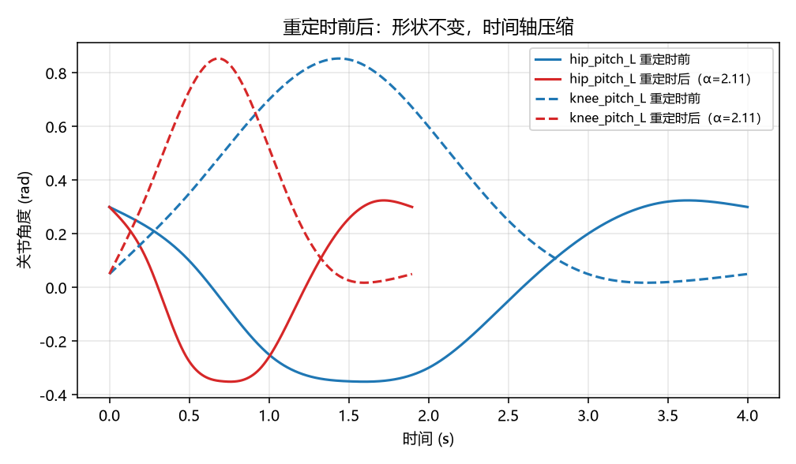
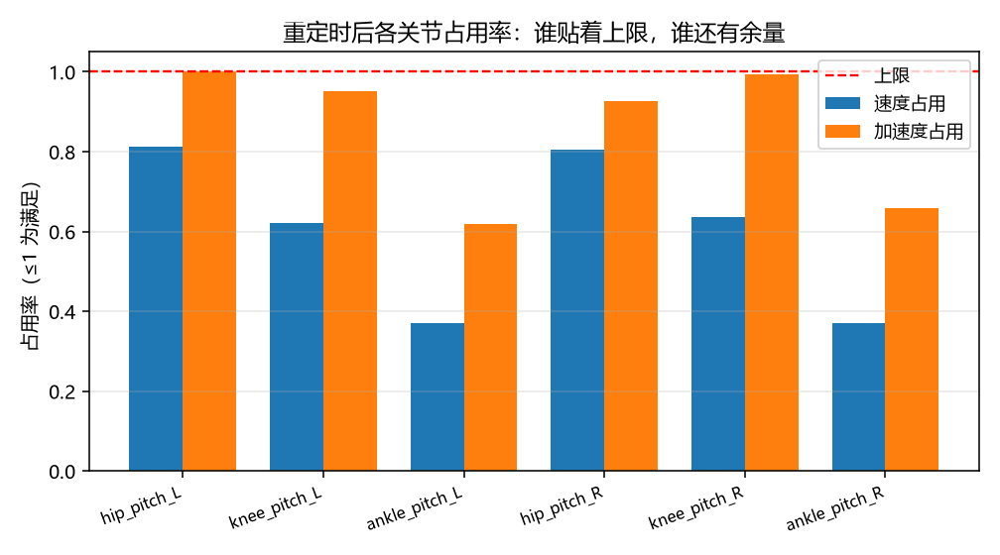

# 关节轨迹重定时：速度/加速度约束下的最大常数时间缩放

示教出来的轨迹通常"形状对、速度慢"：操作员不敢走快，关键帧之间的时间间隔被随手拉长。
下游控制器拿到这条 `JointTrajectory` 只能照原速执行，白白浪费了伺服的能力。

本模块做一件很具体的事：**在给定各关节速度/加速度上限的前提下，求这条轨迹最大能压缩多少倍**，
并把新时间轴直接写回 `trajectory_msgs/JointTrajectory`。属于**人形机器人**方向。

与仓库已有模块的区别：

| 模块 | 做什么 | 本模块的不同 |
|---|---|---|
| `humanoid_joint_tools` | 关节轨迹的**录制与回放** | 不改时间轴，只搬运数据 |
| `biped_cubic_spline_gait_switch` | 用三次样条在**两个步态之间切换** | 关注切换的平滑，不做时间压缩 |
| 本模块 | 保持轨迹形状，**压时间轴到约束饱和** | 输出 α、受限关节、压缩比 |

## 运行效果



同一个关节的位置曲线，蓝色是原始 4 s，红色是重定时后的 1.90 s（α = 2.11）——**形状不变，只是时间轴被压缩**。



重定时后各关节的速度/加速度占用率。`hip_pitch_L` 的加速度占用正好 1.00（它决定了 α），
而踝关节只有 0.62~0.66，还有大量余量。

## 功能包结构

```
src/humanoid/joint_traj_retime/
├── package.xml  setup.py  setup.cfg  requirements.txt
├── main.py                      # 脚本入口（不需要 ROS）
├── joint_traj_retime/
│   ├── core.py                  # 自然三次样条 + 最大常数缩放 + 占用率（纯 numpy）
│   ├── examples.py              # 6 关节步态周期关键帧（演示数据）
│   ├── cli.py                   # 结果排成 Markdown 表格
│   ├── main.py                  # 命令行参数与输出
│   └── ros_node.py              # JointTrajectory 进 → 压缩后的 JointTrajectory 出
├── config/params.yaml
├── launch/main.launch.py
├── tools/make_figures.py        # 生成上面两张图（需要 matplotlib）
└── test/test_core.py            # 22 项单元测试
```

## 运行环境

| 项 | 版本 | 说明 |
|---|---|---|
| OS | 任意 | 纯 Python |
| Python | 3.10 / 3.12 | 只用 `numpy` |
| ROS 2（可选） | Humble | 仅 `ros_node.py` 需要，依赖 `trajectory_msgs` |

已实测：**Windows 11 + Python 3.12.14 + NumPy 2.5.4**（不装 ROS 也能跑完全部计算与测试）。

## 编译与运行

```bash
# A. 不需要 ROS
cd src/humanoid/joint_traj_retime
python3 main.py
python3 -m unittest discover -s test -p "test_*.py" -v     # 22 passed

# B. ROS 2
colcon build --packages-select joint_traj_retime --symlink-install
source install/setup.bash
ros2 launch joint_traj_retime main.launch.py
ros2 topic echo /joint_trajectory_retimed
```

## 原理

### 1. 插值：自然三次样条

关键帧 `(t_k, q_k)` 之间用自然三次样条连接（端点二阶导为 0），得到 C² 连续的位置曲线。
C² 很重要：加速度不跳变，否则下游伺服会在关键帧处"顿一下"。

### 2. 缩放律：时间、速度、加速度的关系

令新时间轴 `τ = α·t`，则

```
q̇_α(τ) = α · q̇(t)
q̈_α(τ) = α² · q̈(t)
```

（位置不变，时间轴被压 α 倍。）

### 3. 约束求 α

```
α ≤ v_max / |q̇|          对每个关节、每个采样点
α ≤ sqrt(a_max / |q̈|)
α = min(所有上界)
```

取最小值的那个关节就是"限制者"，它的占用率恰好是 1.00。

### 4. 为什么是"常数缩放"而不是真正的 TOP

Pham 的逐点时间最优（TOP）让时间律沿路径变化，可以在拐角处单独减速、在直段加速。
本模块只给**一个全局常数 α**：它更简单、可直接换算 `JointTrajectory` 的时间戳，
而且给出一条清晰的"瓶颈关节"信息。两者差别就是文档「方法边界」里写的那条。

## 结果

示例：6 关节下肢一个步态周期，原始 4.000 s；上限 `v_max=2.0 rad/s`、`a_max=8.0 rad/s²`。

### 概况

| 指标 | 数值 |
|---|---|
| 最大时间缩放 α | **2.108** |
| 限制来源 | 加速度上限（关节 `hip_pitch_L`） |
| 重定时后时长 | **1.897 s** |
| 压缩比 | **52.6%** |

### 重定时后各关节占用率

| 关节 | 峰值速度 (rad/s) | 速度占用 | 峰值加速度 (rad/s²) | 加速度占用 |
|---|---|---|---|---|
| `hip_pitch_L` | 1.62 | 0.81 | 8.00 | **1.00** |
| `knee_pitch_L` | 1.55 | 0.62 | 9.50 | 0.95 |
| `ankle_pitch_L` | 0.92 | 0.37 | 6.19 | 0.62 |
| `hip_pitch_R` | 1.61 | 0.81 | 7.41 | 0.93 |
| `knee_pitch_R` | 1.59 | 0.64 | 9.94 | 0.99 |
| `ankle_pitch_R` | 0.93 | 0.37 | 6.57 | 0.66 |

### 缩放律验证（可当自检）

| 指标 | 重定时前 | 重定时后 | 实测倍数 | 理论倍数 |
|---|---|---|---|---|
| 峰值速度 | 0.77 rad/s | 1.62 rad/s | 2.11× | α = 2.11 ✓ |
| 峰值加速度 | 2.24 rad/s² | 9.94 rad/s² | 4.44× | α² = 4.44 ✓ |
| 峰值加加速度 | 6.30 rad/s³ | 59.02 rad/s³ | 9.37× | α³ = 9.37 ✓ |

三行分别对上 α、α²、α³，说明缩放律与实现是一致的——这比"看起来变快了"更可信。

## 三条结论

1. **瓶颈往往不是你以为的那个关节**：α 由 `hip_pitch_L` 的加速度决定（占用 1.00），
   而踝关节只有 0.62——想再快，应该先改踝的轨迹或提高髋的加速度上限，而不是盲目压时间。
2. **压时间的代价是 jerk 的三次方**：α = 2.11 时 jerk 涨了 9.37 倍（正好 α³）。
   伺服带宽、结构刚度、减速器间隙都得吃得下这个量级，否则"更快"会变成"更抖"。
3. **常数缩放的天花板由全轨迹峰值决定**：拐角处的高加速度会拖累整条轨迹；
   分段 α（每个关键帧区间单独缩放）能再快一截，这是最自然的扩展方向。

## 方法边界

- 只做**全局常数**时间缩放，不是 Pham 的逐点 TOP：不能在拐角单独减速；
- **不含力矩约束**：力矩需要逆动力学（质量矩阵、科氏项、重力项）与整机模型，
  本模块刻意不碰，力矩可行性请用控制器或整机模型单独校验；
- 不检查关节限位、碰撞与路径几何可行性——时间缩放不改变位置曲线，但"更快"会改变
  动力学可行性；
- 样条在关键帧之间会改变原始记录的细节形状（只保证穿过关键帧），这是 C² 连续的代价；\n- 关键帧时间戳必须**严格递增**：非单调或重复时 `build_trajectory` 直接抛 `ValueError` 并指出是哪一对\n  （不会静默产生 NaN 或一个"看起来正常"的 α）；节点换算 `Duration` 时用整数纳秒拆分，\n  避免 `nanosec` 被舍入到 `1e9` 越界。

## 可以继续做的实验

- 把 `dt` 从 1 ms 改到 5 ms，看 α 变化多少（离散化敏感性）；
- 分段缩放：在每个关键帧区间单独求 α，总时长还能再降多少；
- 把 `v_max`/`a_max` 按关节设成不同值（贴近真实减速器参数），看瓶颈是否换人；
- 给 `ros_node.py` 加上力矩校验回调（接整机的逆动力学服务）。
