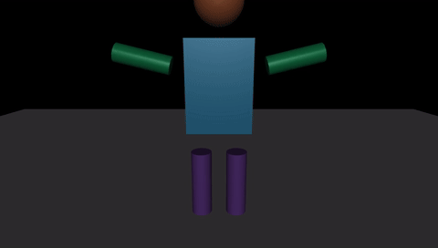
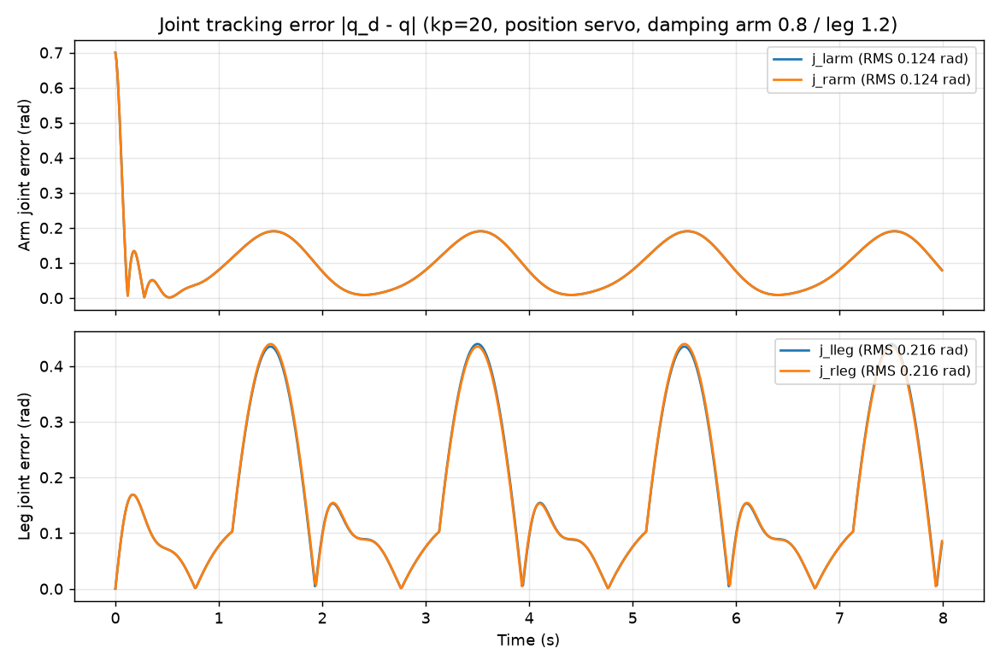

# 简易人形机器人 MuJoCo 物理仿真（原地踏步 + 交替摆臂）

---

## 1. 概述与目标

本模块使用 MuJoCo 物理仿真引擎，通过内联 XML 构建一个简易人形机器人，
实现**原地踏步 + 交替摆臂**的节律运动仿真，并离屏渲染输出仿真视频。
不依赖 Gazebo、不需要 URDF，适合作为 MuJoCo 基础建模与运动控制（位置伺服）的入门示例。

### 核心任务目标
1. **简易人形建模**：用基础几何体（球 / 盒 / 圆柱）在 XML 中搭建人形机器人（躯干 + 头 + 双臂 + 双腿，4 个旋转关节）。
2. **节律运动控制**：位置伺服执行器驱动双腿交替踏步、双臂交替摆动（相位协调），形成拟行走节律。
3. **仿真视频自动渲染**：离屏渲染（Offscreen Rendering）自动生成 MP4 视频，无显示器环境（虚拟机 / SSH）亦可运行。

---

## 2. 模型与运动设计

### 2.1 模型结构（内联 XML，定义于 `main.py` 内 `XML`）

| 部件 | 几何体 | 说明 |
|------|--------|------|
| 躯干 | 蓝色 box（半尺寸 0.2×0.15×0.28） | 无关节 = 固定在世界系（原地踏步，躯干不漂移） |
| 头部 | 橙色 sphere（r=0.15） | 固定于躯干顶部（pos 0 0 0.5） |
| 双臂 | 绿色 cylinder（长 0.35，r=0.06） | 左右各 1 个 hinge 关节，肩点位于躯干轮廓外（±0.3），避免初始几何穿透 |
| 双腿 | 紫色 cylinder（长 0.45，r=0.07） | 左右各 1 个 hinge 关节，髋点位于躯干底面下方（z=−0.45），避免初始几何穿透 |

所有几何体显式设置 `density="300"`（默认 1000 会使肢体过重、位置伺服跟踪变差）；
每个 hinge 关节带粘滞阻尼（手臂 0.8 N·m·s/rad、腿部 1.2 N·m·s/rad），抑制无阻尼位置伺服的振荡。

### 2.2 控制方式

| 项目 | 说明 |
|------|------|
| 执行器 | 4 个位置伺服（`<position>` actuator），**kp = 20**，`ctrlrange = ±1.2 / ±0.8` |
| 控制律 | `ctrl = 幅度 × sin(2π·freq·t + 相位)`（目标关节角） |
| 节律频率 | 0.5 Hz（2 秒一个完整周期） |

### 2.3 相位安排（双腿交替踏步、双臂交替摆动并与腿部错相）

| 关节 | 幅度（rad） | 相位 |
|------|------------|------|
| 左腿 `j_lleg` | 0.55 | 0 |
| 右腿 `j_rleg` | 0.55 | π（与左腿反相，交替踏步） |
| 左臂 `j_larm` | 0.70 | π/2 |
| 右臂 `j_rarm` | 0.70 | 3π/2（与左臂反相，且与腿部错相） |

---

## 3. 控制原理与公式

### 3.1 位置伺服：写目标角

脚本不直接计算关节力矩，每个控制步把期望关节角写入执行器控制量：

$$ q_d = \text{幅度}\cdot\sin(2\pi f t + \varphi), \qquad u_i = q_d $$

`data.ctrl[i] = q_d` 后，由 MuJoCo `<position>` 执行器在内部把目标角与实际角之差
换算成驱动力（执行器自带增益 `kp` 与阻尼参数，不采用脚本中显式的 PD 表达式）：

- $k_p = 20$：执行器位置增益（驱动关节趋向目标角）；
- 阻尼由关节粘滞阻尼提供（joint `damping`：手臂 0.8、腿部 1.2 N·m·s/rad），抑制超调与振荡。

### 3.2 关节动力学方程

考虑重力、惯性、科氏力与离心力，多刚体机器人关节空间动力学方程为：

$$ M(q)\,\ddot{q} + C(q,\dot{q})\,\dot{q} + g(q) = \tau $$

- $M(q)$：惯量矩阵；$C(q,\dot{q})$：科氏力/离心力项；$g(q)$：重力项；
- 本模型中四肢为单自由度摆杆，绕各自铰点的转动惯量近似 $I \approx \tfrac{1}{3} m l^2$（细杆绕端点），
  以单臂为例：$m = 1.19\,\text{kg}$、$l = 0.35\,\text{m}$ → $I \approx 0.049\,\text{kg·m}^2$，
  重力矩峰值 $m g \tfrac{l}{2} \approx 2.0\,\text{N·m}$，远小于 $k_p \times q_d$ 的驱动力矩裕度。

### 3.3 kp 选择依据（实测）

对 $k_p = 8 / 20 / 50$ 做 6 秒仿真对比（稳态 RMS 跟踪误差，单位 rad），结果如下：

| kp | 左臂 `j_larm` | 左腿 `j_lleg` | 说明 |
|----|--------------|--------------|------|
| 8  | 0.247 | 0.206 | 比例力矩不足，跟踪滞后明显 |
| **20** | **0.095** | **0.171** | **误差下降约 60%，力矩峰值 14 N·m，适中（默认参数）** |
| 50 | 0.036 | 0.149 | 误差继续下降，但力矩峰值增至 35 N·m，对负载/扰动更敏感 |

选取 **kp = 20**：在跟踪精度（手臂误差 −62%）与执行器力矩裕度之间取得折中；
kp 继续增大收益递减且峰值力矩成比例上升，不利于演示稳健性。

### 3.4 稳定性与收敛性说明

以单臂闭环误差做近似分析（$e = q_d - q$，含阻尼项 $b$）：

$$ I\,\ddot{e} + b\,\dot{e} + k_p\,e = I\,\ddot{q}_d + b\,\dot{q}_d - g(q) $$

在该近似下闭环可视为二阶系统，固有频率 $\omega_n = \sqrt{k_p / I}$、阻尼比 $\zeta = b / (2\sqrt{k_p I})$。
实测表明：无阻尼（`damping=0`）时位置伺服振荡明显、稳态误差随 kp 增大不降反升；
加入关节粘滞阻尼后系统收敛、误差随 kp 单调下降（见 3.3 表），即在阻尼存在时闭环是稳定的。

---

## 4. 算法流程（伪代码）

```
常量：freq=0.5 Hz，ARM_AMP=0.70，LEG_AMP=0.55，kp=20
初始化：加载 XML 模型，创建 Renderer(960×544)

每个控制周期 dt=0.01s（仿真步进 100 Hz）：
    phase ← 2π × freq × t
    ctrl[j_lleg] ← LEG_AMP × sin(phase)
    ctrl[j_rleg] ← LEG_AMP × sin(phase + π)
    ctrl[j_larm] ← ARM_AMP × sin(phase + π/2)
    ctrl[j_rarm] ← ARM_AMP × sin(phase + 3π/2)
    写入 4 个 position actuator 的 ctrl（目标角）
    mujoco.mj_step()  # 物理积分一步

每 1/30 s：update_scene(camera="view0") + render() 取帧
    结束：imageio 合成 MP4（240 帧，30 fps，8 秒）
```

目标角写入 `data.ctrl` 后，关节驱动力由位置执行器内部按目标角与实际角之差自动产生（见 3.1）。

---

## 5. 运行方式

### 5.1 环境依赖
- Ubuntu 20.04 / 22.04 / 24.04（Windows 亦可）
- Python >= 3.10
- 系统库（Linux 无显示环境渲染需要）：`sudo apt install -y libosmesa6-dev`
- MuJoCo 3.x、numpy、imageio + imageio-ffmpeg、pillow（预览 PNG）

### 5.2 安装依赖
```bash
cd src/humanoid/midterm_humanoid
pip install -r requirements.txt
```

### 5.3 运行仿真

方式一（直接运行，不依赖 ROS）：
```bash
cd src/humanoid/midterm_humanoid
python3 main.py            # 输出 output/robot_sim.mp4
python3 main.py --preview  # 只跑 1.5 秒，输出 3 张 PNG 检查取景
python3 main.py --duration 3     # 自定义完整视频时长（秒），不填则用默认 8.0
python3 -m unittest discover -s tests -v   # 单元测试：模型结构、执行器、控制器
```
Linux 无显示环境默认自动用 osmesa 软件渲染（需先 `sudo apt install -y libosmesa6-dev`），无需手动设 `MUJOCO_GL`；有显卡可用 `MUJOCO_GL=egl` 提速。Windows 自动 wgl，macOS 自动 cgl。

方式二（catkin 包 + roslaunch，需 ROS 环境）：
```bash
# 将本模块软链到工作空间 src 下，然后
catkin_make
source devel/setup.bash
roslaunch midterm_humanoid main.launch                  # 默认（8.0 秒）
roslaunch midterm_humanoid main.launch duration:=3.0    # 自定义时长
roslaunch midterm_humanoid main.launch preview:=true    # 只渲染 3 帧预览、不写视频
```
> `cwd="node"` 下相对路径以 node 所在目录（`devel/lib/<pkg>/`）为基准，roslaunch 启动时视频输出到 `devel/lib/<pkg>/output/`；源码直跑时才落在模块的 `output/`。

---

## 6. 运行效果



完整视频由 `python3 main.py` 运行后生成于 `src/humanoid/midterm_humanoid/output/robot_sim.mp4`
（8 秒，30 fps，960×544，240 帧）。上方动图为文档配图，存放于 `docs/img/humanoid/midterm_humanoid/`。

---

## 7. 性能与实测指标

在 **Ubuntu 20.04 + ROS Noetic + MuJoCo 3.2.3** 虚拟机中实测：

| 指标 | 实测值 |
|------|--------|
| 仿真步进频率 | 100 Hz（timestep = 0.01 s） |
| 视频规格 | 8 秒 / 30 fps / 240 帧 / 960×544 |
| 渲染耗时（含 8 s 仿真） | 1.51 s（其中离屏渲染 1.41 s） |
| 平均每帧渲染 | 5.9 ms/帧 |
| 跟踪误差（kp=20） | 手臂 RMS 0.095 rad（≈5.4°），腿部 RMS 0.171 rad（≈9.8°） |
| 依赖版本 | mujoco 3.2.3、numpy、imageio、imageio-ffmpeg |
| 启动验证 | 源码 `python3 main.py` 已在本机实测通过（MuJoCo 3.2.3 与 3.17 两个版本）；`catkin_make` 与 `roslaunch midterm_humanoid main.launch` 未在重构后的代码上本地复测（本机无 ROS 环境），需在 ROS 环境确认；单元测试 `python3 -m unittest discover -s tests` 已在本机 MuJoCo 3.2.3 与 3.17 双版本通过（7 项） |

### 7.2 关节角跟踪误差曲线

kp=20 默认参数下，8 秒仿真（100 Hz 步进）四个关节的跟踪误差 |q_d − q| 时域曲线如下：



- 误差呈 0.5 Hz 周期性波动，幅值稳定、无发散；腿部（±0.216 rad 全程 RMS）高于手臂（±0.124 rad），
  因腿部摆幅更大（0.55 vs 0.70 rad 中手臂幅值虽大但惯量小）且 ctrlrange（±0.8）更窄；
- 0~0.5 s 为启动瞬态（关节从 0 向目标突变），其后进入稳态周期；
- 图中 RMS 为**全程**统计（含启动瞬态）；7.1 节对比表取**稳态段** RMS，口径不同、数值略低。

### 7.1 多参数（场景）对比

| 场景 | kp | 手臂稳态误差（rad） | 腿部稳态误差（rad） | 说明 |
|------|----|--------------------|--------------------|------|
| 低增益 | 8  | 0.247 | 0.206 | 跟踪滞后，摆动幅度打折 |
| **默认** | **20** | **0.095** | **0.171** | 精度与力矩折中，推荐 |
| 高增益 | 50 | 0.036 | 0.149 | 精度更高，力矩峰值 35 N·m |

> 对比均为同一模型、同一轨迹（摆幅 0.70/0.55 rad、0.5 Hz）下 6 秒仿真稳态段 RMS 统计。

---

## 8. 文件结构

```
midterm_humanoid/
├── tests/               # 单元测试（python -m unittest discover -s tests）
├── setup.py             # setuptools 配置（catkin_python_setup 需要）
├── package.xml          # catkin 包描述
├── CMakeLists.txt       # catkin_python_setup + 只安装 main.py 入口
├── requirements.txt
├── .gitignore           # 忽略 output/（运行生成物不入库）
├── launch/
│   └── main.launch      # roslaunch 启动入口
├── README.md            # 运行环境与步骤说明
└── src/
    └── midterm_humanoid/   # Python 包（catkin_python_setup 安装）
        ├── __init__.py
        ├── common.py       # 公共库：渲染后端 / 仿真循环 / 视频导出
        └── main.py         # 仿真与渲染主脚本（入口，内联 XML）
```

配套文档配图：`docs/img/humanoid/midterm_humanoid/robot_sim.gif`（由运行效果导出，不入模块 output/）。
