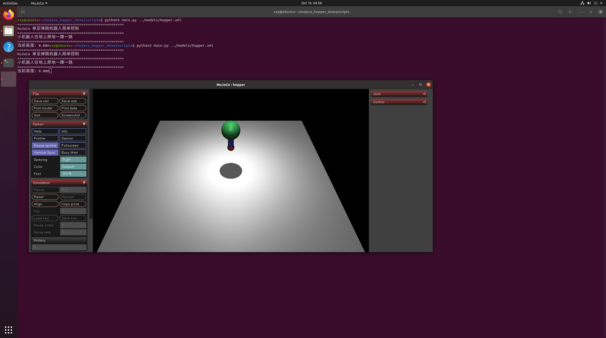

# MuJoCo单足弹跳机器人简单仿真

## 一、实验目的与环境说明
### 1.1 实验目的
1. 在MuJoCo里搭一个最简单的单腿弹跳机器人
2. 写个脚本让它在地上一蹲一跳，看物理仿真效果
3. 熟悉一下MuJoCo里线性关节和力控制的用法

### 1.2 实验环境
|项目|配置|
| ---- | ---- |
|操作系统|Ubuntu 20.04（VMware虚拟机）|
|ROS版本|ROS Noetic|
|MuJoCo版本|MuJoCo 2.1.1|
|编程语言|Python3|
|功能包|mujoco_hopper_demo|

### 1.3 功能包目录结构
```
mujoco_hopper_demo/
├── package.xml
├── CMakeLists.txt
├── launch/
│   └── hopper.launch
├── models/
│   └── hopper.xml      # 单足机器人模型
├── scripts/
│   └── main.py        # 主程序，控制机器人弹跳
└── docs/
    └── index.md
```

## 二、单足弹跳机器人介绍
这个就是超级简单的一个小机器人：绿色的圆身子，下面一根蓝色的腿，脚是个红色小球。腿是可以上下伸缩的，给它加个周期性的力，它就会像个跳跳球一样在地上一蹲一跳。

原理也很简单：力往下压的时候腿收缩、身子下蹲，力往上收的时候腿弹开、把整个身子弹起来，不用搞复杂的控制算法，就用个正弦波生力就行。

## 三、实现步骤
### 3.1 前置准备
确保MuJoCo已经装好，执行 `pip3 install mujoco` 装完Python库，`python3 -c "import mujoco"` 不报错就行。

### 3.2 建ROS功能包
```bash
cd ~/catkin_ws/src
catkin_create_pkg mujoco_hopper_demo rospy
cd ..
catkin_make
source devel/setup.bash
```

### 3.3 写模型文件
在models文件夹里写hopper.xml，就三个部分：绿色圆身子、蓝色伸缩腿、红色小脚，腿是个上下滑动的线性关节，下面一个电机控制力的大小。

### 3.4 写控制脚本
在scripts里建main.py，核心逻辑就是用正弦函数生成周期性的力，发给腿上的电机：
```python
force = 80 * np.sin(t * 4)
data.ctrl[0] = force
```
力一会儿往下压一会儿往上收，机器人就自然蹲下起跳了。

## 四、运行方法
```bash
cd ~/src/humanoid/mujoco_hopper_demo/scripts
python3 main.py ../models/hopper.xml
```
弹出来MuJoCo窗口就能看到绿色小机器人在灰色地上一蹦一蹦的。

用roslaunch启动也一样：
```bash
roslaunch mujoco_hopper_demo hopper.launch
```

## 五、遇到的报错和解决办法
1. **报No module named 'mujoco'**
   老问题了，直接 `pip3 install mujoco` 装一下就行。

2. **机器人直接飞出去不落地**
   就是力给太大了，把脚本里的80改小一点，比如改成50，就正常了。

## 六、运行效果说明
跑起来之后：
- 绿色的圆身子在地上一上一下跳
- 蓝色的腿一会儿伸长一会儿缩回去
- 红色小脚一直接触地面，蹲的时候压下去，跳的时候弹起来

成功运行的样子：


终端会一直打印机器人当前的高度，录个10秒GIF就行。

## 七、测试说明
我是在Ubuntu20.04虚拟机上测的，模型加载正常，机器人能正常原地弹跳，launch也能启动。

## 八、大模型声明
写文档和代码框架的时候用DeepSeek辅助整理了下步骤。
