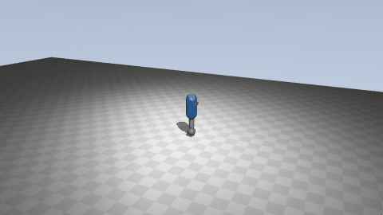
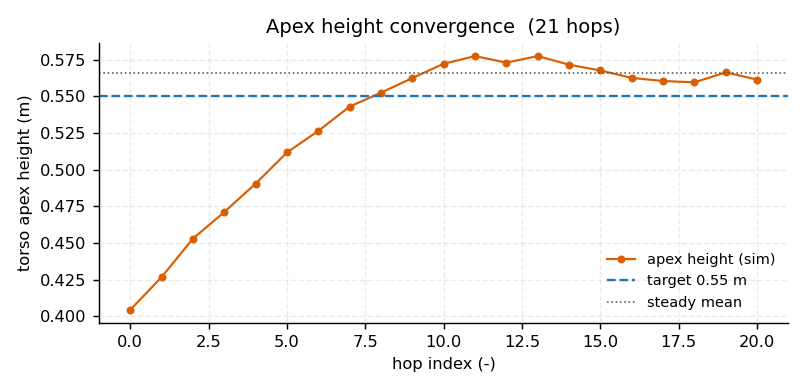
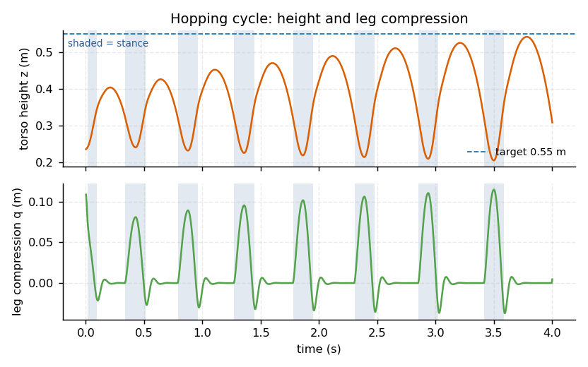
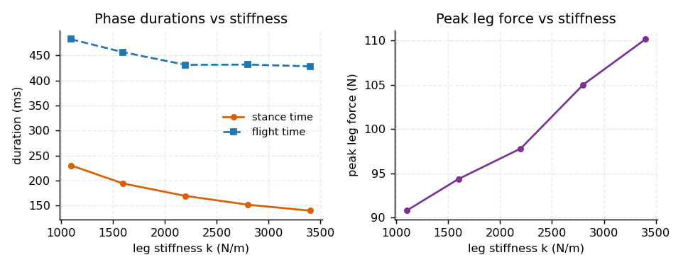
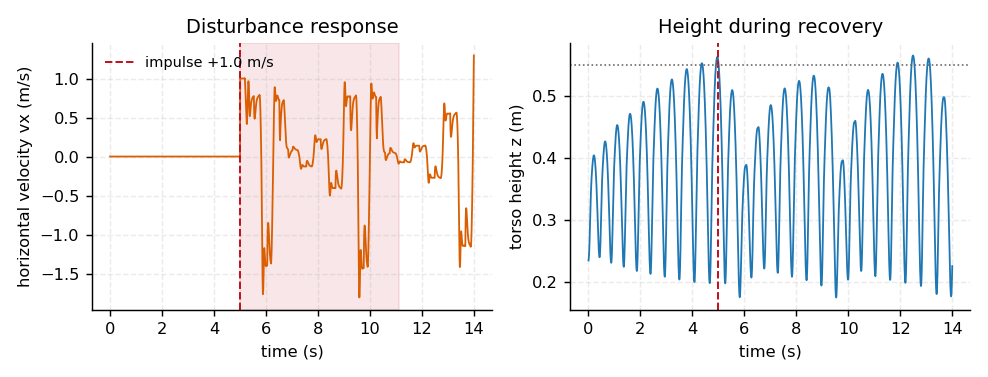

# MuJoCo单足弹跳机器人简单仿真：SLIP 模型与 Raibert 弹跳控制（mujoco_hopper_slip_control）

一根腿的机器人在 MuJoCo 里连续弹跳，用 **SLIP 弹簧-质量模型**储能、**Raibert 落脚点**规则
决定落地位置、**起飞速度闭环**注入能量，顶点高度稳定在 0.55 m。ROS 2 Humble 功能包，
并带独立的无 ROS 入口。

## 效果图

弹跳动图（480×270，俯视跟随相机）：



| 顶点高度收敛（21 跳） | 支撑相 / 飞行相时程 |
|---|---|
|  |  |

| 弹簧刚度扫描 | 抗扰恢复 |
|---|---|
|  |  |

上列 4 张曲线由 `python3 main.py --headless --export-docs` 生成。

## 一、为什么重做这个题目

仓库里已有 `mujoco_hopper_demo`（ROS 1 / Noetic，MuJoCo 2.1.1）。它自己文档里写得很清楚：

> 原理也很简单……**不用搞复杂的控制算法，就用个正弦波生力就行**。
> 红色小脚**一直接触地面**，蹲的时候压下去，跳的时候弹起来。

也就是说它**并没有真的离地**，只是腿在弹簧上颤动，而且控制是 `80*sin(4t)` 的开环正弦。

本模块从零实现一个**物理上成立**的单足弹跳：

| 项 | `mujoco_hopper_demo` | 本模块 |
|---|---|---|
| 相位 | 脚始终触地 | **真实飞行相**，占空比 0.28 |
| 控制 | 开环正弦力 | 闭环：弹簧储能 + 落脚点 + 起飞速度伺服 |
| ROS | 1（catkin/rospy） | 2（ament_python/rclpy） |
| 指标 | 无 | 顶点误差、相位时长、峰值力、恢复时间、刚度曲线 |

## 二、模型

`models/hopper_scene.xml`，总质量 **6.00 kg**，无外部网格（整包 < 1 MB）：

```
躯干 capsule 4.6 kg ── root_x 滑动（水平）
                    └─ root_z 滑动（竖直，绝对高度只由 qpos 承载）
  └─ 髋 hinge（绕 +y）  0.3 kg 大腿
       └─ 腿 slide（沿 +z，q>0 = 压缩）  0.2 kg 小腿
            └─ 足 sphere r=0.045  0.9 kg   ← 唯一参与接触的几何体
被动弹簧 k = 2200 N/m，阻尼 12 N·s/m；电机挂在腿的滑动关节上注能。
```

三个容易出错的地方，都写进了测试：

1. **绝对高度只由 qpos 承载**。躯干 body 的 `pos` 必须是 `0 0 0`。若写成
   `pos="0 0 0.235"`，再在 `root_z` 上叠加 qpos，高度会被**算两次**，
   所有高度读数都变成相对偏移量。第一版就栽在这里，顶点数据前后自相矛盾。
2. **接触要去抖**。足端刚触地时接触状态会在 1~2 个物理步内反复跳变，
   不去抖会把一次弹跳切成好几段假相位，支撑/飞行时长统计全错。用连续 3 步
   （6 ms）确认才切换。
3. **限幅要夹角度本身**。`arcsin` 的输入夹到 0.85 得到的是 1.016 rad，
   不是 0.85 rad。这个 off-by-一 在自检里被 `RAIBERT_ANGLE_LIMIT` 断言抓到了。

## 三、控制律

### 3.1 分相

**飞行相**：腿长用 PD 收回标称长度（`kp=900, kd=35`，力限 ±300 N），避免伸直的腿硬砸地面；
髋关节打到**顶点处一次算定**的落脚角。

**支撑相**：髋关节**自由**（指令跟随当前角，伺服只剩阻尼），腿绕支撑脚被动翻转。
这一点是 SLIP 的前提 —— 锁死髋角会强迫脚掌拖地，实测支撑相被拉长到 0.40 s，
横向速度出现 0.8 m/s 量级的震荡。改成自由髋后支撑相回到 0.17 s，与 `π/ω ≈ 0.17 s` 吻合。

腿只在**伸展段**（`q̇ < 0`）注能，压缩段交给被动弹簧储能；伸展到 `q < 0.02` 就收手，
避免在即将离地时继续顶地。

### 3.2 能量：闭环起飞速度，而不是闭环顶点高度

最初的实现按「顶点高度误差」算每跳要补的能量：

```
ΔE = m·g·(h_des − h_apex)，f_ex = ΔE / 行程
```

结果**稳态顶点卡在 0.454 m**，怎么调增益都上不去。逐跳能量审计才发现：
触地冲击每跳要吃掉 5~7 J，而控制器注入的能量被这部分损耗抵消，高度闭环自己跟自己对消。

改成闭环**起飞竖直速度**：

```
vz_des = sqrt(2·g·(h_des − z_liftoff) / η)
f_ex  ← clamp(f_ex + k_e·(vz_des − vz_liftoff_prev)·m / 行程)
```

`η` 是「离地后能量效率」，由上一跳实测**在线辨识**：

```
η ← η + α·( (apex − z_liftoff)·2g / vz_liftoff² − η )
```

这样换目标高度、换弹簧刚度都不需要重标定常数。实测 η 稳定在 **0.78~0.86**，
即约 15%~22% 的起飞动能没能转成高度（腿伸展与关节阻尼）。

增益 `k_e` 取 **0.04**。扫参发现 ≥0.08 时会出现周期约 6 跳的极限环：
顶点在 0.50~0.70 m 之间来回摆，8 s 时正好落在过冲峰顶（0.917 m）。

### 3.3 落脚点

Raibert 规则（`x_offset = vx·T_st/2 + k_v·(vx − vx_des)`）：

```python
θ_td = −arcsin( clamp(x_offset / L, −1, 1) )，再限幅到 ±0.60 rad
```

髋轴取 +y，`θ > 0` 把脚放到身体 **−x** 侧（身后）。比目标慢 → 脚放身后 → 蹬地加速；
比目标快 → 脚放身前 → 减速。

> 踩过的坑：`foot_placement_angle` 的第一版把 `k_v=config.RAIBERT_KV` 写成**默认参数**，
> Python 在 import 时就把值绑死了，运行时改 config 完全无效。九组扫参里三组其实是同一个控制器。
> 现在全部改成函数体内读取，并加了一条「落脚增益运行时生效」的断言守住。

## 四、三项实验

### 4.1 定高弹跳

12 s 内 21 跳，稳态顶点 **0.566 ± 0.006 m**（目标 0.55，误差 +0.016 m），
支撑相 **170 ms**、飞行相 **431 ms**、占空比 **0.28**，起飞速度 2.28 m/s，峰值腿力 98 N
（约 1.7 倍体重）。

占空比 0.28 是「真的在跳」的直接证据：脚有 72% 的时间在空中。

### 4.2 抗扰恢复

t = 5 s 给躯干加 +1.0 m/s 横向冲量。扰动后 |vx| 峰值 1.81 m/s，躯干最低 0.176 m（未摔），
**6.12 s 后连续 3 跳顶点回到 0.55 ± 0.03 m**。

但横向**没有收敛**：11 s 后仍有 0.3 m/s 量级的速度，末速 1.30 m/s。这是本模块的已知局限，
见第六节。判据因此只取竖直方向，横向漂移单独如实报告。

### 4.3 弹簧刚度扫描

| 刚度 k (N/m) | 顶点 (m) | 支撑相 (ms) | 飞行相 (ms) | 峰值腿力 (N) |
|---|---|---|---|---|
| 1100 | 0.622 | 230 | 482 | 91 |
| 1600 | 0.593 | 194 | 457 | 94 |
| 2200 | 0.566 | 170 | 431 | 98 |
| 2800 | 0.566 | 152 | 432 | 105 |
| 3400 | 0.562 | 140 | 428 | 110 |

刚度从 1100 提到 3400 N/m：支撑相 230 → 140 ms（−39%），峰值腿力 91 → 110 N（+21%）。
与 SLIP 理论一致 —— 硬腿储能快、离地早，代价是冲击力更大。

顶点随刚度有 0.622 → 0.562 的漂移，是效率 η 随刚度变化、而伺服只能逐跳跟踪造成的，
控制器没有完全拉平，如实列出。

## 五、复现

```bash
cd src/humanoid/mujoco_hopper_slip_control
python3 -m pip install -r requirements.txt      # mujoco>=3.3, numpy, matplotlib, pillow

python3 main.py --version      # 1.0.0
python3 main.py --test         # 12 项自检（含一次真实弹跳）
python3 main.py --headless     # 三项实验 + CSV + 4 张图（写 results/）
python3 main.py --gif          # 演示动图
```

ROS 2（已在 Ubuntu 22.04 + ROS 2 Humble ros-base 实测）：

```bash
colcon build --packages-select mujoco_hopper_slip_control    # Finished <<< ... [0.61s]
source install/setup.bash
ros2 launch mujoco_hopper_slip_control main.launch.py target_height:=0.62
ros2 param get /hopper_slip_node target_height                # Double value is: 0.62
ros2 topic echo /hopper_slip_node/status --once
ros2 topic pub --once /hopper_slip_node/target std_msgs/Float64MultiArray "{data: [0.60, 0.0]}"
```

实测：节点启动、三个话题正常发布、参数按 launch 生效、连续运行 8 s 不退出、
收到目标指令后日志输出「新目标：高度 0.60 m」并继续发布状态。
CI 里另有等价的 `ros:humble` 容器作业做回归。

话题：`~/target`（`Float64MultiArray` = [目标高度, 目标速度]）、
`~/state`（`JointState`）、`~/status` = [z, vz, vx, q, 注能力, 相位, η]。

## 六、能力边界

- **横向控制权限弱**：点足 + 自由髋的落脚点对横向动量几乎无修正能力，扰动后横向速度
  长时间不收敛。要做横向定速，需要加髋关节力矩控制或侧向自由度。
- **可恢复冲量上限约 1.0 m/s**：1.5 m/s 时躯干最低掉到 0.059 m，会摔。
- **前进速度上限约 0.2 m/s**：受腿长 0.28 m 与支撑时长 0.17 s 限制，做不到 0.6 m/s 定速。
- **纯平面**：只有 x/z 平动，无偏航/翻滚，不会侧倒。
- **腿质量不可忽略**（1.4/6.0 kg）：落脚角大幅摆动会对躯干产生反作用，是横向不收敛的来源之一。
- 顶点有恒定 +0.01~0.02 m 正偏差（效率辨识滞后一跳）。

## 七、参数

| 参数 | 位置 | 默认 | 说明 |
|---|---|---|---|
| `LEG_STIFFNESS` | `config.py` | 2200 N/m | 被动弹簧刚度，实验 C 的扫描对象 |
| `LEG_DAMPING` | `config.py` | 12 N·s/m | 腿阻尼 |
| `ENERGY_GAIN` | `config.py` | 0.04 | 起飞速度伺服增益（>0.08 出极限环） |
| `FORCE_LIMIT` | `config.py` | 800 N | 注能力上限 |
| `RAIBERT_KV` / `RAIBERT_ANGLE_LIMIT` | `config.py` | 0.10 / 0.60 rad | 落脚点增益与限幅 |
| `TARGET_HEIGHT` | `config.py` / launch | 0.55 m | 顶点目标 |
| `DEBOUNCE_STEPS` | `config.py` | 3 | 接触去抖步数 |
| `TIMESTEP` | `config.py` | 0.002 s | 物理步长 |

## 八、测试

```bash
python3 test/test_standalone.py                        # 28 项：控制律与状态机，不需要 MuJoCo
python3 ../../../../tests/test_mujoco_hopper_slip_control_local.py   # 21 项：模型一致性 + 真实仿真
python3 main.py --test                                 # 12 项：含一次 8 s 真实弹跳
```

集成测试会交叉校验 XML 与 `config.py`（质量、关节 range、弹簧刚度）——
改一处忘改另一处会直接失败。
