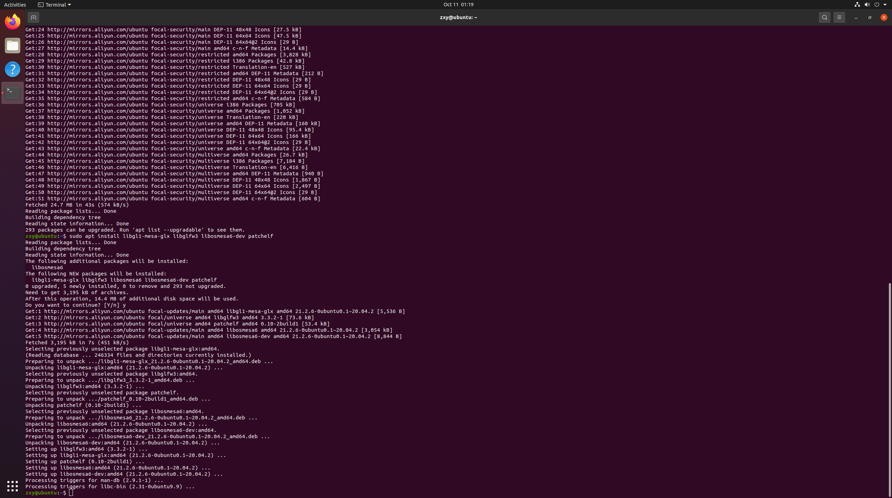
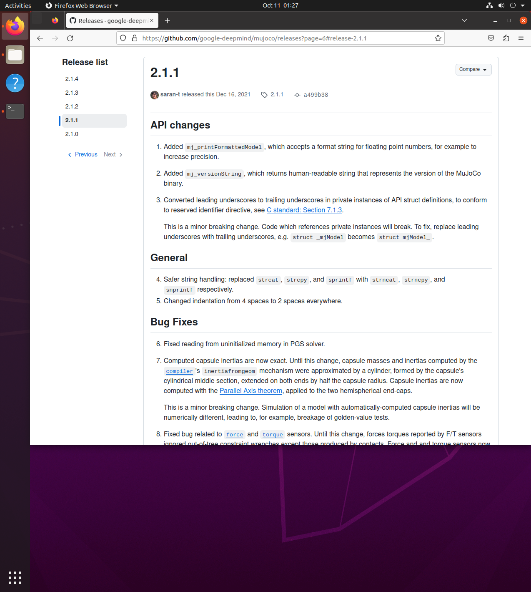

# MuJoCo安装教程

## 一、实验目的与环境说明
### 1.1 实验目的
1. 完成MuJoCo物理仿真引擎在Ubuntu20.04虚拟机的部署安装
2. 测试MuJoCo原生仿真窗口，验证引擎可以正常运行
3. 实现MuJoCo与ROS Noetic联动，编写Python节点完成仿真测试

### 1.2 实验环境
|项目|配置|
| ---- | ---- |
|操作系统|Ubuntu 20.04（VMware虚拟机）|
|ROS版本|ROS Noetic|
|MuJoCo版本|MuJoCo 2.1.1|
|编程语言|Python3|
|功能包|mujoco_demo|

### 1.3 功能包目录结构
 
```text
mujoco_demo/
├── package.xml        # 包清单，声明依赖mujoco、rospy、geometry_msgs
├── CMakeLists.txt     # 编译配置，把python脚本安装到bin目录
└── scripts/
    └── mujoco_test.py  # 主程序：调用MuJoCo仿真的测试节点
```
  

## 二、MuJoCo介绍
MuJoCo是多关节动力学物理仿真引擎，擅长机器人、机械臂、人形机器人动力学仿真，支持接触、碰撞、关节约束，常和ROS结合做机器人控制仿真。

## 三、安装步骤
### 3.1 安装依赖库
打开Ubuntu终端，依次执行：
```bash
sudo apt update
sudo apt install libgl1-mesa-glx libglfw3 libosmesa6-dev patchelf
```

### 3.2 下载MuJoCo压缩包
1. 进入MuJoCo官网下载：`https://github.com/deepmind/mujoco/releases`
2. 下载  `mujoco-2.1.1-linux-x86_64.tar.gz` 
3. 在用户主目录创建文件夹`.mujoco`
 
```bash
mkdir ~/.mujoco
```

4. 将压缩包解压到  `.mujoco`  目录
 
```bash
tar -zxvf mujoco-2.1.1-linux-x86_64.tar.gz -C ~/.mujoco/
```

### 3.3 配置环境变量
 
编辑`bashrc`文件：
 
```bash
gedit ~/.bashrc
```
 
在文件末尾粘贴下面一行：
 
```bash
export LD_LIBRARY_PATH=$LD_LIBRARY_PATH:~/.mujoco/mujoco-2.1.1/bin
```
 
保存退出，执行命令让环境变量生效：
 
```bash
source ~/.bashrc
```
 
### 3.4 测试MuJoCo原生仿真
 
进入MuJoCo的bin目录，运行测试程序：
 
```bash
cd ~/.mujoco/mujoco-2.1.1/bin
./simulate
```
 
✅ 成功：弹出仿真窗口，加载人形机器人模型，支持鼠标拖拽交互。
❌ 报错：检查 LD_LIBRARY_PATH 路径是否正确，确认解压目录无误。
 
### 3.5 Python绑定安装与ROS测试节点
 
安装 mujoco Python 绑定（注意：pip 装的是 3.x 新版，和前面手动下载的 2.1.1 是两套不同的东西，3.x 不需要手动设 LD_LIBRARY_PATH）：

```bash
pip install mujoco
```

> 如果只是想跑原生 simulate 程序，不需要 pip 装库；只有在 Python 里 import mujoco 时才需要。
 
#### 3.5.1 创建 ROS 功能包

在 catkin 工作空间下创建功能包（依赖 rospy 和 std_msgs）：

```bash
cd ~/catkin_ws/src
catkin_create_pkg mujoco_demo rospy std_msgs
```

#### 3.5.2 编写测试节点脚本

在功能包下创建 scripts 目录，新建 `mujoco_test.py`：

```bash
mkdir -p ~/catkin_ws/src/mujoco_demo/scripts
gedit ~/catkin_ws/src/mujoco_demo/scripts/mujoco_test.py
```

文件内容如下（**首行的 shebang 声明 `#!/usr/bin/env python3` 必须保留**，否则脚本无法直接执行）：

```python
#!/usr/bin/env python3
import mujoco
import mujoco.viewer
import rospy
import os

if __name__ == "__main__":
    rospy.init_node("mujoco_demo_node")
    # 加载人形模型
    model = mujoco.MjModel.from_xml_path(os.path.expanduser("~/.mujoco/mujoco-2.1.1/model/humanoid/humanoid.xml"))
    data = mujoco.MjData(model)
    rospy.loginfo("MuJoCo仿真启动成功")
    with mujoco.viewer.launch_passive(model, data) as viewer:
        while viewer.is_running() and not rospy.is_shutdown():
            mujoco.mj_step(model, data)
            viewer.sync()
```

#### 3.5.3 配置 CMakeLists.txt 安装脚本

编辑 `~/catkin_ws/src/mujoco_demo/CMakeLists.txt`，在文件末尾追加以下内容：

```cmake
catkin_install_python(PROGRAMS
  scripts/mujoco_test.py
  DESTINATION ${CATKIN_PACKAGE_BIN_DESTINATION}
)
```

这一步会把 Python 脚本安装到 ROS 的 bin 目录，`rosrun` 才能找到并直接执行，否则会报找不到命令或 Exec format error。

#### 3.5.4 给脚本添加执行权限

```bash
chmod +x ~/catkin_ws/src/mujoco_demo/scripts/mujoco_test.py
```

#### 3.5.5 编译功能包

```bash
cd ~/catkin_ws
catkin_make
source devel/setup.bash
```

#### 3.5.6 运行 ROS 节点

```bash
rosrun mujoco_demo mujoco_test.py
```

#### 3.5.7 验证节点正常启动

运行成功后，终端应输出日志 `MuJoCo仿真启动成功`，并弹出 MuJoCo 人形仿真窗口（可拖拽交互），说明 ROS 节点正常启动。若没有弹出窗口，先检查：

1. `source ~/.bashrc` 和 `source devel/setup.bash` 是否都已执行；
2. `catkin_make` 是否成功完成、有无报错；
3. 模型路径 `~/.mujoco/mujoco-2.1.1/model/humanoid/humanoid.xml` 是否存在。

> **注意**：以上 ROS 代码使用的是 Noetic（ROS 1）的 `rospy` 接口。如果使用的是 ROS 2 Humble（Ubuntu 22.04），需要改用 `rclpy`，节点初始化、日志、循环都需要换成 ROS 2 的写法，MuJoCo 仿真部分代码不变。
 
## 四、MuJoCo + ROS Noetic联动（可选）
 
如需在ROS中使用mujoco_ros插件，在工作空间src下克隆源码，编译即可。
 
## 五、常见报错排查
 
1. error while loading shared libraries 
原因：环境变量未生效，重新执行  source ~/.bashrc ，重启终端。
2. 虚拟机无法弹出仿真窗口
原因：虚拟机显卡加速问题，VMware开启3D图形加速；或者使用offscreen离线渲染。
3. pip安装mujoco失败
 
```bash
pip install --upgrade pip
```
 
## 六、运行效果说明
 
1. 终端执行 `./simulate` ，弹出MuJoCo人形仿真界面，可拖拽模型。
2. ROS节点运行后，在ROS中调用MuJoCo仿真，可拓展编写控制代码。
3. 本地预览网页：仓库根目录执行  `mkdocs serve --livereload` ，浏览器打开 `http://127.0.0.1:8000`
 
## 七、测试说明
 
- 操作系统：Windows11宿主机 + Ubuntu20.04 VMware虚拟机
- 验证项：MuJoCo引擎安装、Python接口调用、ROS节点正常启动
- 文档导航：文档放置在docs/humanoid文件夹，可在mkdocs网页左侧导航访问
 
## 八、大模型声明
 
模型：通义千问
用途：辅助编写MuJoCo安装教程、Python节点代码、排查安装报错。
