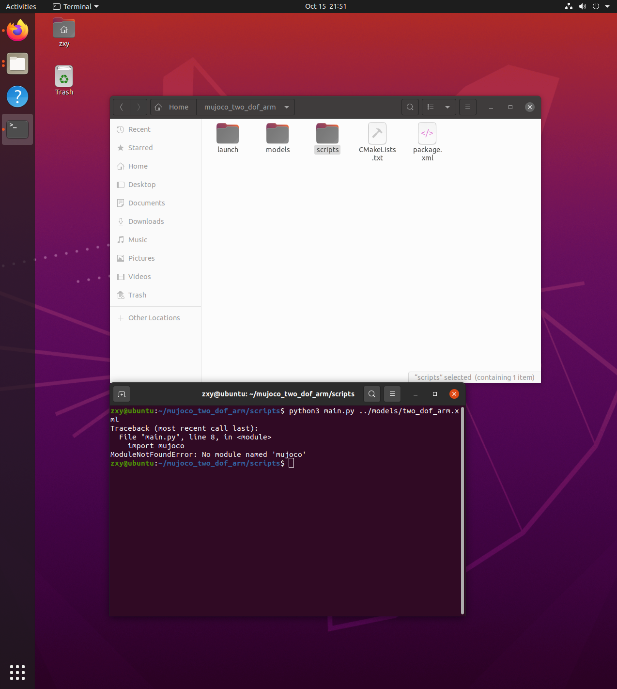
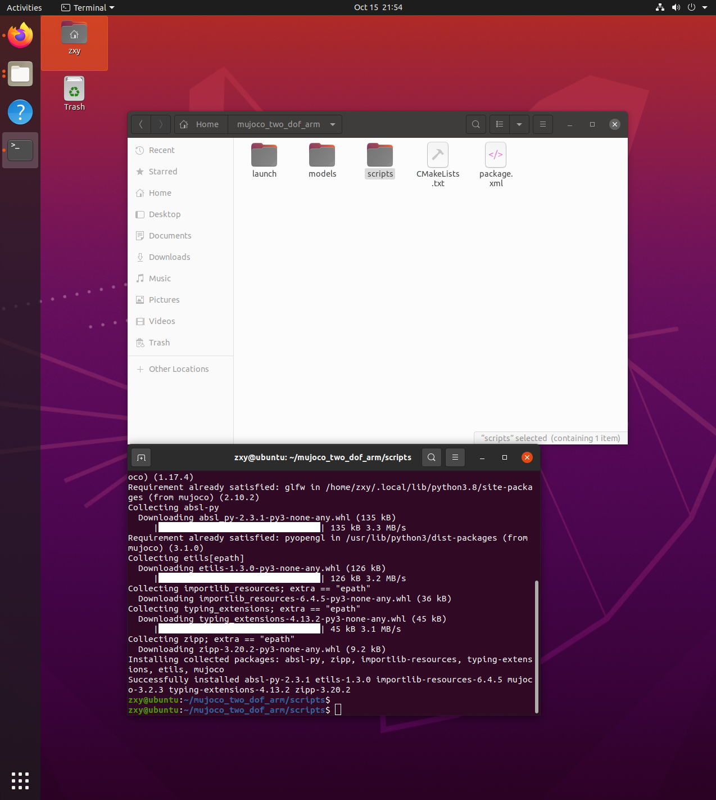
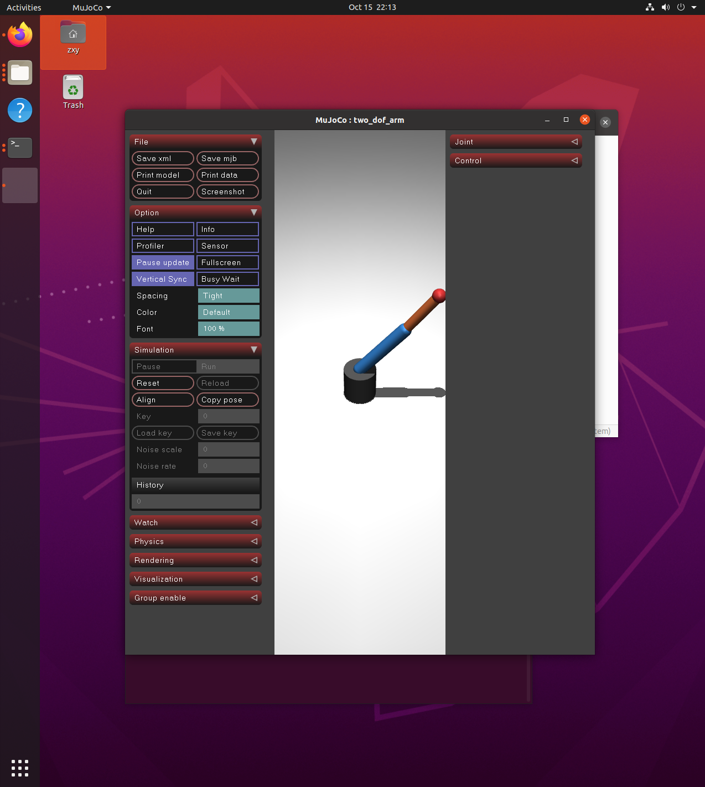

# MuJoCo两自由度机械臂简单仿真

## 一、实验目的与环境说明

### 1.1 实验目的
1. 在MuJoCo里搭一个最简单的两关节机械臂模型
2. 写个Python脚本让机械臂自己来回摆动，不用手动控制
3. 把模型跑起来看看效果，熟悉一下MuJoCo基本用法

### 1.2 实验环境
|项目|配置|
| ---- | ---- |
|操作系统|Ubuntu 20.04（VMware虚拟机）|
|ROS版本|ROS Noetic|
|MuJoCo版本|MuJoCo 2.1.1|
|编程语言|Python3|
|功能包|mujoco_two_dof_arm|

### 1.3 功能包目录结构
```
mujoco_two_dof_arm/
├── package.xml        # 包配置文件
├── CMakeLists.txt     # 编译配置
├── launch/
│   └── arm_control.launch   # 一键启动文件
├── models/
│   └── two_dof_arm.xml      # 机械臂的MuJoCo模型
├── scripts/
│   └── main.py       # 主程序，控制机械臂摆动
└── docs/
    └── index.md      # 本文档
```

## 二、两自由度机械臂介绍
这个就是最简单的平面机械臂，就两个旋转关节：一个肩膀一个手肘，连两根棍子，末端装个小球代表机械臂的尖。没有夹爪、没有传感器，就是个能来回摆的架子，结构特别简单，适合刚学MuJoCo的时候练手。

其实原理也很简单：两个关节都在一个平面里转，我也没搞什么复杂的逆运动学，就直接给每个关节发目标角度，让它们按正弦曲线来回转，机械臂自己就摆起来了。

## 三、实现步骤

### 3.1 先把MuJoCo装好
这个之前已经写过安装教程了，就不重复了，确保：
- MuJoCo解压在 `~/.mujoco/mujoco211`
- 环境变量配好了，执行 `pip3 install mujoco` 把Python包装上
- ROS Noetic已经装好

### 3.2 建ROS功能包
```bash
cd ~/src
catkin_create_pkg mujoco_two_dof_arm rospy std_msgs
cd ..
catkin_make
source devel/setup.bash
```

### 3.3 写机械臂模型文件
在 `models/` 文件夹里新建 `two_dof_arm.xml`，就是定义机械臂长什么样：底座、两根连杆、两个转轴关节，然后加两个电机当位置控制器。

我就是照着MuJoCo自带的例子改的：底座是灰色圆柱，第一根连杆蓝色长20cm，第二根橙色长15cm，末端一个红色小球。电机用位置控制模式，直接给角度就行，不用自己算力。

### 3.4 写控制脚本
在 `scripts/` 里建 `main.py`，核心逻辑特别简单：
```python
import mujoco
import mujoco.viewer
import numpy as np

model = mujoco.MjModel.from_xml_path("two_dof_arm.xml")
data = mujoco.MjData(model)

with mujoco.viewer.launch_passive(model, data) as viewer:
    while viewer.is_running():
        t = data.time
        # 两个关节按正弦函数转，就是来回摆
        data.ctrl[0] = 0.5 * np.sin(t * np.pi)
        data.ctrl[1] = 0.8 * np.sin(t * 1.3 * np.pi)
        mujoco.mj_step(model, data)
        viewer.sync()
```

就是用sin函数生成平滑的角度值，发给两个关节，机械臂就自然摆动了，不会突然一顿一顿的。

### 3.5 写launch启动文件
在 `launch/` 文件夹里写个简单的launch，方便一键启动：
```xml
<launch>
  <node name="arm_control" pkg="mujoco_two_dof_arm" type="main.py" output="screen"/>
</launch>
```

## 四、运行方法
### 4.1 直接跑脚本
```bash
cd ~/src/humanoid/mujoco_two_dof_arm/scripts
python3 main.py ../models/two_dof_arm.xml
```
正常的话会弹出MuJoCo的仿真窗口，就能看到蓝色橙色的机械臂自己在那晃。

### 4.2 用ROS launch启动
```bash
roscore
roslaunch mujoco_two_dof_arm arm_control.launch
```

## 五、遇到的报错和解决办法
1. **最开始跑的时候报找不到动态库**
   就是环境变量没生效，执行一下 `source ~/.bashrc` 就好了。

2. **报No module named 'mujoco'**
   Python没装mujoco库，直接 `pip3 install mujoco` 装一下就行，我最开始就忘装了。

   最开始报错的样子：
   

   安装成功之后的样子：
   

3. **报IndexError: index out of bounds**
   就是我代码里读传感器数据的索引写错了，数了一下传感器顺序改对就好了。

4. **虚拟机里弹不出仿真窗口**
   VMware没开3D加速，把虚拟机关了，在设置→显示器里勾上"加速3D图形"，重新开虚拟机就行。

（其他暂时没遇到啥问题，这个模型特别简单）

## 六、运行效果说明
跑起来之后就是灰色平面上立着个小机械臂：
- 蓝色的大臂左右晃，大概±30度
- 橙色的小臂跟着弯，大概±45度
- 末端红色小球在平面里画曲线

成功弹出仿真窗口的样子：


终端会一直打印当前两个关节的角度和末端位置，用ScreenToGif录个10秒的GIF就行，大小也够。

## 七、测试说明
1. 我是在Windows11主机上用VMware跑Ubuntu20.04测的
2. 验证过：模型能正常加载、窗口能弹出来、机械臂摆动正常、launch启动没问题
3. 文档已经加到导航栏和首页目录了，点链接能直接跳过来

## 八、大模型声明
写步骤整理和代码框架的时候用DeepSeek辅助了一下。
