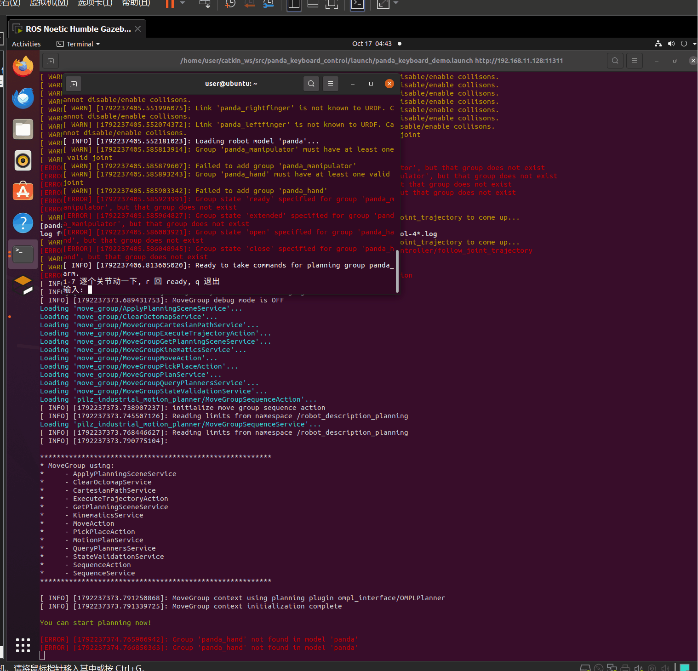

## 通过键盘操控仿真机械臂

### 一、 项目概述

本项目基于 ROS Noetic 与 MoveIt!，在 RViz 中实现 Panda 机械臂的运动规划与轨迹执行演示。未接入 Gazebo 等动力学模拟器，因此不涉及重力、摩擦、接触力等物理动力学验证。

### 二、 项目目录结构

```text
src/
└── panda_keyboard_control/
    ├── launch/
    │   └── panda_keyboard_demo.launch    # 一键启动配置文件
    └── scripts/
        ├── panda_keyboard_control.py     # 键盘控制核心 Python 脚本
        ├── main.py                       # 主程序启动入口脚本
        ├── CMakeLists.txt                # 编译与安装配置文件
        ├── package.xml                   # 包依赖声明文件
        └── mujoco_sim/                       # 【新增】MuJoCo 物理仿真模块
             ├── mujoco_menagerie/             # 官方高精度模型库
             └── keyboard_mujoco.py            # 接入 MuJoCo 的键盘控制核心脚本
```

### 三、 核心配置文件内容

#### 1. CMakeLists.txt

声明功能包所需的依赖组件，并安装 Python 脚本。

```cmake
cmake_minimum_required(VERSION 3.0.2)
project(panda_keyboard_control)

find_package(catkin REQUIRED COMPONENTS
  rospy
  std_msgs
  moveit_commander
  moveit_ros_planning_interface
)

catkin_package()

install(DIRECTORY launch
  DESTINATION ${CATKIN_PACKAGE_SHARE_DESTINATION}
)

catkin_install_python(PROGRAMS
  scripts/panda_keyboard_control.py
  DESTINATION ${CATKIN_PACKAGE_BIN_DESTINATION}
)
```
### 2. MuJoCo 键盘控制脚本
该脚本通过 Python 多线程监听键盘，并结合 MuJoCo 的物理步进计算（mj_step），实现了带有重力效果的关节控制
```python
import mujoco
import mujoco.viewer
import time
import os
import sys
import tty
import termios
import threading

# 加载 MuJoCo 官方的 Franka Panda 高精度模型
xml_path = os.path.join(os.path.dirname(__file__), 'mujoco_menagerie/franka_emika_panda/scene.xml')
model = mujoco.MjModel.from_xml_path(xml_path)
data = mujoco.MjData(model)

target_q = data.qpos[:7].copy()
pressed_key = None

def get_key():
    global pressed_key
    fd = sys.stdin.fileno()
    old_settings = termios.tcgetattr(fd)
    try:
        tty.setraw(fd)
        while True:
            ch = sys.stdin.read(1)
            pressed_key = ch
    finally:
        termios.tcsetattr(fd, termios.TCSADRAIN, old_settings)

threading.Thread(target=get_key, daemon=True).start()

with mujoco.viewer.launch_passive(model, data) as viewer:
    while viewer.is_running():
        if pressed_key:
            if pressed_key == 'q':
                break
            elif pressed_key == 'r':
                target_q = model.key_qpos[0].copy() if model.nkey > 0 else [0, 0, 0, -1.57, 0, 1.57, 0.78]
            elif pressed_key in [str(i) for i in range(1, 8)]:
                idx = int(pressed_key) - 1
                target_q[idx] += 0.1
            pressed_key = None

        data.ctrl[:7] = target_q
        mujoco.mj_step(model, data)
        viewer.sync()
        time.sleep(0.005)
```
#### 3. package.xml

定义功能包在构建和运行时的依赖关系。

```xml
<?xml version="1.0"?>
<package format="2">
  <name>panda_keyboard_control</name>
  <version>0.1.0</version>
  <description>任务②：Panda 机械臂 MoveIt 仿真与键盘运动控制</description>
  <maintainer email="user@example.com">user</maintainer>
  <license>MIT</license>

  <buildtool_depend>catkin</buildtool_depend>

  <build_depend>rospy</build_depend>
  <build_depend>std_msgs</build_depend>
  <build_depend>moveit_commander</build_depend>
  <build_depend>moveit_ros_planning_interface</build_depend>

  <exec_depend>rospy</exec_depend>
  <exec_depend>std_msgs</exec_depend>
  <exec_depend>moveit_commander</exec_depend>
  <exec_depend>moveit_ros_planning_interface</exec_depend>
  <exec_depend>panda_moveit_config</exec_depend>

  <export></export>
</package>
```

#### 4. setup.py

用于确保 Python 脚本能被正确安装到 catkin 工作空间中。

```python
from distutils.core import setup
from catkin_pkg.python_setup import generate_distutils_setup

d = generate_distutils_setup(
    packages=['panda_keyboard_control'],
    package_dir={'': 'src'}
)

setup(**d)
```

#### 5. panda_keyboard_control.py

实现键盘输入读取，并通过 MoveIt Commander 控制机械臂关节运动。

```python
#!/usr/bin/env python3
# -*- coding: utf-8 -*-
import sys
import tty
import termios
import rospy
import moveit_commander


class PandaKeyboardControl(object):
    def __init__(self):
        moveit_commander.roscpp_initialize(sys.argv)
        rospy.init_node('panda_keyboard_control', anonymous=True)

        self.group = moveit_commander.MoveGroupCommander("panda_arm")
        self.group.set_max_velocity_scaling_factor(0.3)
        self.group.set_max_acceleration_scaling_factor(0.3)

        self.joint_step = 0.1  # 每次关节转动弧度
        rospy.loginfo("已连接到 move_group，规划组: %s", self.group.get_name())
        rospy.loginfo("当前关节角度: %s", self.group.get_current_joint_values())

    def _get_key(self):
        """非阻塞读取单个按键，返回字符。"""
        fd = sys.stdin.fileno()
        old = termios.tcgetattr(fd)
        try:
            tty.setraw(fd)
            key = sys.stdin.read(1)
        finally:
            termios.tcsetattr(fd, termios.TCSADRAIN, old)
        return key

    def _move_joint(self, joint_index, delta):
        joint_values = self.group.get_current_joint_values()
        joint_values[joint_index] += delta
        self.group.set_joint_value_target(joint_values)
        plan = self.group.go(wait=True)
        self.group.stop()
        self.group.clear_pose_targets()
        if plan:
            rospy.loginfo("关节 %d 移动成功", joint_index + 1)
        else:
            rospy.logwarn("关节 %d 规划失败，请检查限位", joint_index + 1)

    def _reset(self):
        """复位到初始姿态。"""
        rospy.loginfo("正在复位到初始姿态...")
        self.group.set_named_target("ready")
        self.group.go(wait=True)
        self.group.stop()
        self.group.clear_pose_targets()

    def run(self):
        rospy.loginfo("Panda 机械臂键盘控制：")
        rospy.loginfo("  1-7: 控制对应关节转动")
        rospy.loginfo("  r:   复位到初始姿态")
        rospy.loginfo("  q:   退出程序")

        try:
            while not rospy.is_shutdown():
                key = self._get_key()
                if key == 'q':
                    break
                elif key == 'r':
                    self._reset()
                elif key in [str(i) for i in range(1, 8)]:
                    idx = int(key) - 1
                    self._move_joint(idx, self.joint_step)
        except Exception as e:
            rospy.logerr("运行异常: %s", str(e))
        finally:
            self.group.stop()
            self.group.clear_pose_targets()
            moveit_commander.roscpp_shutdown()
            rospy.loginfo("程序已安全退出")


if __name__ == '__main__':
    try:
        PandaKeyboardControl().run()
    except rospy.ROSInterruptException:
        pass
```

### 四、 编译与启动步骤

### 快速开始

请在终端中依次运行以下命令：

1. 配置 Python 环境：确保安装 MuJoCo
```
pip3 install mujoco
```

2. 下载机器人模型：
```
cd ~/catkin_ws/src/panda_keyboard_control/mujoco_sim
git clone https://github.com/google-deepmind/mujoco_menagerie.git
```

3.运行 MuJoCo 物理仿真控制：
```
python3 keyboard_mujoco.py
```

4.运行成功界面


9. 操作说明
程序运行后，系统会自动弹出键盘控制窗口，请在该窗口中按以下按键控制：

| 按键 | 功能 | 按键 | 功能 |
| ------ |------ |------ |------ |
| 1 | 关节1转动 | 5 | 关节5转动 |
| 2 | 关节2转动 | 6 | 关节6转动 |
| 3 | 关节3转动 | 7 | 关节7转动 |
| 4 | 关节4转动 | r | 复位姿态 |
| q | 退出程序 |  |  |


### 五、 运行效果


