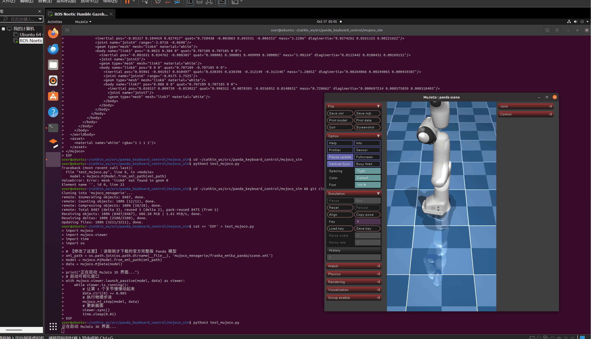

# 键盘操控仿真机械臂

### 一、 项目概述

本项目基于 ROS Noetic 与 MoveIt!，在 RViz 中实现 Panda 机械臂的运动规划演示。为了满足物理动力学验证的要求，本项目进一步接入了 MuJoCo 物理引擎。通过编写独立的 Python 接口，将键盘输入的指令转化为 MuJoCo 中的关节控制信号，实现了在逼真的物理环境（包含重力、摩擦力）下的机械臂实时控制。本项目不依赖笨重的 Gazebo，轻量且运行流畅。

### 二、 项目目录结构

```text
src/
└── panda_keyboard_control/
    ├── CMakeLists.txt                  # 编译与安装配置文件
    ├── package.xml                     # 包依赖声明文件
    ├── launch/
    │   └── main.launch                 # 一键启动配置文件
    ├── scripts/
    │   ├── panda_keyboard_control.py   # 键盘控制核心 Python 脚本（ROS MoveIt 版）
    │   └── main.py                     # 主程序启动入口脚本
    └── mujoco_sim/                     # MuJoCo 物理仿真模块
        ├── README.md                   # MuJoCo 环境依赖说明
        ├── keyboard_mujoco.py          # 接入 MuJoCo 的键盘控制核心脚本
        └── mujoco_menagerie/           # 官方高精度模型库（需自行克隆，不入库）
```

### 三、 核心配置文件说明

#### MuJoCo 键盘控制脚本

[keyboard_mujoco.py](https://github.com/OpenHUTB/ros2/blob/master/src/panda_keyboard_control/mujoco_sim/keyboard_mujoco.py) 通过 Python 多线程监听键盘输入，并结合 MuJoCo 的物理步进计算（`mj_step`），将目标关节角写入 `data.ctrl` 位置伺服通道，实现了带有重力、摩擦力效果的关节实时控制。按键 `1-7` 控制对应关节正向转动，`Shift+1-7` 反向转动，`r` 复位到模型初始关键帧，`q` 退出程序。

#### ROS MoveIt 键盘控制脚本

[panda_keyboard_control.py](https://github.com/OpenHUTB/ros2/blob/master/src/panda_keyboard_control/scripts/panda_keyboard_control.py) 基于 `rospy` 与 `moveit_commander`，通过 `MoveGroupCommander` 对 `panda_arm` 规划组下发关节目标值，由 MoveIt 完成运动规划后在 RViz 中执行。

#### 一键启动配置

[main.launch](https://github.com/OpenHUTB/ros2/blob/master/src/panda_keyboard_control/launch/main.launch) 加载 `franka_description` 的 Panda 机器人描述（xacro），启动 `panda_moveit_config` 的 move_group、RViz 以及键盘控制节点；[main.py](https://github.com/OpenHUTB/ros2/blob/master/src/panda_keyboard_control/scripts/main.py) 为该 launch 文件的启动入口。

### 四、 编译与启动步骤

#### 快速开始

请在终端中依次运行以下命令：

1. 配置 Python 环境：确保安装 MuJoCo
```bash
pip3 install mujoco
```

2. 下载机器人模型：
```bash
cd ~/catkin_ws/src/panda_keyboard_control/mujoco_sim
git clone https://github.com/google-deepmind/mujoco_menagerie.git
```

3. 运行 MuJoCo 物理仿真控制：
```bash
python3 keyboard_mujoco.py
```

4. 运行成功界面


5. 操作说明
程序运行后，系统会自动弹出键盘控制窗口，请在该窗口中按以下按键控制：

| 按键 | 功能 | 按键 | 功能 |
| ------ |------ |------ |------ |
| 1 | 关节1正向转动 | Shift+1 | 关节1反向转动 |
| 2 | 关节2正向转动 | Shift+2 | 关节2反向转动 |
| 3 | 关节3正向转动 | Shift+3 | 关节3反向转动 |
| 4 | 关节4正向转动 | Shift+4 | 关节4反向转动 |
| 5 | 关节5正向转动 | Shift+5 | 关节5反向转动 |
| 6 | 关节6正向转动 | Shift+6 | 关节6反向转动 |
| 7 | 关节7正向转动 | Shift+7 | 关节7反向转动 |
| r | 复位姿态 | q | 退出程序 |

6. （可选）运行 ROS MoveIt 版本：在工作空间编译后，通过主入口一键启动
```bash
cd ~/catkin_ws && catkin_make
rosrun panda_keyboard_control main.py
```

### 五、 运行效果


### 六、 未验证项

- MuJoCo 独立演示 ≠ ROS MoveIt 闭环：`keyboard_mujoco.py` 为直接读写 MuJoCo 物理引擎的独立脚本，未接入 ROS 话题/服务，与 `scripts/panda_keyboard_control.py` 的 MoveIt 规划回路相互独立，两者尚未联调为统一的闭环控制。
- MuJoCo 侧关节目标角为开环递增，未做关节限位检查与碰撞检测，极端输入下的行为未验证。
