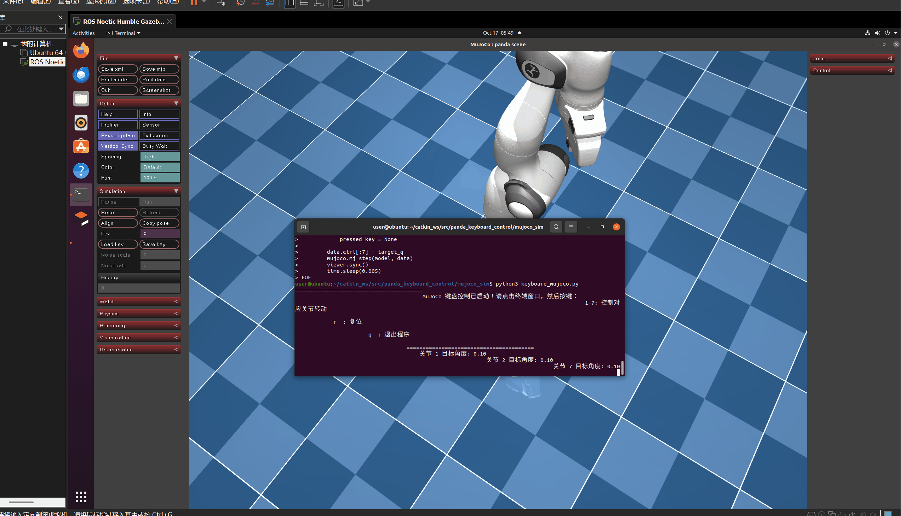

## 通过键盘操控仿真机械臂

### 一、 项目概述

本项目基于 ROS Noetic 与 MoveIt!，在 RViz 中实现 Panda 机械臂的运动规划演示。为了满足物理动力学验证的要求，本项目进一步接入了 MuJoCo 物理引擎。通过编写独立的 Python 接口，将键盘输入的指令转化为 MuJoCo 中的关节控制信号，实现了在逼真的物理环境（包含重力、摩擦力）下的机械臂实时控制。本项目不依赖笨重的 Gazebo，轻量且运行流畅。

### 二、 项目目录结构

```text
src/
└── panda_keyboard_control/
    ├── launch/
    │   └── panda_keyboard_demo.launch    # 一键启动配置文件
    └── scripts/
        ├── panda_keyboard_control.py     # 键盘控制核心 Python 脚本
        ├── main.py                       # 主程序启动入口脚本
        ├── CMakeLists.txt                # 编译与安装配置文件
        └──package.xml                   # 包依赖声明文件
    └── mujoco_sim/                       # 【新增】MuJoCo 物理仿真模块
             ├── mujoco_menagerie/             # 官方高精度模型库
             └── keyboard_mujoco.py            # 接入 MuJoCo 的键盘控制核心脚本
```

### 三、 核心配置文件内容

### MuJoCo 键盘控制脚本
该脚本通过 Python 多线程监听键盘，并结合 MuJoCo 的物理步进计算（mj_step），实现了带有重力效果的关节控制
```python
import mujoco
import mujoco.viewer
import time
import os
import sys
import tty
import termios
import threading

# 加载 MuJoCo 官方的 Franka Panda 高精度模型
xml_path = os.path.join(os.path.dirname(__file__), 'mujoco_menagerie/franka_emika_panda/scene.xml')
model = mujoco.MjModel.from_xml_path(xml_path)
data = mujoco.MjData(model)

target_q = data.qpos[:7].copy()
pressed_key = None

def get_key():
    global pressed_key
    fd = sys.stdin.fileno()
    old_settings = termios.tcgetattr(fd)
    try:
        tty.setraw(fd)
        while True:
            ch = sys.stdin.read(1)
            pressed_key = ch
    finally:
        termios.tcsetattr(fd, termios.TCSADRAIN, old_settings)

threading.Thread(target=get_key, daemon=True).start()

with mujoco.viewer.launch_passive(model, data) as viewer:
    while viewer.is_running():
        if pressed_key:
            if pressed_key == 'q':
                break
            elif pressed_key == 'r':
                target_q = model.key_qpos[0].copy() if model.nkey > 0 else [0, 0, 0, -1.57, 0, 1.57, 0.78]
            elif pressed_key in [str(i) for i in range(1, 8)]:
                idx = int(pressed_key) - 1
                target_q[idx] += 0.1
            pressed_key = None

        data.ctrl[:7] = target_q
        mujoco.mj_step(model, data)
        viewer.sync()
        time.sleep(0.005)
```


### 四、 编译与启动步骤

### 快速开始

请在终端中依次运行以下命令：

1. 配置 Python 环境：确保安装 MuJoCo
```
pip3 install mujoco
```

2. 下载机器人模型：
```
cd ~/catkin_ws/src/panda_keyboard_control/mujoco_sim
git clone https://github.com/google-deepmind/mujoco_menagerie.git
```

3.运行 MuJoCo 物理仿真控制：
```
python3 keyboard_mujoco.py
```

4.运行成功界面


5. 操作说明
程序运行后，系统会自动弹出键盘控制窗口，请在该窗口中按以下按键控制：

| 按键 | 功能 | 按键 | 功能 |
| ------ |------ |------ |------ |
| 1 | 关节1转动 | 5 | 关节5转动 |
| 2 | 关节2转动 | 6 | 关节6转动 |
| 3 | 关节3转动 | 7 | 关节7转动 |
| 4 | 关节4转动 | r | 复位姿态 |
| q | 退出程序 |  |  |


### 五、 运行效果



