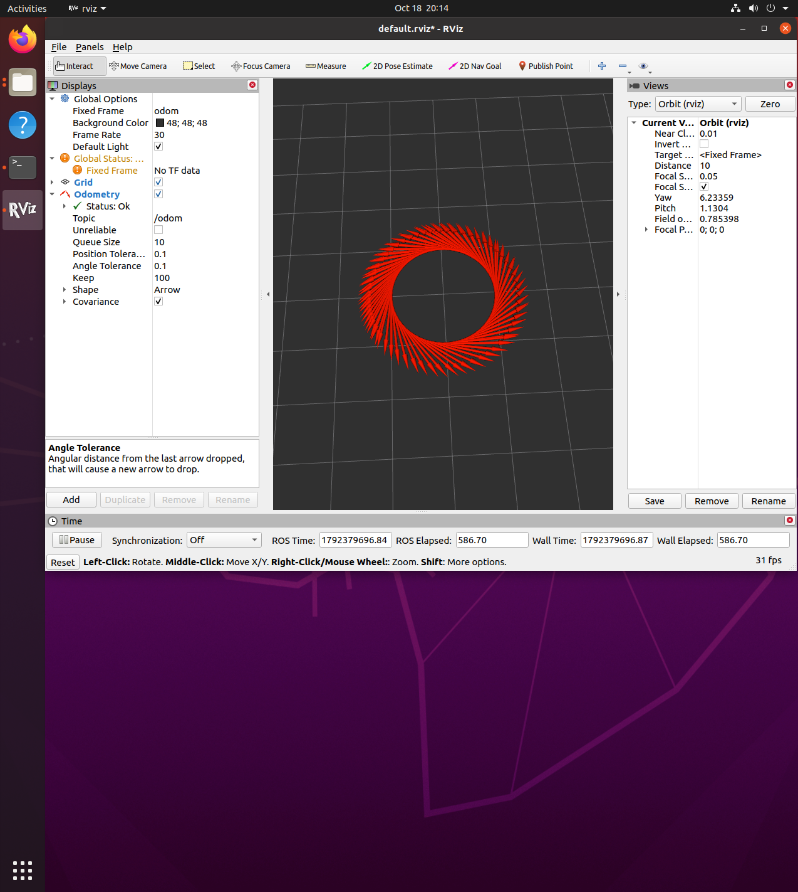

# ROS虚拟机器人圆形轨迹rviz可视化入门

这个是我学ROS里程计话题的时候写的第一个可视化小例子，超级简单，根本不用装MuJoCo、Gazebo那些大软件，只要你电脑上有基础的ROS Noetic环境，一行命令启动，rviz窗口里就能看到一个小红点自己绕着圈转，特别适合刚接触ROS的同学练手，比一上来就开仿真器轻松多了。

## 这个项目是干嘛的
就是写个最简单的ROS节点，持续发里程计（Odometry）话题，轨迹就是半径1米的正圆，启动之后在rviz里加个Odometry显示，就能看到小红点从原点开始，一圈一圈匀速绕圈。
我当时学完ROS话题通信之后，总想找点看得见摸得着的东西做，这个小例子一下就把"发布消息、rviz可视化"两个知识点串起来了，比在终端里打印字符串有意思多了。

## 怎么跑
1. 把整个
os_topic_demo文件夹复制到你的catkin工作区的src目录下：
``bash
cd ~/src/humanoid/ros_topic_demo
``
2. 给脚本加可执行权限，然后编译工作区：
``bash
cd ~/catkin_ws
catkin_make
source devel/setup.bash
``
3. 一键启动：
``bash
roslaunch ros_topic_demo rviz_demo.launch
``
启动之后rviz窗口会自动弹出来，你只需要在rviz左边把Fixed Frame选成odom，点Add加个Odometry显示，就能看到小红点转圈圈了。

## 我踩过的坑
1. 最开始Fixed Frame一直选成map，结果半天看不到点，后来才知道我们的节点发的是odom坐标系，改了立刻就看到了
2. rospy.Rate我一开始参数写反了，一秒钟发了100次消息，rviz里画出来密密麻麻一堆箭头，给我整懵了
3. 最开始忘了加odom.header的frame_id，rviz直接报No TF data，查了20分钟才发现少了这行

## 运行效果
启动之后不用显卡，虚拟机里跑也丝滑，就是终端打印启动日志，rviz窗口里一个小红点匀速绕圈，整个过程1分钟就能跑通，特别有成就感。

