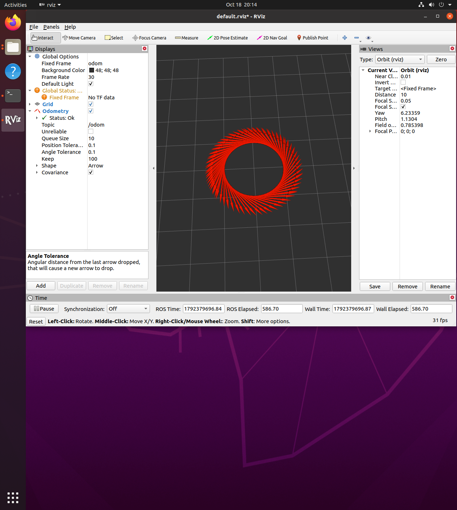

# ROS虚拟机器人圆形轨迹rviz可视化入门

这个是我学ROS里程计话题的时候写的第一个可视化小例子，超级简单，根本不用装MuJoCo、Gazebo那些大软件，只要你电脑上有基础的ROS Noetic环境，一行命令启动，rviz窗口里就能看到一个小红点自己绕着圈转，特别适合刚接触ROS的同学练手，比一上来就开仿真器轻松多了。

## 这个项目是干嘛的
就是写个最简单的ROS节点，持续发里程计（Odometry）话题，轨迹就是半径1米的正圆，启动之后rviz会自动加载预配置好的视图，直接就能看到小红点从 `(radius, 0)` 开始，一圈一圈匀速绕圈（默认约 31.4 秒一圈，与旧版 `t += 0.02` + `Rate(10)` 的速度一致）。
我当时学完ROS话题通信之后，总想找点看得见摸得着的东西做，这个小例子一下就把"发布消息、rviz可视化"两个知识点串起来了，比在终端里打印字符串有意思多了。

## 怎么跑

1. 把 `ros_topic_demo` 文件夹放进 catkin 工作区的 `src` 下（还没有工作区就先建一个）：

```bash
mkdir -p ~/catkin_ws/src
cp -r ros_topic_demo ~/catkin_ws/src/
```

2. 编译工作区（在 `catkin_ws` 目录下执行，不要在家目录执行）：

```bash
cd ~/catkin_ws
catkin_make
source devel/setup.bash
```

3. 一键启动：

```bash
roslaunch ros_topic_demo rviz_demo.launch
```

启动之后 rviz 窗口自动弹出，Fixed Frame 已配好为 `odom`，Odometry 显示也已加载，不需要手动 Add。节点同时广播 `odom -> base_link` 的 TF，因此左下角不会出现 `No TF data`。

## 参数

| 参数 | 默认值 | 说明 |
|---|---|---|
| `radius` | 1.0 m | 圆半径 |
| `period` | 31.4 s | 一圈秒数（默认值与旧版速度一致） |
| `rate` | 10.0 Hz | 发布频率 |
| `frame_id` | `odom` | 固定坐标系 |
| `child_frame_id` | `base_link` | 机器人坐标系 |

命令行可以直接覆盖，例如 5 秒一圈、半径 1.5 m：

```bash
roslaunch ros_topic_demo rviz_demo.launch period:=5.0 radius:=1.5
```

节点内部按 `phase = 2*pi*t/period` 计算位姿；phase=0 时在 `(radius, 0)`，位姿（`pose.pose.orientation` 的 yaw）沿逆时针切线，所以 RViz 的 Odometry 箭头方向也是切向（RViz 用 pose 的 yaw，不用 twist）。`twist.linear.x = radius*omega`、`twist.angular.z = omega` 另外给出机体线速度/角速度。

## 无 ROS 自检

没有 ROS 时也可以先验证轨迹数学（纯 Python，Windows/Linux 都能跑）：

```bash
cd src/humanoid/ros_topic_demo
PYTHONPATH=src python3 -m ros_topic_demo.circle_path --period 10 --rate 10 --radius 1
```

输出采样数、首末点；加 `--csv circle.csv` 可以保存全部采样点：

```
samples=100 radius=1.000 period=10.000s rate=10.000Hz
first: t=0.000 x=1.000 y=0.000 yaw=90.0 deg
last:  t=9.900 x=0.998 y=-0.063 yaw=86.4 deg
```

## 测试

```bash
python3 -m unittest discover -s src/humanoid/ros_topic_demo/tests -v
```

10 个用例，覆盖角度归一化、起点、四分之一圆、半径不变、切向朝向、采样数、完整一圈和 CSV 输出。

## 我踩过的坑
1. 最开始Fixed Frame一直选成map，结果半天看不到点，后来才知道我们的节点发的是odom坐标系，改了立刻就看到了
2. rospy.Rate我一开始参数写反了，一秒钟发了100次消息，rviz里画出来密密麻麻一堆箭头，给我整懵了
3. 最开始只发/odom话题不广播TF，rviz里一直报No TF data，后来在节点里用tf2_ros的TransformBroadcaster广播了odom->base_link的坐标变换才正常

## 运行效果
启动之后不用显卡，虚拟机里跑也丝滑：终端打印启动日志，rviz 窗口里 Odometry 箭头沿半径 1 m 的正圆匀速绕圈，`Global Status` 为 `Ok`，整个过程 1 分钟就能跑通。

下图是 Ubuntu 20.04 + ROS Noetic 下实际运行 `roslaunch ros_topic_demo rviz_demo.launch` 后的 rviz 窗口：Fixed Frame `odom`、Odometry 订阅 `/odom` 且状态 `Ok`，没有 `No TF data`。


