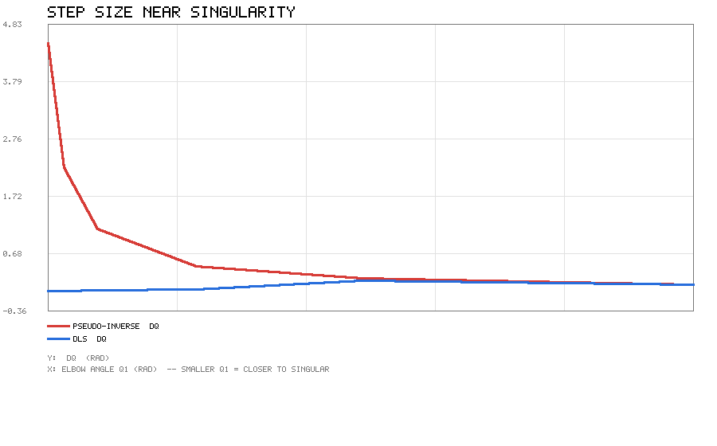
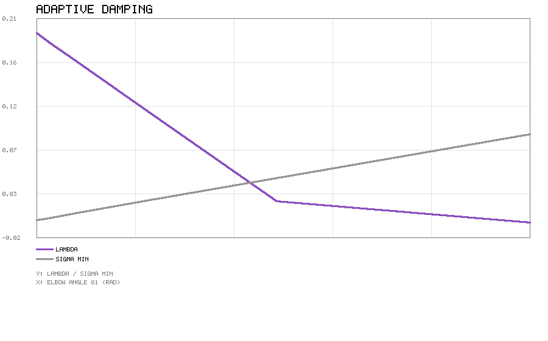
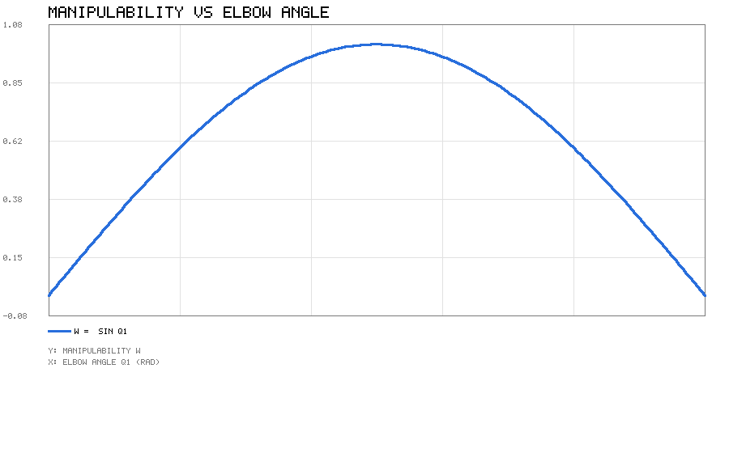
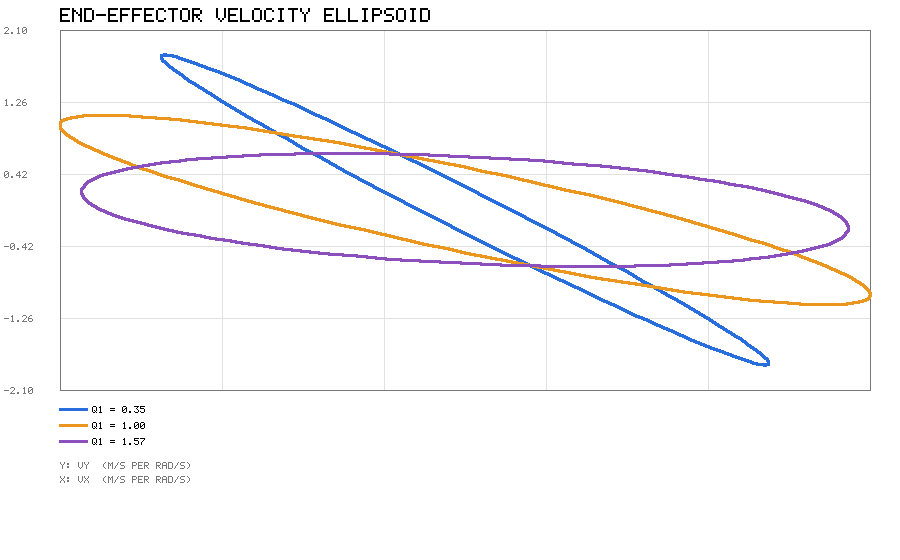
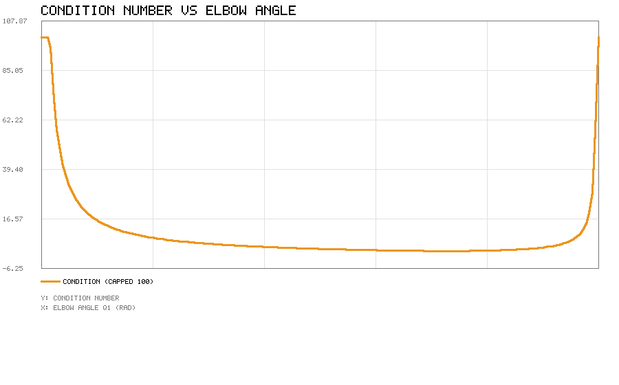
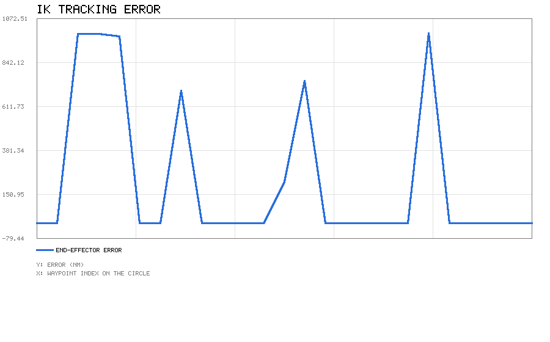
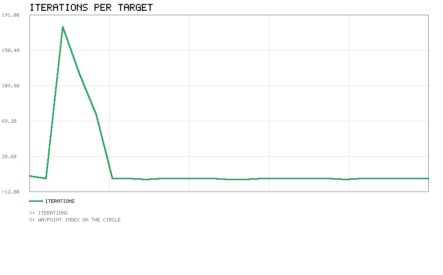
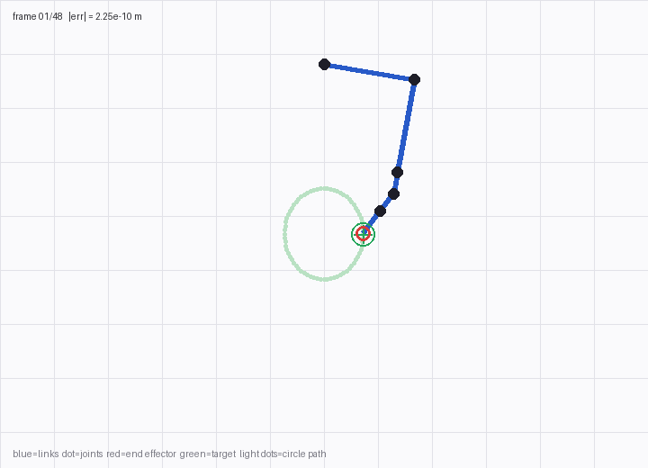

# 人形机器人全身逆运动学与可操作性分析

给定末端位姿反解关节角，用可操作性指标量化位形的好坏，并在奇异位形附近
保持数值稳定。

代码在 `src/humanoid/whole_body_ik/`，**核心逻辑只用 Python 标准库**。

## 为什么做这个

人形机器人板块已有的模块覆盖了这几层：

| 模块 | 层次 |
|---|---|
| 键盘运动控制 / 键盘操控仿真机械臂 | 直接给关节角或末端增量 |
| 平衡控制与外力抗扰恢复 | 动力学（ZMP / 捕获点） |
| PPO 神经网络平衡控制 | 强化学习 |
| 2D 激光雷达 CNN 感知与避障 | 感知 |

**中间缺了「给末端位姿、反解关节角」这一层**——也就是逆运动学。仓库里只有
MoveIt 的 `kinematics.yaml` 配置，没有自己实现的求解器。

这个模块补的就是这一层，而且和上面的模块没有功能重叠：它不控制机器人、
不做感知、也不算动力学，只回答"要到这里，关节该怎么转"。

## 一、正运动学

关节约定为"先平移、再绕轴转动"：

```
T_i = Translate(origin_i) · Rot(axis_i, q_i)
T_ee = T_0 · T_1 · … · T_{n−1} · Translate(tool)
```

比 DH 参数直观，也好手工验算。2R 平面臂展开后应该精确等于

```
x = l1·cos(q0) + l2·cos(q0+q1)
y = l1·sin(q0) + l2·sin(q0+q1)
```

实测四个位形的最大偏差是 **5.55e-17**（双精度舍入量级）。

## 二、雅可比

用几何法而不是解析求导。对转动关节 i：

```
z_i  = R_{0..i−1} · axis_i         （关节轴在世界系下的方向）
p_i  = 关节位置（世界系）
Jv_i = z_i × (p_ee − p_i)
Jw_i = z_i
```

拼成 6×n 的矩阵，前 3 行线速度、后 3 行角速度。

用中心差分 `(p(q+h) − p(q−h)) / 2h`（h = 1e-7）对照，最大偏差 **1.00e-09**。

## 三、三种逆解

### 最小范数解（伪逆）

```
Δq = Jᵀ (J Jᵀ)⁻¹ e
```

在冗余机构上给出范数最小的解。

### 阻尼最小二乘（DLS）

```
Δq = Jᵀ (J Jᵀ + λ² I)⁻¹ e
```

λ 相当于给奇异方向"加一点弹簧"。λ = 0 时退化为伪逆。

### 零空间投影

```
Δq = J⁺ e + (I − J⁺J) z
```

第二项不改变末端位姿，只用来做次级任务（比如远离关节限位）。

## 四、这几种解法在奇异点处的差别

这是整个模块最有意思的部分。让 2R 臂的肘角从 0.2 逐渐趋近 0（完全伸直
就是奇异位形），给一个沿径向的 0.01 m 末端误差，看两种解法的关节步长：

| q1 | σ_min | 伪逆 \|Δq\| | DLS \|Δq\| | 自适应 λ |
|---|---|---|---|---|
| 0.200 | 8.93e-02 | 0.111 | 0.111 | 0.0001 |
| 0.100 | 4.47e-02 | 0.223 | 0.182 | 0.0213 |
| 0.050 | 2.24e-02 | 0.447 | **0.0175** | 0.1106 |
| 0.020 | 8.94e-03 | 1.118 | **0.0033** | 0.1642 |
| 0.010 | 4.47e-03 | 2.236 | **0.0013** | 0.1821 |
| 0.005 | 2.24e-03 | **4.472** | **0.0006** | 0.1911 |

**伪逆的步长按 1/σ_min 线性增长**，σ_min 减半它就翻倍。真实机器人上这就是
关节速度飙到失控、电机报警的原因。DLS 用阻尼把它压住，代价是奇异方向上
收敛变慢。



自适应阻尼的策略是：σ_min 高于阈值（默认 0.05）时不阻尼，尽量保精度；
低于阈值后 λ 随 σ_min 线性升到 0.2。



顶点处还有一个细节：如果误差方向**完全落在不可达子空间**里（比如完全伸直
时想沿手臂方向再往外伸），DLS 会给出 `Δq = 0`。这不是 bug——物理上就是
动不了，任何关节转动都改变不了那个方向的末端位置。

## 五、可操作性

Yoshikawa 指标：

```
w = sqrt(det(J Jᵀ))
```

几何意义是末端速度椭球的体积。2R 平面臂有闭式解 `w = |l1·l2·sin(q1)|`，
和数值实现的一致性到 **2.78e-16**。



在 q1 = π/2（肘部 90°）时最大，q1 = 0 或 π（完全伸直）时为 0。

### 末端速度椭球

J 的奇异值就是末端速度椭球的半轴。把关节速度单位圆 `|u| = 1` 经 `v = J·u`
映射过去，就得到椭球在速度空间的形状：



三个位形下的半轴与可操作性：

| 肘角 q1 | 长半轴 | 短半轴 | w |
|---|---|---|---|
| 0.35 | 2.2033 | 0.1556 | 0.3429 |
| 1.00 | 1.9746 | 0.4261 | 0.8415 |
| 1.57 | 1.6180 | 0.6180 | 1.0000 |

图里三条椭圆**倾角不同**是正常的：主方向由雅可比的奇异向量决定，随位形
变化。q1 越接近 π/2，长短轴之比越小、越接近圆，也就是各个方向都能动。

> **一个容易踩的坑**：平面 2R 臂的 3 维位置雅可比**恒奇异**——它本来就在
> 平面里运动，z 方向永远是 0，直接算 `det(J Jᵀ)` 会把所有位形都判成奇异。
> 必须只取机构真正能驱动的任务维度（这里取 x、y 两行），才退化成经典的
> `|l1 l2 sin q1|`。代码里用 `rows=(0, 1)` 参数处理这件事。



## 六、冗余自由度

7 自由度人形手臂（肩 3 + 肘 1 + 腕 3），自由度 7 > 任务维度 6，有 1 维零空间。

零空间投影的验证：任取一个方向 z，投影后 `|J · (I − J⁺J)z| = 1.50e-16`，
说明末端确实没有被移动，而关节角被调整了。

配套的还有关节限位代价函数（双曲形式，越靠近限位代价越大），梯度可以直接
投到零空间里做次级任务。

## 七、运行结果

### 末端画圆跟踪

7 自由度手臂的末端沿半径 0.12 m 的**竖直圆**（x-z 平面）走一圈，共 25 个
目标点，每个点以上一个点的解作为初值：

| 指标 | 数值 |
|---|---|
| 最大末端误差 | **9.93e-07 m** |
| 平均迭代次数 | **17.6** |
| 最大迭代次数 | 177 |

竖直圆比水平圆难：走到最低点时手臂几乎伸直、肘角接近限位下限，接近奇异
位形，所以那一段迭代次数明显偏高（最多 177 次）。水平圆（x-y 平面）因为
不经过这个位形，平均只要 3 次迭代。





### 动图



蓝线是连杆、黑点是关节、红圈是末端、绿十字是当前目标，浅绿色一圈是整条
目标轨迹、浅红色是末端走过的路径。末端始终压在目标轨迹上。

## 八、调试中踩的坑

### 坑一：默认初值给了全零，正好落在奇异位形

一开始 `solve_position_ik` 的缺省初值是全零。对 7 自由度手臂来说，全零
意味着**完全伸直**，而肘关节限位是 (0, 2.6)——弯肘反而让 x 方向误差变大，
一阶迭代推不动。

实测从全零出发去解 (0.12, 0, −0.45)，误差卡在 0.30 m 出不来；加微扰脱困
也只到 0.18 m。改成**取关节限位中点**做默认初值后，肘部自然弯到 1.3 rad，
同一个目标 6 次迭代就到 2.25e-10。

现在还额外加了"连续 15 次没改进就微扰一次"的脱困机制作为兜底。

### 坑二：平面机构的 3 维雅可比恒奇异

见第五节。这个坑会让人误以为"所有位形都奇异"。

### 坑三：2R 臂做不了 6 维位姿逆解

最初想用 2R 臂测 `solve_pose_ik`，结果误差 0.069 一直下不去。原因是 2R 只能
实现 3 维任务（平面内 2 个位置 + 绕 z 的 1 个姿态），6 维误差里有一半根本
不可达——不是算法的问题，是任务提得超出了机构能力。

改成用 7 自由度手臂测，38 次迭代收敛到 1.28e-11。

## 九、运行方法

```bash
cd src/humanoid/whole_body_ik
python3 main.py            # 完整演示
python3 main.py --quick    # 跳过画圆
python3 main.py --gif      # 生成动图（需 pillow）
./main.sh                  # 等价的 shell 入口
```

测试：

```bash
cd src/humanoid/whole_body_ik
python3 -m unittest discover -s test
```

launch 启动：

```bash
roslaunch whole_body_ik main.launch
roslaunch whole_body_ik quick.launch
```

## 十、测试覆盖（93 个）

| 组 | 数量 | 覆盖内容 |
|---|---|---|
| 线性代数 | 14 | 矩阵乘、转置、叉积、归一化 |
| 旋转 | 7 | 三个基本旋转、正交性、行列式为 1、转轴不变性 |
| 解方程与行列式 | 9 | 已知解、奇异抛异常、维度校验、三角矩阵 |
| 特征分解 | 5 | 已知矩阵、降序、正交归一、残差、对角阵 |
| 位姿工具 | 1 | 4x4 复合与刚体求逆 |
| 关节 | 6 | 轴归一化、零轴报错、限位夹取、限位校验 |
| 关节链 | 9 | 自由度、臂展、空链报错、维数校验、正解对照、雅可比对照 |
| 解析解 | 4 | 2R 逆解回代、超工作空间报错、肘上/肘下 |
| 可操作性 | 11 | 闭式解对照、极值位置、奇异判定、条件数、椭球 |
| 限位代价 | 3 | 中点为 0、靠近限位上升、无限位无代价 |
| 逆解器 | 14 | 收敛性、默认初值、不可达失败、收敛史、限位、参数校验、画圆 |
| 奇异点处理 | 8 | 伪逆抛异常、DLS 有界、步长随 σ_min 变化、λ 单调 |
| 零空间 | 2 | 末端不动、分量被削减 |
| 旋转误差 | 3 | 恒等为零、纯 z 旋转、夹角 |
| 位姿逆解 | 2 | 7 自由度收敛、姿态维度校验 |

其中几条"证明性质"的测试：

* `test_fk_matches_analytic` —— 通用链和解析式逐项对照
* `test_jacobian_matches_numeric` —— 几何雅可比和中心差分对照
* `test_2r_closed_form` —— 可操作性等于 `|sin q1|`
* `test_pseudoinverse_dq_grows_near_singularity` —— 伪逆步长至少翻倍增长
* `test_dls_dq_bounded_near_singularity` —— DLS 步长反而变小
* `test_projection_does_not_move_end_effector` —— 零空间投影后 `|J·Δq| < 1e-6`

## 十一、文件结构

```
src/humanoid/whole_body_ik/
├── package.xml / CMakeLists.txt / setup.py
├── .gitignore               忽略 demo_out 与 __pycache__
├── LICENSE_apache_2_0.txt   Apache-2.0 许可原文
├── main.py                  便捷入口（转到 scripts/main.py）
├── main.sh                  shell 入口
├── launch/
│   ├── main.launch
│   └── quick.launch
├── config/ik_params.yaml
├── scripts/
│   ├── linalg.py            线性代数底座
│   ├── kinematics.py        关节 / 链 / 正解 / 雅可比
│   ├── ik_solver.py         三种逆解 + 自适应阻尼
│   ├── manipulability.py    可操作性 / 奇异值 / 椭球
│   ├── simple_plot.py       PNG 折线图
│   ├── animate.py           线框动图
│   └── main.py              真正的入口（main.* 约定，roslaunch 用）
├── test/test_ik.py
└── README.md
```

图片放在 `docs/img/humanoid/whole_body_ik/`，文档放在 `docs/humanoid/whole_body_ik.md`，
与 `humanoid_push_recovery` 等模块一致。

## 十二、已知限制

* 逆解是**局部**方法，收敛依赖初值。默认给限位中点，但目标远离当前位形时
  可能落到不同的关节解（2R 的肘上/肘下两组解就是典型例子）
* 只做位置/位姿逆解，**不做轨迹的时间参数化和速度规划**
* 没有考虑碰撞，关节限位只在关节空间夹取
* 可操作性指标用的是标准 Yoshikawa 定义，没有做尺度归一化（位置和姿态
  量纲不同，6 维指标需要谨慎解读）
