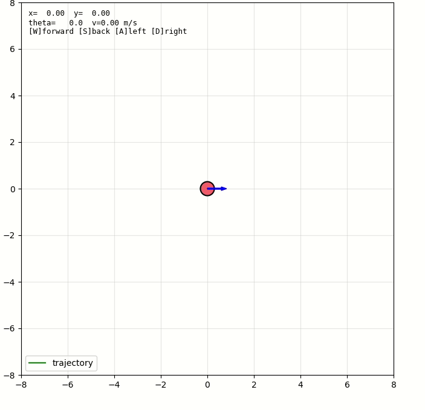

# 人形机器人仿真

基于 ROS1 Noetic 的人形机器人键盘控制仿真，包含简化运动学模型、仿真节点、键盘遥控和 matplotlib 轨迹可视化。

## 运行效果



## 功能

- 简化人形机器人运动学模型（位置、朝向、步态相位）
- 键盘 WASD 控制前进/后退/转向
- matplotlib 实时显示机器人位置和绿色轨迹线
- 发布 `/odom`、`/joint_states` 和 tf，可接 rviz

## 运行环境

- Ubuntu 20.04
- ROS Noetic
- Python 3.8（Noetic 自带）
- matplotlib

## 运行步骤

```bash
# 1. 编译
cd ~/catkin_ws
catkin_make
source devel/setup.bash

# 2. 终端1: 启动 roscore
roscore

# 3. 终端2: 启动仿真节点和可视化
source devel/setup.bash
roslaunch humanoid_sim sim.launch

# 4. 终端3: 键盘遥控
source devel/setup.bash
rosrun humanoid_sim keyboard_teleop.py
```

按键说明：

| 按键 | 动作 |
|------|------|
| `w` / `↑` | 前进 |
| `s` / `↓` | 后退 |
| `a` / `←` | 左转 |
| `d` / `→` | 右转 |
| 空格 | 急停 |
| `q` | 退出遥控 |

## 话题

| 话题 | 类型 | 方向 | 含义 |
|------|------|------|------|
| `/cmd_vel` | geometry_msgs/Twist | 订阅 | linear.x=前进速度(m/s), angular.z=转向角速度(rad/s) |
| `/odom` | nav_msgs/Odometry | 发布 | 机器人位置(x, y, theta) |
| `/joint_states` | sensor_msgs/JointState | 发布 | 腿和臂的关节摆动角 |
| tf | odom -> base_footprint | 发布 | 供 rviz 使用 |

## 文件结构

```
src/humanoid_sim/
├── main.py                  # 仿真节点入口
├── humanoid_model.py        # 运动学模型
├── keyboard_teleop.py       # 键盘遥控
├── plot_viewer.py           # matplotlib 可视化
├── package.xml
├── CMakeLists.txt
├── README.md
└── launch/
    └── sim.launch
```

## 大模型声明

本模块使用豆包协助生成代码。
