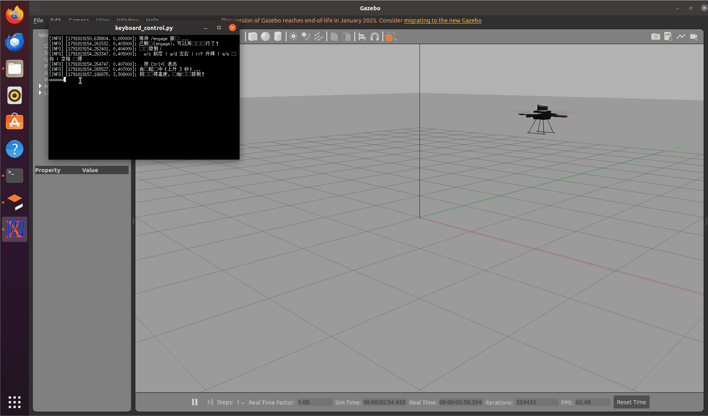

## 通过键盘操控仿真无人机

### 一、 项目概述

本项目基于 ROS 与 Gazebo 仿真环境，实现四旋翼无人机（Hector Quadrotor）的物理仿真与键盘运动控制。通过编写 Python 脚本，实现通过键盘按键控制无人机在仿真环境中的起飞、前后左右移动、升降、偏航以及悬停功能。项目采用 Catkin 工作空间进行编译管理。

### 二、 项目目录结构

```text
drone_ros_project/
└── catkin_ws/
    └── src/
        └── uav_sim/
            ├── CMakeLists.txt               # 编译配置文件
            ├── package.xml                  # 包依赖声明文件
            ├── launch/
            │   └── keyboard_flight.launch   # 启动文件（包含Gazebo环境、无人机模型和键盘节点）
            └── scripts/
                └── keyboard_control.py      # 键盘控制核心Python脚本
```

### 三、 核心配置文件内容

1. CMakeLists.txt

声明功能包所需的依赖组件，并安装Python脚本。

```cmake
cmake_minimum_required(VERSION 3.0.2)
project(uav_sim)

find_package(catkin REQUIRED COMPONENTS
  rospy
  std_msgs
  geometry_msgs
  std_srvs
)

catkin_package()

install(PROGRAMS
  scripts/keyboard_control.py
  DESTINATION ${CATKIN_PACKAGE_BIN_DESTINATION}
)
```

2. package.xml

定义功能包在构建和运行时的依赖关系。

```xml
<?xml version="1.0"?>
<package format="2">
  <name>uav_sim</name>
  <version>0.1.0</version>
  <description>任务①：无人机物理仿真与键盘运动控制</description>
  <maintainer email="user@example.com">user</maintainer>
  <license>MIT</license>

  <buildtool_depend>catkin</buildtool_depend>
  
  <build_depend>rospy</build_depend>
  <build_depend>std_msgs</build_depend>
  <build_depend>geometry_msgs</build_depend>
  <build_depend>std_srvs</build_depend>
  
  <exec_depend>rospy</exec_depend>
  <exec_depend>std_msgs</exec_depend>
  <exec_depend>geometry_msgs</exec_depend>
  <exec_depend>std_srvs</exec_depend>
  
  <export></export>
</package>
```

3. keyboard_flight.launch

一键启动Gazebo空世界、生成无人机模型、拉起键盘控制节点，并分配独立终端。

```xml
<launch>
    <!-- 任务①：无人机物理仿真 + 键盘控制 -->
    <arg name="gui" default="true"/>
    
    <!-- Gazebo 空世界（平地，便于自由飞行） -->
    <include file="$(find gazebo_ros)/launch/empty_world.launch">
        <arg name="use_sim_time" value="true"/>
        <arg name="gui" value="$(arg gui)"/>
    </include>
    
    <!-- 生成无人机（基础型号） -->
    <include file="$(find hector_quadrotor_gazebo)/launch/spawn_quadrotor.launch">
        <arg name="model" value="$(find hector_quadrotor_description)/urdf/quadrotor.gazebo.xacro"/>
        <arg name="x" value="0.0"/>
        <arg name="y" value="0.0"/>
        <arg name="z" value="0.3"/>
    </include>
    
    <!-- 键盘控制节点（独立终端运行，自动调用 /engage 解锁电机） -->
    <node pkg="uav_sim" type="keyboard_control.py" name="keyboard_control" output="screen" launch-prefix="xterm -e"/>
</launch>
```

4. keyboard_control.py

实现非阻塞读取键盘输入，并发布速度指令控制无人机。

```python
#!/usr/bin/env python3
# -*- coding: utf-8 -*-
"""
键盘控制 hector 无人机节点（任务①）。

功能：
  1. 启动后自动调用 /engage 服务解锁电机；
  2. 读取键盘输入，发布 geometry_msgs/Twist 到 /cmd_vel 控制无人机运动。

按键说明：
  w/s  前进/后退      a/d  左移/右移
  r/f  上升/下降      q/e  左转/右转
  空格 悬停           Ctrl+C 退出并断开电机
"""
import rospy
import sys
import select
import termios
import tty

from geometry_msgs.msg import Twist
from std_srvs.srv import Empty

# 按键 -> (前后, 左右, 升降, 转向) 的方向符号
KEYMAP = {
    'w': (1,  0,  0,  0),   # 前进
    's': (-1, 0,  0,  0),   # 后退
    'a': (0,  1,  0,  0),   # 左移
    'd': (0, -1,  0,  0),   # 右移
    'r': (0,  0,  1,  0),   # 上升
    'f': (0,  0, -1,  0),   # 下降
    'q': (0,  0,  0,  1),   # 左转（逆时针）
    'e': (0,  0,  0, -1),   # 右转（顺时针）
}


class KeyboardControl(object):
    def __init__(self):
        rospy.init_node('keyboard_control')

        self.pub = rospy.Publisher('/cmd_vel', Twist, queue_size=1)
        self.max_xy = rospy.get_param('~max_linear_xy', 1.0)   # 水平速度 m/s
        self.max_z = rospy.get_param('~max_linear_z', 0.5)     # 升降速度 m/s
        self.max_yaw = rospy.get_param('~max_angular_z', 1.0)  # 偏航角速度 rad/s
        self.rate = rospy.Rate(10.0)

        # 起飞前必须先 engage 解锁电机
        rospy.loginfo("等待 /engage 服务 ...")
        rospy.wait_for_service('/engage', timeout=15)
        rospy.ServiceProxy('/engage', Empty)()
        rospy.loginfo("已解锁(engage)，可以用键盘飞行了！")

    def _get_key(self, timeout=0.1):
        """非阻塞读取单个按键，返回字符（无按键时返回空串）。"""
        fd = sys.stdin.fileno()
        old = termios.tcgetattr(fd)
        try:
            tty.setraw(fd)
            rlist, _, _ = select.select([sys.stdin], [], [], timeout)
            key = sys.stdin.read(1) if rlist else ''
        finally:
            termios.tcsetattr(fd, termios.TCSADRAIN, old)
        return key

    def run(self):
        rospy.loginfo("键盘控制：")
        rospy.loginfo("  w/s 前后 | a/d 左右 | r/f 升降 | q/e 转向 | 空格 悬停")
        rospy.loginfo("  按 Ctrl+C 退出")

        # 自动起飞：解锁后上升 3 秒到安全悬停高度（约 1.5m），避免趴在地面空转
        rospy.loginfo("自动起飞中（上升 3 秒）...")
        takeoff = Twist()
        takeoff.linear.z = 0.5
        for _ in range(30):
            self.pub.publish(takeoff)
            self.rate.sleep()
        rospy.loginfo("到达悬停高度，开始键盘控制！")

        twist = Twist()
        try:
            while not rospy.is_shutdown():
                key = self._get_key()
                if key == '\x03':        # Ctrl+C
                    break
                if key == ' ':           # 悬停：速度清零
                    twist = Twist()
                elif key in KEYMAP:
                    kx, ky, kz, kyaw = KEYMAP[key]
                    twist.linear.x = kx * self.max_xy
                    twist.linear.y = ky * self.max_xy
                    twist.linear.z = kz * self.max_z
                    twist.angular.z = kyaw * self.max_yaw
                self.pub.publish(twist)
                self.rate.sleep()
        finally:
            self.pub.publish(Twist())
            try:
                rospy.ServiceProxy('/shutdown', Empty)()
            except Exception:
                pass
            rospy.loginfo("已停止并断开电机")


if __name__ == '__main__':
    try:
        KeyboardControl().run()
    except rospy.ROSInterruptException:
        pass
```

### 四、 编译与启动步骤

1. 编译工作空间

打开终端，进入你的项目目录并编译：

```bash
cd ~/drone_ros_project/catkin_ws
catkin_make
```

2. 配置环境

在终端中输入以下命令并回车：

```bash
source ~/drone_ros_project/catkin_ws/devel/setup.bash
```

注意：这一步如果没有任何报错，说明环境配置成功。如果报错“没有那个文件或目录”，请确认你的 drone_ros_project 文件夹是否真的是在这个路径下。

3. 启动仿真

环境配置成功后，紧接着输入以下命令并回车：

```bash
roslaunch uav_sim keyboard_flight.launch
```

注意：执行这条命令后，通常会弹出一个新终端窗口（xterm），这是用来接收键盘输入的。同时，Gazebo 仿真界面应该会打开，并显示一架四旋翼无人机。

4. 操作说明

等仿真界面和输入终端完全加载后，用鼠标点击一下那个黑色输入终端，然后按以下按键控制：

按键 功能 按键 功能
W / S 前进 / 后退 A / D 左移 / 右移
R / F 上升 / 下降 Q / E 左转 / 右转
空格 悬停 Ctrl+C 退出并断开电机

---

### 常见问题排查：

1. 检查路径：确认 ~/drone_ros_project/catkin_ws/devel/setup.bash 这个文件到底存不存在。可以在终端输入 ls ~/drone_ros_project/catkin_ws/devel/setup.bash 验证一下。
2. 如果没有 xterm：如果启动后没有弹出可以打字的黑框，可能是系统没装 xterm。可以在终端执行 sudo apt install xterm 安装一下。或者把 launch 文件里的 launch-prefix="xterm -e" 删掉，直接运行 rosrun uav_sim keyboard_control.py 来单独启动键盘控制节点。
3. 终端必须处于激活状态：执行 roslaunch 后弹出的黑色 xterm 窗口，必须先用鼠标点击一下激活它，键盘按键才会被接收，否则按键无效。

### 运行效果演示


