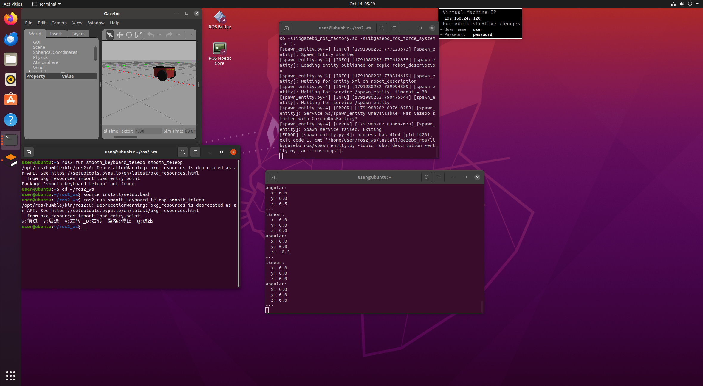

# 键盘控制轮式小车实验

## 一、实验目的
1. 熟悉ROS2的工作空间与功能包创建流程。
2. 掌握话题的发布机制，通过键盘读取速度指令，向/cmd_vel话题发布速度消息。
3. 实现轮式小车的前后、左右运动控制。

## 二、实验环境
Ubuntu22.04，ROS2 Humble，Gazebo小车仿真。

## 三、实验原理
geometry_msgs/msg/Twist消息包含线速度linear与角速度angular。
linear.x控制小车前后；angular.z控制小车转向。
读取键盘按键，修改Twist里面的值，周期发布给/cmd_vel话题，实现运动。

## 四、核心代码
```python
import rclpy
from rclpy.node import Node
from geometry_msgs.msg import Twist
import sys, tty, termios

def getKey():
    fd = sys.stdin.fileno()
    old = termios.tcgetattr(fd)
    try:
        tty.setraw(fd)
        return sys.stdin.read(1)
    finally:
        termios.tcsetattr(fd, termios.TCSADRAIN, old)

class KeyControlNode(Node):
    def __init__(self):
        super().__init__("key_control")
        self.pub = self.create_publisher(Twist,"/cmd_vel",10)
        self.timer = self.create_timer(0.1,self.cb)
        self.speed = 0.2
        self.turn = 0.3

    def cb(self):
        key = getKey()
        msg = Twist()
        if key == 'w':
            msg.linear.x = self.speed
        elif key == 's':
            msg.linear.x = -self.speed
        elif key == 'a':
            msg.angular.z = self.turn
        elif key == 'd':
            msg.angular.z = -self.turn
        else:
            msg.linear.x = 0.0
            msg.angular.z = 0.0
        self.pub.publish(msg)

def main(args=None):
    rclpy.init(args=args)
    node = KeyControlNode()
    rclpy.spin(node)
    node.destroy_node()
    rclpy.shutdown()

if __name__=="__main__":
    main()
## 五、实验步骤
1. 在src下新建python类型ROS2功能包 smooth_keyboard_teleop。
2. 在setup.py注册可执行文件。
3. 编译 colcon build，source install/setup.bash。
4. 启动Gazebo里面的轮式小车仿真；打开另外一个终端运行键盘控制节点。
5. 使用w s a d按键控制小车运动，观察小车运动效果。

## 六、实验结果
按下w小车前进；s后退；a左转；d右转；其余按键停止。话题/cmd_vel可以持续输出速度指令，小车跟随键盘指令运动。




## 七、实验小结
本次实验学会ROS2话题发布，自定义节点读取键盘输入，完成小车键盘遥控。理解Twist消息的含义，熟悉colcon编译流程。

>注：本实验所用ai辅助工具为豆包（doubao）。
