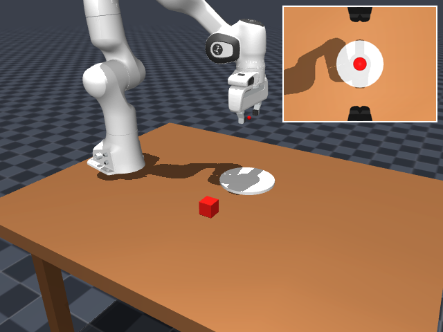
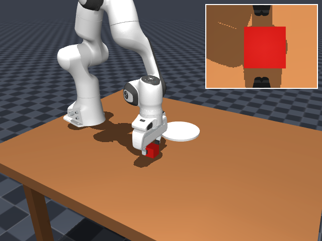
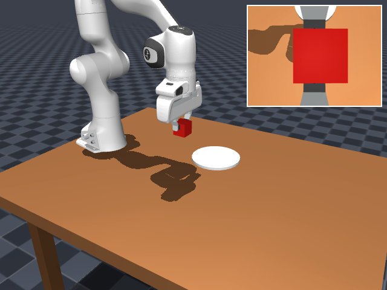
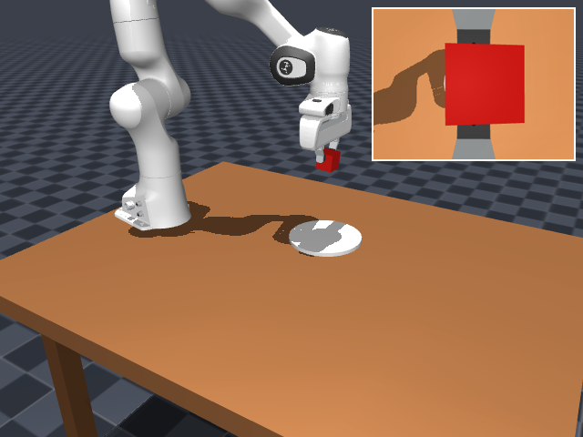
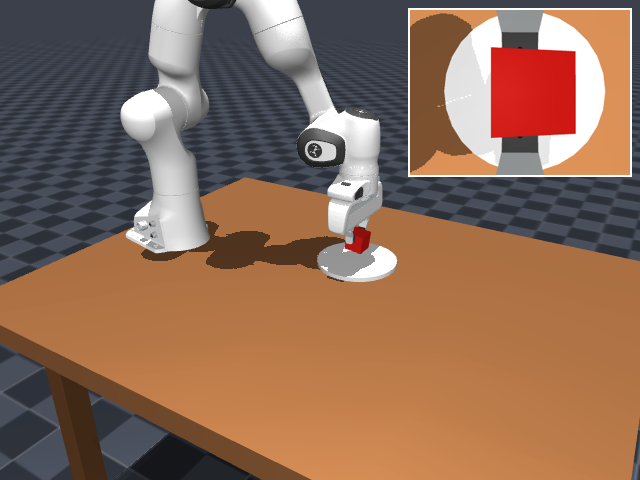
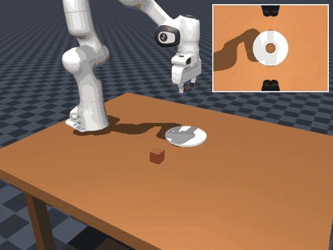

# MuJoCo 单臂抓取与 π0 推理接口复现（CPU 演示）

> 本页对应源码模块：`src/manipulation/pi0_mujoco_grasp/`

## 1. 简介

本模块在 MuJoCo 中实现了 "机械臂从桌面抓取红色方块 → 移到白色圆盘上方 → 放下" 的完整流程，
并提供与 π0 一致的 **观测 → 动作块 → 机器人执行** 接口：

- 机器人：Franka Emika Panda 7 自由度机械臂 + 二指夹爪；
- 场景：木质桌面、红色方块、白色圆盘、主相机 + 腕部相机（画中画）；
- 策略：`pi0_policy_stub.Pi0PolicyStub`（CPU 下的脚本化 IK 策略替身），
  真实 π0 推理需要 GPU 与 openpi 权重，接口位置在 `pi0_policy_stub.py` 中预留；
- 输出：截图、GIF、MP4，均来自真实 MuJoCo 渲染。

## 2. 运行环境

| 项目 | 配置 |
|---|---|
| 操作系统 | Ubuntu 20.04.6（VMware 虚拟机，4 vCPU / 4 GB RAM） |
| Python | 3.8.10 |
| MuJoCo | 2.3.7（CPU，无 GPU）；numpy 1.24.4 / Pillow 10.4.0（见 `requirements.txt`） |
| 渲染 | MuJoCo GLFW 后端 + Mesa 软件渲染（虚拟机桌面） |
| 模型 | MuJoCo Menagerie `franka_emika_panda`（Apache-2.0，固定 commit，SHA256 校验） |

## 3. 安装与运行

```bash
# 安装（模块目录下）
python3 -m venv .venv && source .venv/bin/activate
pip install -r requirements.txt
python scripts/setup_model.py          # 按固定 commit 下载并校验 Panda 网格（~33 MB）

# 运行并录制（XAUTHORITY 按当前 UID 自动查找）
export DISPLAY=:0
export XAUTHORITY=${XAUTHORITY:-$(ls /run/user/$(id -u)/gdm/Xauthority 2>/dev/null || echo "$HOME/.Xauthority")}
export MUJOCO_GL=glfw
python main.py                          # 仅仿真
python main.py --record /tmp/pi0_frames # 录制帧序列
python scripts/make_gif.py --frames /tmp/pi0_frames --out results --fps 30
```

> 安装为 ROS 2 包（colcon）时，请先完成上面的 `setup_model.py` 再 `colcon build`，
> 使 `assets/` 随 `data_files` 装入 share；源码树 venv 方式则直接运行即可。

## 4. 运行效果



*图 1：起始位姿，桌面上的红色方块与白色圆盘，右上角为腕部相机画中画*



*图 2：夹爪在方块两侧闭合完成抓取（腕部相机可见方块位于两指之间）*



*图 3：抓取后抬升并搬运*



*图 4：移动到白色圆盘上方*



*图 5：放下方块，腕部相机中方块位于盘心*


*图 6：最终效果（方块位于白盘中心，机械臂撤离）*



*图 7：完整抓取与放置过程（GIF，约 2.9 MB）*

## 5. 实测数据

| 指标 | 数值 |
|---|---|
| 仿真步长 | 0.002 s |
| IK 位置误差 | < 1e-4 m |
| 抓取-放置 | 方块从 (0.45, -0.12) 移至白盘中心 (0.45, 0.12) |
| 放置误差 | 5.1 mm |
| 录制 | 330 帧（30 fps，640×480 + 腕部画中画） |
| 渲染耗时 | 约 20~60 s（CPU 软件渲染，视内存/CPU 而定；1.9 GB VM 实测 54 s） |
| GIF / MP4 | 约 2.9 MB / 0.4 MB |

## 6. 实现说明

1. **场景**：`scene_pickplace.xml` 在 Menagerie Panda 模型基础上加入桌面、白盘、
   红方块（free joint）和主/腕部相机；`panda_pick.xml` 在 hand body 内加入 TCP site
   与腕部相机。
2. **逆运动学**：对 TCP 目标位姿迭代求解阻尼最小二乘，收敛后作为关节目标；
   关节由 Panda 自带的位置伺服（`general` 执行器）跟踪。
3. **π0 接口**：`Pi0PolicyStub.plan()` 给出动作块（关节目标 + 夹爪），
   与 π0 的 `obs -> action chunk` 接口一致；有 GPU 时替换为 openpi 客户端即可。
4. **录制**：主相机 640×480 与腕部 320×240 合成画中画，输出帧序列后生成截图/GIF/MP4。
5. **模型资源**：网格文件（67 个，约 33 MB）不入库，由 `scripts/setup_model.py` 按固定
   Menagerie commit 下载并逐个校验 SHA256（清单 `models/franka_emika_panda/assets.sha256`）；
   可用 `PI0_MENAGERIE_BASE` 指向镜像加速。

## 7. 已知限制

- 当前环境无 GPU，未运行真实 π0 模型权重，策略为脚本化 IK 替身；
- 场景布局与相机角度为演示自定义，非逐像素一致；
- 网格资源（约 33 MB）不随仓库提交，需运行 `scripts/setup_model.py` 下载（固定 commit + SHA256 校验）。

## 8. 参考

- MuJoCo Menagerie：<https://github.com/google-deepmind/mujoco_menagerie>
- MuJoCo Python：<https://github.com/google-deepmind/mujoco>

## 大模型使用声明

本页文档、脚本与演示由 AI 助手辅助完成，所有命令与实测数据均在 Ubuntu 20.04 +
MuJoCo 2.3.7（CPU）环境中实际运行验证，作者已核对并对内容负责。
