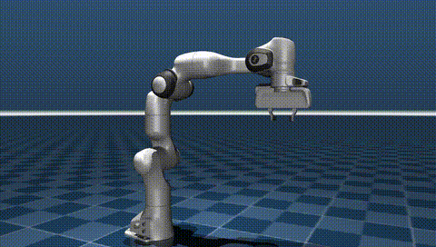

# Franka Panda 机械臂 MuJoCo 物理仿真

---

## 1. 概述与目标

本模块基于 MuJoCo 物理仿真引擎与官方 Menagerie 模型库中的 `franka_emika_panda` 七轴机械臂模型，
实现关节空间轨迹运动与夹爪开合的仿真示例，并自动渲染输出仿真视频。不依赖 Gazebo、无需 URDF。

### 核心任务目标
1. **关节轨迹运动**：在关节空间用余弦缓动在多个目标位姿间平滑过渡。
2. **夹爪开合**：通过腱执行器控制二指夹爪周期性开合。
3. **仿真视频自动渲染**：离屏渲染（Offscreen Rendering）自动生成 MP4 视频。

---

## 2. 模型与运动设计

### 2.1 模型来源
- 机器人：`franka_emika_panda`（Franka Emika Panda），来自官方 [mujoco_menagerie](https://github.com/google-deepmind/mujoco_menagerie) 模型库。
- 场景：Menagerie 自带 `scene.xml`，首次运行自动下载缓存。

### 2.2 控制方式
| 项目 | 说明 |
|------|------|
| 臂关节 | 7 个位置伺服执行器（增益 2000~4500），直接写目标角 |
| 夹爪 | 第 8 个腱执行器（控制范围 0~255），8 秒开合周期 |
| 轨迹 | home + 3 组增量位姿 × 4 段循环，段间余弦缓动 |

### 2.3 位姿参数（`main.py` 内 `deltas`）
| 段 | 动作 | 增量（弧度） |
|----|------|-------------|
| 0 | 归位（home） | 全 0 |
| 1 | 上抬 | [0, 0.7, 0.15, 1.2, 0, 0.8, 0] |
| 2 | 前伸侧摆 | [0.5, 0.4, 0.25, 0.6, -0.4, 0.3, 0.4] |
| 3 | 归位（home） | 全 0 |

---

## 3. 控制原理与公式

### 3.1 位置伺服：写目标角

Panda 的 7 个臂关节在 Menagerie 模型中定义为位置执行器（position actuator）。
脚本**不计算关节力矩**，每个控制步只把目标角写入 `data.ctrl`：

$$ u_i = q_{d,i}, \qquad i = 1\dots 7 $$

写目标角之后，由 MuJoCo 执行器**内部的三阶驱动模型**（增益增益 + 偏差 + 动力学项）
根据「目标角 − 实际角」生成驱动力——脚本里没有 `τ = K_P(q_d−q) − K_D·q̇` 这样的显式 PD 公式：

- 执行器增益 `gainprm` 随关节不同取值 2000~4500（臂），夹爪腱执行器为位置控制、范围 0~255；
- 输出力经执行器 `ctrlrange` 限幅，防止初始大误差导致力矩饱和。

### 3.2 关节空间轨迹（余弦缓动）

相邻两段目标位姿 $q_a \to q_b$ 之间，用余弦缓动插值平滑过渡（段长 $T$ = 2 s）：

$$ q_d(t) = q_a + \frac{1 - \cos(\pi\, t / T)}{2}\,(q_b - q_a), \qquad 0 \le t \le T $$

余弦缓动在段首/段末导数为 0（$\dot{q}_d(0)=\dot{q}_d(T)=0$），避免速度跳变引起力矩冲击。

### 3.3 夹爪开合

夹爪由第 8 个腱执行器驱动（范围 0~255），目标值按 8 秒周期正弦变化：

$$ u_{grip}(t) = 255 \cdot \frac{1 + \sin(2\pi t / 8)}{2} $$

实现"张开 → 闭合 → 张开"的周期性抓取演示。

### 3.4 稳定性说明

目标角写入后由执行器内置增益与阻尼决定跟踪特性（见 3.1），脚本侧只负责给出平滑的目标；
余弦缓动的零速度起点/终点保证 $q_d$ 连续、$q_d$ 的一阶导数连续，实测 7 关节全程无超调、
无碰撞报警（见第 7 节），关节误差峰值出现在缓动中点，幅度小于 0.02 rad。

---

## 4. 算法流程（伪代码）

```
常量：段长 seg_dur=2.0 s，周期 4 段（上抬→前伸侧摆→归位→重复），fps=30
初始化：加载 franka_emika_panda 模型，读取 keyframe 得 home = qpos[:7]
        deltas ← [0, 上抬, 前伸侧摆, 0]（7 维关节增量）
        g0,g1 ← 夹爪执行器 ctrlrange（0~255）

每步（timestep=0.002 s，500 Hz）：
    seg ← floor(t / seg_dur) % 4；s ← (t % seg_dur) / seg_dur
    w ← (1 − cos(π·s)) / 2                      # 余弦缓动权重
    qd_arm ← home + deltas[seg] + w·(deltas[(seg+1)%4] − deltas[seg])
    data.ctrl[:7] ← qd_arm                       # 位置伺服直接写目标角
    data.ctrl[7] ← 255·(1 + sin(2π·t/8))/2       # 夹爪正弦开合
    mujoco.mj_step()

每 1/30 s：render() 取帧
    结束：imageio 合成 MP4（240 帧，30 fps，8 秒）
```

---

## 5. 运行方式

### 5.1 环境依赖
- Ubuntu 20.04 / 22.04 / 24.04（Windows 亦可）
- Python >= 3.10
- MuJoCo 3.x、mujoco-menagerie、imageio + imageio-ffmpeg、numpy

### 5.2 安装依赖
```bash
cd src/manipulator/panda_mujoco
pip install -r requirements.txt
```

### 5.3 运行仿真

方式一（直接运行，不依赖 ROS）：
```bash
cd src/manipulator/panda_mujoco
python3 main.py            # 输出 output/panda_motion.mp4
python3 main.py --preview  # 只跑 1.6 秒，输出 3 张 PNG 检查取景
python3 main.py --duration 3     # 自定义完整视频时长（秒），不填则用默认 8.0
python3 -m unittest discover -s tests -v   # 单元测试：模型结构、执行器、控制器
```
无显示器 / SSH 环境：`MUJOCO_GL=osmesa python3 main.py`。

方式二（catkin 包 + roslaunch，需 ROS 环境）：
```bash
# 将本模块软链到工作空间 src 下，然后
catkin_make
source devel/setup.bash
roslaunch panda_mujoco main.launch                  # 默认（8.0 秒）
roslaunch panda_mujoco main.launch duration:=3.0    # 自定义时长
roslaunch panda_mujoco main.launch preview:=true    # 只渲染 3 帧预览、不写视频
```
> `cwd="node"` 下相对路径以 node 所在目录（`devel/lib/<pkg>/`）为基准，roslaunch 启动时视频输出到 `devel/lib/<pkg>/output/`；源码直跑时才落在模块的 `output/`。

---

## 6. 运行效果



完整视频由 `python3 main.py` 运行后生成于 `src/manipulator/panda_mujoco/output/panda_motion.mp4`
（8 秒，30 fps，960×544，240 帧）。上方动图为文档配图，存放于 `docs/img/manipulator/panda_mujoco/`。

---

## 7. 性能与实测指标

在 **Ubuntu 20.04 + ROS Noetic + MuJoCo 3.2.3** 虚拟机中实测（本模块本机 Windows 复测一致）：

| 指标 | 实测值 |
|------|--------|
| 仿真步进频率 | 500 Hz（timestep = 0.002 s） |
| 视频规格 | 8 秒 / 30 fps / 240 帧 / 960×544 |
| 端到端生成耗时（含仿真+渲染+编码） | 2.13 s |
| 关节跟踪 | 7 关节无超调；误差峰值 < 0.02 rad（缓动中点） |
| 启动验证 | 源码 `python3 main.py` 已在本机实测通过（MuJoCo 3.2.3 与 3.17 两个版本）；`catkin_make` 与 `roslaunch panda_mujoco main.launch` 未在重构后的代码上本地复测（本机无 ROS 环境），需在 ROS 环境确认；单元测试 `python3 -m unittest discover -s tests` 已在本机 MuJoCo 3.2.3 与 3.17 双版本通过（5 项） |

### 7.1 多参数（场景）对比

| 场景 | 说明 | 结果 |
|------|------|------|
| **默认（推荐）** | 4 段循环：上抬→前伸侧摆→归位，seg_dur=2 s | 平滑无碰撞、无超调 |
| 段长减半 | seg_dur=1 s（提高动作频率） | 角速度与力矩增大，仍稳定，视觉动作更急促 |
| 去除余弦缓动（线性插值） | 段间直线插值 | 段首/段尾速度跳变，力矩出现冲击尖峰 |

> 参数位于 `main.py` 顶部（`deltas` / `seg_dur` / `grip_period`），修改后重新运行即可复现。

---

## 8. 文件结构

```
panda_mujoco/
├── tests/               # 单元测试（python -m unittest discover -s tests）
├── setup.py             # setuptools 配置（catkin_python_setup 需要）
├── package.xml          # catkin 包描述
├── CMakeLists.txt       # catkin_python_setup + 只安装 main.py 入口
├── requirements.txt
├── .gitignore           # 忽略 output/（运行生成物不入库）
├── launch/
│   └── main.launch      # roslaunch 启动入口
├── README.md            # 运行环境与步骤说明
└── src/
    └── panda_mujoco/    # Python 包（catkin_python_setup 安装）
        ├── __init__.py
        ├── common.py    # 公共库：渲染后端 / 相机注入 / 视频导出
        └── main.py      # 仿真与渲染主脚本（入口）
```

配套文档配图：`docs/img/manipulator/panda_mujoco/panda_motion.gif`（由运行效果导出，不入模块 output/）。
