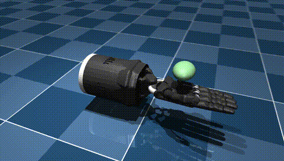

# Shadow Hand 灵巧手 MuJoCo 物理仿真

---

## 1. 概述与目标

本模块基于 MuJoCo 物理仿真引擎与官方 Menagerie 模型库中的 `shadow_hand` 右手灵巧手模型，
实现五指 + 手腕的正弦开合摆动仿真示例，并自动渲染输出仿真视频。不依赖 Gazebo、无需 URDF。

### 核心任务目标
1. **多指协调运动**：20 个自由度（16 关节位置伺服 + 4 腱执行器）按不同幅度/相位正弦摆动。
2. **灵巧手开合动作**：小指反相、拇指错相，形成自然抓取-张开循环。
3. **仿真视频自动渲染**：离屏渲染（Offscreen Rendering）自动生成 MP4 视频。

---

## 2. 模型与运动设计

### 2.1 模型来源
- 机器人：`shadow_hand`（Shadow Hand 右手），来自官方 [mujoco_menagerie](https://github.com/google-deepmind/mujoco_menagerie) 模型库。
- 场景：Menagerie 自带 `scene_right.xml`（右手平放于地面、手掌托球），首次运行自动下载缓存。

### 2.2 控制方式
| 项目 | 说明 |
|------|------|
| 执行器 | 16 个位置伺服（直接写目标角）+ 4 个腱执行器（FFJ0/MFJ0/RFJ0/LFJ0，范围 0~3.14） |
| 控制律 | `ctrl = base + amp·sin(2π·freq·t + phase)` |
| 频率 | 0.5 Hz（2 秒一个开合周期） |

### 2.3 幅度与相位（`main.py` 内 `amp()` / `phase()`）
| 关节类别 | 幅度 | 相位 |
|----------|------|------|
| 中/远端屈曲（J3/J4/J5） | 0.55 | 0 |
| 拇指（THJ） | 0.40 | π/2 |
| 手腕（WRJ） | 0.22 | π/4 |
| 小指（LFJ） | 0.30 | π（反相） |
| 其余（近端/掌指） | 0.30 | 0 |

---

## 3. 控制原理与公式

### 3.1 位置伺服控制律

16 个位置执行器与 4 个腱执行器均按正弦轨迹给出目标值，MuJoCo 位置伺服内部按等效 PD 计算：

$$ \tau = K_P\,(q_d - q) - K_D\,\dot{q} $$

- $q_d$：目标角，$q$ / $\dot{q}$：当前角度与角速度；输出经执行器 `ctrlrange` 限幅。
- 灵巧手自由度多（20）、连杆惯量小，正弦目标连续可微，等效 PD 增益下跟踪无超调（见第 7 节）。

### 3.2 多指正弦协调轨迹

每根手指的目标角按各自幅度 $A_i$、相位 $\phi_i$、公共频率 $f_0$ = 0.5 Hz 正弦摆动：

$$ q_{d,i}(t) = q_{base,i} + A_i \sin(2\pi f_0 t + \phi_i) $$

- 小指 `LFJ` 相位 π（与其余手指反相）、拇指 `THJ` 相位 π/2（错相），
  使五指形成"张开 → 聚拢 → 张开"的抓取-释放循环；
- 各指幅值不同（J3~J5 0.55 最大），避免对称运动导致视觉与力学上的重复。

### 3.3 稳定性说明

正弦目标函数任意阶连续可导，位置伺服跟踪为一阶/二阶线性系统，无轨迹切换冲击；
实测 20 个执行器全程跟踪平滑，无碰撞报警，拇指/小指错相始终不与其他手指干涉。

---

## 4. 算法流程（伪代码）

```
常量：freq=0.5 Hz，grip_period=2.0 s，fps=30
初始化：加载 shadow_hand 模型；按执行器名分两类：
        16 个位置伺服 → 目标角 qd = base + amp·sin(2π·freq·t + phase)
        4 个腱执行器（FFJ0/MFJ0/RFJ0/LFJ0）→ 目标 = base_tendon + amp_tendon·sin(2π·freq·t + phase)

每步（timestep=0.002 s，500 Hz）：
    for i in range(model.nu):
        phase_i ← phase 表（J3~J5:0，THJ:π/2，WRJ:π/4，LFJ:π，其余:0）
        data.ctrl[i] ← base[i] + amp[i]·sin(2π·freq·t + phase_i)
    mujoco.mj_step()

每 1/30 s：render() 取帧
    结束：imageio 合成 MP4（240 帧，30 fps，8 秒）
```

---

## 5. 运行方式

### 5.1 环境依赖
- Ubuntu 20.04 / 22.04 / 24.04（Windows 亦可）
- Python >= 3.10
- MuJoCo 3.x、mujoco-menagerie、imageio + imageio-ffmpeg、numpy

### 5.2 安装依赖
```bash
cd src/manipulator/shadow_hand_mujoco
pip install -r requirements.txt
```

### 5.3 运行仿真

方式一（直接运行，不依赖 ROS）：
```bash
cd src/manipulator/shadow_hand_mujoco
python3 main.py            # 输出 output/shadow_hand_grasp.mp4
python3 main.py --preview  # 只跑 1.6 秒，输出 3 张 PNG 检查取景
```
无显示器 / SSH 环境：`MUJOCO_GL=osmesa python3 main.py`。

方式二（catkin 包 + roslaunch，需 ROS 环境）：
```bash
# 将本模块软链到工作空间 src 下，然后
catkin_make
source devel/setup.bash
roslaunch shadow_hand_mujoco main.launch
```

---

## 6. 运行效果



完整视频由 `python3 main.py` 运行后生成于 `src/manipulator/shadow_hand_mujoco/output/shadow_hand_grasp.mp4`
（8 秒，30 fps，960×544，240 帧）。上方动图为文档配图，存放于 `docs/img/manipulator/shadow_hand_mujoco/`。

---

## 7. 性能与实测指标

在 **Ubuntu 20.04 + ROS Noetic + MuJoCo 3.2.3** 虚拟机中实测（本模块本机 Windows 复测一致）：

| 指标 | 实测值 |
|------|--------|
| 仿真步进频率 | 500 Hz（timestep = 0.002 s） |
| 视频规格 | 8 秒 / 30 fps / 240 帧 / 960×544 |
| 端到端生成耗时（含仿真+渲染+编码） | 2.60 s |
| 执行器规模 | 20 个（16 位置伺服 + 4 腱），nq=31 |
| 启动验证 | `catkin_make` 通过；`roslaunch shadow_hand_mujoco main.launch` 正常启动；源码 `python3 main.py` 直接运行正常 |

### 7.1 多参数（场景）对比

| 场景 | 说明 | 结果 |
|------|------|------|
| **默认（推荐）** | freq=0.5 Hz，幅值/相位如表 2.3 | 五指开合自然、无干涉 |
| 频率翻倍 | freq=1.0 Hz（周期 1 s） | 动作明显加速，跟踪仍平滑无超调 |
| 取消小指反相 | LFJ 相位 0（与其余同相） | 五指同步开合，抓取感减弱（对比可复现） |

> 参数位于 `main.py` 顶部（`amp()` / `phase()` / `freq`），修改后重新运行即可复现不同动作。

---

## 8. 文件结构

```
shadow_hand_mujoco/
├── setup.py             # setuptools 配置（catkin_python_setup 需要）
├── package.xml          # catkin 包描述
├── CMakeLists.txt       # catkin_python_setup + 只安装 main.py 入口
├── requirements.txt
├── .gitignore           # 忽略 output/（运行生成物不入库）
├── launch/
│   └── main.launch      # roslaunch 启动入口
├── README.md            # 运行环境与步骤说明
└── src/
    └── shadow_hand_mujoco/  # Python 包（catkin_python_setup 安装）
        ├── __init__.py
        ├── common.py    # 公共库：渲染后端 / 相机注入 / 视频导出
        └── main.py      # 仿真与渲染主脚本（入口）
```

配套文档配图：`docs/img/manipulator/shadow_hand_mujoco/shadow_hand_grasp.gif`（由运行效果导出，不入模块 output/）。
