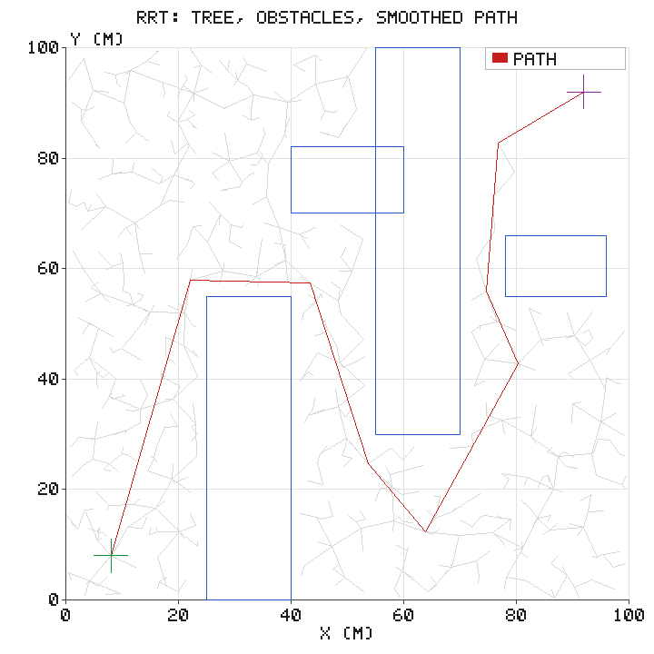
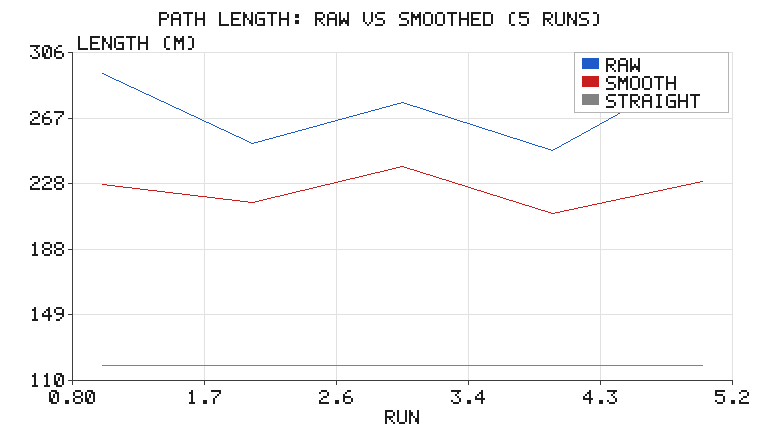

# RRT 采样式路径规划：让随机性解决高维规划

在已知栅格地图上做最短路径，Dijkstra / A\* 是标准答案。但它们有个前提：
**要先把连续空间离散成图**。二维 100×100 的栅格还能应付，一旦到了 7 自由度机械臂
（关节角空间），栅格数就是天文数字，"先建图再搜索"直接不可行。

RRT（Rapidly-exploring Random Tree，LaValle 1998）换了个思路：
**不需要建图，直接往空间里撒随机点，把树长出去。** 它不保证最优，
但保证**概率完备**——只要有解，采样足够多就一定能找到（概率 1）。

## 1. 算法

```
树 T ← {q_start}
while 未到达目标 and 迭代未超限:
    q_rand ← 自由空间中的随机点（以一定概率直接取目标点）
    q_near ← T 中离 q_rand 最近的节点
    q_new  ← 从 q_near 朝 q_rand 前进一个步长 step
    if 线段 q_near→q_new 无碰撞:
        T.add(q_new, parent=q_near)
        if |q_new - q_goal| < tol: 回溯得到路径，返回
```

三个工程要点：

1. **步长 `step`**：太小则树长得慢、节点爆炸；太大则容易撞障碍、路径粗糙。
   本例取 6 m（地图 100 m 的 6%）。
2. **目标偏置 `goal_bias`**：以 12% 概率直接采样目标点。纯随机采样的树
   "四处乱长"，加了偏置后明显更快朝目标推进。
3. **最近邻搜索**：节点少时线性扫描 $O(n)$ 就够；上万个节点才需要 KD-Tree。

## 2. 结果

地图 100 m × 100 m，4 个矩形障碍，起点 (8, 8)，终点 (92, 92)。



灰色细线是长出来的树（658 个节点、657 条边），蓝框是障碍（含 1.5 m 安全外扩），
红色是**平滑后**的路径，绿/紫十字是起点/终点。可以看到树几乎是"均匀铺满"整个自由
空间的——这正是 RRT 的名字由来：**快速探索**。它不做全局优化，只是尽快把空间"探开"。

| 指标 | 数值 |
|---|---|
| 树节点数 / 边数 | 658 / 657 |
| 原始路径长度 | 293.74 m |
| 平滑后长度 | **217.06 m**（−26.1%） |
| 起终点直线距离 | 118.79 m |
| 绕行比 | 1.83 × |

绕行比 1.83 听起来很大，但考虑到障碍把地图切成了"S 形通道"（必须先向右绕、
再向上、再向左上），这个值实际上是合理的。RRT 的路径通常**明显长于最优解**，
这是它的固有代价——不是 bug。

## 3. 后处理：随机捷径平滑

原始 RRT 路径有一个典型特征：**每段都是 6 m 的固定步长**，于是路径像"毛毛虫"
一样由许多小折线组成，虽然无碰撞但很难直接给底盘跟踪。

随机捷径（random shortcut）非常朴素：反复随机取路径上两点 $a, b$，
若直连 $a \to b$ 无碰撞，就用直线替换中间那一大段。



| run | 1 | 2 | 3 | 4 | 5 |
|---|---|---|---|---|---|
| 原始 (m) | 293.74 | 252.01 | 276.63 | 247.55 | 297.35 |
| 平滑后 (m) | 227.03 | 216.45 | 238.15 | 209.82 | 229.02 |

两个观察：

- **方差大**：不同随机种子的原始路径长度在 247～297 m 之间波动（±10%）。
  这是随机算法的固有属性，工程上靠"多跑几次取最好"或改用 RRT\* / Informed RRT\*。
- **平滑稳定降 15～25%**，且平滑后仍严格无碰撞（单测里用 1.0 m 外扩也验证过）。

## 4. 代码与运行

```bash
cd src/motion_planning/rrt_path_planning
python3 tests/test_rrt.py            # 12 项单元测试
./main.sh                            # 跑一次演示，配图写到 docs/img/motion_planning/rrt_path_planning/
```

配图由 `scripts/main.py` 现场生成，默认输出目录就是本页图片所在位置，
脚本目录下不保留 PNG 副本（`--outdir <目录>` 可改）。`simple_plot.py`（手写 zlib PNG）
与 `sim_node.py`（闭环里的运动学模拟器）三个模块共用一个源码，放在
`src/motion_planning/common/`，构建时由各包 CMakeLists 拷进自己的 `lib/`。

```python
import rrt

planner = rrt.RRT(rrt.START, rrt.GOAL, rrt.OBSTACLES, step=6.0, seed=3)
path = planner.plan()
smoothed = rrt.smooth(path, rrt.OBSTACLES, iterations=300)
assert rrt.path_is_free(smoothed, rrt.OBSTACLES)
```

碰撞检测是纯解析的：线段与轴对齐矩形求交（slab 裁剪法），没有栅格化，
因此**精度不取决于分辨率**，这一点比栅格 A\* 更干净。

### 规划无碰撞 ≠ 跟踪无碰撞（一个真实的坑）

随机捷径平滑把 53 个原始路点削到约 10 个顶点，几何上每段都无碰撞，
但**直接拿这 10 个点做纯跟踪会撞墙**。控制节点最初把「沿路径累计弧长超过
前视距离 `lookahead` 的下一个顶点」当作目标点；平滑后相邻顶点相距几十米，
这个"前视点"其实远在拐角之后，车辆会朝它直线切过去。按默认参数
（seed=3、`lookahead=8 m`、起点 (8, 8)、朝向 0.7854 rad、控制 20 Hz /
积分 50 Hz）回放，13.2 s 时到达 (25.008, 39.619)，正好进入第一个矩形障碍。

修法是两层：

1. `rrt.densify(path, 0.5)` 把平滑折线按 ≤0.5 m 等距重采样（10 点 → 439 点，
   端点与总长度不变），发布的 `nav_msgs/Path` 也随之变平滑；
2. `rrt.lookahead_point()` 先把车辆位姿投影到最近的线段，再沿路径累计弧长，
   在跨越的那一段上**线性插值**得到精确前视点，而不是返回下一个顶点。
   这个实现与路径分辨率无关，稀疏/加密路径给出同一目标点。

| 路径 | 前视点求法 | 回放结果 |
|---|---|---|
| 平滑 10 点 | 旧：下一个顶点 | **碰撞** (25.008, 39.619) @ 13.2 s |
| 加密 0.5 m | 旧：下一个顶点 | 通过，86.2 s 抵达 (90.65, 91.42) |
| 加密 0.5 m | 新：弧长插值 | 通过，86.7 s 抵达 (90.66, 91.41) |
| 平滑 10 点 | 新：弧长插值 | 通过（与加密路径一致） |

`tests/test_rrt.py` 里 `test_tracking_trajectory_is_collision_free` 用同一套
控制律（`plan_control_node.pure_pursuit_cmd`）回放整条轨迹，逐步断言不进入任何
障碍并在时限内抵达目标，把这个缺陷锁死。


### 在 ROS 2 中跑闭环

上面的 `main.py` 是离线出图。真正接到 ROS 图里时，本包提供两个节点，`launch`
会一次把它们都起来：

```bash
cd <ros2_ws>
colcon build --packages-select rrt_path_planning
source install/setup.bash
ros2 launch rrt_path_planning rrt_path_planning.launch.py
```

两个节点组成一条闭合的数据流——这正是"仿真器 + 传感器输入 + 控制输出"的最小形态：

```
sim_node（运动学自行车模型，扮演仿真器/传感器）
        │  /odom   nav_msgs/Odometry
        ▼
plan_control_node（规划 + 控制）
        │  /cmd_vel  geometry_msgs/Twist
        └─────────────────────► 回到 sim_node
        │  /planning/path  nav_msgs/Path
        └─────────────────────► RViz
```

| 方向 | 话题 | 类型 | 说明 |
|---|---|---|---|
| 发布 | `/odom` | `nav_msgs/Odometry` | 模拟器位姿与速度 |
| 订阅 | `/cmd_vel` | `geometry_msgs/Twist` | 模拟器接收速度指令 |
| 发布 | `/cmd_vel` | `geometry_msgs/Twist` | 控制节点输出速度指令 |
| 订阅 | `/odom` | `nav_msgs/Odometry` | 控制节点读取车辆状态 |
| 发布 | `/planning/path` | `nav_msgs/Path` | 规划结果，RViz 加 Path 显示即可看到 |

```bash
ros2 topic echo /odom                  # 车在动
ros2 topic echo /cmd_vel               # 控制输出
ros2 topic echo /planning/path --once  # 规划出的路点
rviz2                                  # 添加 Path 显示，Topic 选 /planning/path
```

换成真实机器人或 Carla / Gazebo 时，只需让它们发布 `/odom`、订阅 `/cmd_vel`，
控制节点不用改。要接仿真器但暂时没有，也可以只起 `sim_node.py`，用
`ros2 topic pub /cmd_vel ...` 手动验证链路通不通。

## 5. 什么时候该用 RRT，什么时候不该

| 场景 | 推荐 | 原因 |
|---|---|---|
| 二维栅格地图、要最短路径 | A\* / Dijkstra | 有最优性保证，实现更简单 |
| 7 自由度机械臂、高维关节空间 | RRT / RRT\* / PRM | 无法栅格化 |
| 窄通道、需要穿过细缝 | RRT-Connect / PRM | 单向 RRT 在窄缝里极慢 |
| 需要路径平滑、可执行 | RRT + shortcut / 样条优化 | 原始路径全是折线 |
| 动态障碍、要快速重规划 | RRT\* / D\* Lite | 支持增量修复 |

## 6. 局限与延伸

- **不是最优**：RRT\* 加了"rewire"步骤（新节点尝试改进邻居的父节点），
  代价是收敛慢很多。
- **窄缝不友好**：单向扩展在窄通道里撞墙率高，RRT-Connect（双树相向生长）好得多。
- **路径不连续可导**：平滑只能消除折角，要真正给差速/阿克曼底盘跟踪，
  还得做曲率约束的样条拟合。

## 7. 与已有内容的关系

- 上游 `air/octree_uav_3d_pathfinding/astar_planning.md` 是**三维八叉树上的 A\* 图搜索**（有最优性）；
- 本篇是**连续空间上的采样法**（无最优性，但可扩展到高维）；
- `motion_planning/stanley_tracking.md` 负责把规划出的路径**跟踪**出来，
  规划与跟踪是前后衔接的两件事。

---

> 本文档由 AI 辅助撰写，算法、代码与全部数值均在本地实跑验证（`tests/test_rrt.py` 12 项全过）。
> 配图由纯标准库手写 PNG 编码生成。
