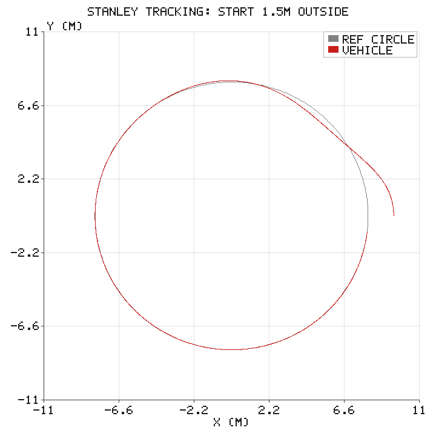
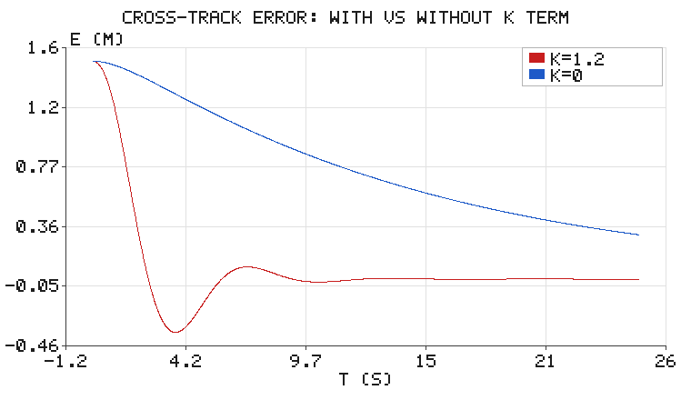

# Stanley 前视路径跟踪：航向误差 + 横向误差

规划给出了一条路径，速度规划给出了时间参数化，最后一步是**让车真的贴在线上跑**。
这一步的难点不在"打方向盘"，而在**打多少**。

Stanley 控制器是斯坦福无人车在 2005 年 DARPA Grand Challenge 上夺冠时用的横向控制律，
它比经典的 Pure Pursuit 少一个需要调参的前视距离，却在低速大偏差时收敛更快。
本篇用运动学自行车模型把它跑一遍，并把一个容易被忽略的工程细节讲清楚：
**原版 Stanley 在弯道上有稳态偏差，必须补曲率前馈。**

## 1. 被控对象与两个误差

运动学自行车模型（后轴参考点）：

$$
\dot{x} = v\cos\psi,\qquad \dot{y} = v\sin\psi,\qquad
\dot{\psi} = \frac{v\tan\delta}{L}
$$

$L$ 是轴距，$\delta$ 是前轮转角。跟踪一个参考路径时定义两个误差：

- **横向偏差** $e$：车体到参考路径的（有符号）距离，圆外为正；
- **航向偏差** $\psi_e = \mathrm{wrap}(\psi_{\text{ref}} - \psi)$，参考路径切向与车头的夹角。

## 2. 控制律

$$
\delta = \psi_e + \arctan\!\left(\frac{k\,e}{v}\right)
$$

两项各司其职：

- $\psi_e$：先把车头**摆正**到路径方向（这一项是几何前馈，不依赖增益）；
- $\arctan(ke/v)$：偏差越大打得越多；**除以 $v$** 使高速时自动减弱修正
  （高速打大方向会失稳），这是 Stanley 比固定增益方案更稳的关键。

输出要限幅：本例 $|\delta| \le 0.6$ rad（约 34°）。

## 3. 弯道上的陷阱与曲率前馈

沿半径 $R$ 的圆稳定行驶，几何上**必须**有前轮转角

$$
\delta_{\text{curve}} = \arctan\!\left(\frac{L}{R}\right)
$$

但原版 Stanley 只有误差项，误差为 0 时 $\delta = 0$——车走不了圆。于是误差被迫停在
非零处"凑"出这个角度，形成**稳态横向偏差**。可以推导出稳态值（一阶近似）：

$$
e_{\text{ss}} \approx \frac{L}{1 + kR/v}
$$

代入 $L = 2.5$ m、$R = 8$ m、$k = 1.2$、$v = 2$ m/s，理论值约 0.43 m。
仿真（关闭前馈）实测 **0.493 m**，量级一致（近似推导忽略了航向项的二次效应）。

解决方案是加**曲率前馈**（Apollo / Autoware 的标准做法）：

$$
\delta = \psi_e + \arctan\!\left(\frac{k e}{v}\right) + \arctan(L\,\kappa)
$$

$\kappa$ 是最近点处的路径曲率（圆上 $\kappa = 1/R$）。加了这一项，误差为 0 时
转向角也恰好是 $\arctan(L/R)$，车能"自然地"沿弯道走，误差项只负责修正扰动。

## 4. 结果

参考路径是半径 8 m 的圆（逆时针），车速 2 m/s，初始位置在圆**外 1.5 m**、朝向正确。



灰色是参考圆，红色是实际轨迹。从 $(9.5, 0)$ 出发，约 2.5 秒内切回圆上，
之后一直稳定跟踪。



| 配置 | 末时刻横向偏差 |
|---|---|
| 完整 Stanley（$k = 1.2$ + 曲率前馈） | **0.0020 m** |
| 去掉 $k$ 项（只修航向） | 0.307 m |
| 去掉曲率前馈（原版 Stanley） | 0.493 m |

| 指标 | 数值 |
|---|---|
| 初始偏差 | 1.500 m |
| 收敛到 0.05 m 用时 | **2.46 s** |
| 最大前轮转角 | 0.600 rad（上限 0.6，起步阶段饱和） |
| 稳态圆心距 | 8.00 m（到达 15 s 后均值） |

蓝线（$k = 0$）说明了一个容易误解的点：**只靠航向项也能把偏差压下来一部分**
（1.5 m → 0.307 m），因为"摆正车头"本身就让车朝路径靠；但它压不到 0，
残余偏差由瞬态几何决定。红线的 $k$ 项才是真正消除横向偏差的那一项。

## 5. 代码与运行

```bash
cd src/motion_planning/stanley_tracking
python3 tests/test_stanley.py        # 15 项单元测试
./main.sh                            # 跑一次演示，配图写到 docs/img/motion_planning/stanley_tracking/
```

配图由 `scripts/main.py` 现场生成，默认输出目录就是本页图片所在位置，
脚本目录下不保留 PNG 副本（`--outdir <目录>` 可改）。`simple_plot.py`（手写 zlib PNG）
与 `sim_node.py`（闭环里的运动学模拟器）三个模块共用一个源码，放在
`src/motion_planning/common/`，构建时由各包 CMakeLists 拷进自己的 `lib/`。

```python
import stanley as st

path = st.CirclePath(8.0)
r = st.simulate(path=path, v=2.0, k=1.2, duration=25.0)
print(r["e"][-1])                     # 末时刻横向偏差
```

`stanley_steer()` 是纯函数，便于单测直接验证限幅、增益方向、前馈量；
`simulate()` 用 10 ms 欧拉积分（控制周期量级足够，无须 RK4）。


### 在 ROS 2 中跑闭环

上面的 `main.py` 是离线出图。真正接到 ROS 图里时，本包提供两个节点，`launch`
会一次把它们都起来：

```bash
cd <ros2_ws>
colcon build --packages-select stanley_tracking
source install/setup.bash
ros2 launch stanley_tracking stanley_tracking.launch.py

# 关掉曲率前馈，复现弯道稳态偏差（原版 Stanley）
ros2 launch stanley_tracking stanley_tracking.launch.py feedforward:=false
```

`feedforward` 是 launch 里 `DeclareLaunchArgument` 声明并以 bool 传给控制节点
的参数，名字与节点中 `declare_parameter("feedforward", ...)` 完全一致；设成
`false` 后稳态横向偏差会回到解析值 $L/(1+kR/v)\approx0.43$ m 附近，与离线
对照实验一致。

两个节点组成一条闭合的数据流——这正是"仿真器 + 传感器输入 + 控制输出"的最小形态：

```
sim_node（运动学自行车模型，扮演仿真器/传感器）
        │  /odom   nav_msgs/Odometry
        ▼
plan_control_node（规划 + 控制）
        │  /cmd_vel  geometry_msgs/Twist
        └─────────────────────► 回到 sim_node
        │  /planning/path  nav_msgs/Path
        └─────────────────────► RViz
```

| 方向 | 话题 | 类型 | 说明 |
|---|---|---|---|
| 发布 | `/odom` | `nav_msgs/Odometry` | 模拟器位姿与速度 |
| 订阅 | `/cmd_vel` | `geometry_msgs/Twist` | 模拟器接收速度指令 |
| 发布 | `/cmd_vel` | `geometry_msgs/Twist` | 控制节点输出速度指令 |
| 订阅 | `/odom` | `nav_msgs/Odometry` | 控制节点读取车辆状态 |
| 发布 | `/planning/path` | `nav_msgs/Path` | 规划结果，RViz 加 Path 显示即可看到 |

```bash
ros2 topic echo /odom                  # 车在动
ros2 topic echo /cmd_vel               # 控制输出
ros2 topic echo /planning/path --once  # 规划出的路点
rviz2                                  # 添加 Path 显示，Topic 选 /planning/path
```

换成真实机器人或 Carla / Gazebo 时，只需让它们发布 `/odom`、订阅 `/cmd_vel`，
控制节点不用改。要接仿真器但暂时没有，也可以只起 `sim_node.py`，用
`ros2 topic pub /cmd_vel ...` 手动验证链路通不通。

## 6. 调参经验

- **$k$ 越大收敛越快，但越容易振荡**。$k$ 的单位是 1/s，量级通常取 $0.5 \sim 3$。
  高速时 $\arctan(ke/v)$ 自动变小，所以 $k$ 不必随速度改。
- **$k$ 过小** → 偏差收敛慢，长直道上残余偏差看得见。
- **$k$ 过大** → 方向盘来回打（高频摆振），尤其在低质量定位（噪声大）时。
- **前馈必需**：只要路径有曲率，不加前馈就必然有稳态偏差，调 $k$ 也压不掉。
- **低速异常**：$v \to 0$ 时 $\arctan(ke/v) \to \pi/2$，必须给 $v$ 加下限
  （本例 `max(v, 0.1)`），否则停车瞬间方向盘会打满。

## 7. 与 Pure Pursuit / LOS 的区别

| 方法 | 核心量 | 参数 | 特点 |
|---|---|---|---|
| Pure Pursuit | 前视点几何 | 前视距离 $L_d$ | 简单稳，弯道会"切内道" |
| **Stanley** | 航向误差 + 横向误差 | 增益 $k$ | 低速收敛快，对噪声敏感 |
| LOS（视线制导） | 前视距离上的视线角 | 前视距离 | 常用于船舶/无人机，含积分项抗漂 |

> 注：水域栏目里的 USV 视线制导（LOS）是**船舶视线制导**（用前视距离算期望航向），
> 与本篇的 Stanley（直接算前轮转角）在公式与适用对象上都不同，可对照阅读。

## 8. 与已有内容的关系

- `motion_planning/rrt_path_planning.md`：给出几何路径；
- `motion_planning/trapezoidal_profile.md`：给出速度/时间参数化；
- 本篇：闭环跟踪，把"计划"变成"实际轨迹"。

---

> 本文档由 AI 辅助撰写，算法、代码与全部数值均在本地实跑验证（`tests/test_stanley.py` 15 项全过）。
> 配图由纯标准库手写 PNG 编码生成。
