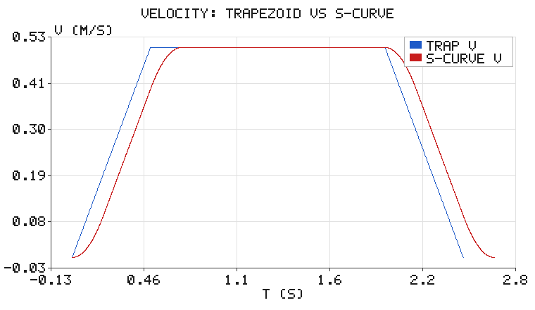
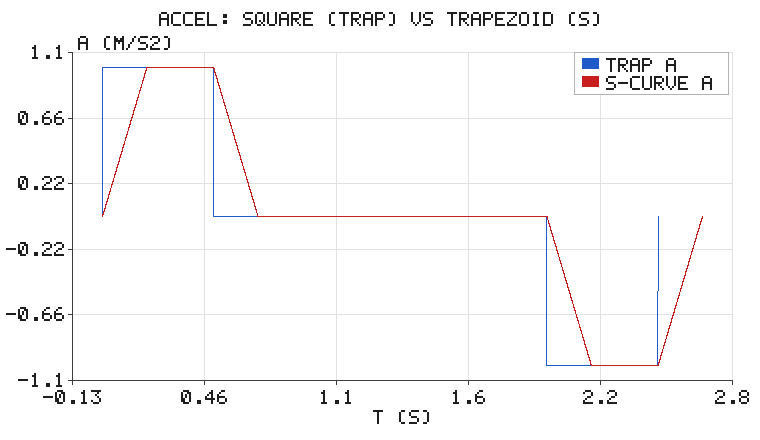

# 梯形与 S 曲线速度规划：为什么电梯不"猛加速"

路径规划告诉你"走哪条线"，**速度规划**告诉你"每个时刻走多快"。后者看起来只是
插值，实际上决定了机械系统的寿命和手感：加速度突变意味着**无穷大的 jerk**，
它会激起结构振动、让液体晃出来、让电机电流出现尖峰。

本篇用两种最经典的曲线做对比——**梯形速度**（时间最短）与 **S 曲线**（jerk 有界），
并给出精确的耗时差与约束验证。

## 1. 问题定义

把负载从静止移动距离 $d$，速度上限 $v_{\max}$、加速度上限 $a_{\max}$、
（对 S 曲线）加加速度上限 $j_{\max}$，要求末端**速度精确为 0**。

这在 ROS 里对应 `joint_trajectory_controller` 的插值、`nav2` 的 Velocity Smoother、
以及所有 CNC / 3D 打印机的运动规划模块。

## 2. 梯形速度曲线

加速度取三值：$+a_{\max}$、$0$、$-a_{\max}$，速度就是梯形（距离短时退化为三角形）。

加速段时长 $t_a = v_{\max}/a_{\max}$，加速+减速所需距离

$$
d_{\text{reach}} = \frac{v_{\max}^2}{a_{\max}}
$$

- 若 $d \ge d_{\text{reach}}$：有匀速段，$t_c = (d - d_{\text{reach}})/v_{\max}$；
- 否则冲不到 $v_{\max}$，峰值速度 $v_{\text{peak}} = \sqrt{a_{\max} d}$（三角形）。

例子（$d = 1$ m, $v_{\max} = 0.5$ m/s, $a_{\max} = 1$ m/s²）：
$t_a = 0.5$ s，$t_c = 1.5$ s，**总时长 2.5 s**，末端位置 1.000000 m、速度为 0。

## 3. S 曲线：把加速度也做成梯形

jerk 先 $+j_{\max}$、再 $0$、再 $-j_{\max}$，加速度平滑升到 $a_{\max}$，速度就成了
"双 S"（bell 形）。

若 $v_{\max} \ge a_{\max}^2 / j_{\max}$，加速段分三段：
$t_j = a_{\max}/j_{\max}$（jerk 段）与 $t_a = v_{\max}/a_{\max} - t_j$（恒加速段），
总加速时间 $T = 2t_j + t_a$。由于速度曲线关于中点对称，加速段位移

$$
d_{\text{acc}} = \frac{v_{\text{peak}}\,T}{2}
$$

距离不够时同样用二分法求可行的 $v_{\text{peak}}$，使 $2 d_{\text{acc}} = d$。

例子（$j_{\max} = 5$ m/s³）：$t_j = 0.2$ s，$t_a = 0.3$ s，
加速时间 0.7 s，**总时长 2.7 s**。

## 4. 结果对比



速度形状差别不大，都是"起来—巡航—落下"，但**耗时差 8%**（2.7 s vs 2.5 s）。
真正的差别在加速度上：



蓝线是梯形曲线的加速度：**方波**，在 $t = 0.5$ s 处从 $+1$ 直接跳到 $0$，
在 $t = 2.0$ s 处从 $0$ 直接跳到 $-1$。这些跳变点对应 jerk 为**冲击函数（无穷大）**，
物理上表现为"咔"的一声冲击和结构振动。

红线是 S 曲线的加速度：**梯形**，斜坡升到 $\pm a_{\max}$，jerk 恒为 $\pm 5$ m/s³ 有界。

| 指标 | 梯形 | S 曲线 |
|---|---|---|
| 总时长 | **2.500 s** | 2.700 s（+8.0%） |
| 峰值速度 | 0.50 m/s | 0.50 m/s |
| 峰值加速度 | 1.00 m/s² | 1.00 m/s² |
| 峰值 **jerk** | ∞（理论） | **5.00 m/s³**（恰达上限） |
| 末端位置误差 | 0 | 0 |

**用 8% 的时间，换 jerk 从无穷大降到有界。** 这就是电梯、CNC、协作机械臂
普遍采用 S 曲线的原因：省下的 8% 时间远不值机械磨损和振动抑制的代价。

## 5. 短距离：两条曲线都会退化

当 $d = 0.05$ m 时，两者都冲不到 $v_{\max}$：

| | 峰值速度 |
|---|---|
| 梯形 | 0.224 m/s |
| S 曲线 | 0.146 m/s |

S 曲线的峰值更低（32%），因为 jerk 限制让它"起步更慢"。这也是短行程点焊、
贴片机等场合偏好梯形的原因——行程短时 S 曲线的平滑优势不值那点时间。

## 6. 代码与运行

```bash
cd src/motion_planning/trapezoidal_profile
python3 tests/test_profile.py        # 11 项单元测试
./main.sh                            # 跑一次演示，配图写到 docs/img/motion_planning/trapezoidal_profile/
```

配图由 `scripts/main.py` 现场生成，默认输出目录就是本页图片所在位置，
脚本目录下不保留 PNG 副本（`--outdir <目录>` 可改）。`simple_plot.py`（手写 zlib PNG）
与 `sim_node.py`（闭环里的运动学模拟器）三个模块共用一个源码，放在
`src/motion_planning/common/`，构建时由各包 CMakeLists 拷进自己的 `lib/`。

```python
import profile as pf

tp = pf.TrapezoidProfile(distance=1.0, vmax=0.5, amax=1.0)
sc = pf.SCurveProfile(distance=1.0, vmax=0.5, amax=1.0, jmax=5.0)

s, v, a = tp.eval(0.25)              # 任意时刻的状态
print(tp.T, sc.T, sc.peak_jerk())
```

S 曲线用"分段解析 jerk + 数值积分"构造，最后用解析总距离做一次标定，
保证末端位置精确等于 $d$（实测误差 < 1e-6 m）。单测覆盖了极限情况：
短距离、$t_c = 0$、峰值 jerk 恰好达到 $j_{\max}$、位置单调性。


### 在 ROS 2 中跑闭环

上面的 `main.py` 是离线出图。真正接到 ROS 图里时，本包提供两个节点，`launch`
会一次把它们都起来：

```bash
cd <ros2_ws>
colcon build --packages-select trapezoidal_profile
source install/setup.bash
ros2 launch trapezoidal_profile trapezoidal_profile.launch.py
```

两个节点组成一条闭合的数据流——这正是"仿真器 + 传感器输入 + 控制输出"的最小形态：

```
sim_node（运动学自行车模型，扮演仿真器/传感器）
        │  /odom   nav_msgs/Odometry
        ▼
plan_control_node（规划 + 控制）
        │  /cmd_vel  geometry_msgs/Twist
        └─────────────────────► 回到 sim_node
        │  /planning/path  nav_msgs/Path
        └─────────────────────► RViz
```

| 方向 | 话题 | 类型 | 说明 |
|---|---|---|---|
| 发布 | `/odom` | `nav_msgs/Odometry` | 模拟器位姿与速度 |
| 订阅 | `/cmd_vel` | `geometry_msgs/Twist` | 模拟器接收速度指令 |
| 发布 | `/cmd_vel` | `geometry_msgs/Twist` | 控制节点输出速度指令 |
| 订阅 | `/odom` | `nav_msgs/Odometry` | 控制节点读取车辆状态 |
| 发布 | `/planning/path` | `nav_msgs/Path` | 规划结果，RViz 加 Path 显示即可看到 |

```bash
ros2 topic echo /odom                  # 车在动
ros2 topic echo /cmd_vel               # 控制输出
ros2 topic echo /planning/path --once  # 规划出的路点
rviz2                                  # 添加 Path 显示，Topic 选 /planning/path
```

换成真实机器人或 Carla / Gazebo 时，只需让它们发布 `/odom`、订阅 `/cmd_vel`，
控制节点不用改。要接仿真器但暂时没有，也可以只起 `sim_node.py`，用
`ros2 topic pub /cmd_vel ...` 手动验证链路通不通。

## 7. 实践要点

- **顺序要对**：先做路径规划（几何），再做速度规划（时间），最后才是跟踪控制。
- **约束来自硬件**：$a_{\max}$ 由电机力矩/惯量给出，$j_{\max}$ 由结构刚度给出，
  不是随便填的数字。
- **多轴同步**：多关节轨迹必须**按最长的那一轴做时间缩放**，
  否则会因为各轴时长不同而不协调（ROS 的 `time_scaling` 就是这个）。
- **在线重规划**：目标点连续变化时（如视觉伺服），每周期重算完整曲线会抖，
  常用"前瞻一小段"的做法。

## 8. 与已有内容的关系

- `motion_planning/rrt_path_planning.md`：解决"走哪条线"；
- 本篇：解决"沿着线怎么走"（时间参数化）；
- `motion_planning/stanley_tracking.md`：解决"实际跑偏了怎么修回来"。

三者构成"规划 → 参数化 → 跟踪"的完整链路。

---

> 本文档由 AI 辅助撰写，算法、代码与全部数值均在本地实跑验证（`tests/test_profile.py` 11 项全过）。
> 配图由纯标准库手写 PNG 编码生成。
