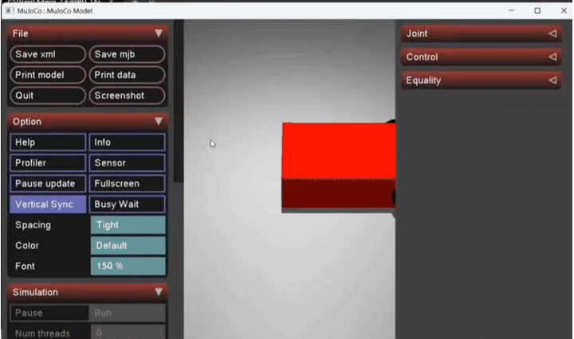

# 基于 Mujoco 的两轮小车运动仿真

## 运行环境
- Windows / Ubuntu 20.04
- Python 3.8+
- Mujoco 3.15.0

## 依赖安装
pip install mujoco

## 运行步骤
1. 打开终端，进入项目文件夹
2. 输入 `python main.py`
3. 观察 Mujoco 窗口中红色小车在灰色地面上向前移动

## 运行结果

## 大模型声明
代码由本人参考 Mujoco 官方文档和课程资料编写，未使用大模型生成。
