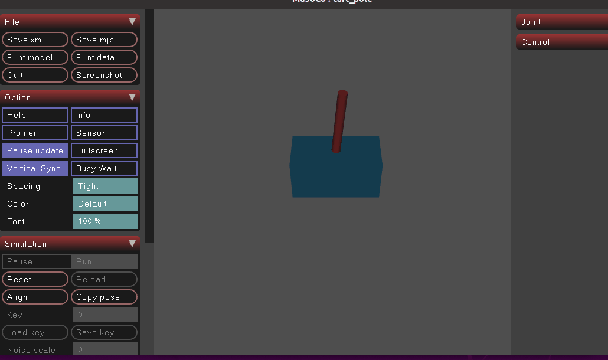

# MuJoCo 两轮自平衡机器人（倒立摆）LQR控制仿真
## 1.项目简介
本项目基于MuJoCo物理引擎搭建小车倒立摆动力学模型，使用LQR线性二次调节器实现摆杆直立稳定控制。
仿真给摆杆施加初始角度扰动，控制器实时计算输出力，维持倒立摆竖直平衡，可直观观察LQR控制效果。



## 2.环境依赖
1. Ubuntu 20.04
2. ROS Noetic
3. MuJoCo3.2.3
4. Python3.8.10
5. numpy 1.24.3、scipy1.10.1


## 3.安装步骤
1. 安装Python依赖
```bash
pip3 install -r src/mujoco_inverted_pendulum_lqr/requirements.txt
```
2. 编译 ROS 工作空间
```
cd ~/ground_ws
catkin_make
source devel/setup.bash
```
## 4. 文件结构

```
ros2/
├── src/
│   └── mujoco_inverted_pendulum_lqr/
│       ├── requirements.txt
│       ├── main.py
│       ├── balance.xml
│       ├── package.xml
│       ├── CMakeLists.txt
│       └── launch/
│           └── balance_lqr.launch
├── docs/
│   └── mujoco_inverted_pendulum_lqr/
│       ├── img/
│       │   └── balance_demo.gif
│       └── README.md

```
## 5. 运行方式

### 方式 1：项目根目录直接 Python 运行
```bash
python3 src/mujoco_inverted_pendulum_lqr/main.py
```
### 方式 2：ROS launch 启动

```
cd ~/ground_ws
catkin_make
source devel/setup.bash
roslaunch mujoco_inverted_pendulum_lqr balance_lqr.launch
```
## 6. 控制原理

1. 对小车倒立摆非线性动力学模型在平衡点附近线性化，得到状态空间方程
2. 设计 LQR 代价函数，求解状态反馈增益矩阵 K
3. 实时读取 MuJoCo 仿真状态，计算控制量施加给小车，抵消摆杆倾倒趋势

## 7. 仿真说明

- 摆杆总长度 0.3m，质心距离转轴 0.15m
- 仿真添加 0.2rad 初始倾斜扰动，用来触发控制器
- 代码加入 time.sleep 限制仿真速度，方便录制 GIF 动画

## 8. 常见问题

1. 找不到 balance.xml：脚本读取 XML 依赖运行时路径，建议在 ROS 工作空间根目录执行。
2. mujoco.viewer 无法弹出：检查显卡与虚拟机加速设置
3. `scipy 缺失：执行 pip3 install -r src/mujoco_inverted_pendulum_lqr/requirements.txt 安装对应版本依赖`。
4. XML 模型文件找不到：CMakeLists 已配置，将 balance.xml 安装至与 main.py 同级目录，脚本使用相对路径读取模型文件，直接运行 python 脚本或 roslaunch 均可正常加载。
5. 小车震荡飞出：代码对控制输入做限幅 [-10, 10]；可调整 LQR 的 Q、R 权重矩阵，改变控制器响应速度。
6. Python 依赖缺失：使用`pip3 install -r src/mujoco_inverted_pendulum_lqr/requirements.txt`一键安装锁定版本依赖。

## 9. 系统建模说明
XML物理模型参数：
- 小车质量 M = 1.0 kg
- 摆杆总长 L = 0.3 m，质点位于杆中点，等效摆长 l = 0.15 m
- 摆杆质量 m = 0.5 kg
 说明：本项目将摆杆简化为质点模型，质点位置在几何中心，参数在数值上与XML保持一致，但数学模型存在近似。
 若采用均匀细杆刚体模型，等效摆长为2L/3=0.2m，同时需要引入摆杆转动惯量；本项目选择质点简化方案。
 本项目在LQR线性化推导中忽略了关节阻尼以简化计算。物理仿真中引入微小阻尼以提升稳定性，属于工程上的近似假设。
#### XML模型优化说明
1. 相机姿态优化：将相机姿态定义从`zaxis`改为`xyaxes`，直接指定相机X、Y轴方向，消除视图倾斜问题，录制GIF画面水平稳定。
2. 碰撞设置优化：摆杆几何体增加`contype="0" conaffinity="0"`，关闭摆杆与小车之间的碰撞检测。防止摆杆大角度时与车体发生突发碰撞冲击，干扰LQR控制器稳定；此设置仅禁用杆车碰撞，小车与地面碰撞不受影响。