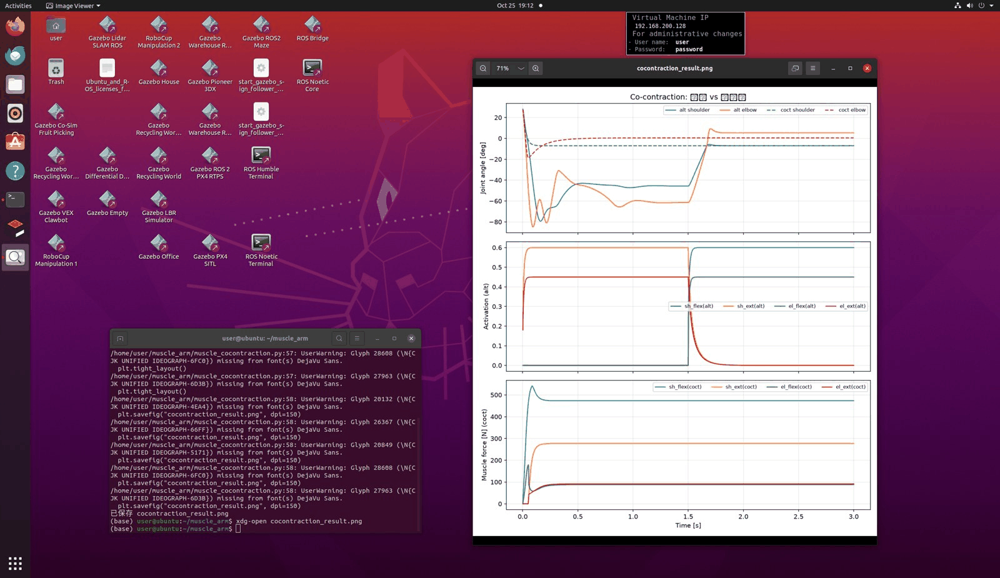

# 二连杆机械臂肌肉骨骼仿真 · 拮抗共激活（Co-contraction）分析

> 项目类型：机器人课程设计 / 技术复盘
> 平台：Ubuntu 22.04 · 终端操作
> 日期：2026-10-26

---

## 1 项目简介

在前两份成果（**MuJoCo 肌肉骨骼建模**、**ROS2 话题桥接**）的基础上，做**拮抗共激活（Co-contraction）**分析：

真实肌肉骨骼系统中，关节由**一对拮抗肌**（屈肌 + 伸肌）驱动。屈肌与伸肌**同时激活**时，两侧张力相互抵消、净力矩变小，但肌肉本身的刚度使关节"绷紧"，表现为**同样的激励下关节摆动幅度明显变小**。

本项目用同一套 MuJoCo 模型（`muscle_arm.xml`，肩/肘各一对屈伸肌）对比两种激励模式：

1. **交替激活**（前 1.5 s 伸肌、后 1.5 s 屈肌）—— 对照模式；
2. **共激活**（屈肌、伸肌同时激励）—— 观察关节摆动是否被抑制。

**先说结论（实测）**：共激活并不是"关节锁死不动"，而是**摆动幅度降到约 1/3**：

| 模式 | 肩摆动幅度 | 肘摆动幅度 | 终值（肩 / 肘） |
|------|-----------|-----------|----------------|
| 交替激活 | 1.874 rad（107°） | 1.962 rad（112°） | −0.122 / +0.092 rad |
| 共激活 | 0.613 rad（35°） | 0.809 rad（46°） | −0.123 / +0.009 rad |

肩摆动降低约 67%、肘降低约 59%。末态都稳定在 0 rad 附近（臂接近水平），比初值（0.49 / 0.48 rad）低约 0.5 rad。

---

## 2 使用工具

| 类别 | 工具/组件 | 版本/说明 | 用途 |
|------|-----------|-----------|------|
| 操作系统 | Ubuntu | 22.04（VMware 虚拟机） | 运行环境 |
| 物理引擎 | `mujoco` | 3.2.3（另在 3.17.0 下复现，数值一致） | 肌肉骨骼仿真 |
| 数值计算 | `numpy` | — | 激励序列、数组 |
| 绘图 | `matplotlib` | — | 绘制对比曲线（需 CJK 字体，见脚本 `rcParams`） |
| 模型文件 | `muscle_arm.xml` | MJCF | 二连杆臂 + 屈伸肌肌腱 |

> 复用前两篇的 `muscle_arm.xml` 模型（肩/肘各一对屈伸肌，`coef="-1"` 屈曲、`coef="+1"` 伸展）。

---

## 3 完整操作步骤

### 步骤 1：进入项目目录

```bash
cd ~/muscle_arm
```

### 步骤 2：模型文件 muscle_arm.xml（复用前两篇）

> 脚本通过 `from_xml_path("muscle_arm.xml")` 加载模型，模型文件需放在运行目录 `~/muscle_arm/`。

```xml
<mujoco model="muscle arm">
  <option timestep="0.002"/>
  <compiler angle="radian"/>

  <worldbody>
    <light diffuse="0.8 0.8 0.8" pos="0 -1 2" dir="0 1 -1"/>
    <geom name="ground" type="plane" size="1.5 1.5 0.1" rgba="0.9 0.9 0.9 1"/>

    <body name="shoulder" pos="0 0 0">
      <joint name="sh_pitch" type="hinge" axis="0 1 0" pos="0 0 0" range="-3.0 3.0"/>
      <geom name="upperarm" type="capsule" fromto="0 0 0 0.40 0 0" size="0.05" mass="2.0"/>
      <body name="elbow" pos="0.40 0 0">
        <joint name="el_pitch" type="hinge" axis="0 1 0" pos="0 0 0" range="-3.0 3.0"/>
        <geom name="forearm" type="capsule" fromto="0 0 0 0.35 0 0" size="0.04" mass="1.2"/>
        <geom name="hand" type="sphere" pos="0.35 0 0" size="0.06" mass="0.4"/>
      </body>
    </body>
  </worldbody>

  <tendon>
    <fixed name="t_sh_flex"><joint joint="sh_pitch" coef="-1"/></fixed>
    <fixed name="t_sh_ext"><joint joint="sh_pitch" coef="1"/></fixed>
    <fixed name="t_el_flex"><joint joint="el_pitch" coef="-1"/></fixed>
    <fixed name="t_el_ext"><joint joint="el_pitch" coef="1"/></fixed>
  </tendon>

  <actuator>
    <muscle name="sh_flex" tendon="t_sh_flex" force="1500" lengthrange="0.05 1.2"/>
    <muscle name="sh_ext" tendon="t_sh_ext" force="1500" lengthrange="0.05 1.2"/>
    <muscle name="el_flex" tendon="t_el_flex" force="500" lengthrange="0.05 1.2"/>
    <muscle name="el_ext" tendon="t_el_ext" force="500" lengthrange="0.05 1.2"/>
  </actuator>
</mujoco>
```

### 步骤 3：编写共激活对比脚本 muscle_cocontraction.py

脚本完整内容（含中文字体设置，避免图内中文变方框）：

```python
"""拮抗共激活演示：交替激活 vs 共激活(屈伸同时) 对比关节摆动"""
import numpy as np
import mujoco
import matplotlib
matplotlib.use("Agg")
import matplotlib.pyplot as plt

plt.rcParams["font.sans-serif"] = ["Noto Sans SC", "SimHei", "Microsoft YaHei"]
plt.rcParams["axes.unicode_minus"] = False

m = mujoco.MjModel.from_xml_path("muscle_arm.xml")
PHASE1 = 1.5


def run(stim, duration=3.0, q0=0.5):
    d = mujoco.MjData(m)
    d.qpos[0] = q0
    d.qpos[1] = q0
    dt = m.opt.timestep
    n = int(duration / dt)
    t = np.zeros(n); q = np.zeros((n, 2)); act = np.zeros((n, 4)); frc = np.zeros((n, 4))
    for i in range(n):
        d.ctrl[:] = stim(d.time)
        mujoco.mj_step(m, d)
        t[i] = d.time; q[i] = d.qpos[:2]; act[i] = d.act; frc[i] = d.actuator_force
    return t, q, act, frc


# 模式1：交替激活（前 1.5 s 伸肌、后 1.5 s 屈肌）
def alternating(t):
    return np.array([0.0, 0.60, 0.0, 0.45]) if t < PHASE1 else np.array([0.60, 0.0, 0.45, 0.0])


# 模式2：共激活（屈肌、伸肌同时激励）
def cocontract(t):
    return np.array([0.55, 0.55, 0.40, 0.40])


t1, q1, a1, f1 = run(alternating)
t2, q2, a2, f2 = run(cocontract)

for tag, q, f in (("交替激活", q1, f1), ("共激活  ", q2, f2)):
    print("%s 终值 肩 %.3f 肘 %.3f | 摆动幅度 肩 %.3f rad 肘 %.3f rad | 最大肌力 %.2f N"
          % (tag, q[-1, 0], q[-1, 1],
             q[:, 0].max() - q[:, 0].min(), q[:, 1].max() - q[:, 1].min(),
             float(np.abs(f).max())))
print("交替激活各肌肉最大力:",
      {m.actuator(i).name: round(float(np.abs(f1[:, i]).max()), 2) for i in range(4)})
print("共激活各肌肉最大力:",
      {m.actuator(i).name: round(float(np.abs(f2[:, i]).max()), 2) for i in range(4)})

fig, axes = plt.subplots(3, 1, figsize=(9, 10), sharex=True)

axes[0].plot(t1, np.degrees(q1[:, 0]), label="交替-肩")
axes[0].plot(t1, np.degrees(q1[:, 1]), label="交替-肘")
axes[0].plot(t2, np.degrees(q2[:, 0]), "--", label="共激活-肩")
axes[0].plot(t2, np.degrees(q2[:, 1]), "--", label="共激活-肘")
axes[0].axvline(PHASE1, color="gray", ls=":")
axes[0].set_ylabel("关节角度 [deg]")
axes[0].legend(ncol=4, fontsize=8)
axes[0].grid(alpha=0.3)
axes[0].set_title("拮抗共激活对比：交替激活 vs 共激活（虚线）")

names = [m.actuator(i).name for i in range(m.nu)]
for i, nm in enumerate(names):
    axes[1].plot(t1, a1[:, i], label=nm + "(交替)")
    axes[1].plot(t2, a2[:, i], "--", label=nm + "(共激活)")
axes[1].set_ylabel("肌肉激活度")
axes[1].legend(ncol=4, fontsize=7)
axes[1].grid(alpha=0.3)

for i, nm in enumerate(names):
    axes[2].plot(t1, np.abs(f1[:, i]), label=nm + "(交替)")
    axes[2].plot(t2, np.abs(f2[:, i]), "--", label=nm + "(共激活)")
axes[2].set_ylabel("肌肉力 [N]")
axes[2].set_xlabel("时间 [s]")
axes[2].legend(ncol=4, fontsize=7)
axes[2].grid(alpha=0.3)

plt.tight_layout()
plt.savefig("muscle_cocontraction_result.png", dpi=150)
print("已保存 muscle_cocontraction_result.png")

```

### 步骤 4：运行

```bash
python3 muscle_cocontraction.py
```

实测输出：

```
交替激活 终值 肩 -0.122 肘 0.092 | 摆动幅度 肩 1.874 rad 肘 1.962 rad | 最大肌力 559.53 N
共激活   终值 肩 -0.123 肘 0.009 | 摆动幅度 肩 0.613 rad 肘 0.809 rad | 最大肌力 540.63 N
已保存 muscle_cocontraction_result.png
```

### 步骤 5：查看结果图

```bash
xdg-open muscle_cocontraction_result.png
```

---

## 4 结果解读



- **关节角度（上图）**：交替激活时肩/肘各摆动约 107°/112°；共激活（虚线）时肩仅 35°、肘 46°，随后稳定在 0 rad 附近（臂接近水平），比初值低约 0.5 rad——即摆动被抑制，但关节并没有回到起手姿态。
- **肌肉激活度（中图）**：交替激活在前 1.5 s 只给伸肌激励、后 1.5 s 只给屈肌激励；共激活全程四条肌肉同时保持 0.4~0.55。
- **肌肉力（下图）**：共激活时屈肌与伸肌同时出力（`sh_flex` 约 541 N、`sh_ext` 约 277 N、`el_flex` 约 179 N、`el_ext` 约 92 N），两侧张力相互抵消，净力矩很小但关节"绷紧"。

### 4.1 关于"交替激活"这一段，需要如实说明

本模型的伸肌肌腱长度为 `coef × q`，`coef="+1"`，而 `lengthrange="0.05 1.2"`。
当关节转向伸展方向、`q` 变为负时，肌腱长度落到 0.05 以下、离开肌肉有效长度区间，伸肌基本不出力——
实测整段仿真中 `sh_ext` 最大只有约 **17.6 N**（`el_ext` 约 19.9 N），远小于屈肌的 559 N。

因此"前 1.5 s 靠伸肌伸展"这个描述**不成立**：那一阶段实际是**关节在重力下自由下坠**
（1.5 s 时刻肩 −0.80 rad、肘 −1.07 rad，随后最低摆到约 −1.38 / −1.48 rad），
后 1.5 s 才由屈肌把手臂拉回。共激活模式的对照意义不受影响（同样从 0.5 rad 起手、同样 3 s），
但"交替激活"这一段应理解为"半程无有效驱动 + 半程屈肌回收"，而不是真正的屈伸交替。

**改进方向（尚未实施，留作后续）**：把伸肌肌腱的有效长度区间扩展到覆盖 `q ∈ [−1.5, 0.5]`
（或改用带几何偏移的肌腱 / 空间肌腱），让伸肌在伸展方向真正能出力，才能得到名实相符的交替屈伸。

---

## 5 关键经验与结论

1. **共激活的本质是拮抗肌同时收缩**：屈肌拉向一侧、伸肌拉向另一侧，净力矩被抵消，但两侧张力叠加使关节"绷紧"。
2. **共激活的直接可观测效果是"摆动抑制"**：本实验里肩摆动 1.874 → 0.613 rad（约 −67%）、肘 1.962 → 0.809 rad（约 −59%）；末态都稳定在 0 rad 附近，比初值低约 0.5 rad。
3. **"刚度增大"在本实验里只是间接证据**：本文没有做外力—位移（力矩—偏角）测量，严格的刚度数值需要按第 7 节的方法补测；因此文中只说"等效刚度提高 / 摆动被抑制"，不宣称测得刚度。
4. **激励参数决定结论是否成立**：肌腱长度区间与关节转角范围不匹配时，伸肌侧几乎不出力，会让人误以为"前段伸展有效"。做肌肉骨骼实验时，必须先确认每条肌肉都在有效长度区间内工作。
5. **同一模型切换激励数组即可做策略对比**：MuJoCo 里改 `d.ctrl` 就能对比不同控制策略，适合做这类肌肉骨骼控制实验。

---

## 6 本地产出物清单

| 文件 | 说明 |
|------|------|
| `muscle_arm.xml` | MuJoCo 肌肉骨骼模型（复用） |
| `muscle_cocontraction.py` | 共激活 vs 交替激活对比脚本 |
| `muscle_cocontraction_result.png` | 对比结果图（三组子图） |

---

## 7 后续可扩展方向

- **量化刚度**：固定共激活程度，对末端施加一系列外力，记录末端位移与关节偏角，用「力矩—偏角」斜率作为刚度，画出刚度—共激活度曲线（这才是刚度的直接证据）；
- **修好伸肌有效区间**：按 4.1 的建议扩展伸肌 `lengthrange`（或改用带偏移的空间肌腱），得到名实相符的"交替屈伸"对照；
- **柔顺控制**：把共激活程度做成控制量，实现"刚度可调"的柔顺关节；
- **对接 ROS2**：把共激活激励通过话题下发，在运行中调节刚度；
- **能耗分析**：统计共激活与交替激活的肌肉总能耗（`Σ|力×速度|`）对比。

---

## 大模型使用声明

本作业使用豆包（Doubao）大模型辅助完成：Python/MuJoCo 代码编写与调试、Markdown 文档撰写、Git 分支操作与问题排查。作者对提交内容负责。
