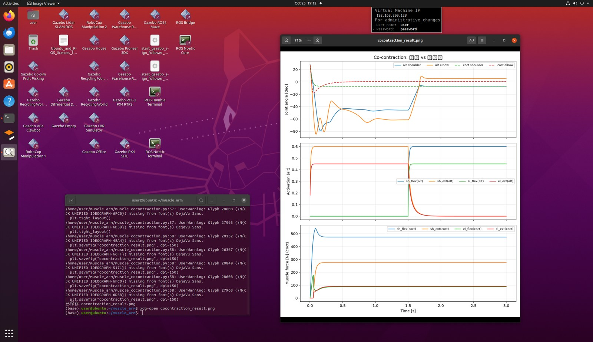

# 二连杆机械臂肌肉骨骼仿真 · 拮抗共激活（Co-contraction）分析

> 项目类型：机器人课程设计 / 技术复盘
> 平台：Ubuntu 22.04 · 终端操作
> 日期：2026-10-26

---

## 1 项目简介

在前两份成果（**MuJoCo 肌肉骨骼建模**、**ROS2 话题桥接**）的基础上，做**拮抗共激活（Co-contraction）**分析：

真实肌肉骨骼系统中，关节由**一对拮抗肌**（屈肌 + 伸肌）驱动。当屈肌和伸肌**同时激活**（共激活）时，两者互相"锁紧"，关节**刚度增大、抗扰动能力增强**，但代价是能耗和疲劳增加。这在机器人柔顺控制、外骨骼柔顺性、以及仿生关节设计中有重要意义。

本项目通过 MuJoCo 仿真，对比两种激励模式：

1. **交替激活** —— 前段激活伸肌、后段激活屈肌，关节大幅屈伸运动；
2. **共激活（co-contraction）** —— 屈肌与伸肌同时激励，关节被肌肉锁紧、几乎不动。

从而直观展示**共激活增加关节刚度**的机理。

---

## 2 使用工具

| 类别 | 工具/组件 | 版本/说明 | 用途 |
|------|-----------|-----------|------|
| 操作系统 | Ubuntu | 22.04（VMware 虚拟机） | 运行环境 |
| 物理引擎 | `mujoco` | 3.2.3 | 肌肉骨骼仿真 |
| 数值计算 | `numpy` | — | 激励序列、数组 |
| 绘图 | `matplotlib` | — | 绘制对比曲线 |
| 模型文件 | `muscle_arm.xml` | MJCF | 二连杆臂 + 屈伸肌肌腱 |

> 复用前两篇的 `muscle_arm.xml` 模型（肩/肘各一对屈伸肌，`coef="-1"` 屈曲、`coef="+1"` 伸展）。

---

## 3 完整操作步骤

### 步骤 1：进入项目目录

```bash
cd ~/muscle_arm
```

### 步骤 2：编写共激活对比脚本 muscle_cocontraction.py

```bash
nano muscle_cocontraction.py
```

脚本完整内容：

```python
"""拮抗共激活演示：交替激活 vs 共激活(屈伸同时) 对比关节刚度"""
import numpy as np
import mujoco
import matplotlib
matplotlib.use("Agg")
import matplotlib.pyplot as plt

m = mujoco.MjModel.from_xml_path("muscle_arm.xml")

PHASE1 = 1.5

def run(stim, duration=3.0, q0=0.5):
    d = mujoco.MjData(m)
    d.qpos[0] = q0
    d.qpos[1] = q0
    dt = m.opt.timestep
    n = int(duration / dt)
    t = np.zeros(n); q = np.zeros((n, 2)); act = np.zeros((n, 4)); frc = np.zeros((n, 4))
    for i in range(n):
        d.ctrl[:] = stim(d.time)
        mujoco.mj_step(m, d)
        t[i]=d.time; q[i]=d.qpos[:2]; act[i]=d.act; frc[i]=d.actuator_force
    return t, q, act, frc

# 模式1：交替激活（前1.5s伸肌，后1.5s屈肌）—— 关节大幅运动
def alternating(t):
    return np.array([0.0, 0.60, 0.0, 0.45]) if t < PHASE1 else np.array([0.60, 0.0, 0.45, 0.0])

# 模式2：共激活（屈伸肌同时激励）—— 关节被肌肉锁住，刚度增大
def cocontract(t):
    return np.array([0.55, 0.55, 0.40, 0.40])

t1, q1, a1, f1 = run(alternating)
t2, q2, a2, f2 = run(cocontract)

print("交替激活: 肩 %.3f->%.3f  肘 %.3f->%.3f (幅度大)" % (q1[0,0], q1[-1,0], q1[0,1], q1[-1,1]))
print("共激活  : 肩 %.3f->%.3f  肘 %.3f->%.3f (几乎不动=锁住)" % (q2[0,0], q2[-1,0], q2[0,1], q2[-1,1]))

fig, axes = plt.subplots(3, 1, figsize=(9, 10), sharex=True)
axes[0].plot(t1, np.degrees(q1[:,0]), label="alt shoulder")
axes[0].plot(t1, np.degrees(q1[:,1]), label="alt elbow")
axes[0].plot(t2, np.degrees(q2[:,0]), '--', label="coct shoulder")
axes[0].plot(t2, np.degrees(q2[:,1]), '--', label="coct elbow")
axes[0].set_ylabel("Joint angle [deg]"); axes[0].legend(ncol=4, fontsize=8); axes[0].grid(alpha=0.3)
axes[0].set_title("Co-contraction: 交替 vs 共激活")

names = [m.actuator(i).name for i in range(m.nu)]
for i, nm in enumerate(names):
    axes[1].plot(t1, a1[:, i], label=nm+"(alt)")
axes[1].set_ylabel("Activation (alt)"); axes[1].legend(ncol=4, fontsize=8); axes[1].grid(alpha=0.3)

for i, nm in enumerate(names):
    axes[2].plot(t2, np.abs(f2[:, i]), label=nm+"(coct)")
axes[2].set_ylabel("Muscle force [N] (coct)"); axes[2].set_xlabel("Time [s]")
axes[2].legend(ncol=4, fontsize=8); axes[2].grid(alpha=0.3)

plt.tight_layout()
plt.savefig("cocontraction_result.png", dpi=150)
print("已保存 cocontraction_result.png")
```

### 步骤 3：运行

```bash
python3 muscle_cocontraction.py
```

### 步骤 4：查看结果图

```bash
xdg-open cocontraction_result.png
```

---

## 4 结果解读

**实际运行截图**（终端运行脚本 + 打开结果图 cocontraction_result.png）：



- **交替激活（实线）**：肩/肘角度大幅屈伸运动，关节自由活动；
- **共激活（虚线）**：屈伸肌同时收缩，肌肉互相锁紧，关节角度几乎不动——关节**刚度增大、被锁住**；
- **力曲线**：共激活时四条肌肉同时发力（绝对值都非零），说明刚度来自主动肌肉的相互对抗。

---

## 5 关键经验与结论

1. **共激活的本质是拮抗肌同时收缩**：屈肌拉向正方向、伸肌拉向负方向，净力矩被抵消，但肌肉本身的刚度（主动 + 被动）使关节"绷紧"。
2. **刚度 vs 运动的权衡**：共激活提高抗扰动稳定性（刚度大、位置不易偏移），但代价是能耗高、关节响应慢、易疲劳——这正是真实人体和仿生关节的折衷。
3. **与机器人柔顺控制的关系**：类似"阻抗控制"中的高刚度设定；外骨骼、机械臂在需要稳定承载时用高刚度，在需要柔顺交互时降低共激活程度。
4. **MuJoCo 便于对比**：同一模型切换激励数组即可做不同控制策略的对比，是研究肌肉骨骼控制的有效工具。

---

## 6 本地产出物清单

> 以下文件在 Ubuntu 虚拟机本地生成。

| 文件 | 说明 |
|------|------|
| `muscle_arm.xml` | MuJoCo 肌肉骨骼模型（复用） |
| `muscle_cocontraction.py` | 共激活 vs 交替激活对比脚本 |
| `cocontraction_result.png` | 对比结果图 |

---

## 7 后续可扩展方向

- **量化刚度**：对共激活关节施加外力，测定位移与力矩比，画出刚度-共激活度曲线；
- **柔顺控制**：把共激活程度做成控制量，实现"刚度可调"的柔顺关节控制；
- **对接 ROS2**：将共激活模式的肌肉激励通过 `/muscle_cmd` 话题下发，闭环调节关节刚度；
- **能耗分析**：统计共激活与交替激活的肌肉总能耗对比。
