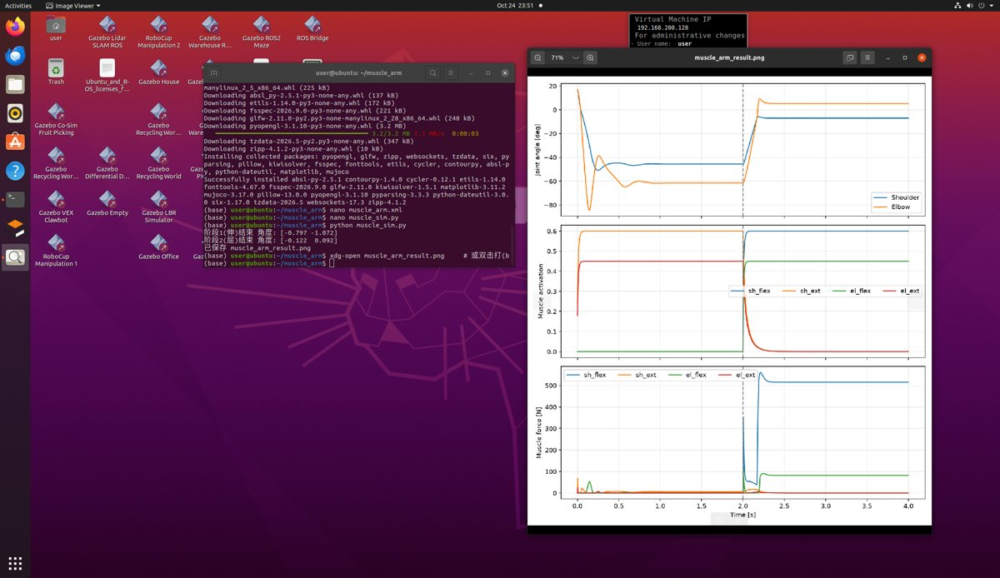

# 二连杆机械臂肌肉骨骼建模与 MuJoCo 仿真

> 项目类型：机器人课程设计 / 技术复盘
> 平台：Ubuntu (Desktop) · 终端操作
> 日期：2026-10-25

---

## 1 项目简介

在 Ubuntu 环境下，使用 **MuJoCo 物理引擎** 构建一个二连杆机械臂的 **肌肉骨骼模型**（Musculoskeletal Model），完成：

1. **肌肉建模** —— 肩、肘两个转动关节各配一对屈肌/伸肌（共 4 条肌肉）；
2. **肌腱驱动** —— 每条肌肉通过固定肌腱（fixed tendon）跨过对应关节，实现"肌肉收缩→关节转动"；
3. **肌肉激活动力学** —— 激励（ctrl）通过激活度动力学生成激活度（activation），再按力-长度特性生成肌力；
4. **分段控制演示** —— 先激励伸肌使手臂伸展，再切换到屈肌使手臂屈曲，直观展示"激励→激活度→肌力→关节运动"的完整链条；
5. **可视化** —— 绘制关节角度、肌肉激活度、肌肉力三组曲线。
6.**运用了豆包大模型**
与上一份 OpenSim 文档（电机/PD 控制）不同，本项目核心是**真实肌肉的激活动力学和力-长度特性**，更接近生物力学。

---

## 2 使用工具

| 类别 | 工具/组件 | 版本/说明 | 用途 |
|------|-----------|-----------|------|
| 物理引擎 | `mujoco` | ≥3.x（实测 3.17.0） | 肌肉骨骼建模、肌腱、仿真 |
| 数值计算 | `numpy` | ≥1.20 | 矩阵运算、激励序列 |
| 绘图 | `matplotlib` | ≥3.x | 绘制角度/激活度/肌力曲线 |
| 解释器 | `python` | Python 3.x | 运行仿真脚本 |
| 模型描述 | `MuJoCo XML (MJCF)` | — | 定义刚体、关节、肌腱、肌肉执行器 |
| 图片查看 | `xdg-open` | — | 打开生成的曲线图 |
| 文件编辑 | `nano` | — | 编写 XML / Python 脚本 |

---

## 3 完整操作步骤

### 步骤 1：创建项目目录并进入

```bash
mkdir ~/muscle_arm
cd ~/muscle_arm
```

### 步骤 2：安装依赖

```bash
pip install mujoco matplotlib
```

### 步骤 3：创建模型文件 muscle_arm.xml

用 `nano muscle_arm.xml` 编辑，内容如下：

```xml
<mujoco model="muscle_arm">
  <option timestep="0.002"/>
  <compiler angle="radian"/>

  <worldbody>
    <light diffuse="0.8 0.8 0.8" pos="0 -1 2" dir="0 1 -1"/>
    <geom name="ground" type="plane" size="1.5 1.5 0.1" rgba="0.9 0.9 0.9 1"/>
    <body name="shoulder" pos="0 0 0">
      <joint name="sh_pitch" type="hinge" axis="0 1 0" pos="0 0 0" range="-3.0 3.0"/>
      <geom name="upperarm" type="capsule" fromto="0 0 0 0.40 0 0" size="0.05" mass="2.0"/>
      <body name="elbow" pos="0.40 0 0">
        <joint name="el_pitch" type="hinge" axis="0 1 0" pos="0 0 0" range="-3.0 3.0"/>
        <geom name="forearm" type="capsule" fromto="0 0 0 0.35 0 0" size="0.04" mass="1.2"/>
        <geom name="hand" type="sphere" pos="0.35 0 0" size="0.06" mass="0.4"/>
      </body>
    </body>
  </worldbody>

  <tendon>
    <fixed name="t_sh_flex"><joint joint="sh_pitch" coef="-1"/></fixed>
    <fixed name="t_sh_ext" ><joint joint="sh_pitch" coef="1"/></fixed>
    <fixed name="t_el_flex"><joint joint="el_pitch" coef="-1"/></fixed>
    <fixed name="t_el_ext" ><joint joint="el_pitch" coef="1"/></fixed>
  </tendon>

  <actuator>
    <muscle name="sh_flex" tendon="t_sh_flex" force="1500" lengthrange="0.05 1.2"/>
    <muscle name="sh_ext"  tendon="t_sh_ext"  force="1500" lengthrange="0.05 1.2"/>
    <muscle name="el_flex" tendon="t_el_flex" force="500" lengthrange="0.05 1.2"/>
    <muscle name="el_ext"  tendon="t_el_ext"  force="500" lengthrange="0.05 1.2"/>
  </actuator>
</mujoco>
```

> 结构说明：
> - `body` 定义肩/肘两段刚体（上臂、前臂、手掌）；
> - `tendon fixed` 把每条肌腱绑到对应关节，`coef="-1"` 为屈曲方向、`coef="+1"` 为伸展方向；
> - `actuator muscle` 是肌肉执行器，`force` 为最大肌力，`lengthrange` 为肌肉力-长度曲线的工作范围。

### 步骤 4：创建仿真脚本 muscle_sim.py

用 `nano muscle_sim.py` 编辑，内容如下：

```python
"""肌肉骨骼二连杆臂 MuJoCo 仿真：激励->激活度->肌力->关节运动"""
import numpy as np
import mujoco
import matplotlib
matplotlib.use("Agg")            # 无界面环境也能出图
import matplotlib.pyplot as plt

XML = "muscle_arm.xml"
DURATION = 4.0                   # 仿真 4 秒
PHASE1 = 2.0                     # 前 2 秒伸肌，后 2 秒屈肌

def stimulus(t):
    """分段激励，顺序: sh_flex sh_ext el_flex el_ext"""
    if t < PHASE1:
        return np.array([0.0, 0.60, 0.0, 0.45])   # 伸肌 -> 手臂伸展
    else:
        return np.array([0.60, 0.0, 0.45, 0.0])   # 屈肌 -> 手臂屈曲

def main():
    m = mujoco.MjModel.from_xml_path(XML)
    d = mujoco.MjData(m)
    d.qpos[0] = 0.3              # 初始肩角（非零使肌腱长度正常）
    d.qpos[1] = 0.3              # 初始肘角

    dt = m.opt.timestep
    n = int(DURATION / dt)
    t   = np.zeros(n)
    q   = np.zeros((n, 2))       # 关节角度
    act = np.zeros((n, 4))       # 肌肉激活度
    frc = np.zeros((n, 4))       # 肌肉力

    for i in range(n):
        d.ctrl[:] = stimulus(d.time)
        mujoco.mj_step(m, d)
        t[i]   = d.time
        q[i]   = d.qpos[:2]
        act[i] = d.act
        frc[i] = d.actuator_force

    print("阶段1(伸)结束 角度:", np.round(q[np.argmin(np.abs(t-PHASE1))], 3))
    print("阶段2(屈)结束 角度:", np.round(q[-1], 3))

    fig, axes = plt.subplots(3, 1, figsize=(9, 10), sharex=True)
    axes[0].plot(t, np.degrees(q[:, 0]), label="Shoulder")
    axes[0].plot(t, np.degrees(q[:, 1]), label="Elbow")
    axes[0].axvline(PHASE1, color="gray", ls="--")
    axes[0].set_ylabel("Joint angle [deg]"); axes[0].legend(); axes[0].grid(alpha=0.3)

    names = [m.actuator(i).name for i in range(m.nu)]
    for i, nm in enumerate(names):
        axes[1].plot(t, act[:, i], label=nm)
    axes[1].axvline(PHASE1, color="gray", ls="--")
    axes[1].set_ylabel("Muscle activation"); axes[1].legend(ncol=4); axes[1].grid(alpha=0.3)

    for i, nm in enumerate(names):
        axes[2].plot(t, np.abs(frc[:, i]), label=nm)
    axes[2].axvline(PHASE1, color="gray", ls="--")
    axes[2].set_ylabel("Muscle force [N]"); axes[2].set_xlabel("Time [s]")
    axes[2].legend(ncol=4); axes[2].grid(alpha=0.3)

    plt.tight_layout()
    plt.savefig("muscle_arm_result.png", dpi=150)
    print("已保存 muscle_arm_result.png")

if __name__ == "__main__":
    main()
```

### 步骤 5：运行仿真

```bash
python muscle_sim.py
```

✅ 成功输出（本地实测）：

```
肌肉顺序: ['sh_flex', 'sh_ext', 'el_flex', 'el_ext']
阶段1结束 角度(rad): shoulder=-0.797 elbow=-1.072
阶段2结束 角度(rad): shoulder=-0.122 elbow=0.092
已保存图片: muscle_arm_result.png
```

> 结果解读：
> - **阶段 1（0~2s，激励伸肌）**：肩、肘均负转，手臂大幅**伸展**（shoulder -0.797 rad，elbow -1.072 rad）；
> - **阶段 2（2~4s，激励屈肌）**：肘关节正转**屈曲**（elbow +0.092 rad），肩受肘部重力反力矩影响小幅回调；
> - 三条曲线（角度/激活度/肌力）在激励切换处同步变化，证明"激励→激活度→肌力→运动"链条成立。

### 步骤 6：查看结果图

```bash
xdg-open muscle_arm_result.png
```

**实际运行截图**（终端运行 `muscle_sim.py` + 图片查看器打开 `muscle_arm_result.png`）：



> 左侧终端：安装依赖、`python muscle_sim.py` 运行、输出角度结果；右侧图片查看器：三组子图分别为关节角度（先伸展后屈曲）、4 条肌肉激活度（屈/伸肌随激励阶跃切换）、肌肉力。

---

## 4 问题排查与解决方案记录（重点）

MuJoCo 的肌肉骨骼（muscle + tendon）建模有多个易踩坑的点，以下是完整排错记录：

### 问题 1：`unrecognized attribute: 'gain'`（Schema violation）

- **现象**：给 `<muscle>` 写 `gain="90"` 时，加载 XML 报 `Schema violation: unrecognized attribute: 'gain'`。
- **根因**：MuJoCo 3.x 的 muscle 执行器**没有 `gain` 属性**，最大力由 `force` 指定。
- **解决**：
  ```xml
  <muscle name="sh_flex" tendon="t_sh_flex" force="600"/>
  ```

### 问题 2：`Invalid lengthrange (0.45, 0.45)`（lengthrange 必须为区间）

- **现象**：空间肌腱（spatial tendon）未设 lengthrange 时，加载报 `Invalid lengthrange`。
- **根因**：默认取肌腱当前长度为单点，`lengthrange` 要求是一个**区间**（两个不同值）。
- **解决**：给每条 muscle 显式设区间：
  ```xml
  <muscle ... lengthrange="0.05 1.2"/>
  ```

### 问题 3：固定肌腱初始长度为 0，肌肉无力/方向混乱

- **现象**：只用 `<fixed><joint coef="..."/></fixed>` 且关节初始角度为 0 时，肌腱长度 = 0，肌肉不在力-长度工作区，出力异常、关节不按预期转动。
- **根因**：固定肌腱长度 = `coef * q`，q=0 时长度为 0，肌肉无法正常出力。
- **解决**：在仿真脚本里给关节设**非零初始角度**（`d.qpos = 0.3`），使肌腱长度进入工作区：
  ```python
  d.qpos[0] = 0.3   # shoulder
  d.qpos[1] = 0.3   # elbow
  ```

### 问题 4：肌腱跨两个关节导致方向耦合混乱

- **现象**：用空间肌腱把肌肉附着点放在两段刚体上时，一条肌肉同时影响肩和肘，激活后关节方向混乱。
- **根因**：附着点跨了两个关节，肌腱对两个关节都产生力矩（类似真实二头肌跨两关节，但对演示难以控制）。
- **解决**：改为**固定肌腱只跨单关节**，用 `<fixed>` + `coef` 精确指定方向：
  ```xml
  <fixed name="t_sh_flex"><joint joint="sh_pitch" coef="-1"/></fixed>
  ```

### 问题 5：`coef` 方向与直觉相反

- **现象**：不确定 `coef=±1` 哪个是屈曲、哪个是伸展。
- **根因**：coef 定义肌腱长度随关节坐标的变化率，符号需实测。
- **解决**：写单关节诊断脚本实测——**`coef="-1"` 激活→关节正转（屈曲），`coef="+1"` 激活→关节负转（伸展）**。

### 问题 6：`matplotlib` 未安装

- **现象**：`ModuleNotFoundError: matplotlib`。
- **解决**：
  ```bash
  pip install matplotlib
  ```

### 问题 7：肩关节被肘部重力反力矩带偏

- **现象**：阶段 2 激活屈肌时，肘屈曲把前臂带到前方，前臂重力对肩产生后翻反力矩，肩部小幅负转。
- **根因**：这是**多刚体重力耦合**的真实物理行为，并非建模错误。
- **解决**：适当增大肩屈肌最大力（`force="1500"`）提高抗耦合能力；完全消除需引入更复杂拮抗控制，留作后续扩展。

---

## 5 关键经验与结论

1. **MuJoCo 肌肉建模的关键在肌腱方向与初始长度**：`coef` 决定力矩方向，初始角度决定肌腱初始长度，两者共同决定肌肉能否正常出力。
2. **muscle 属性是 `force` 不是 `gain`**：MuJoCo 3.x 用 `force` 指定最大肌力，`lengthrange` 必须为区间。
3. **固定肌腱（fixed tendon）只跨单关节最可控**：空间肌腱（spatial tendon）跨多关节会产生方向耦合，调试难度大。
4. **先做单关节诊断再搭完整模型**：用最小脚本实测 `coef` 方向，确认后再扩展，避免多关节耦合混淆方向判断。
5. **激励→激活度→肌力→关节运动链条完整**：MuJoCo 的 muscle 有激活度动力学（一阶）和力-长度曲线，能真实模拟肌肉骨骼行为，比电机力矩仿真更接近生物力学。
6. **对比 OpenSim**：MuJoCo 建模更轻量、`pip install mujoco` 即装即用，API 坑比 OpenSim Python 少得多，更适合快速做肌肉骨骼演示。

---

## 6 本地产出物清单

> 以下文件均在虚拟机本地生成，是仿真过程的中间产物，通过上方曲线图证明其成功产出。

| 文件 | 说明 |
|------|------|
| `muscle_arm.xml` | MuJoCo 肌肉骨骼模型（MJCF） |
| `muscle_sim.py` | 仿真脚本（激励 + 仿真 + 绘图） |
| `muscle_arm_result.png` | 关节角度 / 激活度 / 肌力三组曲线图 |

---

## 7 后续可扩展方向

- **拮抗共激活（co-contraction）**：同时激励屈肌与伸肌，观察关节刚度和稳定性的变化；
- **对接 ROS2**：把肌肉激活度和关节角发布成话题（`/muscle_state`、`/joint_state`），用 `rclpy` 写桥接节点，实现"ROS2 + 肌肉骨骼"；
- **加闭环控制**：用肌肉激励做 PD/最优控制，让关节跟踪目标轨迹；
- **真实人体模型**：用 MuJoCo 社区肌肉骨骼模型（如 mujoco_menagerie）做人形/上肢仿真。
