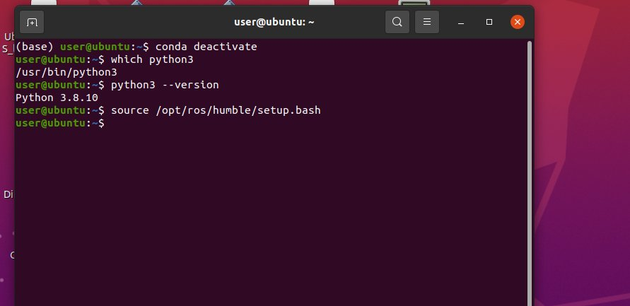
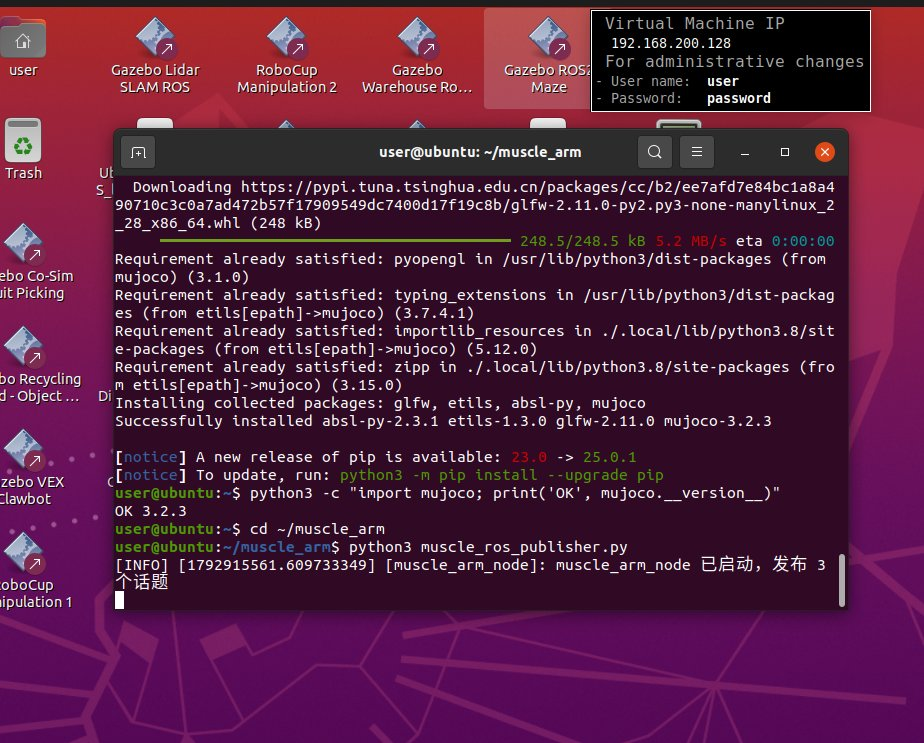
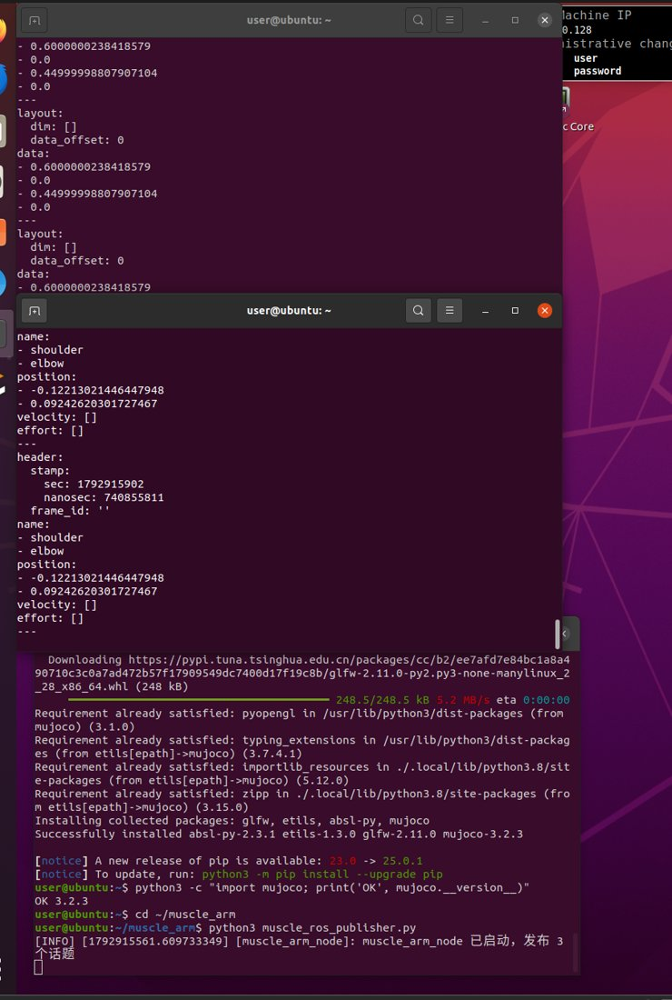

# 二连杆机械臂肌肉骨骼仿真 · ROS2 话题桥接

> 项目类型：机器人课程设计 / 技术复盘
> 平台：Ubuntu 22.04 + ROS2 Humble · 终端操作
> 日期：2026-10-25

---

## 1 项目简介

在上一份 **MuJoCo 肌肉骨骼二连杆臂仿真** 的基础上，接入 **ROS2（Humble）**，编写一个 ROS2 桥接节点，把肌肉骨骼仿真产生的数据发布成标准话题，实现"**ROS2 + 肌肉骨骼**"：

1. **实时仿真** —— 节点内用 MuJoCo 推进二连杆臂肌肉骨骼模型（屈/伸肌肌腱驱动）；
2. **话题发布** —— 每步把关节角、肌肉激活度、肌肉力发布到 3 个话题；
3. **可观测** —— 用 `ros2 topic echo` 实时查看仿真数据，方便对接下游（rviz、gazebo、控制器）。
4.**运用了豆包大模型**
发布的话题：

| 话题名 | 消息类型 | 内容 |
|--------|----------|------|
| `/joint_state` | `sensor_msgs/JointState` | 肩/肘关节角度 |
| `/muscle_state` | `std_msgs/Float32MultiArray` | 4 条肌肉激活度 |
| `/muscle_force` | `std_msgs/Float32MultiArray` | 4 条肌肉力 |

---

## 2 使用工具

| 类别 | 工具/组件 | 版本/说明 | 用途 |
|------|-----------|-----------|------|
| 操作系统 | Ubuntu | 22.04（VMware 虚拟机） | 运行环境 |
| 机器人框架 | ROS2 | Humble | 话题通信、节点管理 |
| 物理引擎 | `mujoco` | ≥3.x（实测 3.2.3） | 肌肉骨骼仿真 |
| 数值计算 | `numpy` | — | 激励序列、数组 |
| 模型文件 | `muscle_arm.xml` | MJCF | 二连杆臂 + 屈伸肌肌腱 |
| 终端 | `bash` / `nano` | — | 编辑脚本、运行节点 |
| 话题工具 | `ros2 topic` | — | 查看话题、echo 数据 |

---

## 3 完整操作步骤

### 步骤 1：确认系统 Python 版本（关键前提）

ROS2 Humble 的 `rclpy` 是用**系统 Python 3.8** 编译的，因此**必须退出 conda 环境**，让 `python3` 回到系统版：

```bash
conda deactivate
which python3          # 必须显示 /usr/bin/python3
python3 --version      # 必须显示 3.8.x
source /opt/ros/humble/setup.bash
```

**实际运行截图**（退出 conda + 确认系统 python3.8 + 加载 ROS2）：



### 步骤 2：在系统 Python 3.8 安装 mujoco

> 之前 mujoco 装在了 conda（Python 3.14）里，ROS2 用系统 Python 3.8，需单独安装。国外源易超时，用国内清华源：

```bash
pip install mujoco numpy -i https://pypi.tuna.tsinghua.edu.cn/simple --timeout 120
```

验证：
```bash
python3 -c "import mujoco; print('OK', mujoco.__version__)"   # 输出 OK 3.2.3
```

### 步骤 3：编写 ROS2 桥接节点 muscle_ros_publisher.py

```bash
cd ~/muscle_arm
nano muscle_ros_publisher.py
```

节点完整代码：

```python
#!/usr/bin/env python3
import numpy as np
import mujoco
import rclpy
from rclpy.node import Node
from sensor_msgs.msg import JointState
from std_msgs.msg import Float32MultiArray

PHASE1 = 2.0   # 前2s伸肌，后2s屈肌

class MuscleArmNode(Node):
    def __init__(self):
        super().__init__('muscle_arm_node')
        self.joint_pub = self.create_publisher(JointState, '/joint_state', 10)
        self.act_pub   = self.create_publisher(Float32MultiArray, '/muscle_state', 10)
        self.force_pub = self.create_publisher(Float32MultiArray, '/muscle_force', 10)
        self.m = mujoco.MjModel.from_xml_path('muscle_arm.xml')
        self.d = mujoco.MjData(self.m)
        self.d.qpos[0] = 0.3
        self.d.qpos[1] = 0.3
        self.timer = self.create_timer(0.01, self.publish_state)
        self.get_logger().info('muscle_arm_node 已启动，发布 3 个话题')

    def stimulus(self, t):
        if t < PHASE1:
            return np.array([0.0, 0.60, 0.0, 0.45])   # 伸肌
        else:
            return np.array([0.60, 0.0, 0.45, 0.0])   # 屈肌

    def publish_state(self):
        self.d.ctrl[:] = self.stimulus(self.d.time)
        mujoco.mj_step(self.m, self.d)
        # 关节角
        js = JointState()
        js.header.stamp = self.get_clock().now().to_msg()
        js.name = ['shoulder', 'elbow']
        js.position = [float(self.d.qpos[0]), float(self.d.qpos[1])]
        self.joint_pub.publish(js)
        # 肌肉激活度
        act = Float32MultiArray()
        act.data = [float(a) for a in self.d.act]
        self.act_pub.publish(act)
        # 肌肉力
        frc = Float32MultiArray()
        frc.data = [float(f) for f in self.d.actuator_force]
        self.force_pub.publish(frc)

def main():
    rclpy.init()
    node = MuscleArmNode()
    try:
        rclpy.spin(node)
    except KeyboardInterrupt:
        pass
    finally:
        node.destroy_node()
        rclpy.shutdown()

if __name__ == '__main__':
    main()
```

> 说明：节点在 ROS2 定时器回调里每步 `mj_step` 推进 MuJoCo 仿真，然后发布关节角、激活度、肌力。用标准消息类型（`JointState`、`Float32MultiArray`），**无需自定义消息、无需 colcon 构建**，直接 `python3` 运行。

### 步骤 4：运行节点

```bash
source /opt/ros/humble/setup.bash
cd ~/muscle_arm
python3 muscle_ros_publisher.py
```

✅ 成功日志：
```
[INFO] [muscle_arm_node]: muscle_arm_node 已启动，发布 3 个话题
```

**实际运行截图**（节点启动成功）：



### 步骤 5：验证话题数据

另开两个终端，分别 echo 话题：

```bash
# 终端 B
conda deactivate
source /opt/ros/humble/setup.bash
ros2 topic echo /joint_state
```

```bash
# 终端 C
conda deactivate
source /opt/ros/humble/setup.bash
ros2 topic echo /muscle_state
```

✅ 实时看到数据持续更新：
- `/joint_state`：`position=[-0.122, -0.092]`（shoulder/elbow 角度随时间变化）；
- `/muscle_state`：`data=[0.6, 0.0, 0.45, 0.0]`（前 2s 伸肌激活，后 2s 切换屈肌）。

**实际运行截图**（echo `/joint_state` 与 `/muscle_state`）：



也可用 `ros2 topic list` 确认 3 个话题都在。

---

## 4 问题排查与解决方案记录（重点）

### 问题 1：`ModuleNotFoundError: No module named 'rclpy_pybind11'`

- **现象**：运行节点报 `.../miniconda3/lib/python3.14/importlib/__init__.py ... No module named 'rclpy_pybind11'`。
- **根因**：终端处在 **conda base 环境**（提示符 `(base)`），`python3` 指向 conda 的 **Python 3.14**；而 ROS2 Humble 的 `rclpy` 是为**系统 Python 3.8** 编译的，3.14 下找不到对应的 C++ 扩展。
- **解决**：退出 conda，让 `python3` 回到系统版：
  ```bash
  conda deactivate
  which python3          # /usr/bin/python3
  python3 --version      # 3.8.x
  ```

### 问题 2：`pip install mujoco` 下载超时（`Read timed out`）

- **现象**：从 `files.pythonhosted.org` 下载 mujoco 时 `ReadTimeoutError`。
- **根因**：国外 PyPI 源网络不稳定。
- **解决**：换国内清华源并加大超时：
  ```bash
  pip install mujoco numpy -i https://pypi.tuna.tsinghua.edu.cn/simple --timeout 120
  ```

### 问题 3：mujoco 装在 conda 里，系统 python3.8 用不到

- **现象**：`python3 -c "import mujoco"` 报错，因为 mujoco 之前装在了 conda 的 Python 3.14 里。
- **根因**：ROS2 用系统 Python 3.8，与 conda 环境是两套 site-packages。
- **解决**：退出 conda 后在系统 Python 3.8 重新安装 mujoco，并验证 `OK 3.2.3`。

### 问题 4：`pip` 提示 `externally-managed-environment`

- **现象**：pip 拒绝安装（若遇到）。
- **根因**：Ubuntu 新版本对系统 Python 做外部管理保护。
- **解决**：加 `--break-system-packages` 或 `--user`。

---

## 5 关键经验与结论

1. **ROS2 桥接的关键是 Python 版本匹配**：ROS2 Humble 的 `rclpy` 绑定系统 Python 3.8，**必须退出 conda**，用 `which python3` 确认是 `/usr/bin/python3` 才能 `import rclpy`。
2. **第三方库要装到 ROS2 用的 Python 里**：mujoco 装在 conda 里，系统 Python 3.8 用不到，需在正确解释器下重装。
3. **国内网络用清华镜像**：`pip install -i https://pypi.tuna.tsinghua.edu.cn/simple` 可避免 `Read timed out`。
4. **用标准消息类型可免去 colcon 构建**：`JointState`、`Float32MultiArray` 都是内置消息，节点直接用 `python3` 跑，不需要自定义 `.msg` 和构建。
5. **ROS2 定时器回调驱动仿真**：`create_timer` 每秒 100 次回调，每次 `mj_step` 推进 0.002s，实现"仿真即发布"。

---

## 6 本地产出物清单

> 以下文件在 Ubuntu 虚拟机本地生成，是本次作业的运行产物。

| 文件 | 说明 |
|------|------|
| `muscle_arm.xml` | MuJoCo 肌肉骨骼模型（复用上一份） |
| `muscle_ros_publisher.py` | ROS2 桥接节点（发布 3 个话题） |

---

## 7 后续可扩展方向

- **拮抗共激活（co-contraction）**：同时激励屈肌与伸肌，观察关节刚度变化（下一步 PR）；
- **对接 rviz2**：用 `JointState` 话题驱动 rviz 里的机械臂模型可视化；
- **下游控制器**：订阅 `/joint_state`，用话题数据做肌肉激励的闭环控制；
- **改为功能包**：若需在 launch 中统一启动，可把脚本组织为 `ament_python` 功能包。
