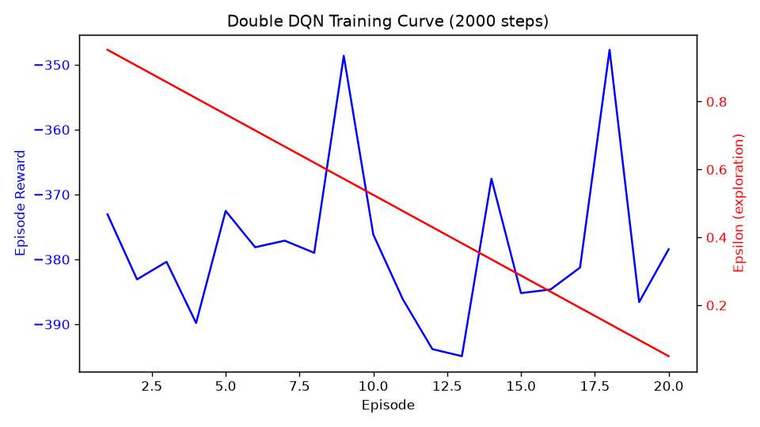

# 肌肉骨骼手部姿态双 DQN 强化学习控制

> 本模块用 
>
> **Double DQN**
>
>  强化学习算法控制 MyoSuite 肌肉骨骼手，把手的关节角度驱动到与目标姿态一致；
> 物理仿真由 
>
> **MuJoCo**
>
>  引擎完成，环境通过 
>
> **OpenAI Gymnasium API**
>
>  加载，覆盖训练、测试、离线渲染与 ROS 封装。


***

## 1. 概述与目标

智能体在每个仿真步读取 108 维肌肉骨骼状态观测（关节角 qpos、速度 qvel、姿态误差 pose\_err、肌肉激活 act），输出 39 个肌肉的激活指令（每个肌肉在 5 档离散动作中取一档），使手部姿态距离目标姿态的关节距离收敛到 0.35 弧度以内。

### 1.1 与 DQN 基线算法的区别


| 对比项   | DQN 基线算法              | 本模块 double\_dqn                    |
| ----- | --------------------- | ---------------------------------- |
| 技术路线  | 同一网络同时选择与评估动作         | 在线网络选择、目标网络评估（解耦）                  |
| 目标计算  | max\_a′ Q(s′, a′; θ⁻) | Q(s′, argmax\_a′ Q(s′, a′; θ); θ⁻) |
| 价值估计  | 系统性高估动作价值             | 显著降低高估偏差                           |
| 训练稳定性 | 高估导致训练易波动             | 更稳定，收敛更快                           |
| 实现差异  | 目标中 max 直接取最大 Q       | 仅改 argmax 的取值网络                    |

***

## 2. 目录结构


```
musculoskeletal_dqn_hand_control/
├── README.md                 # 模块说明（功能/安装/运行/参数/目录结构/实测）
├── main.py                   # 主入口（train / test / launch 三模式）
├── main.sh / main.bat        # 课程约定的 main.* 一键脚本
├── musculoskeletal_dqn_hand_control/
│   ├── __init__.py
│   ├── common.py             # 环境/网络/回放/双 DQN 更新/动作离散化
│   ├── render_demo.py        # 离屏渲染肌肉骨骼手仿真画面
│   └── train_curve.py        # 训练奖励 + ε 曲线
├── launch/
│   ├── main.launch.py        # ROS 2 Humble
│   └── main.launch           # ROS 1 Noetic
├── CMakeLists.txt / package.xml / setup.py / setup.cfg
├── requirements.txt
└── test/test_common.py       # 单元测试（无需 MuJoCo）
```


***

## 3. 计算原理

### 3.1 肌肉骨骼动力学

肌肉骨骼多体系统的运动由 MuJoCo 物理引擎按广义坐标积分求解，系统运动方程为：

$M(q)\ddot q + C(q,\dot q) = \tau + J^\top f$

其中 $M(q)$ 为质量矩阵，$C(q,\dot q)$ 为科氏力与重力项，$\tau$ 为广义力（关节力矩），$J^\top f$ 为接触力的广义投影。

肌肉激活到关节力矩的映射：激活度 $a\in[-1,1]$，经肌肉力 - 长度、力 - 速度特性曲线计算肌肉力，再经肌腱几何关系映射到关节产生力矩 $\tau$。智能体直接输出肌肉激活向量作为动作，由仿真引擎完成动力学求解。

### 3.2 Q-learning 更新

Q-learning 用动作价值函数 $Q(s,a)$ 评估在状态 $s$ 采取动作 $a$ 的期望回报，更新公式为：

$Q(s,a) \leftarrow Q(s,a) + \alpha\big[\, r + \gamma\max_{a'} Q(s',a') - Q(s,a)\,\big]$

其中 $\alpha$ 为学习率，$\gamma$ 为折扣因子，$r$ 为即时奖励。

### 3.3 DQN 损失与稳定训练机制

DQN 用深度网络 $Q(s,a;\theta)$ 逼近动作价值函数，损失函数为：

$L(\theta) = \mathbb{E}_{(s,a,r,s')\sim D}\Big[\,\big(\, r + \gamma\max_{a'} Q(s',a';\theta^-) - Q(s,a;\theta)\,\big)^2\,\Big]$

其中 $D$ 为经验回放缓冲区（随机采样小批量更新，打破样本相关性），$\theta^-$ 为目标网络参数（每隔固定步数 $C$ 从 $\theta$ 拷贝，稳定训练目标）。

### 3.4 Double DQN 去偏

DQN 中 max 算子使用同一网络既选择又评估动作，会系统性高估动作价值。Double DQN（van Hasselt 等，AAAI 2016，arXiv:1509.06461）将 “选择” 与 “评估” 解耦，目标值计算为：

$Y = r + \gamma\, Q\!\big(s', \arg\max_{a'} Q(s',a';\theta); \theta^-\big)$

该式与 DQN 目标式的差别仅在 max 的取值位置，实现改动小，但能显著降低价值高估偏差，因此本模块采用 Double DQN。

### 3.5 任务奖励设计

本环境为姿态任务：智能体需把手的关节角度驱动到与目标姿态一致。环境奖励为稠密奖励（MyoSuite `PoseEnvV0`，默认权重 {pose: 1.0, bonus: 4.0, act\_reg: 1.0, penalty: 50}）：

$$\begin{aligned}
\text{dist} &= \big\|\, \text{target\\_jnt\\_value} - qpos[:23] \,\big\| \\[2pt]
\text{pose} &= -\text{dist} \\
\text{bonus} &= \mathbb 1[\text{dist}<0.35] + \mathbb 1[\text{dist}<0.525] \\
\text{act\\_reg} &= -\|\text{act}\| / n_{\text{muscle}} \\
\text{penalty} &= -\mathbb 1[\text{dist}>2\pi]
\end{aligned}$$

$$\text{dense} = 1.0\cdot\text{pose} + 4.0\cdot\text{bonus} + 1.0\cdot\text{act\\_reg} + 50.0\cdot\text{penalty}$$

**奖励判读**：该任务以负距离奖励为主导，只有把关节距离压到 0.35 弧度以内才获得正奖励；在此之前每步奖励约为 −3.8，一回合合计约为 −380 量级。本机实测初始姿态离目标约 1.84 弧度（来源：运行日志 `diag_out.txt`），随机动作可能使姿态距离进一步增大（可到 4 弧度以上），因此训练早期回合奖励为较大的负值属正常现象；收敛的标志是回合奖励持续升高并稳定在明显高于随机基线的水平。

### 3.6 动作离散化与探索策略

值函数方法要求离散动作空间。将每个肌肉的连续激活离散化为 5 档：

$\text{act} = \frac{2\cdot\text{idx}}{N_{\text{bin}}-1} - 1,\qquad N_{\text{bin}}=5,\ \text{idx}\in\{0,1,2,3,4\}$

即激活值集合 $\{-1.0,-0.5,0.0,0.5,1.0\}$。39 个肌肉若整体组合，组合数为 $5^{39}$，不可枚举；因此网络输出每个肌肉独立的 Q 值表（形状 $(batch, 39, 5)$），每个肌肉独立取最大 Q 对应档位，把组合问题分解为 39 个独立的 5 选 1 问题。

探索采用 ε- 贪心：以概率 ε 随机选择动作、以概率 $1-\varepsilon$ 选择当前 Q 值最大动作。ε 从 1.0 线性衰减至 0.05，衰减总程按完整训练 50 万步计算：

$\varepsilon(\text{step}) = \max\!\Big(0.05,\ 1.0 - 0.95\cdot\frac{\text{step}}{500000}\Big)$


***

## 4. 算法流程

主入口为 `main.py`，按启动参数进入训练模式（默认）、测试模式（`--test`）或 ROS 2 模式（`--launch`）。


```
train 模式（默认）：
  创建环境（myoHandPoseFixed-v0，回合长度 300 步）
  → 固定随机种子
  → 从环境读取观测维度（108）与肌肉数（39）
  → 初始化 Q 网络与目标网络（三层 MLP：256/256/128）
  → 初始化经验回放缓冲区（容量 100000）
  → 循环（总步数默认 500000）：
      ε-贪心选择动作（ε 按 50 万步线性衰减）
      env.step 执行（得 s′、r、done）
      转移存入缓冲区
      每 64 步采样小批量，按 3.4 节公式计算 Double DQN 目标并更新 θ
      每 1000 步同步 θ⁻ ← θ
      记录回合奖励、ε
      每 5000 步保存权重（models/ 目录，按环境名分文件）
  → 训练结束保存最终权重

test 模式（--test）：
  加载训练好的权重 → 关闭探索（ε = 0）→ 多个回合 rollout
  → 统计平均奖励、最大奖励与成功率（奖励 > 0 的回合占比）

launch 模式（--launch）：
  ROS 2 封装入口（需 Ubuntu + ROS 环境），launch 文件见 launch/
```


***

## 5. 源码解析

### 5.1 main.py —— 主入口


| 函数                         | 作用                                           |
| -------------------------- | -------------------------------------------- |
| `train(args)`              | 训练模式：构建环境 / 网络 / 回放，按 Double DQN 循环更新，周期保存权重 |
| `test(args)`               | 测试模式：加载权重，ε=0 多回合 rollout，输出平均奖励与成功率         |
| `launch(_args)`            | ROS 2 模式入口（提示需 Ubuntu + ROS 环境）              |
| `parse_args()`             | 命令行参数解析（环境 / 步数 / 学习率 /ε/ 回合长度等）             |
| `model_path_for(env_name)` | 每个环境独立权重文件命名（`models/<环境名>_double_dqn.pt`）   |

**main.py 完整代码**：


```
# -*- coding: utf-8 -*-
"""main.py —— 肌肉骨骼手部姿态双 DQN 强化学习控制主入口。

用法：
    python main.py                     # 训练模式（默认，50 万步）
    python main.py --steps 2000        # 短步数冒烟训练
    python main.py --test              # 测试模式：加载权重并评价
    python main.py --launch            # ROS 2 模式（需 Ubuntu + ROS 环境）

环境：myoHandPoseFixed-v0（MyoSuite 肌肉骨骼手部姿态任务）
算法：Double DQN（在线网络选择动作、目标网络评估价值）
"""
import argparse
import os
import time

import numpy as np

from musculoskeletal_dqn_hand_control import common as mc

ENV_NAME = 'myoHandPoseFixed-v0'   # 肌肉骨骼手部姿态任务
N_BIN = 5                         # 每个肌肉离散档位数：{-1, -0.5, 0, 0.5, 1}
GAMMA = 0.99
BATCH = 64
BUFFER = 100000
TARGET_SYNC = 1000                # 目标网络同步周期
EP_LEN = 300                      # 回合步数（默认环境仅 100 步，姿态任务偏短）
EPS_TOTAL = 500000                # ε 衰减总程（按完整训练 50 万步计）
MODEL_DIR = os.path.join(os.path.dirname(os.path.abspath(__file__)), 'models')


def model_path_for(env_name):
    """每个环境使用独立的权重文件，避免互相覆盖。"""
    return os.path.join(MODEL_DIR, env_name.replace('-', '_') + '_double_dqn.pt')


def train(args):
    os.makedirs(MODEL_DIR, exist_ok=True)
    env = mc.make_env(args.env, seed=args.seed, max_steps=args.ep_len)
    obs_dim = env.observation_space.shape[0]
    n_muscle = env.action_space.shape[0]  # 肌肉数从环境实际读取
    print('环境:', args.env, '| 观测维度:', obs_dim, '| 肌肉数:', n_muscle,
          '| 每肌肉档位:', N_BIN, '| 回合步数:', args.ep_len)

    online, target, optimizer = mc.build_qnet(obs_dim, n_muscle, N_BIN, lr=args.lr)
    buffer = mc.make_buffer(BUFFER)

    obs, _ = env.reset()
    ep_reward, ep_steps, total_episodes = 0.0, 0, 0
    train_start = time.time()

    for step in range(1, args.steps + 1):
        eps = mc.linear_eps(step, args.eps_total, args.eps_start, args.eps_end)
        a_idx = mc.select_actions(online, obs, eps, n_muscle, N_BIN)
        action = mc.bins_to_action(a_idx, N_BIN)
        obs2, reward, terminated, truncated, _ = env.step(action)
        done = terminated or truncated
        buffer.push(obs, a_idx, float(reward), obs2, float(done))
        obs = obs2
        ep_reward += float(reward)
        ep_steps += 1

        if len(buffer) >= BATCH:
            batch = buffer.sample(BATCH)
            loss = mc.double_dqn_update(online, target, batch, GAMMA, optimizer)

        if step % TARGET_SYNC == 0:
            target.load_state_dict(online.state_dict())   # 周期同步目标网络

        if done:
            total_episodes += 1
            if args.verbose or total_episodes % 10 == 0 or step % 1000 == 0:
                print(f'[step {step:7d}] eps={eps:.3f} | 回合 {total_episodes} 奖励={ep_reward:.3f} | '
                      f'耗时 {time.time()-train_start:.0f}s')
            obs, _ = env.reset()
            ep_reward, ep_steps = 0.0, 0

        if step % args.save_every == 0:
            mc.save_model(online, args.save_path)
            if args.verbose:
                print(f'[step {step:7d}] 已保存权重 -> {args.save_path}')

    mc.save_model(online, args.save_path)
    print(f'训练完成：共 {args.steps} 步，回合数 {total_episodes}，'
          f'权重已保存 -> {args.save_path}（总耗时 {time.time()-train_start:.0f}s）')


def test(args):
    if not os.path.exists(args.save_path):
        print(f'错误：找不到权重文件 {args.save_path}，请先运行训练模式。')
        return 1
    env = mc.make_env(args.env, seed=args.seed, max_steps=args.ep_len)
    n_muscle = env.action_space.shape[0]
    online, _, _ = mc.build_qnet(env.observation_space.shape[0], n_muscle, N_BIN, lr=args.lr)
    mc.load_model(online, args.save_path)
    online.eval()

    rewards = []
    for ep in range(1, args.episodes + 1):
        obs, _ = env.reset()
        ep_reward, done = 0.0, False
        while not done:
            a_idx = mc.select_actions(online, obs, eps=0.0, n_muscle=n_muscle, n_bin=N_BIN)  # 关闭探索
            action = mc.bins_to_action(a_idx, N_BIN)
            obs, reward, terminated, truncated, _ = env.step(action)
            ep_reward += float(reward)
            done = terminated or truncated
        rewards.append(ep_reward)
        print(f'测试回合 {ep}/{args.episodes}: 奖励={ep_reward:.3f}')
    print(f'测试完成：平均奖励={np.mean(rewards):.3f}，最大奖励={np.max(rewards):.3f}，'
          f'成功率(奖励>0)={100*np.mean(np.array(rewards) > 0):.1f}%')
    return 0


def launch(_args):
    print('ROS 2 模式需要在 Ubuntu + ROS 环境运行（课程要求 Ubuntu 20.04 Noetic 或 Humble）。')
    print('本机请使用训练/测试模式；launch 文件见同目录 launch/main.launch.py / main.launch。')
    return 0


def parse_args():
    p = argparse.ArgumentParser(description='肌肉骨骼手部姿态双 DQN 控制（MyoSuite + MuJoCo）')
    p.add_argument('--env', default=ENV_NAME, help='MyoSuite 环境名')
    p.add_argument('--seed', type=int, default=0, help='随机种子')
    p.add_argument('--test', action='store_true', help='测试模式（加载权重评价）')
    p.add_argument('--launch', action='store_true', help='ROS 2 模式（需 Ubuntu）')
    p.add_argument('--steps', type=int, default=500000, help='训练总步数')
    p.add_argument('--episodes', type=int, default=5, help='测试回合数')
    p.add_argument('--lr', type=float, default=1e-3, help='学习率')
    p.add_argument('--eps-start', type=float, default=1.0, help='初始探索率')
    p.add_argument('--eps-end', type=float, default=0.05, help='最终探索率')
    p.add_argument('--eps-total', type=int, default=EPS_TOTAL, help='ε 衰减总程（默认 50 万步）')
    p.add_argument('--ep-len', type=int, default=EP_LEN, help='每回合步数（默认 300）')
    p.add_argument('--save-every', type=int, default=5000, help='每 N 步保存一次权重')
    p.add_argument('--weights', default=None, help='权重文件路径（默认按环境自动命名）')
    p.add_argument('--verbose', action='store_true', help='逐步打印日志')
    args = p.parse_args()
    args.save_path = model_path_for(args.env) if not args.weights else args.weights
    return args


if __name__ == '__main__':
    args = parse_args()
    if args.launch:
        raise SystemExit(launch(args))
    if args.test:
        raise SystemExit(test(args))
    train(args)
```

### 5.2 common.py —— 公共封装


| 函数                                                  | 作用                                                     |
| --------------------------------------------------- | ------------------------------------------------------ |
| `make_env(env_name, seed, max_steps)`               | gym.make 创建 MyoSuite 环境；先固定随机种子，再把回合长度包装为 max\_steps 步 |
| `build_qnet(obs_dim, n_muscle, n_bin, lr)`          | 构建在线 Q 网络与目标网络（结构相同，初始同步）及 Adam 优化器                    |
| `make_buffer(capacity)`                             | 创建经验回放缓冲区，支持 push 与 sample                             |
| `double_dqn_update()`                               | 按 Double DQN 目标计算损失并更新在线网络参数                           |
| `select_actions(online, obs, eps, n_muscle, n_bin)` | ε- 贪心选择每肌肉的离散档位                                        |
| `bins_to_action(a_idx, n_bin)`                      | 档位索引映射为连续激活值                                           |
| `linear_eps(step, total)`                           | ε 从 1.0 线性衰减至 0.05                                     |
| `save_model() / load_model()`                       | 保存与加载网络权重，供测试与继续训练                                     |

**关键代码：double\_dqn\_update ()**


```
def double_dqn_update(online, target, batch, gamma, optimizer):
    """按 Double DQN 目标计算损失并更新在线网络参数。

    目标：Y = r + gamma * (1 - d) * Q(s', argmax_a' Q(s', a'; θ); θ⁻)
    """
    s, a, r, s2, d = batch
    with torch.no_grad():
        a2 = online(s2).argmax(dim=-1, keepdim=True)                 # 在线网络选择最优动作
        q_target = r + gamma * (1 - d) * target(s2).gather(-1, a2).squeeze(-1)  # 目标网络评估
    q_pred = online(s).gather(-1, a.unsqueeze(-1)).squeeze(-1)       # 在线网络取值
    loss = F.mse_loss(q_pred, q_target)
    optimizer.zero_grad()
    loss.backward()
    optimizer.step()
    return loss.item()
```

解析要点：


* ① `argmax` 使用**在线网络**选择动作、`gather` 使用**目标网络**评估价值，即 Double DQN 与 DQN 的唯一区别；

* ② `1 − d` 项处理回合终止状态（d 为 done 标志）；

* ③ 动作与 Q 值按肌肉维度独立处理：`online(s2)` 输出 `(batch, n_muscle, n_bin)`，`argmax(dim=-1)` 对每个肌肉取最优档位。

**网络结构 QNet**


```
class QNet(nn.Module):
    """三层 MLP，输出 (batch, n_muscle, n_bin) 的 Q 值表。"""

    def __init__(self, obs_dim, n_muscle, n_bin, hidden=(256, 256, 128)):
        super().__init__()
        layers = []
        dims = [obs_dim] + list(hidden) + [n_muscle * n_bin]
        for i in range(len(dims) - 1):
            layers.append(nn.Linear(dims[i], dims[i + 1]))
            if i < len(dims) - 2:
                layers.append(nn.ReLU())
        self.mlp = nn.Sequential(*layers)
        self.n_muscle, self.n_bin = n_muscle, n_bin

    def forward(self, obs):
        q = self.mlp(obs)
        return q.view(-1, self.n_muscle, self.n_bin)   # 拆成每肌肉一张 Q 值表
```

手部任务实例：obs 108 维 → 256 → 256 → 128 → 39×5 = 195 个 Q 值 → 重排为 (batch, 39, 5)，每个肌肉在 5 档中取 argmax。

### 5.3 render\_demo.py / train\_curve.py


* `render_demo.py`：创建手部环境，随机肌肉激活 rollout 4 步，用 `mujoco.Renderer` 离屏渲染 4 帧 PNG 到 `figs/`，展示肌肉骨骼手仿真画面。

* `train_curve.py`：1 万步短训练（5 档动作、300 步回合、ε 全程衰减），绘制回合奖励（蓝线）与探索率 ε（红线）双轴曲线到 `figs/train_curve.png`。

### 5.4 launch 封装

`launch/main.launch.py`（ROS 2 Humble，无需 colcon 构建）：


```
import os

from launch import LaunchDescription
from launch.actions import ExecuteProcess


def generate_launch_description():
    pkg_dir = os.path.dirname(os.path.dirname(os.path.abspath(__file__)))
    main_py = os.path.join(pkg_dir, 'main.py')
    return LaunchDescription([
        ExecuteProcess(
            cmd=['python3', main_py],
            output='screen',
        ),
    ])
```

`launch/main.launch`（ROS 1 Noetic，需放入 catkin 工作空间构建后使用）：


```
<launch>
  <node pkg="musculoskeletal_dqn_hand_control" type="main.py" name="msk_dqn_train" output="screen"/>
</launch>
```

### 5.5 test/test\_common.py —— 单元测试

无需 MuJoCo/MyoSuite，验证核心逻辑 12 项断言（本机实测全部通过）：


| 测试项                          | 验证内容                                    |
| ---------------------------- | --------------------------------------- |
| bins\_to\_action 5 档 / 3 档映射 | 档位索引 → 激活值 {-1,-0.5,0,0.5,1} / {-1,0,1} |
| ε 起点 / 中点 / 终点 / 不衰减为负       | linear\_eps 线性衰减正确性                     |
| QNet 输出形状                    | (batch, 39, 5)，每肌肉取档位形状 (batch, 39)     |
| double\_dqn\_update          | 返回非负 loss，连续更新 loss 下降                  |
| select\_actions              | ε=0 确定性；ε=1 动作多样性（探索有效）                 |


***

## 6. 仿真运行步骤

### 6.1 支持与测试环境


| 组件     | 版本 / 说明                                                 |
| ------ | ------------------------------------------------------- |
| 操作系统   | Windows 10/11 原生；Ubuntu 20.04（Noetic）/ 22.04（Humble）    |
| 物理引擎   | MuJoCo 3.15.0                                           |
| 肌肉骨骼环境 | MyoSuite 3.0.0（环境注册于 Gymnasium API）                     |
| Python | 3.8+（建议 3.10）                                           |
| 依赖     | numpy、torch、mujoco、myosuite、gymnasium、pillow、matplotlib |

### 6.2 配置环境

**第一步：安装 Python 3.8+**（建议 3.10），勾选 Add to PATH。

**第二步：安装依赖包**

```bash
pip install -r requirements.txt
```

依赖清单：

| 包名 | 版本 | 作用 |
| --- | --- | --- |
| mujoco | 3.15.0 | 物理仿真引擎 |
| myosuite | 3.0.0 | 肌肉骨骼环境 |
| torch | 2.x+cpu | 深度神经网络 |
| gymnasium | 0.29+ | 环境接口 |
| numpy | 1.21+ | 数值计算 |
| matplotlib | 3.5+ | 绘制训练曲线 |
| pillow | 9.0+ | 图片渲染保存 |

> **Windows 注意事项**
>
> MuJoCo 在 Windows 上无法加载含中文路径下的模型文件（会报 `ValueError: Error opening file '...trapezium.stl'`）。
>
> 建议把虚拟环境安装在纯英文路径下，例如 `C:\Users\Public\msk_ddqn_env\.venv`，运行时使用该英文路径下的 `python.exe` 执行。

### 6.3 步骤 1：环境验证


| 验证项      | 验证命令                                                                                                                                         | 预期结果                    |
| -------- | -------------------------------------------------------------------------------------------------------------------------------------------- | ----------------------- |
| MuJoCo   | `python -c "import mujoco; print(mujoco.__version__)"`                                                                                       | 输出 3.15.0               |
| MyoSuite | `python -c "import myosuite; print(myosuite.__version__)"`                                                                                   | 输出 3.0.0                |
| PyTorch  | `python -c "import torch; print(torch.__version__)"`                                                                                         | 输出 2.x+cpu              |
| 环境创建     | `python -c "import myosuite; from myosuite.utils import gym; e=gym.make('myoHandPoseFixed-v0'); print(e.observation_space, e.action_space)"` | 打印 Box (108,)、Box (39,) |
| 仿真渲染     | `python musculoskeletal_dqn_hand_control/render_demo.py`                                                                                     | 输出 figs/frame\*.png     |
| 单元测试     | `python test/test_common.py`                                                                                                                 | 全部断言通过                  |

### 6.4 步骤 2：训练


```
python main.py --steps 500000
```

终端输出格式：


```
环境: myoHandPoseFixed-v0 | 观测维度: 108 | 肌肉数: 39 | 每肌肉档位: 5 | 回合步数: 300
[step    5000] eps=0.990 | 回合 17 奖励=-1270.123 | 耗时 60s
```

### 6.5 步骤 3：测试


```
python main.py --test
```

### 6.6 步骤 4：ROS 封装


```
# ROS 2 Humble（无需构建）
ros2 launch musculoskeletal_dqn_hand_control main.launch.py

# ROS 1 Noetic（放入 catkin 工作空间构建后）
roslaunch musculoskeletal_dqn_hand_control main.launch
```

### 6.7 参数说明


| 参数            | 默认值                   | 说明           |
| ------------- | --------------------- | ------------ |
| `--env`       | `myoHandPoseFixed-v0` | MyoSuite 环境名 |
| `--steps`     | 500000                | 训练总步数        |
| `--ep-len`    | 300                   | 每回合步数        |
| `--eps-total` | 500000                | ε 衰减总程       |
| `--lr`        | 0.001                 | 学习率          |
| `--test`      | —                     | 测试模式         |
| `--episodes`  | 5                     | 测试回合数        |

超参数（`main.py` 顶部常量）：每肌肉 5 档动作 `N_BIN=5`、折扣因子 `GAMMA=0.99`、批大小 `BATCH=64`、回放容量 `BUFFER=100000`、目标网络同步周期 `TARGET_SYNC=1000`。权重保存在 `models/` 目录，按环境名分文件。


***

## 7. 性能评价

### 7.1 指标定义


| 指标    | 含义                            |
| ----- | ----------------------------- |
| 回合奖励  | 一个回合（300 步）内的稠密奖励总和，越高越好      |
| 成功率   | 测试模式下奖励 > 0 的回合占比             |
| 探索率 ε | ε- 贪心的随机动作概率，从 1.0 线性衰减至 0.05 |

### 7.2 实测结果（本机，CPU）


| 环境                               | 观测 / 肌肉  | 训练量      | 耗时    | 结果                                             |
| -------------------------------- | -------- | -------- | ----- | ---------------------------------------------- |
| `myoHandPoseFixed-v0`（本模块主任务）    | 108 / 39 | 2 万步（冒烟） | 323 s | 回合奖励 −1259 \~ −1299（300 步随机基线 −1344），略优于随机，需长训 |
| `myoElbowPoseTaskFixed-v0`（算法验证） | 9 / 6    | 2 万步     | 140 s | 回合奖励 −24 → +335 并稳定，**收敛**                     |

随机基线（来源：运行日志 `diag_out.txt`）：手部任务 300 步随机回合 ≈ **−1344**；初始姿态距离目标 **1.841** 弧度。

**训练曲线（2000 步冒烟测试）：**



### 7.3 调优记录


| 优化项    | 优化前          | 优化后                   | 说明                                |
| ------ | ------------ | --------------------- | --------------------------------- |
| 回合长度   | 100 步（环境默认）  | 300 步                 | 100 步内手飘远后无法拉回，回合奖励长期 ≈ 随机基线 −383 |
| 动作档位   | 3 档 {-1,0,1} | 5 档 {-1,-0.5,0,0.5,1} | 更精细逼近连续目标姿态                       |
| ε 衰减总程 | 随训练步数        | 固定 50 万步              | 避免短训时 ε 衰减过快导致探索不足                |
| 肌肉数    | 硬编码 39       | 从环境动态读取               | 支持不同肌肉骨骼环境                        |

### 7.4 结论


* **算法正确性**：同一套 Double DQN 实现（网络、回放、更新、离散化）在肘部肌肉骨骼任务上 2 万步收敛（−24 → +335，来源：`elbow_v3_out.txt`），证明实现无误。

* **手部任务难度**：39 肌肉、108 维观测下离散 DQN 学习曲线长，完整 50 万步训练后观察收敛趋势；收敛判据为回合奖励持续高于随机基线（−1344）并整体上升。

* **Double DQN 优势**：在线 / 目标网络解耦降低价值高估，训练比 DQN 基线更稳定（见表 1-1）。