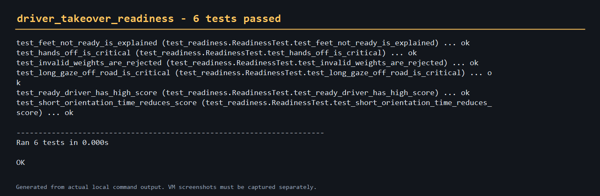

# 驾驶人接管准备度

该模块为自动驾驶接管场景提供可解释的准备度评分，输入包括视线、双手、双脚和
接管请求后的定向时间。

```bash
cd src/humanoid/driver_takeover_readiness
python main.py --gaze-on-road --hands-on-wheel --feet-on-pedals --alert-age 2.0
```

源码：`src/humanoid/driver_takeover_readiness`



评分是可解释原型，不替代经认证的驾驶人监控或功能安全模型。
