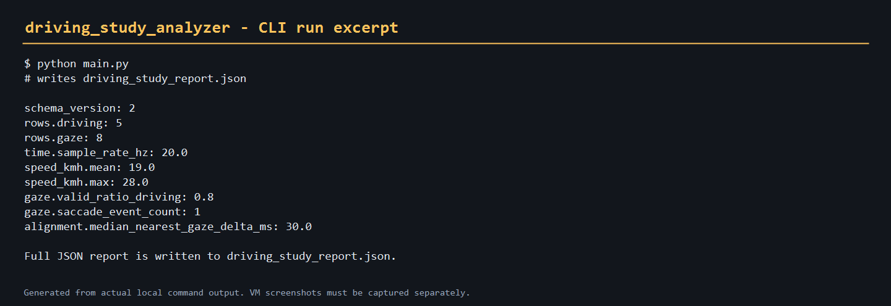
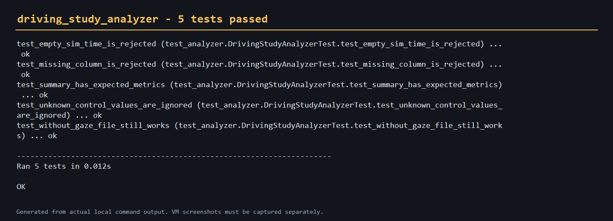

# 驾驶人行为数据离线分析

该模块把 DReyeVR 驾驶研究记录转换成可复核的会话指标，为后续驾驶位肌肉骨骼人
的回放和评价提供稳定的数据契约。

## 目录

- 源码：`src/humanoid/driving_study_analyzer`
- 启动：`ros2 launch driving_study_analyzer main.launch.py`
- 测试：`python -m unittest discover -s test -p "test_*.py" -v`

## 直接运行

```bash
cd src/humanoid/driving_study_analyzer
python main.py
```

默认样例输出保存在 `driving_study_report.json`，包括：

- 驾驶时长和有效采样率；
- 速度均值/最大值/P95；
- 转向、油门、刹车活跃比例；
- 注视有效率、注视信号灯比例；
- 扫视事件数和平均扫视幅度；
- 驾驶行与最近眼动样本的对齐误差。

## 运行效果



## 验证结果



当前验证范围：CSV 分析和样例 CLI。坐姿肌肉骨骼模型回放、手/脚末端轨迹误差和
在线 ROS 2 闭环尚未包含在本模块中。
