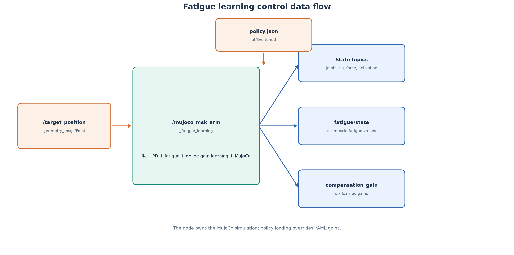
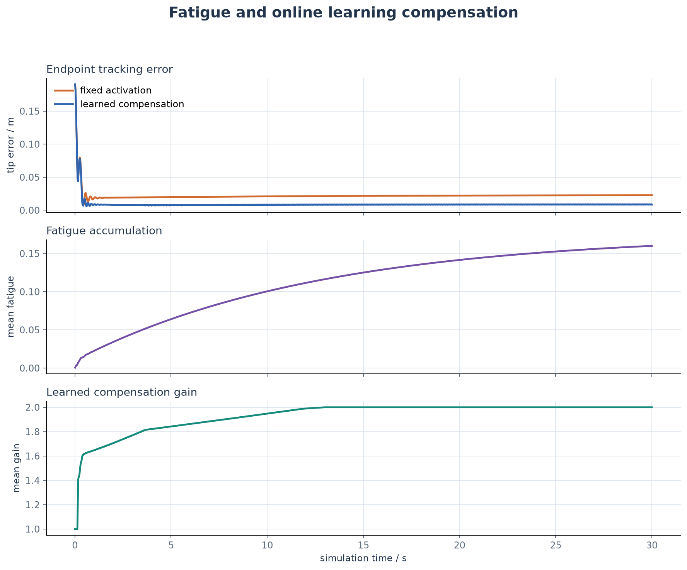

# MuJoCo 肌肉骨骼手臂疲劳与学习控制

本模块把双关节肌肉骨骼手臂扩展到持续任务。六条 Hill 型肌肉会在持续激活后
积累疲劳并降低输出能力，在线学习器根据跟踪误差调整补偿增益。实验使用
1 kg 末端负载，使疲劳和补偿效果能在 30 s 内稳定观察。

## 1. 系统结构



节点自己拥有 MuJoCo 手臂模型和控制循环：

```text
目标位置
  → 两连杆逆运动学
  → 肩肘 PD 控制
  → 六肌肉基础激活
  → 疲劳强度衰减
  → 在线学习补偿
  → MuJoCo 物理步
  → 状态、疲劳和增益话题
```

与第二个本体感觉模块不同，本模块不仅估计疲劳，还把疲劳造成的强度衰减
直接作用到 MuJoCo 激活命令上。

## 2. 疲劳动力学

每条肌肉维护疲劳状态 `f_m ∈ [0, 0.95]`：

```text
df_m/dt = a_m(1 - f_m)/T_f,m
          - (1 - a_m)f_m/T_r,m
```

其中：

- `a_m` 是基础肌肉激活；
- `T_f,m` 是疲劳积累时间常数；
- `T_r,m` 是恢复时间常数；
- `strength_loss_m` 是满疲劳时的最大力量损失比例。

强度保留率与疲劳后激活：

```text
retention_m = 1 - strength_loss_m f_m
fatigued_activation_m = a_m retention_m
```

当前时间常数是加速教学参数，用于在短时间仿真内展示趋势，不是特定受试者
或真实肌肉的实验标定。

## 3. 在线学习补偿

学习器为每条肌肉维护增益 `g_m`。当关节误差持续存在时，激活越大的肌肉获得
更大的增益修正：

```text
error = ||q_target - q||

if error_deadband < error <= error_ceiling:
    g_m += learning_rate * error * a_m * dt
else:
    g_m -= gain_decay_rate (g_m - 1) dt

g_m = clip(g_m, 1, maximum_gain)
```

最终激活：

```text
u_effective = clip(a_m retention_m g_m, 0, 1)
```

`error_ceiling_rad` 防止启动瞬态直接让全部增益饱和；增益在没有持续误差时
缓慢回到 1。

## 4. ROS 2 接口

| 话题 | 类型 | 方向 | 内容 |
| --- | --- | --- | --- |
| `/target_position` | `geometry_msgs/msg/Point` | 订阅 | `x-z` 平面目标 |
| `/joint_states` | `sensor_msgs/msg/JointState` | 发布 | 肩、肘位置和速度 |
| `/end_effector_position` | `geometry_msgs/msg/Point` | 发布 | 末端位置 |
| `/muscle_activations` | `std_msgs/msg/Float64MultiArray` | 发布 | 疲劳与增益调整后的激活 |
| `/muscle_forces` | `std_msgs/msg/Float64MultiArray` | 发布 | 六维肌肉力 |
| `/fatigue/state` | `std_msgs/msg/Float64MultiArray` | 发布 | 六维疲劳状态 |
| `/fatigue/compensation_gain` | `std_msgs/msg/Float64MultiArray` | 发布 | 六维学习增益 |
| `/fatigue/tracking_error` | `std_msgs/msg/Float32` | 发布 | 关节误差范数 |

所有六维数组顺序为：

```text
shoulder_flexor
shoulder_extensor
elbow_flexor
elbow_extensor
biarticular_flexor
biarticular_extensor
```

## 5. 训练与推理

训练脚本在多个 `learning_rate`、`gain_decay_rate` 和 `maximum_gain` 组合下
运行 12 s 闭环，选择尾段误差最小的策略并写入 JSON：

```bash
python3 \
  src/musculoskeletal/mujoco_msk_arm_fatigue_learning/scripts/train_learning_policy.py \
  --duration-s 12 \
  --output ~/.ros/mujoco_msk_arm_fatigue_learning/policy.json
```

节点参数 `policy_file` 为空时直接使用 YAML 学习参数；文件存在时优先加载
训练策略；路径配置错误时打印 warning 并回退 YAML。策略 JSON 不提交仓库。

训练示例结果：

```text
fixed_tail_error_m=0.021143
best_tail_error_m=0.008296
```

## 6. 闭环实验



实验条件：

- 默认目标 `(0.38, -0.17) m`；
- 末端负载 `1 kg`；
- 控制频率 `100 Hz`；
- 每次控制推进 5 个 2 ms 物理步；
- 仿真时长 30 s。

| 指标 | 固定激活 | 学习补偿 |
| --- | --- | --- |
| 尾段平均末端误差 | `0.0227 m` | `0.0088 m` |
| 30 s 平均疲劳 | `0.160` | `0.160` |
| 最终平均增益 | `1.0` | `2.0` |

学习补偿把尾段误差降低约 61%。增益在约 13 s 达到上限后保持，说明疲劳模型
带来的持续弱化需要较高的补偿激活。

## 7. 构建与运行

```bash
source /opt/ros/humble/setup.bash

colcon build \
  --packages-select \
    mujoco_musculoskeletal_arm_reach \
    mujoco_msk_arm_fatigue_learning \
  --symlink-install

source install/setup.bash
ros2 launch mujoco_msk_arm_fatigue_learning main.launch.py
```

检查节点和疲劳输出：

```bash
ros2 node list
ros2 topic list -t
ros2 topic hz /fatigue/tracking_error
ros2 topic echo /fatigue/state --once
ros2 topic echo /fatigue/compensation_gain --once
rqt_graph
```

关闭学习对照：

```bash
ros2 param set /mujoco_msk_arm_fatigue_learning learning_enabled false
```

## 8. 参数

主要参数位于 `config/simulation.yaml`：

| 参数 | 含义 |
| --- | --- |
| `payload_kg` | MuJoCo 末端负载 |
| `fatigue_time_s` | 六肌肉疲劳积累时间 |
| `recovery_time_s` | 六肌肉恢复时间 |
| `strength_loss` | 满疲劳时的力量损失比例 |
| `learning_enabled` | 是否启用在线增益学习 |
| `policy_file` | 可选训练策略 JSON |
| `learning_rate` | 增益学习率 |
| `gain_decay_rate` | 无误差时增益回落速度 |
| `maximum_gain` | 单肌肉最大补偿增益 |
| `error_ceiling_rad` | 启动瞬态不参与学习的误差上限 |

## 9. 测试

```bash
python3 -m pytest \
  src/musculoskeletal/mujoco_msk_arm_fatigue_learning/test -q

colcon test --packages-select mujoco_msk_arm_fatigue_learning
colcon test-result --verbose
```

测试覆盖疲劳积累/恢复、疲劳上限、学习增益增长和衰减、补偿饱和、策略文件
往返、未知策略字段、ROS 话题、学习开关和非有限目标。

## 10. 当前边界

- 使用线性集总疲劳和增益学习，不是深度神经网络；
- 疲劳参数是加速演示值，尚未进行人体或硬件标定；
- `/muscle_activations` 发布的是疲劳和学习处理后的实际激活；
- ROS 2 Humble 实机运行截图仍需在可用虚拟机中补测。
