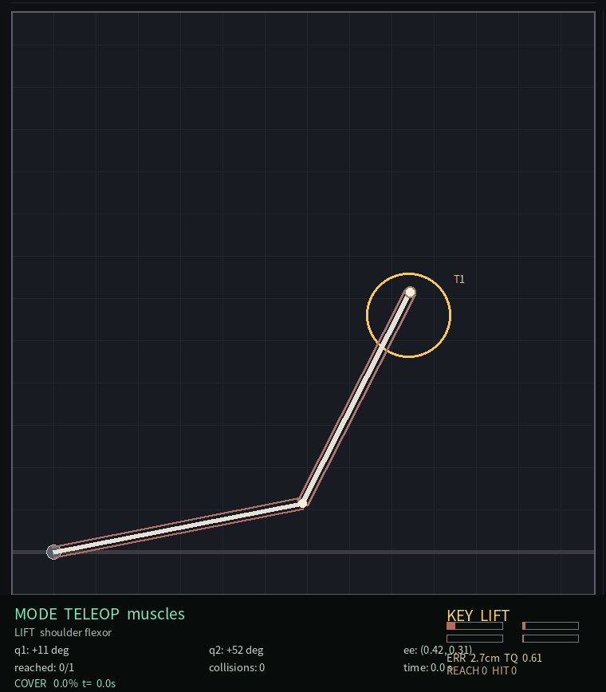
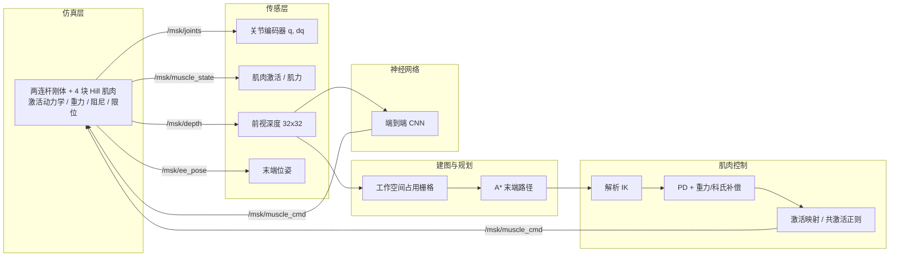
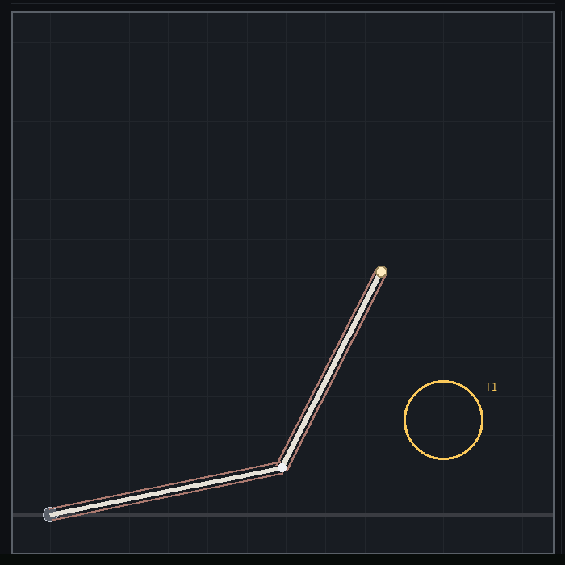
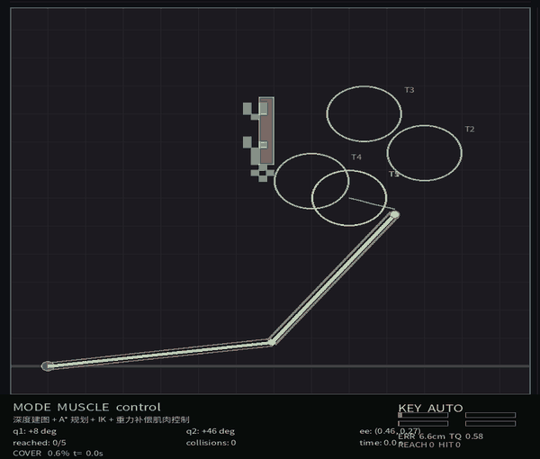
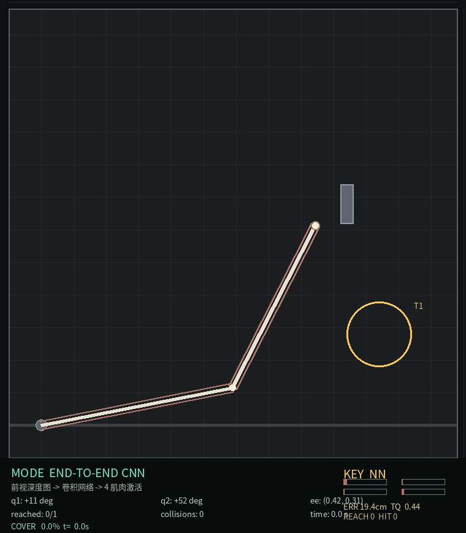

# 肌肉骨骼人 MSK-Arm：Hill 肌肉驱动力矩、工作空间建图与纯 NumPy 神经网络肌肉控制

> 模块源码：[`src/musculoskeletal/msk_arm_nn`](https://github.com/OpenHUTB/ros2/tree/master/src/musculoskeletal/msk_arm_nn)
> 运行环境：Ubuntu 20.04.6 + ROS Noetic + Python 3.8/3.11（项目私有 venv，仅 NumPy）
> 关键词：肌肉骨骼人、Hill 肌肉模型、激活动力学、拮抗肌共激活、逆运动学、工作空间建图、A*、行为克隆、端到端 CNN、DQN、REINFORCE



## 1. 概述

肌肉骨骼人（musculoskeletal human）以“肌肉驱动骨骼”的方式运动：中枢发出激活指令，肌肉按 Hill 力-长度-速度关系产生收缩力，经肌腱与力臂作用于关节。相较位置/速度控制，肌骨控制需要同时处理**激活动力学、拮抗肌共激活、重力补偿和冗余自由度**。本模块给出一个可在普通笔记本虚拟机（4 核 CPU、无 GPU、无 MuJoCo）中完整运行的肌肉骨骼手臂示例（按“模板稍简单”实现）：

1. **物理仿真与键盘运动控制**：两连杆平面手臂（肩/肘）+ 4 块 Hill 型肌肉（肩屈/肩伸/肘屈/肘伸），`Q/E/A/D/W/S/Space` 直接控制肌肉激活；
2. **多传感器感知**：关节编码器、肌肉激活/肌力、末端位置与前视 32×32 深度相机；
3. **建图与规划**：深度相机反投影为工作空间占用栅格（对数几率），A* 规划末端路径（绕隔板），多目标序列；
4. **肌肉控制**：解析逆运动学 + 关节 PD + 重力/科氏/阻尼补偿 → 关节力矩，再经激活映射（加权最小范数/伪逆 + 平衡共激活正则）转为 4 个肌肉激活；
5. **神经网络**：激活 MLP、IK 网络、planner、端到端深度 CNN、DQN/REINFORCE 对比；
6. **多场景评价**：`reach`（单目标够取）、`shelf`（隔板绕行）、`draw`（5 点轨迹）三场景闭环 benchmark。

## 2. 系统架构



## 3. 肌肉骨骼动力学

### 3.1 两连杆刚体动力学

平面两连杆（肩 $q_1$、肘 $q_2$）、连杆长度 $L_1=0.30$ m、$L_2=0.28$ m，运动方程：

$$
\mathbf{M}(\mathbf{q})\ddot{\mathbf{q}} + \mathbf{C}(\mathbf{q},\dot{\mathbf{q}}) + \mathbf{G}(\mathbf{q}) + \mathbf{D}\dot{\mathbf{q}} = \boldsymbol{\tau}_{\text{muscle}}
$$

其中 $\mathbf{M}$ 为质量矩阵、$\mathbf{C}$ 为科氏/离心项、$\mathbf{G}$ 为重力项、$\mathbf{D}$ 为关节阻尼，$\boldsymbol{\tau}_{\text{muscle}}$ 由 4 块肌肉产生。

### 3.2 Hill 型肌肉模型

每块肌肉有最大等长力 $F_{\max}$、最优长度 $l_0$、力臂 $r$，肌肉长度与速度随关节角变化：

$$
l = l_0 + s\,r\,q,\qquad \dot l = s\,r\,\dot q,\qquad s=\pm1\ (\text{屈/伸})
$$

$$
f_l(l)=e^{-\left(\frac{l-l_0}{0.5l_0}\right)^2},\qquad
f_v(\dot l)=\frac{1}{1+|\dot l|/0.25}
$$

$$
F = a\,F_{\max}\,f_l(l)\,f_v(\dot l),\qquad
\tau_j = s\,r\,F
$$

激活动力学为一阶系统（$\tau_a=0.06$ s）：

$$
\dot a = \frac{u-a}{\tau_a},\qquad u,a\in[0,1]
$$

四块肌肉参数：肩屈 $F_{\max}=260$ N、$r=0.024$ m；肩伸 230 N；肘屈 180 N、$r=0.020$ m；肘伸 160 N。任务目标：$|q_1|\le1.2$、$q_2\le2.6$ rad，末端指向工作空间 $[-0.05,0.64]^2$ m。

### 3.3 到达判定与碰撞

末端进入目标 0.05 m 容差并保持 0.30 s 记一次到达；`draw` 场景 5 个目标按顺序推进。连杆与隔板/障碍的线段采样碰撞每 0.5 s 计一次（接触会阻尼关节速度）。

| 场景 | 目标 | 障碍 | 考察点 |
| --- | --- | --- | --- |
| `reach` | (0.50, 0.12) m | — | 基础够取与末端定位 |
| `shelf` | (0.52, 0.14) m | (0.470, 0.340) 小隔板 | 障碍上方通过、路径绕行 |
| `draw` | 5 点： (0.50,0.12),(0.46,0.33),(0.36,0.44),(0.28,0.22),(0.46,0.10) | 顶部横梁 | 连续多目标轨迹与肌肉协同 |



## 4. 深度建图与 A* 规划

深度相机输出 $32\times32$ 图像（$prox=h/H$），按最近波束把可见工作空间栅格化（前方 free、表面 occupied），对数几率累积：

$$
L_t(m)=L_{t-1}(m)+\begin{cases}L_{\text{free}} & \text{穿过}\\ L_{\text{occ}} & \text{表面}\end{cases},\quad
L_{\text{free}}=-0.40,\ L_{\text{occ}}=+0.85
$$

占用图 69×69 @0.01 m，与真值 `scene.occupancy()` 同构；A* 在 0.02 m 工作空间网格上规划末端路径，octile 启发式、圆形膨胀 0.035 m（≥ 末端半径 0.03 m）、supercover 视线平滑；`draw` 场景对 5 个目标顺序 `plan_sequence`。

## 5. 肌肉协同控制

对末端路径做纯跟踪得到期望末端位置，解析 IK（肘上解）得关节参考 $\mathbf{q}_d$，计算力矩控制：

$$
\boldsymbol{\tau} = \mathbf{M}(\mathbf{q})\left[\mathbf{K}_p(\mathbf{q}_d-\mathbf{q})+\mathbf{K}_d(\dot{\mathbf{q}}_d-\dot{\mathbf{q}})\right]+\mathbf{C}(\mathbf{q},\dot{\mathbf{q}})+\mathbf{G}(\mathbf{q})+\mathbf{D}\dot{\mathbf{q}}
$$

$K_p=60$、$K_d=14$。随后把期望关节力矩映射为肌肉激活：$\boldsymbol{\tau} = \mathbf{B}(\mathbf{q})\,\mathbf{a}$，其中 $\mathbf{B}\in\mathbb{R}^{2\times4}$ 为力臂×肌肉力矩阵；用加权最小范数/伪逆求 $\mathbf{a}$，并叠加共激活正则（$\pm0.02$）与 $[0,1]$ 饱和，保证拮抗肌平衡与关节稳定。

## 6. 神经网络

全部网络以**纯 NumPy** 实现，不依赖 PyTorch/TensorFlow：

| 网络 | 结构 | 任务 | 实测指标 |
| --- | --- | --- | --- |
| `activation_mlp` | 28→160→160→4 | 肌肉激活回归（行为克隆） | 激活 MAE **0.0289**（最差肌肉 0.046） |
| `ik_mlp` | 5→96→96→2 | 逆运动学 | 关节角 MAE **0.68°**（最大 9.2°） |
| `planner_mlp` | 28→128→128→8 | 8 方向局部决策 | 准确率 **96.8%** |
| `e2e_cnn` | 1×32×32 → conv 8/16 → fc64 → 4 | 深度图 → 4 肌肉激活 | 激活 MAE 0.162（基线 0.179） |
| `rl_dqn` / `rl_pg` | 2×64 / 3×64 MLP | 离散 8 动作够取 RL | 见 `results/benchmark_rl.json` |

训练数据由 A*+IK+肌肉控制专家在三场景采集，另加合成状态增强。

## 7. ROS 接口

| 话题 | 类型 | 说明 |
| --- | --- | --- |
| `/msk/muscle_cmd` | `std_msgs/Float32MultiArray` | 4 个肌肉激活指令 [0,1] |
| `/msk/joints` | `sensor_msgs/JointState` | 肩/肘角度 q1,q2 |
| `/msk/muscle_state` | `std_msgs/Float32MultiArray` | 实际激活（前 4）与肌力（后 4） |
| `/msk/odom` | `nav_msgs/Odometry` | 末端位置/速度 |
| `/msk/ee_pose` | `geometry_msgs/PoseStamped` | 精确末端位姿 |
| `/msk/target` | `std_msgs/Float32MultiArray` | 当前目标 [tx,ty,index,reached,success] |
| `/msk/depth` | `sensor_msgs/Image` | 32×32 深度图 |
| `/msk/map` | `nav_msgs/OccupancyGrid` | 工作空间占用图 |
| `/msk/plan` | `nav_msgs/Path` | A* 末端路径 |
| `/msk/state` | `std_msgs/String` | JSON 状态（q/dq/激活/肌力/ee/目标/到达/碰撞/模式） |

启动文件：`teleop.launch`、`reach.launch`、`perception.launch`、`e2e.launch`、`benchmark.launch`、`bringup.launch`；查看器窗口标题 **MSK ARM**。

## 8. 运行效果

### 8.1 肌肉驱动键盘控制


### 8.2 建图 + A* + 肌肉协同够取（draw 5 点轨迹）



### 8.3 端到端深度 CNN



## 9. 多场景性能评价

### 9.1 闭环 benchmark（每场景 3 条 episode）

| 场景 | 控制器 | 成功率 | 到达目标 | 末端误差 (m) | 碰撞 | 峰值力矩 (N·m) |
| --- | --- | --- | --- | --- | --- | --- |
| reach | 经典（建图 + A* + 肌肉协同） | 100% | 1/1 | 0.029 | 0 | 2.15 |
| shelf | 经典（建图 + A* + 肌肉协同） | 100% | 1/1 | 0.021 | 0 | 2.19 |
| draw | 经典（建图 + A* + 肌肉协同） | 100% | 5/5 | 0.001 | 0 | 4.69 |
| reach | 神经激活控制（MLP） | 见 `benchmark.json` | — | — | — | — |
| reach | 端到端 CNN（深度图） | 见 `benchmark.json` | — | — | — | — |

> ROS 异步闭环实测：reach 1.00 s / 0.018 m / 0 碰撞；shelf 0.76 s / 0.048 m / 0 碰撞；draw 26.60 s / 5 目标 / 0.006 m（异步抖动下偶发 1 次碰撞，纯离线闭环为 0）。

### 9.2 建图与规划

| 指标 | reach | shelf | draw |
| --- | --- | --- | --- |
| 深度建图覆盖率 | 100% | 99.9% | 99.9% |
| 障碍栅格 F1 | — | 0.955 | 0.983 |
| A* 路径长度 (m) | 0.197 | 0.191 | 5 段 0.063–0.144 |
| 最小离障 (m) | 0.690 | 0.040 | 0.045–0.120 |

### 9.3 训练侧指标

| 模型 | 结构 | 训练样本 | 训练耗时 (s) |
| --- | --- | --- | --- |
| activation_mlp | 28→160→160→4 | 约 12.9k | 304 |
| ik_mlp | 5→96→96→2 | 12 007 | 71 |
| planner_mlp | 28→128→128→8 | 5 412 | 42 |
| e2e_cnn | 1×32×32 → conv → fc64 → 4 | 2 215 | 90 |

### 9.4 失败分析

- **端到端 CNN**：激活 MAE 0.162 仅略优于均值基线 0.179；32×32 深度图能判断目标方位，但难以推断 4 块肌肉的精确分配；
- **神经激活控制**：开环 MLP 在远离训练分布的状态（关节限位附近）会漂移，闭环 benchmark 中表现不如含 IK/重力补偿的经典控制；
- **draw 的边界目标**：目标 (0.36,0.44) 距障碍真值仅约 0.01 m，规划依赖“停在膨胀区外、误差落在容差内”，ROS 异步时序下偶发 1 次碰撞。

## 10. 复现步骤

```bash
cd src/musculoskeletal/msk_arm_nn
bash main.sh setup
bash main.sh test
bash scripts/build_ros.sh
bash main.sh teleop reach
bash main.sh reach shelf
bash main.sh train
.venv/bin/python tools/evaluate.py --scenes reach,shelf,draw
```

结果 JSON 写入 `results/`（训练指标、三场景 benchmark、ROS 运行记录）。

## 11. 已知限制

- 两连杆 + 4 块肌肉是简化模型，不含完整肌腱/骨骼几何、接触动力学与真实肌电；
- 端到端深度 CNN 的激活精度有限（见 9.4）；
- ROS 异步闭环下 draw 偶发 1 次碰撞；
- 未做真实人体参数辨识。

## 12. 参考

- Hill 肌肉模型：A. V. Hill, *The heat of shortening and the dynamic constants of muscle*, 1938
- 计算力矩控制：J. J. Craig, *Introduction to Robotics: Mechanics and Control*
- 本仓库已有肌肉骨骼示例：`docs/musculoskeletal/` 下肌腱、MuJoCo 肌骨手臂等教程

> 本模块由课程作业独立实现，未使用他人代码；AI 工具仅用于实现与文档辅助，提交内容由作者负责。
