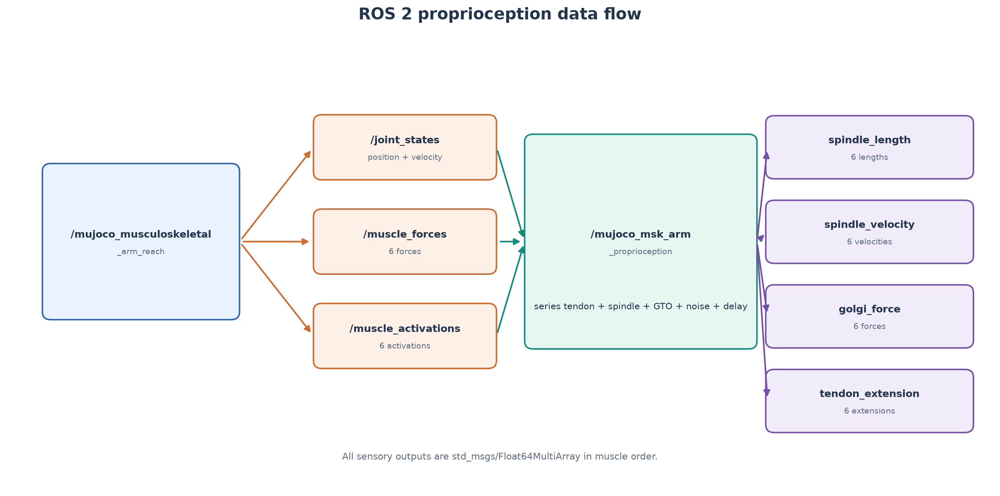
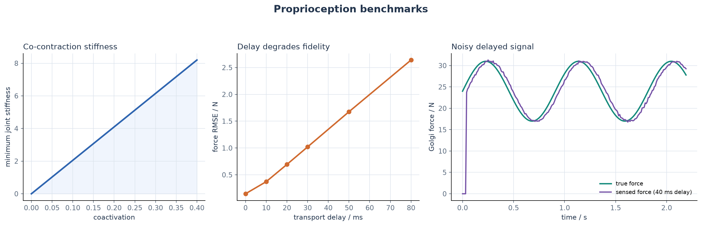

# MuJoCo 肌肉骨骼手臂本体感觉与串联弹性肌腱

本模块在双关节肌肉骨骼手臂上增加本体感觉层。它读取肩肘运动状态与
六维肌肉状态，估计肌梭、高尔基腱器官和串联弹性肌腱信号，并研究共收缩
刚度以及噪声、传输延迟对感知质量的影响。

## 1. 系统结构



已合并的 `mujoco_musculoskeletal_arm_reach` 节点负责 MuJoCo 刚体动力学和
肌肉控制；本模块的 `mujoco_msk_arm_proprioception` 节点只处理感觉信号。
这种分层避免在第二个项目中重复实现手臂模型。

| 输入 | 用途 |
| --- | --- |
| `/joint_states` | 肩、肘角度与角速度 |
| `/muscle_forces` | 六条肌肉力 |
| `/muscle_activations` | 六条肌肉激活 |

本节点发布四条 `std_msgs/msg/Float64MultiArray` 话题：

| 输出 | 含义 | 单位 |
| --- | --- | --- |
| `/proprioception/spindle_length` | 肌梭感受的肌纤维长度 | m |
| `/proprioception/spindle_velocity` | 肌纤维长度变化率 | m/s |
| `/proprioception/golgi_force` | 高尔基腱器官肌肉力 | N |
| `/proprioception/tendon_extension` | 串联弹性肌腱伸长 | m |

所有数组长度均为 6，顺序为肩屈肌、肩伸肌、肘屈肌、肘伸肌、
双关节屈肌、双关节伸肌。

节点只有在三个输入都至少收到一帧有效消息后才发布。任何回调发现缺失关节、
非数值、NaN/Inf 或维度错误时，会打印 warning、撤销对应输入的就绪状态并
跳过该帧，不会让异常传播到 ROS executor。

## 2. 串联弹性肌腱

当前采用线性集总模型：

```text
Delta L_t = F_m / k_t
L_f = L_mt - Delta L_t
```

其中 `F_m` 是肌肉力，`k_t` 是肌腱刚度，`L_mt` 是肌肉-肌腱单元长度，
`L_f` 是肌纤维长度。肌腱伸长被限制为非负，肌纤维长度设置正的下界。

肌肉-肌腱单元长度由关节角和力臂矩阵给出：

```text
L_mt = L_rest + J q
```

`J` 为 `6 x 2` 力臂矩阵，包含肩、肘、双关节肌的跨关节作用。输出前使用
一阶低通估计肌梭速度，降低离散差分噪声。

## 3. 本体感觉信号

肌梭主信号为 `L_f` 与 `dL_f/dt`，高尔基腱器官信号直接取肌肉力 `F_m`。
传感器管线按以下顺序处理：

```text
真实肌肉-肌腱状态
  → 肌腱伸长与肌纤维长度
  → 肌梭/GTO 信号
  → 高斯噪声
  → 固定传输延迟
  → ROS 2 多数组话题
```

延迟使用固定长度历史缓冲区实现。默认采样率 `100 Hz`、延迟 `30 ms`，
即延迟约 3 个采样周期。随机种子可配置，因此相同参数下噪声序列可复现。

## 4. 共收缩与关节刚度

肌肉激活同时增加主动肌和拮抗肌力时，关节刚度提高。这里使用集总刚度近似：

```text
K_joint = J^T diag(k_m a_m) J
```

其中 `k_m` 是单条肌肉刚度，`a_m` 是激活。共激活从 `0.02` 提高到 `0.40`
时，最小特征值表示的关节刚度从约 `0.41` 提高到 `8.20`。



右图展示真实 Golgi 力和带 `40 ms` 延迟、噪声的传感力。延迟导致明显相位
滞后；80 ms 延迟下示例力 RMSE 约 `2.64 N`。

## 5. 构建与运行

```bash
source /opt/ros/humble/setup.bash

colcon build \
  --packages-select \
    mujoco_musculoskeletal_arm_reach \
    mujoco_msk_arm_proprioception \
  --symlink-install

source install/setup.bash
ros2 launch mujoco_msk_arm_proprioception main.launch.py
```

launch 会同时启动双关节手臂仿真和本体感觉节点。

检查 ROS 计算图与频率：

```bash
ros2 node list
ros2 topic list -t
ros2 topic hz /proprioception/spindle_length
rqt_graph
```

读取一次感觉输出：

```bash
ros2 topic echo /proprioception/spindle_length --once
ros2 topic echo /proprioception/golgi_force --once
```

## 6. 参数

`config/simulation.yaml` 提供：

| 参数 | 默认值 | 含义 |
| --- | --- | --- |
| `sample_rate_hz` | `100.0` | 传感器更新频率 |
| `delay_s` | `0.03` | 固定传输延迟 |
| `length_noise_std_m` | `0.0005` | 肌梭长度标准差 |
| `velocity_noise_std_m_s` | `0.005` | 肌梭速度标准差 |
| `force_noise_std_n` | `0.2` | GTO 力标准差 |
| `tendon_extension_noise_std_m` | `0.0001` | 肌腱伸长标准差 |
| `random_seed` | `0` | 噪声随机种子 |
| `velocity_filter_tau_s` | `0.02` | 肌梭速度低通时间常数 |
| `muscle_names` | 六条肌肉 | 输入数组顺序契约 |
| `moment_arms_flat` | 12 个系数 | `6 x 2` 力臂矩阵展开 |
| `resting_lengths_m` | 六个长度 | 肌肉-肌腱静息长度 |
| `tendon_stiffness_n_m` | 六个刚度 | 串联肌腱刚度 |
| `max_forces_n` | 六个峰值力 | 共收缩刚度计算参数 |

参数来源：

- `moment_arms_flat` 直接对应第一个模块 fixed tendon 的肩、肘关节系数；
- `max_forces_n` 与第一个模块 MuJoCo muscle actuator 的 `force` 一致；
- `resting_lengths_m` 和 `tendon_stiffness_n_m` 是集总模型的初始标定值，
  不是实验测量值，应通过肌腱拉伸试验或参数辨识替换；
- `muscle_names` 必须与上述六肌肉顺序完全一致，否则节点拒绝启动。

## 7. 测试与实验

```bash
python3 -m pytest \
  src/musculoskeletal/mujoco_msk_arm_proprioception/test -q

python3 \
  src/musculoskeletal/mujoco_msk_arm_proprioception/scripts/evaluate_proprioception.py

colcon test --packages-select mujoco_msk_arm_proprioception
colcon test-result --verbose
```

测试覆盖串联肌腱、肌梭、GTO、共收缩刚度、噪声可复现性、延迟缓冲和
ROS 话题接口。

## 8. 排错

`/proprioception/*` 没有输出时，先确认：

```bash
ros2 topic hz /joint_states
ros2 topic hz /muscle_forces
ros2 topic hz /muscle_activations
```

三条输入都存在后，节点才会发布感觉输出。默认 `30 ms` 延迟意味着启动后
需要积累少量样本；可临时把 `delay_s` 设为 `0.0` 检查。

## 9. 当前边界

- 串联弹性肌腱是传感估计使用的集总模型，没有改变 MuJoCo 刚体动力学；
- 当前没有把肌梭/GTO 反馈接入控制闭环；
- 噪声和延迟用于感知质量评估；
- ROS 2 Humble 实机运行截图仍需在可用虚拟机中补充。
