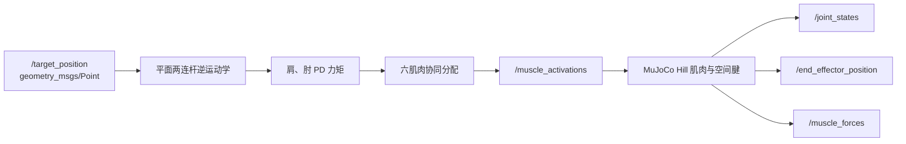

# MuJoCo 双关节肌肉骨骼手臂到达控制

本模块把肌肉骨骼控制从单关节扩展到肩、肘两个关节。上臂和前臂由 6 条
Hill 型肌肉驱动，其中两条肌肉跨越双关节，因此同一个肌肉激活会同时影响
肩关节和肘关节。

## 1. 与现有模块的区别

| 模块 | 自由度 | 肌肉 | 重点 |
| --- | --- | --- | --- |
| `muscle_joint_control` | 1 | 2 | Hill 模型与单关节刚度 |
| 灵巧手模块 | 8 | 11 | 手部遥操作和逆模型 |
| 本模块 | 2 | 6 | 双关节肌与笛卡尔到达 |

本模块没有重复实现单关节拮抗肌实验，而是重点处理运动冗余和肌肉跨关节
耦合力臂。

## 2. 系统结构



控制器不直接向关节施加理想力矩。它只输出 6 条肌肉的激活度，实际关节力矩
由 MuJoCo 根据肌腱长度、速度、力臂和肌肉执行器参数计算。

## 3. 双关节模型

模型位于 `models/arm.xml`。

| 项目 | 数值 |
| --- | --- |
| 上臂长度 | 0.30 m |
| 前臂长度 | 0.28 m |
| 肩关节范围 | -1.25 ～ 1.45 rad |
| 肘关节范围 | -0.10 ～ 2.30 rad |
| 控制周期 | 2 ms |


六条肌肉为：

| 肌肉 | 作用 |
| --- | --- |
| `shoulder_flexor` | 肩屈 |
| `shoulder_extensor` | 肩伸 |
| `elbow_flexor` | 肘屈 |
| `elbow_extensor` | 肘伸 |
| `biarticular_flexor` | 同时参与肩、肘屈曲 |
| `biarticular_extensor` | 同时参与肩、肘伸展 |

固定腱用关节系数定义每条肌肉的力臂。双关节肌同时包含肩系数和肘系数，
因此一条肌肉的激活会同时改变两个关节的力矩。

## 4. 逆运动学与力矩分配

末端位置由两连杆正运动学给出：

```text
x = L1 cos(q1) + L2 cos(q1 + q2)
z = -L1 sin(q1) - L2 sin(q1 + q2)
```

目标点先通过肘上构型的逆运动学转换为目标关节角，再由肩、肘 PD 控制器
计算期望关节力矩。关节力矩按下面的协同关系分配：

```text
肩正力矩 -> shoulder_flexor
肩负力矩 -> shoulder_extensor
肘正力矩 -> elbow_flexor
肘负力矩 -> elbow_extensor
肩肘共同力矩 -> biarticular_flexor / biarticular_extensor
```

所有激活最终被限制在 `[0, 1]`。如果目标超出最大臂展或肘关节范围，
节点会拒绝该目标。

目标坐标均相对于肩关节，使用手臂平面的 `x-z` 坐标；100 Hz 控制回调每次
推进 5 个 2 ms MuJoCo 物理步。

## 5. 构建与运行

```bash
source /opt/ros/humble/setup.bash

python3 -m pip install --user \
  -r src/musculoskeletal/mujoco_musculoskeletal_arm_reach/requirements.txt

colcon build \
  --packages-select mujoco_musculoskeletal_arm_reach \
  --symlink-install

source install/setup.bash
ros2 launch mujoco_musculoskeletal_arm_reach main.launch.py
```

向目标点发送指令：

```bash
ros2 topic pub --once /target_position geometry_msgs/msg/Point \
  "{x: 0.30, y: 0.0, z: -0.10}"
```

观察状态：

```bash
ros2 topic echo /end_effector_position
ros2 topic echo /joint_states
ros2 topic echo /muscle_activations
ros2 topic echo /muscle_forces
```

## 6. 测试

```bash
python3 -m pytest \
  src/musculoskeletal/mujoco_musculoskeletal_arm_reach/test -q

colcon test --packages-select mujoco_musculoskeletal_arm_reach
colcon test-result --verbose
```

覆盖内容：

- 正运动学和逆运动学闭环；
- 不可达目标拒绝；
- 六维肌肉激活范围；
- 肩、肘主动肌选择；
- 模型关节、空间腱和肌肉数量；
- MuJoCo 模型加载与安全步进。

闭环到达结果：


默认目标 `(0.38, -0.17) m` 在 3.2 s 内到达，最终误差约 `0.014 m`。

## 7. 当前边界

本模块是三步扩展中的 Commit 1：

- 目前只有刚性 Hill 肌肉参数；
- 尚未加入串联弹性肌腱；
- 尚未加入肌梭、高尔基腱器官、噪声和传输延迟；
- 尚未加入疲劳和学习控制。

这些内容分别进入后续肌腱/本体感觉与疲劳/学习控制提交，避免一个提交同时
修改模型、传感和控制造成难以验收。
