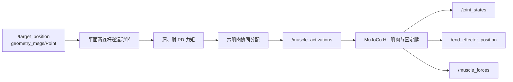
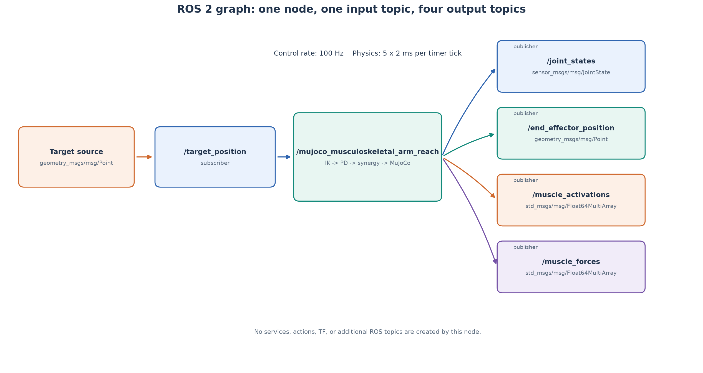
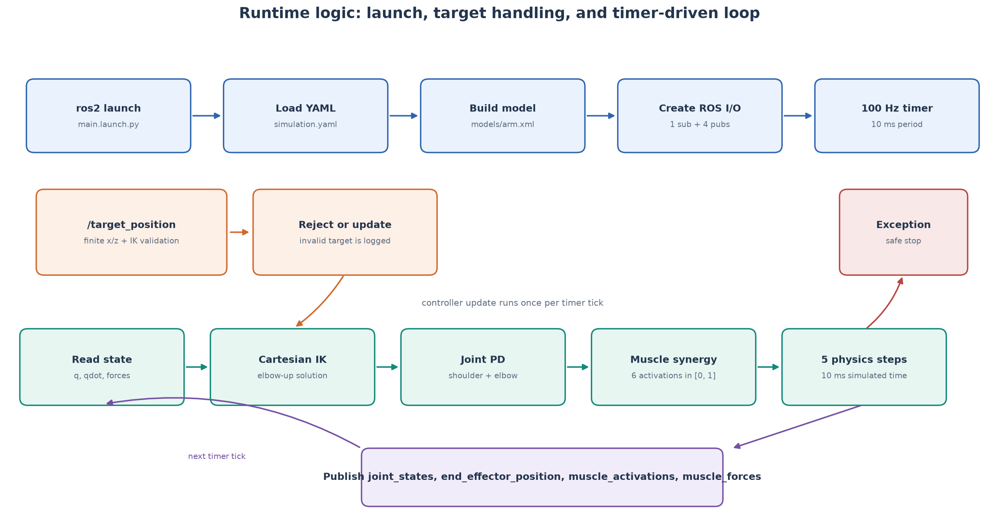
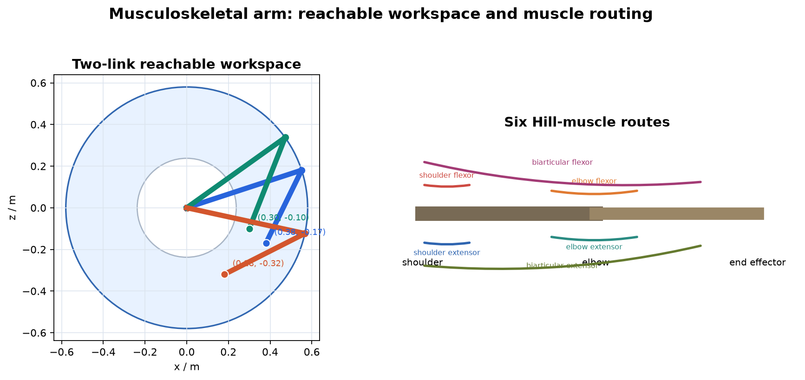
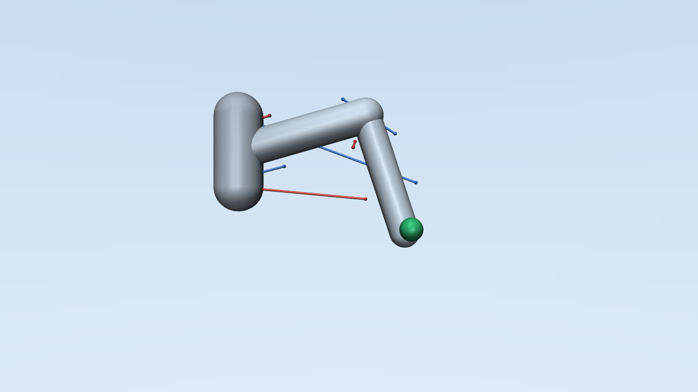
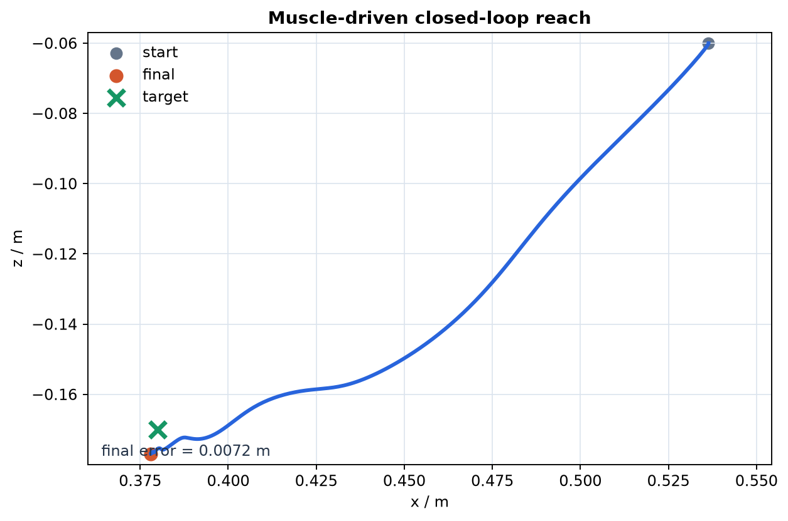
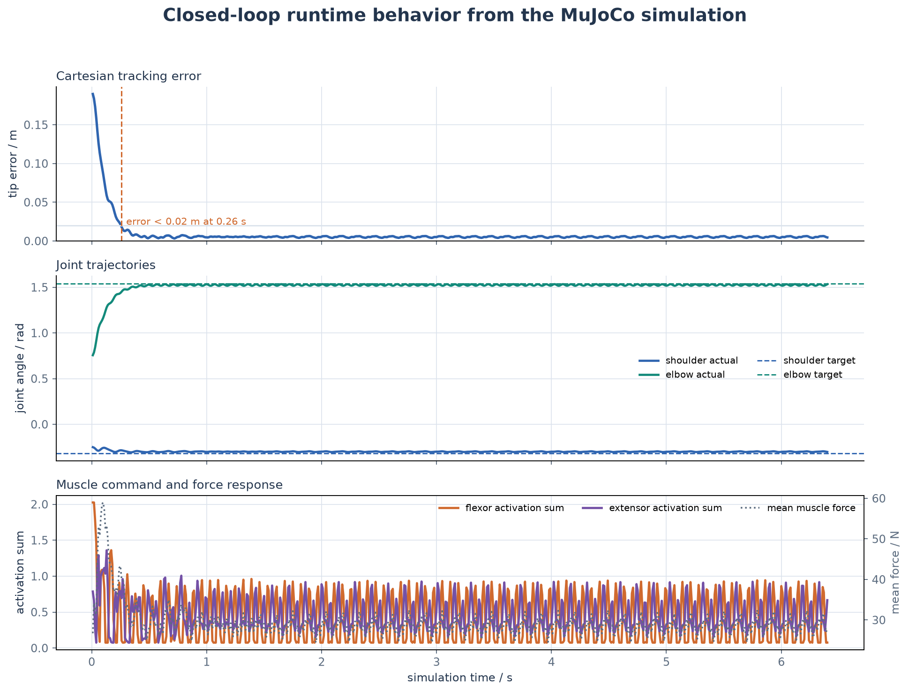

# MuJoCo 双关节肌肉骨骼手臂到达控制

本模块把肌肉骨骼控制从单关节扩展到肩、肘两个关节。上臂和前臂由 6 条
Hill 型肌肉驱动，其中两条肌肉跨越双关节，因此同一个肌肉激活会同时影响
肩关节和肘关节。

## 1. 与现有模块的区别

| 模块 | 自由度 | 肌肉 | 重点 |
| --- | --- | --- | --- |
| `muscle_joint_control` | 1 | 2 | Hill 模型与单关节刚度 |
| 灵巧手模块 | 8 | 11 | 手部遥操作和逆模型 |
| 本模块 | 2 | 6 | 双关节肌与笛卡尔到达 |

本模块没有重复实现单关节拮抗肌实验，而是重点处理运动冗余和肌肉跨关节
耦合力臂。

## 2. ROS 2 计算图与接口



本模块只创建一个 ROS 2 节点
`/mujoco_musculoskeletal_arm_reach`，包含 1 个订阅话题和 4 个发布话题，
不创建 service、action 或 TF。



| 话题 | 类型 | 方向 | 内容与发布时机 |
| --- | --- | --- | --- |
| `/target_position` | `geometry_msgs/msg/Point` | 订阅 | 使用 `x`、`z`，`y` 忽略；收到消息后先做可达性检查 |
| `/joint_states` | `sensor_msgs/msg/JointState` | 发布 | 肩、肘位置与速度，每个 100 Hz 控制周期发布 |
| `/end_effector_position` | `geometry_msgs/msg/Point` | 发布 | 末端在手臂平面的 `x-z` 坐标 |
| `/muscle_activations` | `std_msgs/msg/Float64MultiArray` | 发布 | 6 条肌肉的归一化激活，顺序与模型一致 |
| `/muscle_forces` | `std_msgs/msg/Float64MultiArray` | 发布 | MuJoCo 计算出的 6 条肌肉力，单位 N |

启动后检查实时 ROS 计算图：

```bash
ros2 node list
ros2 node info /mujoco_musculoskeletal_arm_reach
ros2 topic list -t
ros2 topic hz /joint_states
rqt_graph
```

预期 `ros2 node info` 中的接口与上图及表格一致；`rqt_graph` 中应只出现上述
节点与五个话题。

## 3. 运行逻辑



启动阶段按以下顺序执行：

1. `main.launch.py` 启动 `arm_sim_node`；
2. 从 `config/simulation.yaml` 加载参数；
3. 读取 `models/arm.xml`，创建 MuJoCo 状态；
4. 创建 1 个目标订阅和 4 个状态发布者；
5. 注册 100 Hz 定时器，每 10 ms 执行一次控制回调。

每个控制周期读取肩、肘状态，执行逆运动学、PD 控制和六肌肉协同分配，
然后推进 5 个 2 ms MuJoCo 物理步，并发布最新状态。目标不可达时保留上一
有效目标；非有限坐标或不可达目标会被拒绝；仿真计算出现异常时清零全部
肌肉激活并停止定时器。

控制器不直接向关节施加理想力矩。它只输出 6 条肌肉的激活度，实际关节力矩
由 MuJoCo 根据肌腱长度、速度、力臂和肌肉执行器参数计算。

## 4. 双关节模型

模型位于 `models/arm.xml`。

| 项目 | 数值 |
| --- | --- |
| 上臂长度 | 0.30 m |
| 前臂长度 | 0.28 m |
| 肩关节范围 | -1.25 ～ 1.45 rad |
| 肘关节范围 | -0.10 ～ 2.30 rad |
| 控制周期 | 10 ms（5 个 2 ms 物理步） |





工作空间内半径不是两连杆差值 `0.02 m`。肘关节最大角为 `2.30 rad`，
因此允许的内半径约为 `0.238 m`；肩关节限位又会进一步裁掉部分扇区。

六条肌肉为：

| 肌肉 | 作用 |
| --- | --- |
| `shoulder_flexor` | 肩屈 |
| `shoulder_extensor` | 肩伸 |
| `elbow_flexor` | 肘屈 |
| `elbow_extensor` | 肘伸 |
| `biarticular_flexor` | 同时参与肩、肘屈曲 |
| `biarticular_extensor` | 同时参与肩、肘伸展 |

固定腱用关节系数定义每条肌肉的力臂。双关节肌同时包含肩系数和肘系数，
因此一条肌肉的激活会同时改变两个关节的力矩。

MuJoCo 的 fixed tendon 长度定义为关节坐标的线性组合，在 `q=0` 时为 `0`，
缩短时会出现负值。它是相对腱行程，不是绝对肌纤维长度。因此肩肌、肘肌和
双关节肌的 `lengthrange` 分别使用 `±0.09 m`、`±0.12 m`、`±0.14 m`，
覆盖全部关节行程，并让零位对应归一化长度的中值。

## 5. 逆运动学与力矩分配

末端位置由两连杆正运动学给出：

```text
x = L1 cos(q1) + L2 cos(q1 + q2)
z = -L1 sin(q1) - L2 sin(q1 + q2)
```

目标点先通过肘上构型的逆运动学转换为目标关节角，再由肩、肘 PD 控制器
计算期望关节力矩。关节力矩按下面的协同关系分配：

```text
肩正力矩 -> shoulder_flexor
肩负力矩 -> shoulder_extensor
肘正力矩 -> elbow_flexor
肘负力矩 -> elbow_extensor
肩肘共同力矩 -> biarticular_flexor / biarticular_extensor
```

所有激活最终被限制在 `[0, 1]`。如果目标超出最大臂展或肘关节范围，
节点会拒绝该目标。

目标坐标均相对于肩关节，使用手臂平面的 `x-z` 坐标；100 Hz 控制回调每次
推进 5 个 2 ms MuJoCo 物理步。

## 6. 构建与运行

```bash
source /opt/ros/humble/setup.bash

python3 -m pip install --user \
  -r src/musculoskeletal/mujoco_musculoskeletal_arm_reach/requirements.txt

colcon build \
  --packages-select mujoco_musculoskeletal_arm_reach \
  --symlink-install

source install/setup.bash
ros2 launch mujoco_musculoskeletal_arm_reach main.launch.py
```

向目标点发送指令：

```bash
ros2 topic pub --once /target_position geometry_msgs/msg/Point \
  "{x: 0.30, y: 0.0, z: -0.10}"
```

观察状态：

```bash
ros2 node info /mujoco_musculoskeletal_arm_reach
ros2 topic list -t
ros2 topic hz /joint_states
ros2 topic echo /end_effector_position
ros2 topic echo /joint_states
ros2 topic echo /muscle_activations
ros2 topic echo /muscle_forces
```

## 7. 测试

```bash
python3 -m pytest \
  src/musculoskeletal/mujoco_musculoskeletal_arm_reach/test -q

colcon test --packages-select mujoco_musculoskeletal_arm_reach
colcon test-result --verbose
```

覆盖内容：

- 正运动学和逆运动学闭环；
- 非有限目标和肩、肘限位拒绝；
- 不可达目标拒绝；
- 六维肌肉激活范围；
- 肩、肘主动肌选择；
- ROS 节点订阅和发布话题名称；
- 回合目标回调拒绝与仿真异常安全停机；
- 100 Hz 控制下的收敛时间和最终误差；
- 模型关节、固定腱和肌肉数量；
- 固定腱长度范围覆盖全部关节行程；
- MuJoCo 模型加载与安全步进。

闭环到达结果：



默认目标 `(0.38, -0.17) m` 在 3.2 s 内到达，最终误差约
`0.005 ～ 0.007 m`。

真实 MuJoCo 闭环运行记录：



默认目标下，末端误差约 `0.26 s` 进入 `0.02 m` 范围，随后保持在
`0.005 m` 左右。关节角逐渐跟踪逆运动学目标；屈肌与伸肌保持共同激活，
以提供关节稳定性和双向力矩控制能力。

重新生成三张 ROS 与运行图：

```bash
python3 \
  src/musculoskeletal/mujoco_musculoskeletal_arm_reach/scripts/generate_ros_diagrams.py
```

## 8. 当前边界

本模块是三步扩展中的 Commit 1：

- 目前只有刚性 Hill 肌肉参数；
- 尚未加入串联弹性肌腱；
- 尚未加入肌梭、高尔基腱器官、噪声和传输延迟；
- 尚未加入疲劳和学习控制。

这些内容分别进入后续肌腱/本体感觉与疲劳/学习控制提交，避免一个提交同时
修改模型、传感和控制造成难以验收。
