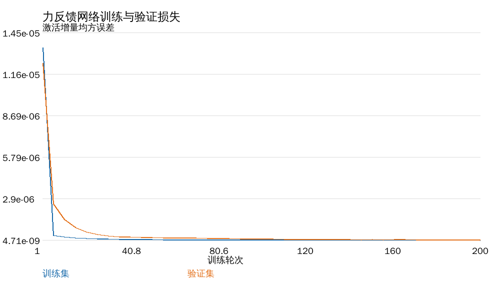
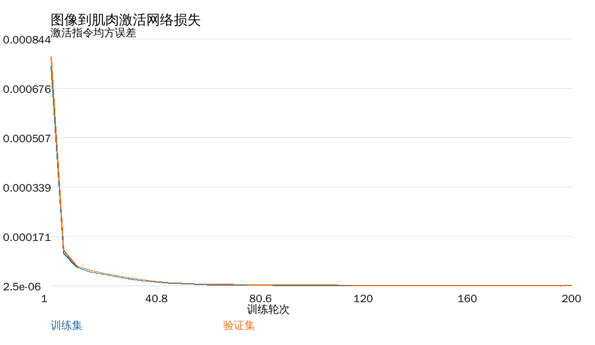
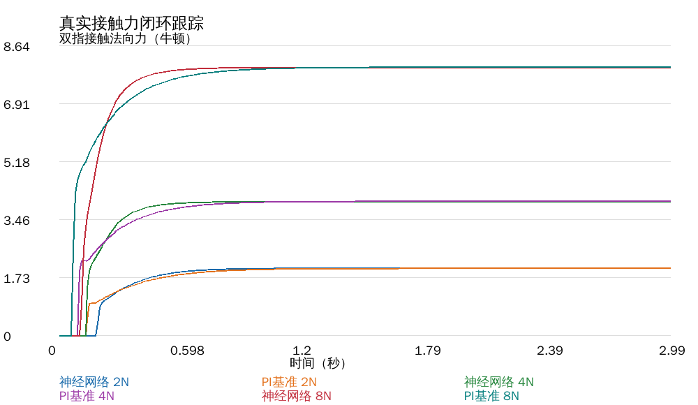
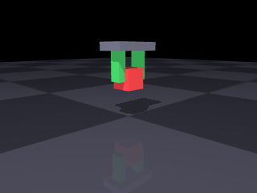
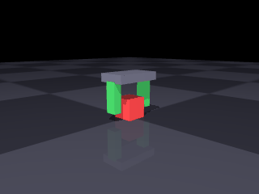
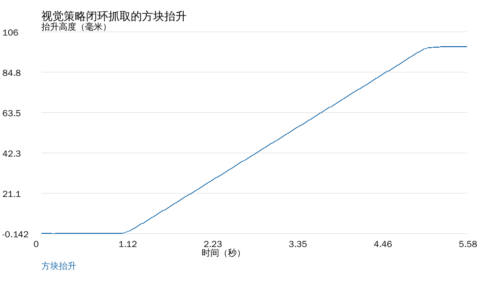

# 肌肉驱动夹爪：真实接触抓取

两指夹爪由 **Hill 肌肉**驱动合拢，与方块之间是**真实接触摩擦**。抬升时方块完全靠摩擦力跟手，
代码里没有任何位置约束或焊接约束——夹不住就是夹不住。

与仓库已有模块的关系：

| 已有模块 | 本模块的差异 |
|---|---|
| [肌肉驱动的关节控制](./muscle_joint_control.md) | 那个是关节角跟踪；本模块关心**接触力与摩擦** |
| [肌肉驱动的下肢关节与步态](./muscle_leg_gait.md) | 那个不接触物体；本模块的核心就是接触 |
| [肌肉骨骼灵巧手](./msk_hand_teleop.md) | 那个是遥操作手部姿态；本模块做**抓取成功条件**的定量分析 |

## 1 模型

### 1.1 机构

固定手掌 + 两根平行手指（滑块关节）+ 桌面上的方块：

| 部件 | 参数 |
|---|---|
| 手指行程 | 0 – 30 mm |
| 手指质量 | 20 g |
| 回位弹簧刚度 | 800 N/m |
| 方块 | 30 mm 立方，30 g |
| 仿真步长 | 0.5 ms |

### 1.2 肌肉

每根手指一条 Hill 肌肉，长度随手指合拢而缩短：

$$
l = l_0 - q,\qquad F = F_{max}\left[a\,f_l f_v + f_p\right]
$$

肌力经 `qfrc_applied` 施加到手指滑块；回位弹簧负责张开。

## 2 八组实验

下表数值按 Ubuntu 22.04 / ROS 2 Humble 容器中的 MuJoCo 3.3.7 实测统一更新，完整记录见[基准指标](./msk_gripper_data/classical_metrics.json)。原有 G2/G8 动图保留，用于观察相同场景的运动过程；新增神经网络图像与数据见第 11 节。

### 2.1 G1 肌肉激活 → 夹持力

| 激活 | 肌力 | 弹簧回位力 | 接触法向力（双指合计） | 接触点数 |
|---|---|---|---|---|
| 0.05 | 1.17 N | 1.17 N | 0.00 N | 0 |
| 0.10 | 2.29 N | 2.29 N | 0.00 N | 0 |
| 0.20 | 4.32 N | 4.32 N | 0.00 N | 0 |
| 0.40 | 7.67 N | 7.42 N | **0.50 N** | 8 |
| 0.80 | 14.13 N | 9.20 N | **9.86 N** | 8 |

夹持力取**手指与方块之间的真实接触法向力**（`mj_contactForce`），而不是肌力：
肌力要先扣掉 800 N/m 的回位弹簧力才作用到方块上。前三档手指行程只有 1.5–5.4 mm，
还没碰到方块（接触点数 0），因此接触力为 0——**不是"夹了 4.3 N 但滑了"，而是根本没夹上**。


### 2.2 G2 抬升阈值

抬升目标 100 mm：

| 激活 | 抬升高度 | 结果 |
|---|---|---|
| 0.05 / 0.10 / 0.20 | ~0 mm | 打滑 |
| **0.40** | **97.8 mm** | 夹住 |
| 0.80 | 98.2 mm | 夹住 |

**阈值在 0.2 与 0.4 之间**：0.2 时手指行程 5.4 mm，还没碰到方块（接触点数 0）；0.4 时每指真实法向力约 0.25 N 即可夹住。这是真实的"夹得住 / 夹不住"分界：
低于阈值时方块保持在桌面附近，高于阈值时方块跟着手走约 98 mm。


抓住时的画面：


激活 0.15（低于阈值）时的打滑：


### 2.3 G3 摩擦系数的影响

| 摩擦 μ | 激活 0.4 时抬升 |
|---|---|
| 0.3 | 3.7 mm（抬起后滑脱） |
| 0.8 | 97.8 mm |
| 1.5 | 97.8 mm |

**摩擦不足时，力够了也夹不住**——限制来自接触面，不是肌肉。这条结论对真实夹爪设计有直接意义：
表面摩擦系数决定了下限，超过之后再加肌肉力没有收益。


### 2.4 G4 对照组：松开就掉

夹住抬到 95 mm 后把激活降到 0：

| 指标 | 数值 |
|---|---|
| 抬升高度 | 95.3 mm |
| 松开后掉落时间 | **0.16 s** |

这一组用来验证前面的"抓住"确实是摩擦维持的——松开肌肉，方块立刻掉。

### 2.5 G5 抓持力闭环

PI 调节激活，跟踪目标夹持力。反馈通过 `mj_contactForce()` 读取两指与方块的真实接触法向力并求和，与 G1 使用同一测量口径。

| 目标 | 稳态 | 上升时间 | 末态激活 |
|---|---|---|---|
| 2 N | 2.00 N | 0.576 s | 0.474 |
| 4 N | 4.00 N | 0.445 s | 0.554 |
| 8 N | 8.00 N | 0.390 s | 0.713 |

所需激活随目标力增长。上升时间取真实接触力首次到达目标值 90% 的时刻；稳态值由结束前的采样计算。


### 2.6 G6 滑移反射

40 g 方块，初始激活固定 0.33（略低于静摩擦阈值）：

| 配置 | 抬升高度 | 加力步数 |
|---|---|---|
| 无反射 | **0 mm** | 0 |
| 有反射 | **86.0 mm** | 6 步（每步 +0.01，合计 +0.06）|

判据：手掌已抬起但方块没跟上（相对位移超过 2 mm）即判为滑移，立即提高激活。
**6 个时间步（每步 +0.01 激活，合计 +0.06）就把一个本来抓不住的负载救回来了**——这是纯反馈带来的能力，开环控力做不到。


### 2.7 G7 负载扫描

| 方块质量 | 最小可抓激活 |
|---|---|
| 10 g | 0.38 |
| 30 g | 0.38 |
| 60 g | 0.40 |

> 说明：最小激活是在网格 (0.20, 0.25, 0.28, 0.30, 0.32, 0.35, 0.38, 0.40, 0.45, 0.50)
> 上搜索得到的，分辨率 0.02–0.05。10 g 与 30 g 同为 0.38 是网格效应，
> 不代表两者物理阈值完全相同。

质量从 10 g 增到 60 g，所需激活只从 0.38 到 0.40——因为摩擦上限远高于重力，
真正的瓶颈是"能否形成稳定接触"，不是"力够不够"。

### 2.8 G8 手臂-夹爪联合抓取

前面七组实验中夹爪固定在竖直滑轨上。本节把夹爪装到两连杆手臂末端：

- 肩、肘由 PD 跟踪逆解目标（`ik()` 用 `ee_x = L1 sin q0 + L2 sin(q0+q1)` 的几何）；
- 腕关节伺服保持手掌竖直（`ctrl = -(q0+q1)`）；
- **手指参数与 G1-G7 完全一致**（质量 20 g、回位弹簧 800 N/m、`solref=0.02 1`）。

| 指标 | 数值 |
|---|---|
| 方块起始高度 | −0.345 m |
| 方块结束高度 | −0.257 m |
| **抬升** | **87.6 mm** |


调试中踩到两个坑，记录下来：

1. **前臂胶囊的球形端伸出 23 mm**，正好插进手指的运动空间，把手指顶住（接触穿透 3 mm）。解决：让躯干/上臂/前臂 `contype=0 conaffinity=0`，不参与碰撞。
2. **手指下端蹭到桌面**时会被摩擦卡住，合拢行程只有 4.6 mm。解决：把握取高度从 `OBJ_Z+0.030` 抬到 `OBJ_Z+0.045`。

## 3 复现

```bash
cd src/musculoskeletal/mujoco_muscle_gripper
python3 main.py check
python3 main.py bench --out out       # 复现 G1–G8 全部数字
python3 main.py gif --out gif         # 复现本页动图
python3 tools/plot_metrics.py out/metrics.json out
python3 -m unittest discover -s tests # 18 项
```

## 4 已知限制

1. **单指单肌肉**：每根手指只有一条屈肌 + 一个回位弹簧，没有拮抗肌对与肌梭反馈。
2. **指尖近似为长方体**，未建模指尖曲面与滚动接触。
3. **方块为刚体、30 g**，不对应具体物体。
4. **步长 0.5 ms**：接触刚度较高，步长再大就会数值不稳。
5. 未接入 ROS 话题，未做 sim2real。

## 5 与"运动学跟随"演示的区别

本模块的方块**完全由接触力驱动**。若把方块位置每帧直接设到手上（运动学跟随），
任何激活都会"抓得住"，阈值、打滑、掉落这些现象全部消失——那种实现只能当示意，不能定量。

## 6 参考

* A. V. Hill, *The heat of shortening and the dynamic constants of muscle*, 1938
* R. M. Murray, Z. Li, S. S. Sastry, *A Mathematical Introduction to Robotic Manipulation*, 1994

## 7 键盘控制与可重复操作

`main.py manual` 将键盘指令直接作用于同一套 Hill 肌肉和 MuJoCo 接触模型。每次按键后推进 0.1 s 物理仿真，并输出时间、激活、抬升目标、接触点数和真实接触法向力。

| 按键 | 操作 | 范围 |
|---|---|---|
| W | 双指激活增加 0.05 | 0–1 |
| S | 双指激活减少 0.05 | 0–1 |
| R | 手掌抬升目标增加 10 mm | 0–150 mm |
| F | 手掌抬升目标减少 10 mm | 0–150 mm |
| 空格 | 肌肉激活归零，松开方块 | 0 |
| Q | 结束当前操作 | — |

在有标准输入的终端运行：

```bash
python3 main.py manual
```

同一映射支持按键序列复现。以下序列逐步合拢、抬升、降低，再退出；序列参数使用小写字母：

```bash
python3 main.py manual --keys wwwwwwwwwwwwrrrrffffq
ros2 launch mujoco_muscle_gripper main.launch.py mode:=manual keys:=wwwwwwwwwwwwrrrrffffq
```

`manual.command()` 对激活与高度分别限幅；`manual.run()` 在每个仿真子步先更新肌肉激活动力学，再施加肌力，最后由 `mj_step()` 计算接触运动。按键改变的是驱动力与抬升目标，方块运动由求解器计算。

## 8 神经网络真实接触力控制

### 8.1 观测、动作与训练回合

力控制策略使用 MuJoCo 当前接触力、手指行程和速度作为反馈。`runs._finger_contact()` 只累加手指与方块之间的接触，通过 `mj_contactForce()` 读取法向分量，排除方块与桌面的接触。控制周期为 10 ms，每个控制周期执行 20 个 0.5 ms 物理子步。

网络输入为五维归一化状态：

$$
\mathbf{x}_t=\left[\frac{F^*}{10},\frac{F_t}{15},\frac{\bar q_t}{0.02},\frac{\bar v_t}{0.10},u_{t-1}\right].
$$

其中，$F^*$ 为目标双指接触法向力，$F_t$ 为测得的双指法向力之和，$\bar q_t$、$\bar v_t$ 为两指平均行程和速度，$u$ 为肌肉激活指令。训练教师产生激活增量：

$$
\Delta u_t^*=\operatorname{clip}\left(0.30(F^*-F_t)\Delta t_c,-0.02,0.02\right),\qquad \Delta t_c=0.01\ \mathrm{s}.
$$

训练数据来自 24 个完整仿真回合，每回合 240 个控制时刻；回合随机改变质量（20–60 g）、摩擦系数（0.7–1.5）、目标力（1–10 N）和初始激活。`split_episodes()` 按回合编号划分训练、验证和测试集，避免同一回合的相邻帧落入不同集合。默认种子为 21，训练、验证、测试分别使用 16、4、4 个回合。

### 8.2 网络和闭环更新

策略是一个 5–24–1 的多层感知机。训练集均值和标准差用于输入与输出标准化，隐层使用双曲正切：

$$
\hat{\mathbf{x}}=\operatorname{clip}\left(\frac{\mathbf{x}-\boldsymbol\mu_x}{\boldsymbol\sigma_x},-6,6\right),\qquad
\Delta u_\theta=\sigma_y\left[\tanh(\hat{\mathbf{x}}W_1+\mathbf b_1)W_2+b_2\right]+\mu_y.
$$

`MLP.fit()` 使用 Adam 和均方误差训练，批大小为 128。闭环运行时用学习到的增量更新指令：

$$
u_t=\operatorname{clip}\left(u_{t-1}+\operatorname{clip}(\Delta u_\theta,-0.02,0.02),0,1\right).
$$

同一物理环境中的独立 PI 基准使用比例增益 0.025、积分增益 0.30。测试目标为 2 N、4 N、8 N，记录整段均方根误差、最后 0.5 s 的平均绝对误差、稳态力和最终激活。教师模仿误差与闭环接触力误差分别统计，前者衡量动作预测，后者衡量控制效果。

### 8.3 算法流程与源码对应

```text
随机化完整物理回合 → 采集反馈与教师动作 → 按回合划分数据
→ 训练集标准化 → Adam 训练 → 验证损失 → 保留测试集评估
→ 保存网络参数 → 神经网络闭环与 PI 基准对比 → 导出 CSV、曲线、指标
```

| 文件与函数 | 职责 |
|---|---|
| `core.py / HillMuscle.update_activation()` | 以激活、去激活两个时间常数更新肌肉内部激活 |
| `core.py / HillMuscle.force()` | 根据肌长、速度和激活计算 Hill 肌力 |
| `runs.py / _finger_contact()` | 读取手指与方块之间的真实接触法向力 |
| `neural.py / GripEnvironment.step()` | 应用肌力、执行物理子步、返回反馈 |
| `neural.py / collect_force_data()` | 在质量、摩擦和目标随机化的回合中采样 |
| `neural.py / split_episodes()` | 按完整回合划分数据 |
| `neural.py / MLP.fit()` | 标准化、前向传播、误差反传和 Adam 参数更新 |
| `neural.py / force_rollout()` | 对同一目标分别评估网络和 PI 控制 |

肌肉内部激活也有一阶动态，而非瞬间等于网络输出：

$$
a_{k+1}=\operatorname{clip}\left(a_k+(u-a_k)\min\left(1,\frac{\Delta t}{\tau}\right),0,1\right).
$$

当 $u>a_k$ 时，$\tau=0.01\ \mathrm{s}$；否则 $\tau=0.04\ \mathrm{s}$。

这使网络输出、肌肉激活、肌肉力和接触法向力形成连续的物理因果链。对于两侧对称夹持，静摩擦支撑重量的必要条件为 $\mu(N_L+N_R)\ge mg$；抬升加速度为 $\ddot z$ 时对应 $\mu(N_L+N_R)\ge m(g+\ddot z)$。实际滑移仍由 MuJoCo 的接触与摩擦求解器决定。

## 9 从真实渲染像素到肌肉激活

### 9.1 图像输入与监督学习

`GripEnvironment.render()` 从当前 MuJoCo 场景生成 320×240 RGB 图像。`image_features()` 将图像转为灰度、缩小至 16×16 并除以 255，得到 256 维像素向量。视觉策略采用 256–24–1 多层感知机，其部署输入为当前图像，输出为双指肌肉激活指令：

$$
\mathbf p_t=\frac{\operatorname{vec}(\operatorname{resize}_{16\times16}(\operatorname{gray}(I_t)))}{255},\qquad
u_t=\operatorname{clip}(\pi_\theta(\mathbf p_t),0,1).
$$

视觉训练的 18 个回合随机化初始行程（0–8 mm）、质量（20–40 g）和摩擦系数（1–1.5），每回合采集 24 张真实渲染图像。教师根据仿真行程产生标签：

$$
u^*=0.60+0.20\operatorname{clip}\left(\frac{0.009-\bar q}{0.009},0,1\right).
$$

行程用于训练教师生成标签；部署时 `visual_rollout()` 只把图像特征传给网络。默认训练、验证、测试分别使用 12、3、3 个完整回合。像素模型学习当前固定机位、场景和随机化范围内的闭合策略。

### 9.2 抓取闭环与评价

视觉控制以 20 ms 为周期执行 280 次。网络控制手指激活，手掌执行给定的竖直抬升轨迹：

$$
z_d(t)=0.10\operatorname{clip}\left(\frac{t-1}{4},0,1\right)\ \mathrm{m}.
$$

因此，图像到控制的学习任务是夹持激活；竖直抬升采用给定轨迹。输出包含独立测试动作误差、方块实际抬升高度、最终接触力、平均激活以及完整的闭环时序。`camera_frame.png` 是实际相机帧，`visual_control.gif` 由连续相机帧组成，`visual_lift.png` 根据保存的高度时序绘制。

```text
当前物理场景 → RGB 渲染 → 灰度缩放 → 256 维像素
→ 视觉网络 → 双指激活 → Hill 肌肉力 → 接触与摩擦求解
→ 新物理状态 → 下一帧图像
```

## 10 Docker 与 ROS 2 Humble 复现

### 10.1 环境与构建

模块提供 `Dockerfile`，基于 `ros:humble-ros-base-jammy`：Ubuntu 22.04、ROS 2 Humble，固定 NumPy 1.26.4、MuJoCo 3.3.7、Pillow 11.3.0 与 Matplotlib 3.9.4。Linux 容器采用 EGL 离屏渲染，运行时无需操作宿主桌面。

在模块目录执行以下 Docker 命令。Windows PowerShell 中 `${PWD}` 指当前模块目录：

```powershell
docker build -t lyzzzz0921-msk-gripper:humble .
New-Item -ItemType Directory -Path results -Force
docker run --rm -v "${PWD}/results:/results" lyzzzz0921-msk-gripper:humble
```

镜像构建执行 `colcon build` 并验证包安装路径；镜像默认命令通过 ROS 2 launch 运行 G1–G8 全部基准实验，结果写入挂载目录。

### 10.2 模型、键盘、网络和动图入口

模块具有 `main.py`、`main.sh`、`main.bat` 统一入口；ROS 2 launch 参数 `mode` 选择 `check`、`run`、`bench`、`manual`、`neural` 或 `gif`。

```bash
source /opt/ros/humble/setup.bash
source /ws/install/setup.bash
ros2 launch mujoco_muscle_gripper main.launch.py mode:=check
ros2 launch mujoco_muscle_gripper main.launch.py mode:=run scene:=g8
ros2 launch mujoco_muscle_gripper main.launch.py mode:=bench out:=/results/base
ros2 launch mujoco_muscle_gripper main.launch.py mode:=manual keys:=wwwwwwwwwwwwrrrrffffq
ros2 launch mujoco_muscle_gripper main.launch.py mode:=neural out:=/results/neural
ros2 launch mujoco_muscle_gripper main.launch.py mode:=gif out:=/results/gif
```

训练轮数可通过神经网络模块的直接入口设置；该入口与 launch 的网络模式调用同一实验实现：

```bash
python3 -m mujoco_muscle_gripper.neural --out /results/neural --seed 21 --epochs 300
python3 -m unittest discover -s /ws/src/mujoco_muscle_gripper/tests
```

### 10.3 输出文件与读图顺序

| 文件 | 内容 |
|---|---|
| `metrics.json` | 数据划分、训练损失、独立测试误差、各目标闭环统计 |
| `force_training_loss.png` | 力策略训练与验证损失曲线 |
| `force_tracking.png` | 三个目标力下网络与 PI 的真实接触力时序 |
| `force_nn_*n.csv`、`force_baseline_*n.csv` | 时间、目标力、接触力、激活、行程、接触点数 |
| `visual_training_loss.png` | 图像策略训练与验证损失 |
| `camera_frame.png` | 当前物理场景的真实相机帧 |
| `visual_control.gif` | 图像驱动夹持与给定抬升轨迹下的连续运动 |
| `visual_closed_loop.csv`、`visual_lift.png` | 时间、激活、真实接触力、方块实际高度及高度曲线 |
| `force_policy.npz`、`visual_policy.npz` | 网络参数及训练集标准化统计量 |
| `force_dataset.npz`、`visual_dataset.npz` | 特征、标签、回合编号与数据划分索引 |

先检查训练集与验证集损失，再检查独立测试误差，最后对照闭环曲线、相机帧和动图。网络动作误差较小并不自动等于抓取稳定；评价以物理闭环的真实接触力和方块位移为依据。

## 11 容器实测结果与图像记录

### 11.1 运行记录和数据来源

本节数据来自 Docker 中 ROS 2 Humble 的完整运行，MuJoCo 版本为 3.3.7，随机种子为 21，两个网络均训练 200 轮。18 项测试全部通过，用时 22.38 s；键盘、G1–G8 基准和神经网络三种 launch 进程均正常结束。原始[运行日志](./msk_gripper_data/docker_acceptance.log)、[网络指标 JSON](./msk_gripper_data/metrics.json)与[基准指标 JSON](./msk_gripper_data/classical_metrics.json)可逐项核对。

键盘实测从 0 激活逐次合拢，激活 0.40 时形成 8 个接触点；升至 0.50 后，双指真实法向力为 2.562 N。随后四次 R 指令将目标高度从 0 提高到 40 mm，保持 8 个接触点，最后法向力为 2.631 N。

### 11.2 训练、验证与保留测试集

| 策略 | 总样本 | 训练/验证/测试回合 | 初始训练 MSE | 最终训练 MSE | 最终验证 MSE | 独立测试 MSE |
|---|---|---|---|---|---|---|
| 接触力反馈网络 | 5760 | 16 / 4 / 4 | 1.341×10⁻⁵ | 4.709×10⁻⁹ | 3.017×10⁻⁸ | 1.377×10⁻⁸ |
| 像素视觉网络 | 432 | 12 / 3 / 3 | 7.493×10⁻⁴ | 2.499×10⁻⁶ | 3.007×10⁻⁶ | 2.214×10⁻⁶ |

MSE 在原始动作尺度上计算：力反馈网络对应激活增量，视觉网络对应激活指令。





### 11.3 真实接触力闭环对比

| 目标力 | 控制器 | 稳态真实力 | 稳态 MAE | 全程 RMSE | 最终激活 |
|---|---|---|---|---|---|
| 2 N | 神经网络 | 2.0046 N | 0.00459 N | 0.5492 N | 0.4740 |
| 2 N | PI 基准 | 2.0000 N | 0.0000121 N | 0.5011 N | 0.4738 |
| 4 N | 神经网络 | 3.9872 N | 0.01276 N | 0.9320 N | 0.5530 |
| 4 N | PI 基准 | 4.0000 N | 0.0000052 N | 0.8329 N | 0.5535 |
| 8 N | 神经网络 | 7.9933 N | 0.00668 N | 1.7491 N | 0.7124 |
| 8 N | PI 基准 | 8.0000 N | 0.0000321 N | 1.4329 N | 0.7127 |

网络在三个目标下均收敛到目标附近，稳态平均绝对误差不超过 0.013 N。PI 基准在本次固定目标实验中的误差更低；网络结果体现了从随机化仿真数据中学习的闭环控制能力。



原始 CSV：[网络 2 N](./msk_gripper_data/force_nn_2n.csv)、[网络 4 N](./msk_gripper_data/force_nn_4n.csv)、[网络 8 N](./msk_gripper_data/force_nn_8n.csv)、[PI 2 N](./msk_gripper_data/force_baseline_2n.csv)、[PI 4 N](./msk_gripper_data/force_baseline_4n.csv)、[PI 8 N](./msk_gripper_data/force_baseline_8n.csv)。

### 11.4 视觉策略抓取

| 指标 | Docker 实测 |
|---|---|
| 视觉控制时刻数 | 280 |
| 图像输入 | 16×16 灰度像素 |
| 方块最大实际抬升 | 98.114 mm |
| 最终双指接触法向力 | 10.186 N |
| 平均肌肉激活指令 | 0.6271 |
| 动图文件大小 | 360944 字节（0.361 MB） |

下图直接来自 MuJoCo 的当前物理场景渲染，红色方块位于绿色双指之间：



动图由 280 个控制时刻中每隔三个时刻采集的相机帧组成，展示闭合、接触和抬升过程：



高度曲线与[视觉闭环 CSV](./msk_gripper_data/visual_closed_loop.csv)使用同一时序数据：



补充运行记录：[模型自检、机械臂实验与动图入口](./msk_gripper_data/docker_other_modes.log)。三个补充 launch 进程正常退出，三段动图分别为 2.99、1.01、2.77 MB；结合前述记录，六种入口模式均完成容器运行。
