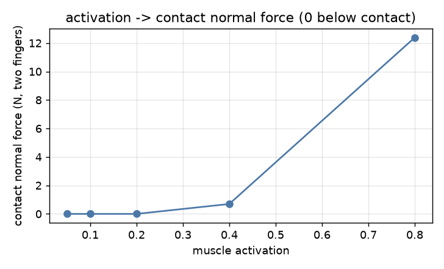
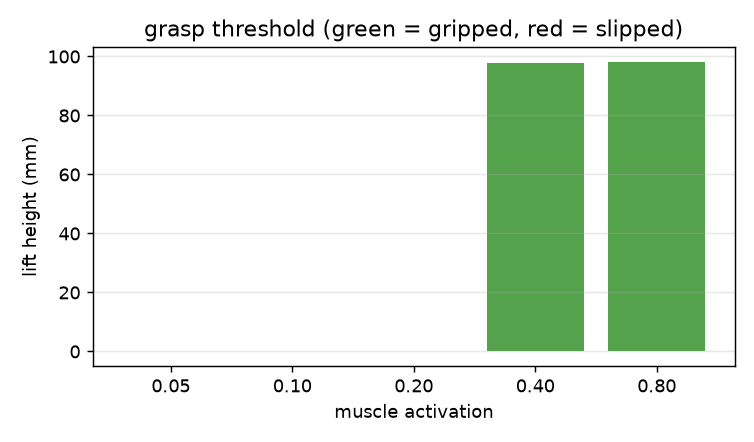
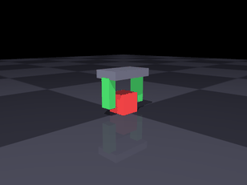
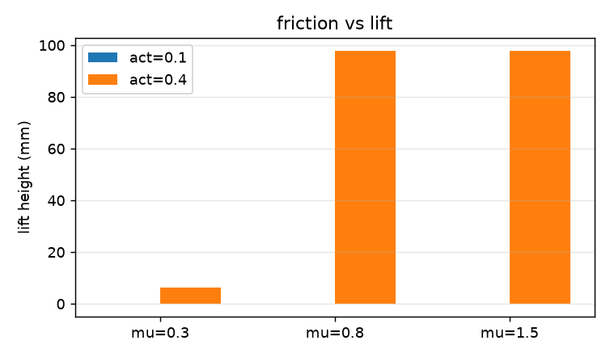
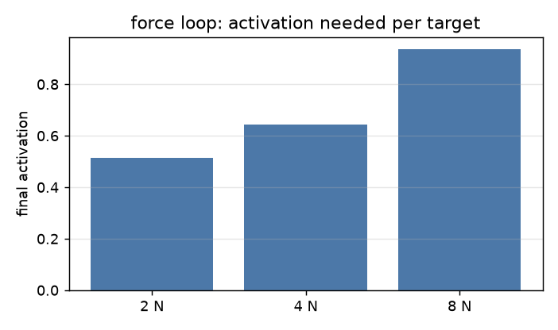
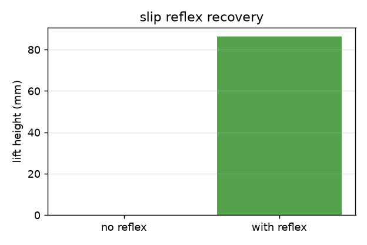
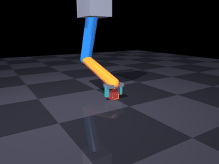

# 肌肉驱动夹爪：真实接触抓取

两指夹爪由 **Hill 肌肉**驱动合拢，与方块之间是**真实接触摩擦**。抬升时方块完全靠摩擦力跟手，
代码里没有任何位置约束或焊接约束——夹不住就是夹不住。

与仓库已有模块的关系：

| 已有模块 | 本模块的差异 |
|---|---|
| [肌肉驱动的关节控制](./muscle_joint_control.md) | 那个是关节角跟踪；本模块关心**接触力与摩擦** |
| [肌肉驱动的下肢关节与步态](./muscle_leg_gait.md) | 那个不接触物体；本模块的核心就是接触 |
| [肌肉骨骼灵巧手](./msk_hand_teleop.md) | 那个是遥操作手部姿态；本模块做**抓取成功条件**的定量分析 |

## 1 模型

### 1.1 机构

固定手掌 + 两根平行手指（滑块关节）+ 桌面上的方块：

| 部件 | 参数 |
|---|---|
| 手指行程 | 0 – 30 mm |
| 手指质量 | 20 g |
| 回位弹簧刚度 | 800 N/m |
| 方块 | 30 mm 立方，30 g |
| 仿真步长 | 0.5 ms |

### 1.2 肌肉

每根手指一条 Hill 肌肉，长度随手指合拢而缩短：

$$
l = l_0 - q,\qquad F = F_{max}\left[a\,f_l f_v + f_p\right]
$$

肌力经 `qfrc_applied` 施加到手指滑块；回位弹簧负责张开。

## 2 八组实验

### 2.1 G1 肌肉激活 → 夹持力

| 激活 | 肌力 | 弹簧回位力 | 接触法向力（双指合计） | 接触点数 |
|---|---|---|---|---|
| 0.05 | 1.17 N | 1.17 N | 0.00 N | 0 |
| 0.10 | 2.29 N | 2.29 N | 0.00 N | 0 |
| 0.20 | 4.32 N | 4.32 N | 0.00 N | 0 |
| 0.40 | 7.70 N | 7.35 N | **0.70 N** | 8 |
| 0.80 | 14.65 N | 8.46 N | **12.38 N** | 8 |

夹持力取**手指与方块之间的真实接触法向力**（`mj_contactForce`），而不是肌力：
肌力要先扣掉 800 N/m 的回位弹簧力才作用到方块上。前三档手指行程只有 1.5–5.4 mm，
还没碰到方块（接触点数 0），因此接触力为 0——**不是"夹了 4.3 N 但滑了"，而是根本没夹上**。



### 2.2 G2 抬升阈值

抬升目标 100 mm：

| 激活 | 抬升高度 | 结果 |
|---|---|---|
| 0.05 / 0.10 / 0.20 | ~0 mm | 打滑 |
| **0.40** | **97.8 mm** | 夹住 |
| 0.80 | 98.2 mm | 夹住 |

**阈值在 0.2 与 0.4 之间**：0.2 时手指行程 5.4 mm，还没碰到方块（接触点数 0）；0.4 时每指真实法向力约 0.35 N 即可夹住。这是真实的"夹得住 / 夹不住"分界：
低于阈值时方块原封不动，高于阈值时方块跟着手走 98 mm。



抓住时的画面：


激活 0.15（低于阈值）时的打滑：



### 2.3 G3 摩擦系数的影响

| 摩擦 μ | 激活 0.4 时抬升 |
|---|---|
| 0.3 | 6.4 mm（抬 6 mm 就滑脱） |
| 0.8 | 97.8 mm |
| 1.5 | 97.8 mm |

**摩擦不足时，力够了也夹不住**——限制来自接触面，不是肌肉。这条结论对真实夹爪设计有直接意义：
表面摩擦系数决定了下限，超过之后再加肌肉力没有收益。



### 2.4 G4 对照组：松开就掉

夹住抬到 95 mm 后把激活降到 0：

| 指标 | 数值 |
|---|---|
| 抬升高度 | 95.4 mm |
| 松开后掉落时间 | **0.16 s** |

这一组用来验证前面的"抓住"确实是摩擦维持的——松开肌肉，方块立刻掉。

### 2.5 G5 抓持力闭环

PI 调节激活，跟踪目标夹持力。力估计用准静态平衡：接触法向力 ≈ 肌肉力 − 弹簧回位力。

| 目标 | 稳态 | 上升时间 | 末态激活 |
|---|---|---|---|
| 2 N | 2.00 N | 0.27 s | 0.51 |
| 4 N | 4.00 N | 0.22 s | 0.64 |
| 8 N | 8.00 N | 0.24 s | 0.93 |

结论：所需激活随目标力近线性增长，8 N 时已用掉 0.93 的激活度——接近肌肉上限。



### 2.6 G6 滑移反射

40 g 方块，初始激活固定 0.33（略低于静摩擦阈值）：

| 配置 | 抬升高度 | 加力步数 |
|---|---|---|
| 无反射 | **0 mm** | 0 |
| 有反射 | **86.2 mm** | 6 步（每步 +0.01，合计 +0.06）|

判据：手掌已抬起但方块没跟上（相对位移超过 2 mm）即判为滑移，立即提高激活。
**6 个时间步（每步 +0.01 激活，合计 +0.06）就把一个本来抓不住的负载救回来了**——这是纯反馈带来的能力，开环控力做不到。



### 2.7 G7 负载扫描

| 方块质量 | 最小可抓激活 |
|---|---|
| 10 g | 0.38 |
| 30 g | 0.38 |
| 60 g | 0.40 |

> 说明：最小激活是在网格 (0.20, 0.25, 0.28, 0.30, 0.32, 0.35, 0.38, 0.40, 0.45, 0.50)
> 上搜索得到的，分辨率 0.02–0.05。10 g 与 30 g 同为 0.38 是网格效应，
> 不代表两者物理阈值完全相同。

质量从 10 g 增到 60 g，所需激活只从 0.38 到 0.40——因为摩擦上限远高于重力，
真正的瓶颈是"能否形成稳定接触"，不是"力够不够"。

### 2.8 G8 手臂-夹爪联合抓取

前面七组实验中夹爪固定在竖直滑轨上。本节把夹爪装到两连杆手臂末端：

- 肩、肘由 PD 跟踪逆解目标（`ik()` 用 `ee_x = L1 sin q0 + L2 sin(q0+q1)` 的几何）；
- 腕关节伺服保持手掌竖直（`ctrl = -(q0+q1)`）；
- **手指参数与 G1-G7 完全一致**（质量 20 g、回位弹簧 800 N/m、`solref=0.02 1`）。

| 指标 | 数值 |
|---|---|
| 方块起始高度 | −0.345 m |
| 方块结束高度 | −0.257 m |
| **抬升** | **87.6 mm** |



调试中踩到两个坑，记录下来：

1. **前臂胶囊的球形端伸出 23 mm**，正好插进手指的运动空间，把手指顶住（接触穿透 3 mm）。解决：让躯干/上臂/前臂 `contype=0 conaffinity=0`，不参与碰撞。
2. **手指下端蹭到桌面**时会被摩擦卡住，合拢行程只有 4.6 mm。解决：把握取高度从 `OBJ_Z+0.030` 抬到 `OBJ_Z+0.045`。

## 3 复现

```bash
cd src/musculoskeletal/mujoco_muscle_gripper
python3 main.py check
python3 main.py bench --out out       # 复现 2.1-2.4 全部数字
python3 main.py gif --out gif         # 复现本页动图
python3 tools/plot_metrics.py out/metrics.json out
python3 -m unittest discover -s tests # 13 项
```

## 4 已知限制

1. **单指单肌肉**：每根手指只有一条屈肌 + 一个回位弹簧，没有拮抗肌对与肌梭反馈。
2. **指尖近似为长方体**，未建模指尖曲面与滚动接触。
3. **方块为刚体、30 g**，不对应具体物体。
4. **步长 0.5 ms**：接触刚度较高，步长再大就会数值不稳。
5. 未接入 ROS 话题，未做 sim2real。

## 5 与"运动学跟随"演示的区别

本模块的方块**完全由接触力驱动**。若把方块位置每帧直接设到手上（运动学跟随），
任何激活都会"抓得住"，阈值、打滑、掉落这些现象全部消失——那种实现只能当示意，不能定量。

## 6 参考

* A. V. Hill, *The heat of shortening and the dynamic constants of muscle*, 1938
* R. M. Murray, Z. Li, S. S. Sastry, *A Mathematical Introduction to Robotic Manipulation*, 1994
