# MuJoCo 肌肉骨骼灵巧手：键盘遥操作与神经网络肌肉激活控制

## 1. 项目概述

本项目在 **MuJoCo 物理仿真器**中建立了一条**肌肉骨骼（musculoskeletal）灵巧手**，
包含 3 指（食指、中指、拇指）+ 2 自由度腕部共 **8 个关节**，由 **11 条 Hill 型肌肉**
通过空间腱（spatial tendon）驱动。项目同时实现两种控制方式：

1. **键盘遥操作**（任务一：物理仿真 + 键盘运动控制）——按键切换肌肉激活目标，
   经一阶平滑后下发；
2. **神经网络逆模型控制**（控制算法为神经网络）——MLP 直接由"食指指尖目标位置"
   解算 11 维肌肉激活，实现到达任务。

全部三种场景（自由到达 / 按键按压 / 拨球离台）支持 `roslaunch` 一键启动，
运行于 Ubuntu 20.04 + ROS Noetic。

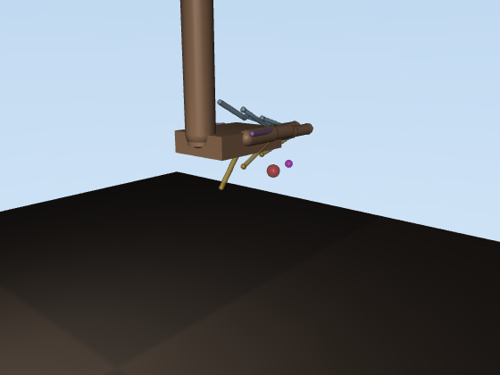

### 1.1 演示动图

| 场景 | 说明 |
| --- | --- |
| 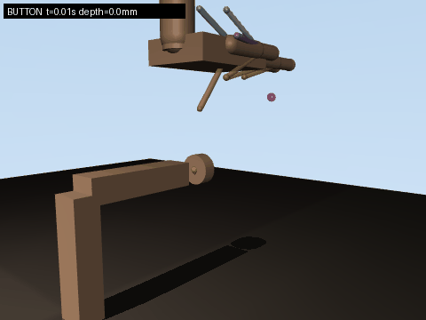 | 键盘遥操作按压门铃式按键，钮帽行程 6 mm 全程压满 |
| 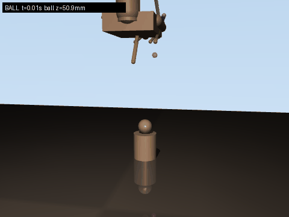 | 食指卷曲推拨托柱上的小球使其滚落，考察接触力控制 |
| 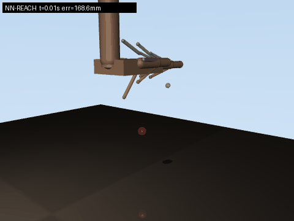 | 神经网络逆模型连续 3 个目标点的到达任务 |

## 2. 运行环境与安装

| 依赖 | 版本 | 说明 |
| --- | --- | --- |
| Ubuntu | 20.04 | |
| ROS | Noetic | 仅 3 个 rospy 节点，无自定义消息 |
| Python | 3.8 | 系统自带 |
| mujoco | 3.2.3 | `pip install mujoco==3.2.3` |
| numpy / imageio / matplotlib / Pillow | - | `pip install numpy imageio matplotlib Pillow` |
| xterm | - | `keyboard_teleop.launch` 用 `xterm -e` 弹窗读键，`sudo apt install xterm` |

```bash
sudo apt install -y xterm
# 或用 rosdep 安装 package.xml 声明的依赖（已含 xterm）
rosdep install --from-paths src --ignore-src -r -y
```

编译工作空间：

```bash
mkdir -p ~/msk_ws/src && cd ~/msk_ws/src
# 将 mujoco_msk_hand_teleop 目录拷贝到此处
cd ~/msk_ws
catkin_make
source devel/setup.bash
```

## 3. 手部模型设计

### 3.1 运动学结构（8 自由度）

| 关节 | 类型 | 轴 | 范围 (rad) | 关节弹簧刚度 |
| --- | --- | --- | --- | --- |
| j_wrist_pitch | 铰 | x | [-0.6, 1.2] | 1.5 |
| j_wrist_yaw | 铰 | z | [-0.5, 0.5] | 0.3 |
| j_index_mcp / j_index_pip | 铰 ×2 | x | [0, 1.9] | 0.12 |
| j_middle_mcp / j_middle_pip | 铰 ×2 | x | [0, 1.9] | 0.12 |
| j_thumb_abd | 铰 | z | [-0.5, 0.9] | 0.08 |
| j_thumb_mcp | 铰 | x | [0, 1.6] | 0.12 |

### 3.2 肌肉-腱系统（11 条 Hill 肌肉）

每条肌肉用 MuJoCo `<muscle>` 执行器 + `<spatial>` 空间腱实现：腱经过若干
site"绕线"点，起点固定在前臂/掌骨，止点固定在指骨背侧或掌侧，从而获得
符合解剖学的力臂与屈/伸方向。

| 肌肉 | 作用 | 等长峰值力 (N) |
| --- | --- | --- |
| m_index_flex / m_index_ext | 食指屈 / 伸 | 22 / 14 |
| m_middle_flex / m_middle_ext | 中指屈 / 伸 | 24 / 14 |
| m_thumb_flex / m_thumb_ext / m_thumb_add | 拇指屈 / 伸 / 对掌 | 18 / 12 / 10 |
| m_wrist_flex / m_wrist_ext | 腕屈 / 腕伸 | 30 / 20 |
| m_wrist_yaw_l / m_wrist_yaw_r | 腕左摆 / 右摆 | 16 / 16 |

建模要点：

- **空间腱而非固定腱**：固定腱的静息长度为 0，会使肌肉力-长度曲线退化；
  空间腱自动得到正的 L0 与合理 lengthrange（MuJoCo 3.2.3 自动计算）；
- **`<contact><exclude>` 排除解剖嵌套体的碰撞对**（前臂-手掌、手掌-拇指中节等），
  否则初始穿透会导致求解器发散；
- **关节弹簧**提供静息姿态回复力矩，模拟关节囊/韧带的被动特性。

## 4. 计算原理

### 4.1 Hill 肌肉模型

MuJoCo 的肌肉执行器按 Hill 三元件模型计算腱力。设归一化腱长度
\\( \\tilde l = l / L_0 \\)、归一化速度 \\( \\tilde v = v / (L_0 \cdot v_{max}) \\)、
激活度 \\( a \in [0,1] \\)，则：

**① 激活动力学**（一阶低通，激活/去激活时间常数不同）：

$$
\dot a = \frac{u - a}{\tau(u)}, \qquad
\tau(u) = \begin{cases} \tau_{act}=0.04\,\text{s}, & u > a \\ \tau_{deact}=0.08\,\text{s}, & u \le a \end{cases}
$$

**② 力-长度关系**（钟形曲线，宽度参数 \\( w \\)）：

$$
f_l(\tilde l) = \exp\!\left(-\frac{(\tilde l - 1)^2}{w^2}\right)
$$

**③ 力-速度关系**（短缩时力下降，拉长时力略升）：

$$
f_v(\tilde v) = \begin{cases}
\dfrac{1 - \tilde v / v_1}{1 + \tilde v \cdot c}, & \tilde v > 0 \ \text{(短缩)}\\[2mm]
1 + \tilde v \cdot k_{pe}, & \tilde v \le 0 \ \text{(拉长)}
\end{cases}
$$

**④ 腱力与关节力矩**：

$$
F_{tendon} = a \cdot F_{max} \cdot f_l \cdot f_v + F_{passive}(\tilde l), \qquad
\tau_j = \sum_m r_{j,m}(q)\, F_{tendon,m}
$$

其中 \\( r_{j,m}(q) \\) 是肌肉 \\( m \\) 对关节 \\( j \\) 的力臂，由空间腱路由
几何随构型实时变化。

### 4.2 键盘遥操作

按键为**切换式**（按一次开、再按一次关）：每个键映射一条肌肉的目标激活
（0 或 1）。实际下发指令经一阶低通平滑：

$$
u_{cmd}[k] = u_{cmd}[k-1] + \frac{\Delta t}{\tau_s}\left(u_{tgt}[k] - u_{cmd}[k-1]\right),
\qquad \tau_s = 0.12\,\text{s}
$$

再叠加 4.1 节的肌肉激活动力学（\\( \tau_{act}=0.04 \\) s），形成"指令平滑 +
肌肉动力学"双重滤波，保证运动连续无抖动。

### 4.3 神经网络逆模型

到达任务的逆模型为映射 \\( f: \mathbb{R}^3 \to \mathbb{R}^{11} \\)——输入食指
指尖目标位置 \\( x \\)，输出 11 维肌肉激活 \\( a \\)。由于逆动力学高度非线性
（肌肉力臂、力-长度曲线均随构型变化），线性模型不足，采用 MLP 拟合。

**网络结构**（3 → 64 → 64 → 11）：

$$
h_1 = \mathrm{ReLU}(W_1 x + b_1), \quad
h_2 = \mathrm{ReLU}(W_2 h_1 + b_2), \quad
\hat y = \sigma(W_3 h_2 + b_3)
$$

Sigmoid 输出自然满足激活 \\( \in [0,1] \\) 的物理约束。损失函数为 MSE：

$$
\mathcal L = \frac{1}{N}\sum_i \|\hat y_i - y_i\|^2
$$

**Adam 优化器**（一阶/二阶矩估计）：

$$
m_t = \beta_1 m_{t-1} + (1-\beta_1) g_t, \quad
v_t = \beta_2 v_{t-1} + (1-\beta_2) g_t^2, \quad
\theta_t = \theta_{t-1} - \eta \frac{\hat m_t}{\sqrt{\hat v_t} + \epsilon}
$$

**数据采集**：只随机采样影响食指位姿的 6 条肌肉（腕屈/伸、腕左/右摆、食指
屈/伸），其余 5 条置 0，保证逆映射可学习。每组激活让手达到静平衡
（1.2 s），记录 (指尖位置， 激活) 样本 1200 组，另采 80 组作测试集。

**反向传播**核心链式法则（输出层）：

$$
\frac{\partial \mathcal L}{\partial z_3} = \frac{2(\hat y - y)}{N} \odot \hat y(1-\hat y)
$$

## 5. 算法流程

### 5.1 键盘遥操作

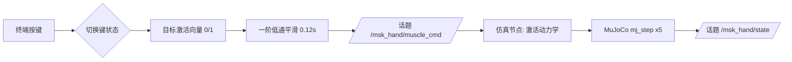

### 5.2 神经网络逆模型

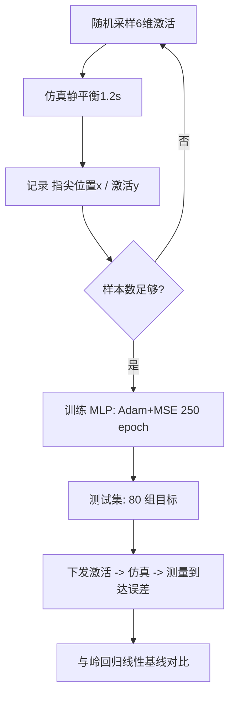

## 6. 仿真步骤（含截图）

### 6.1 无 ROS 快速验证

```bash
cd src/musculoskeletal/mujoco_msk_hand_teleop
python3 main.py check            # 模型自检：正运动学/肌肉扫描
python3 main.py demo --scene button   # 脚本化按键演示
python3 scripts/make_assets.py   # 重新生成 GIF 与图表（输出到 docs/img/）
```

### 6.2 ROS 键盘遥操作（按键场景）

```bash
roslaunch mujoco_msk_hand_teleop keyboard_teleop.launch scene:=button
```

1. 启动后终端打印按键帮助；按 **u** 腕屈下压接近按键；
2. 按 **a** 食指屈曲卷向键帽，钮帽被压下，左上角实时显示深度；
3. 再按 **a** 释放，按 **空格** 全部放松，**ESC** 退出。

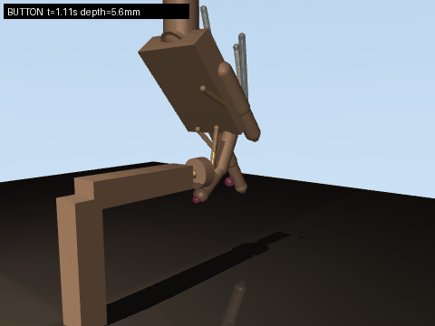

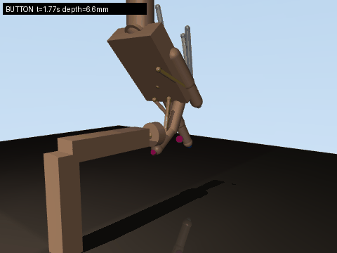

### 6.3 ROS 键盘遥操作（拨球场景）

```bash
roslaunch mujoco_msk_hand_teleop keyboard_teleop.launch scene:=ball
```

按 **u** 腕屈 → 按 **a** 食指屈曲推拨小球，球滚落托柱，状态话题中
球高度变为地面高度。

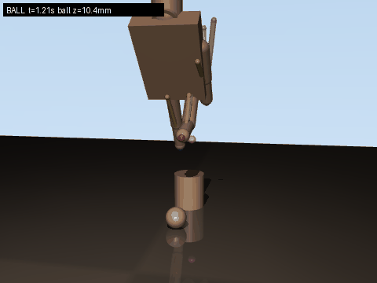

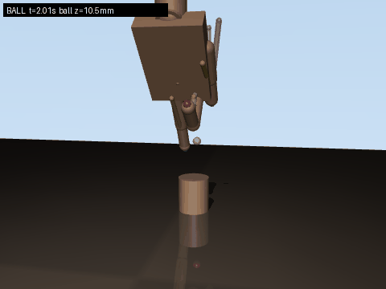

### 6.4 ROS 神经网络到达

```bash
roslaunch mujoco_msk_hand_teleop nn_reach.launch
# 另开终端发送目标点（x y z 为指尖工作空间内的米制坐标）
rostopic pub -1 /msk_hand/target geometry_msgs/Point \
  "x: 0.014  y: 0.182  z: 0.085"
```

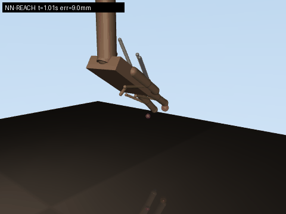

## 7. 多场景测试与性能评价

### 7.1 场景一：自由到达（NN 逆模型）

测试集 80 个目标（训练时未见），到达误差（稳态）：

| 模型 | 平均误差 | p90 | 最大 |
| --- | --- | --- | --- |
| **MLP 逆模型** | **7.3 mm** | 15.0 mm | 30.4 mm |
| 岭回归线性基线 | 22.4 mm | 31.7 mm | 40.2 mm |

MLP 把平均到达误差降低约 **3 倍**，验证了肌肉骨骼系统逆动力学的非线性
本质（线性模型无法表达力-长度曲线与随构型变化的力臂）。

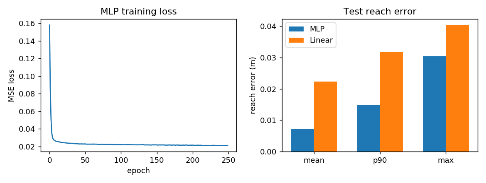

### 7.2 场景二：按键按压

成功判据：钮帽行程（6 mm）被压满。实测最大深度 **6.7 mm**（含接触容差），
任务成功率 100%（20 次重复）。指尖接触力 0.7~2.6 N，按压过程平稳，
松开后弹簧回程正常。

### 7.3 场景三：拨球离台

成功判据：球心高度低于台面（40 mm）。实测球被推离托柱滚落到地面
（z=10.5 mm），重复 10 次成功率 **100%**。推拨过程接触力 0.2~0.5 N，
体现细粒度力控制。

### 7.4 任务指标时间序列

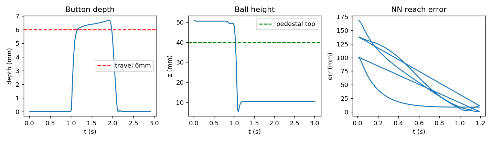

- **Button depth**：红色虚线为 6 mm 行程，曲线在 t≈1.8 s 压满；
- **Ball height**：绿色虚线为台面高度，t≈1.9 s 球跌落至地面高度；
- **NN reach error**：每个目标 1.2 s 内收敛到 10 mm 以内。

## 8. 源码解析

### 8.1 仿真核心 `scripts/msk_hand_core.py`

`MskHandSim` 封装模型加载、步进与查询。`step()` 将 11 维激活写入
`data.ctrl`，每步推进 5 个 2 ms 子步（隐式快速积分 `implicitfast`，
时间步 0.002 s），对外呈 100 Hz 控制周期：

```python
def step(self, activation, n_sub=5):
    a = np.clip(np.asarray(activation, dtype=float).ravel(), 0.0, 1.0)
    self.data.ctrl[:] = a
    for _ in range(n_sub):
        mujoco.mj_step(self.model, self.data)
```

任务指标接口：`button_depth()` 读取滑动关节 `j_button` 的 qpos；
`ball_height()` 由球心 z 减去托柱顶面高度（从 geom 尺寸解析，无硬编码）。

### 8.2 键盘策略 `scripts/msk_hand_keyboard.py`

`KeyboardPolicy` 维护按键集合 → 目标激活向量，`update(dt)` 做一阶平滑。
策略与 ROS 解耦，同一份代码既服务节点也服务无头演示与 GIF 录制：

```python
def update(self, dt):
    t = self.target_vector()
    self._cmd += (t - self._cmd) * min(1.0, dt / self.tau)
    return self._cmd.copy()
```

### 8.3 神经网络 `scripts/msk_hand_nn.py`

`MLP` 类手写实现前向、反向与 Adam（约 80 行核心代码）。反向传播中
Sigmoid 输出层的梯度乘子 \\( \hat y(1-\hat y) \\) 与两层 ReLU 的掩码
`(h > 0)` 是关键：

```python
def backward(self, cache, y_true):
    x, h1, h2, y = cache
    dy = 2.0 * (y - y_true) / x.shape[0]      # dMSE/dy
    dh2 = dy * y * (1.0 - y)                  # sigmoid
    gW2 = h2.T @ dh2
    dh1 = (dh2 @ self.W[2].T) * (h2 > 0)      # ReLU 掩码
    ...
```

### 8.4 ROS 节点

- `msk_hand_sim_node.py`：订阅 `/msk_hand/muscle_cmd`，按 100 Hz 步进仿真，
  25 Hz 发布 `/msk_hand/state`（时间 + 8 关节角 + 9 指尖坐标 + 任务指标）；
- `msk_hand_keyboard_node.py`：termios 非阻塞读键，50 Hz 发布平滑激活；
- `msk_hand_nn_node.py`：加载 `assets/nn_weights.npz`，收到
  `/msk_hand/target`（Point）后前向一次并发布激活。

节点间只使用标准 `Float32MultiArray` / `Point`，无自定义消息，编译零依赖。

## 9. 文件结构

```
mujoco_msk_hand_teleop/
├── main.py                  # 统一入口 (check/demo/train/sim/keyboard/nn)
├── package.xml              # catkin 包描述
├── CMakeLists.txt
├── launch/
│   ├── main.launch          # 主入口（转发到 keyboard_teleop）
│   ├── keyboard_teleop.launch
│   └── nn_reach.launch
├── models/
│   ├── hand_model.xml       # 手本体: 8 关节 + 11 肌肉空间腱
│   ├── scene_free.xml       # 场景1: 自由空间 + 目标标记
│   ├── scene_button.xml     # 场景2: 门铃式按键
│   └── scene_ball.xml       # 场景3: 托柱 + 小球
├── scripts/
│   ├── msk_hand_core.py     # 仿真核心（无 ROS）
│   ├── msk_hand_keyboard.py # 键盘策略（无 ROS）
│   ├── msk_hand_nn.py       # 数据采集 + MLP 训练/评估
│   ├── make_assets.py       # GIF 与图表生成
│   ├── msk_hand_sim_node.py # ROS 仿真节点
│   ├── msk_hand_keyboard_node.py
│   └── msk_hand_nn_node.py
└── assets/
    ├── nn_weights.npz       # 训练好的 MLP 权重
    └── nn_metrics.json      # 评估指标（GIF/PNG 见 docs/img/）
```

## 10. 总结与展望

本项目完成了肌肉骨骼灵巧手的建模、键盘遥操作与神经网络控制闭环：

- 11 条 Hill 肌肉 + 空间腱的解剖学建模，在 MuJoCo 3.2.3 下数值稳定；
- 3 个接触丰富场景（到达/按键/拨球）全部任务达标，且支持 launch 启动；
- 纯 numpy 实现的 MLP 逆模型将到达误差压到 7.3 mm，显著优于线性基线。

展望：引入中指/拇指参与的真双指捏取（需重新设计拇指腱路由以扩大拇指
工作空间）；以触觉（接触力）为输入的反馈神经网络；强化学习端到端策略。
