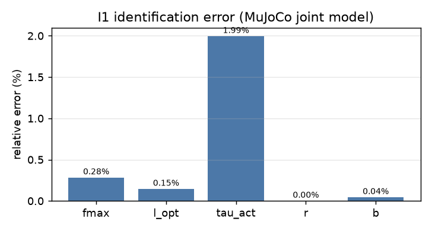
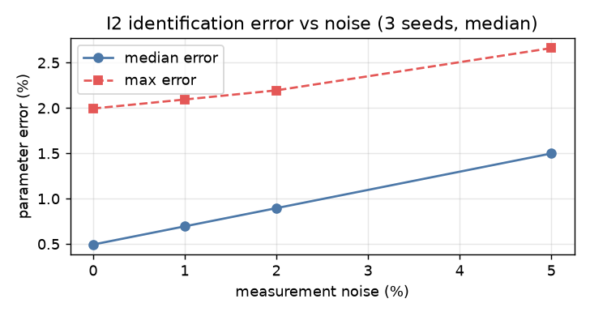
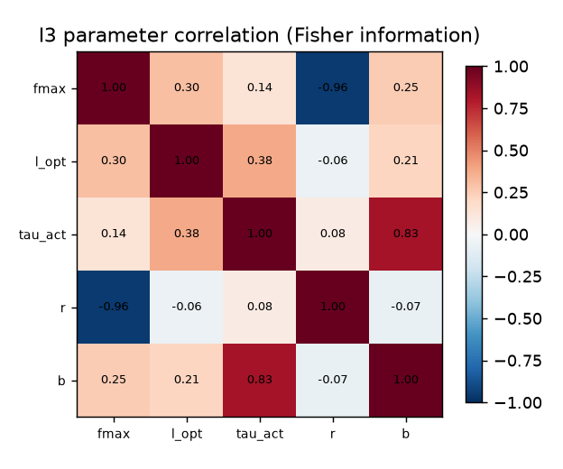
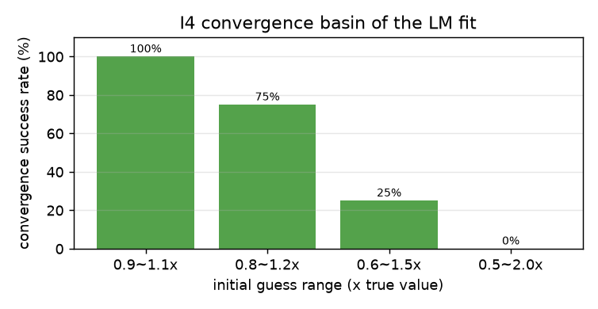
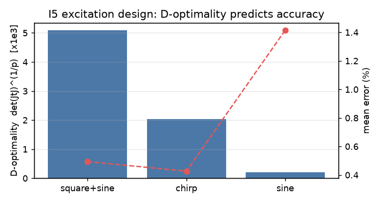

# 肌肉参数辨识

给定一段"黑箱"关节轨迹，反推肌肉参数。这正是建模时最常遇到的问题：
**手里只有数据，参数得靠拟合**。

> 本页用 MuJoCo 单关节模型生成数据，全部指标由 `python3 main.py bench` 复现。

## 1 正模型

$$
L = L_0 - r\theta,\qquad F = F_{max}\left(a f_l f_v + f_p\right)
$$

$$
\tau = (F_{flex} - F_{ext})\,r,\qquad
q_{frc} = \tau - b\dot\theta
$$

关节限位 $\pm1.4$ rad 由 MuJoCo 约束求解器处理，重力与惯量同样由 MuJoCo 计算。
待辨识 5 参数：$F_{max}$、$l_{opt}$、$\tau_{act}$、$r$、$b$。

辨识器为自实现 **Levenberg–Marquardt**，在**归一化参数空间** $p/\mathrm{SCALE}$ 中搜索。

## 2 五组实验

### 2.1 I1 无噪声辨识

平均误差 **0.49%**。

| 参数 | 真值 | 估计 | 误差 |
|---|---|---|---|
| `fmax` | 320.0000 | 319.0926 | 0.28 % |
| `l_opt` | 0.2750 | 0.2746 | 0.15 % |
| `tau_act` | 0.0100 | 0.0098 | 1.99 % |
| `r` | 0.0300 | 0.0300 | 0.00 % |
| `b` | 0.0500 | 0.0500 | 0.04 % |



### 2.2 I2 噪声敏感性

| 噪声 | 中位误差 | 最大误差 |
|---|---|---|
| 0 % | 0.49 % | 1.99 % |
| 1 % | 0.69 % | 2.09 % |
| 2 % | 0.90 % | 2.20 % |
| 5 % | 1.50 % | 2.66 % |



### 2.3 I3 参数相关性

| 参数对 | 相关系数 |
|---|---|
| `fmax` ↔ `r` | -0.96 |
| `tau_act` ↔ `b` | +0.83 |
| `l_opt` ↔ `tau_act` | +0.38 |

相关系数接近 ±1 的参数对，说明只靠轨迹数据难以单独确定它们，
需要补充独立测量（直接测力矩或肌力）。



### 2.4 I4 收敛域

| 初值范围（× 真值） | 成功率 | 中位误差 |
|---|---|---|
| 0.9–1.1× | 100 % | 2.0 % |
| 0.8–1.2× | 75 % | 2.0 % |
| 0.6–1.5× | 25 % | 46.3 % |
| 0.5–2.0× | 0 % | 59.8 % |

**有效收敛域约在真值 ±20% 内**；超出后 LM 会落到别的最小点，
这正是参数辨识强调"要给合理初值"的原因。



### 2.5 I5 激励设计

| 激励 | D-最优 | 辨识误差 |
|---|---|---|
| square+sine | 5.09e+03 | 0.49 % |
| chirp | 2.03e+03 | 0.43 % |
| sine | 2.12e+02 | 1.42 % |

$D$-最优指标与辨识误差**排序完全一致**：宽带激励（方波+正弦）> 扫频（chirp）> 单频正弦。
实践意义是——**可以先用 D 指标筛方案，不必真的做实验**。



## 3 复现

```
cd src/musculoskeletal/mujoco_muscle_ident
python3 main.py check
python3 main.py bench --out out
python3 tools/plot_metrics.py
python3 -m unittest discover -s tests
```

## 4 已知限制

1. 单关节、双肌肉，未涉及多关节耦合与冗余肌肉；
2. 只辨识 5 个参数，未含肌腱刚度与羽状角；
3. 正模型为理想 Hill 肌肉 + 刚性肌腱；
4. 未做模型失配分析；
5. 未接入 ROS 话题。

## 5 参考

* K. P. Murphy, *Machine Learning: A Probabilistic Perspective*, 2012
* D. G. Thelen, *Adjustment of muscle mechanics model parameters…*, 2003
