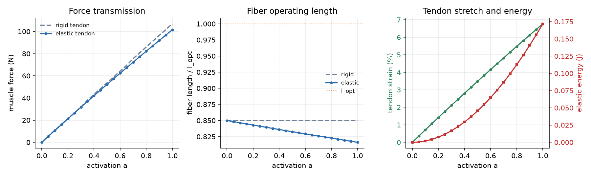
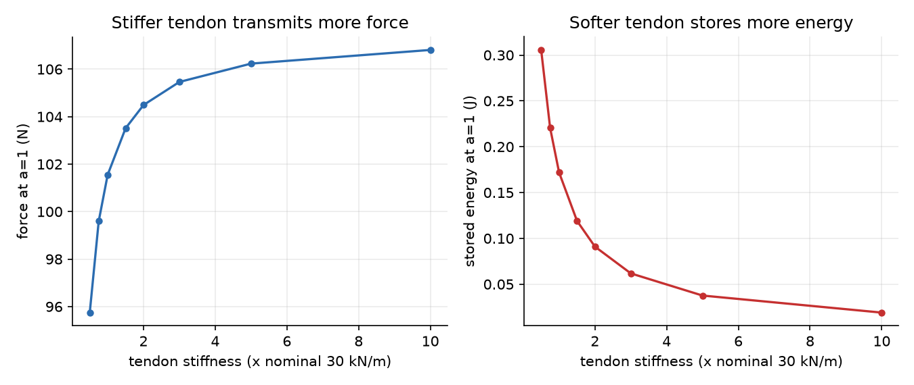
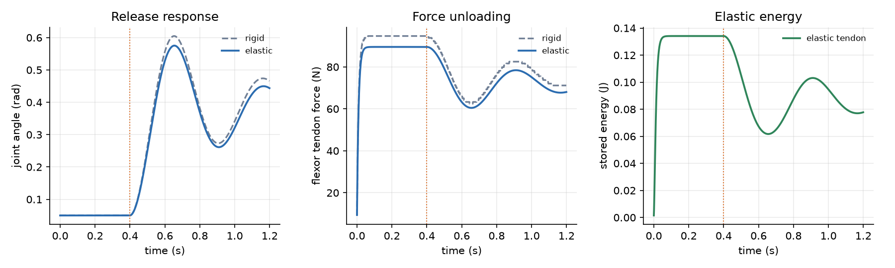

# 肌肉-肌腱串联弹性实验

[肌肉骨骼人基础](./musculoskeletal_basics.md) 的 2.1 节说，一块骨骼肌由**收缩
成分**（肌纤维）和**弹性成分**（肌腱）串联组成；仿真里常把肌腱简化成串联弹性
单元，或者干脆忽略。本版块已有的
[肌肉驱动的关节控制](./muscle_joint_control.md) 采用的是后一种做法——肌腱刚性，
肌纤维长度直接由关节角决定。

本文把肌腱补上，用三组可以复现的实验回答三个基础问题：

1. 肌腱会分走多少长度？同样的激活度，传到关节上的力会小多少？
2. 肌腱越软，储能越多，但传力越少——这个权衡有多明显？
3. 关节松开时，肌腱里存的能量是怎么释放的？

代码在 `src/musculoskeletal/msk_tendon_basics/`，纯 Python；模型部分只用标准
库，画图用 matplotlib。不需要 ROS、MuJoCo 或真实机器人。

## 1 模型

### 1.1 肌肉-肌腱单元

肌纤维和肌腱串联，承受相同的力，长度相加：

```
L_mtu = l_m + l_t
```

肌腱取线性弹性，只有拉力：

```
F_t = k_t · max(0, l_t - l_slack)
```

肌纤维沿用 Hill 模型，长度、速度都归一化，`l_n = l_m / l_opt`，
`v_n = v_m / v_max`，`v_m` 以**缩短为正**：

```
F_m = F_max · [ a · f_l(l_n) · f_v(v_n) + f_p(l_n) ]
```

串联、忽略质量，所以每一时刻都有力平衡：

```
F_t = F_m
```

给定 MTU 总长度和激活度，上式只有一个未知量 `l_m`。代码用二分法解它
（`solve_fiber_length`），再回代得到肌腱长度、应变和储能：

```
E_t = F_t² / (2 k_t)
```

### 1.2 肌腱刚度

名义刚度由“最大力下的应变”定义：

```
k_t = F_max / (ε_t · l_slack)
```

默认 `F_max = 120 N`、`l_slack = 0.05 m`、`ε_t = 8%`，所以
`k_t = 30000 N/m`；名义上在 `F_max` 下肌腱伸长 4 mm（应变 8%），本实验最高
激活时实际约为 6.8%（3.4 mm）。这落在哺乳动物肌腱常见的 2%–10% 范围内。

### 1.3 关节

一对拮抗肌挂在关节两侧，力矩臂 `r`：

```
L_flex = L_rest - r · θ
L_ext  = L_rest + r · θ
τ = r · (F_flex - F_ext) - b · θ̇
```

`L_rest = 0.135 m`，比 `l_slack + l_opt = 0.15 m` 短 15 mm。这样在 `θ = 0`
时肌纤维处于 `0.85 l_opt` 的**上升段**，而不是力-长度曲线的顶点。选这个工作
点有两个原因：

* 上升段上肌纤维刚度不为零，肌腱串联弹性的影响看得见；
* 真实关节也常停在离最优长度有段距离的位置，不是每次都正好在顶点。

关节动力学是**准静态**的：肌腱和肌纤维的固有时间尺度是毫秒级，远快于关节
运动，所以每一步都假设它们瞬间达到力平衡。这样不需要给肌纤维引入等效质量，
数值上也稳定。

## 2 参数

| 参数 | 默认值 | 说明 |
|---|---|---|
| `f_max` | 120 N | 最大等长收缩力 |
| `l_opt` | 0.10 m | 肌纤维最优长度 |
| `v_max` | 1.2 m/s | 最大缩短速度 |
| `l_slack` | 0.05 m | 肌腱 slack length |
| `tendon_strain` | 8% | 最大力下的肌腱应变 |
| `k_t` | 30000 N/m | 由上面两项算出的名义刚度 |
| `width` | 0.45 | 主动力-长度曲线宽度 |
| `tau_act` / `tau_deact` | 0.01 / 0.04 s | 激活 / 放松时间常数 |
| `moment_arm` | 0.03 m | 关节力矩臂 |
| `inertia` | 0.05 kg·m² | 关节等效惯量 |
| `damping` | 0.20 N·m·s/rad | 关节阻尼 |
| `rest_mtu` | 0.135 m | θ=0 时的 MTU 长度 |
| `load_stiffness` | 6.0 N·m/rad | 释放实验里的负载弹簧 |

## 3 运行

```bash
cd src/musculoskeletal/msk_tendon_basics
pip install -r requirements.txt      # 仅画图需要，可跳过
python3 main.py                      # Linux/macOS：完整实验，输出到 demo_out/
python main.py                       # Windows：同上
python3 main.py --quick              # 少采样点，快速跑一遍
python3 main.py --outdir demo_out    # 指定输出目录（Windows 用 .\demo_out）
```

没有安装 matplotlib 时，`main.py` 仍会跑完三组实验并输出 CSV，只是跳过 PNG，
终端会提示 `未安装 matplotlib，跳过 ...`。Windows 下如果终端里的中文是乱码，
先执行 `chcp 65001` 再运行。

放进 catkin 工作空间后也可以统一用 launch 启动：

```bash
catkin_make
source devel/setup.bash
roslaunch msk_tendon_basics main.launch
roslaunch msk_tendon_basics main.launch args:="--quick"
```

输出：

```
demo_out/isometric.png          等长传力、肌纤维工作长度、肌腱应变/储能
demo_out/tendon_stiffness.png   肌腱刚度-传力-储能权衡
demo_out/release.png            松手后的关节角、肌力与肌腱能量
demo_out/*.csv                  对应的数值
```

## 4 结果

以下数字来自 `python3 main.py` 的默认参数，可在 `demo_out/*.csv` 里复核。

### 4.1 等长传力：肌腱分走了一部分长度



固定 `θ = 0`，把两侧激活度从 0 扫到 1，对比刚性肌腱（`k_t → ∞`）和弹性肌腱：

| 激活度 a | 弹性肌腱力 | 刚性肌腱力 | 力损失 | 肌纤维长度 | 肌腱应变 | 储能 |
|---:|---:|---:|---:|---:|---:|---:|
| 0.50 | 52.2 N | 53.7 N | 2.7% | 0.833 l_opt | 3.5% | 0.045 J |
| 1.00 | 101.6 N | 107.0 N | 5.1% | 0.816 l_opt | 6.8% | 0.172 J |

三件事同时发生：

* 肌腱被拉长（最大 6.8%），肌纤维相应变短（0.85 → 0.816 l_opt）；
* 肌纤维沿上升段往左走，主动力下降，所以传到关节上的力比刚性情形小 5.1%；
* 少掉的那部分力没有消失，而是变成肌腱里的 0.172 J 弹性势能。

这就是串联弹性的基本代价：**同样的激活度，关节拿到的力少一点，但系统多了一个
储能元件**。激活度越低，肌腱越松，两者差别越小——a = 0.5 时力损失只有 2.7%。

### 4.2 肌腱刚度：传力与储能的权衡



把肌腱刚度从名义值的 0.5 倍扫到 10 倍，激活度固定为 1：

| 刚度倍数 | k_t (N/m) | 力 (N) | 应变 | 储能 (J) |
|---:|---:|---:|---:|---:|
| 0.5 | 15000 | 95.7 | 12.8% | 0.306 |
| 1.0 | 30000 | 101.6 | 6.8% | 0.172 |
| 2.0 | 60000 | 104.5 | 3.5% | 0.091 |
| 5.0 | 150000 | 106.2 | 1.4% | 0.038 |
| 10.0 | 300000 | 106.8 | 0.7% | 0.019 |

两条曲线方向相反：硬肌腱传力接近刚性极限（106.8 N），但几乎存不住能量；
软肌腱能存 0.306 J，代价是传到关节的力只剩 95.7 N。生物体选肌腱刚度，本质上
是在“力量输出”和“储能/缓冲”之间做取舍——跟腱粗而硬，适合短时大力；项韧带
这类结构则更看重储能。

### 4.3 松手释放：储能怎么还回来



前 0.4 s 关节被“刹车”固定，屈肌激活到 0.9、伸肌 0.05，肌腱被拉长、储能。
0.4 s 时松开，关节在肌肉力和负载弹簧共同作用下运动：

| | 弹性肌腱 | 刚性肌腱 |
|---|---:|---:|
| 松手前屈肌力 | 89.5 N | 94.7 N |
| 松手前肌腱储能 | 0.134 J | ≈ 0 |
| 松手后最低储能 | 0.062 J | ≈ 0 |
| 释放比例 | 54.0% | — |
| 峰值关节角 | 0.58 rad | 0.60 rad |

松手后肌腱从 0.134 J 卸到最低 0.062 J，约 54% 的弹性势能在关节运动中被释放
出去，剩下的部分因为肌肉仍保持激活、关节停在新的平衡点而没有完全卸掉。刚性
肌腱没有储能，关节峰值角略大（0.60 rad），但肌肉力下降得更快。

这条曲线也解释了为什么肌腱在跳跃、落地、奔跑里重要：它把肌肉做功的一部分
先存起来，再在需要的时候还回去，肌肉本身不必在瞬间输出全部功率。

## 5 源码结构

```
src/musculoskeletal/msk_tendon_basics/
├── main.py                  包根入口，转调 scripts/main.py
├── README.md                运行说明与文件清单
├── package.xml, CMakeLists.txt, launch/main.launch
├── requirements.txt         matplotlib（可选，仅画图需要）
├── scripts/
│   ├── muscle_tendon.py     Hill 肌纤维 + 线性肌腱 + 串联平衡求解
│   ├── joint_tendon.py      单自由度关节、拮抗肌、准静态动力学
│   ├── experiments.py       等长 / 刚度扫描 / 松手释放三组实验
│   ├── plots.py             matplotlib 出图
│   └── main.py              命令行入口、汇总表格、CSV
└── tests/
    ├── test_muscle_tendon.py   模型、曲线、串联平衡
    ├── test_joint_tendon.py    关节、扫描、释放实验
    └── test_cli.py             命令行入口与 roslaunch 私有参数
```

## 6 测试

```bash
cd src/musculoskeletal/msk_tendon_basics
python3 -m unittest discover -s tests -v
```

共 32 个用例，覆盖：

* Hill 力-长度、力-速度、被动力的已知性质；
* 激活快于放松、激活度限幅；
* 肌腱 slack、线性、储能公式；
* 串联平衡的力残差（`|F_t - F_m| < 1e-5 N`）；
* 激活越高肌纤维越短、弹性肌腱传力小于刚性；
* 关节对称激活零力矩、松手后能量下降、刚性肌腱不储能。

## 7 局限

* 肌腱取线性弹性，没有考虑肌腱的滞回、预调理（preconditioning）和率相关性；
* 肌纤维没有羽状角（pennation），力直接沿肌腱方向；
* 关节是准静态的：松手过程用准静态肌肉力积分关节动力学，没有显式建模肌腱回弹
  振荡；文中的“释放比例”按肌腱储能差计算，不做完整能量收支；
* 参数是一组上肢量级，不是从某块具体肌肉的 MRI/超声数据标定的；
* 只做单关节，没有多关节耦合和肌腱路由（wrapping）。

这些局限不影响本文要说明的三个基础结论，但如果要做跳跃、落地这类短时高功率
动作，需要把肌腱的率相关性和肌纤维质量补上。

## 参考

* A. V. Hill, *The heat of shortening and the dynamic constants of muscle*, 1938
* F. E. Zajac, *Muscle and tendon: properties, models, scaling, and application to
  biomechanics and motor control*, 1989
* M. Millard, T. Uchida, A. Seth, S. Delp, *Flexing computational muscle: modeling
  and simulation of musculotendon dynamics*, 2013

## 大模型使用声明

使用 DeepSeek 辅助代码结构设计、公式核对、文档撰写与绘图脚本调试；作者已在本机
（Windows 11 + Python 3.13）实际运行 `main.py`、`--quick` 与 32 个单元测试，
并对提交内容负责。
