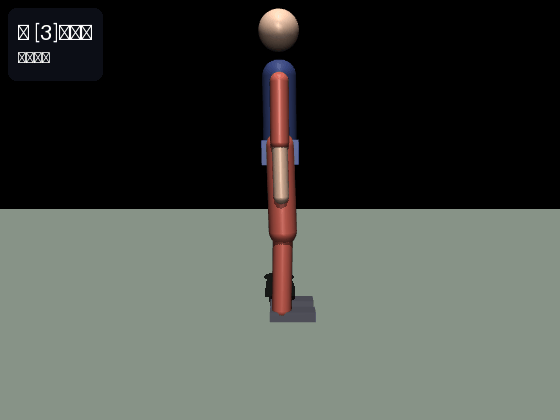
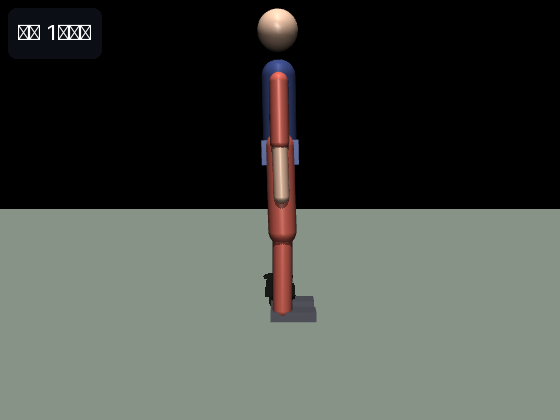
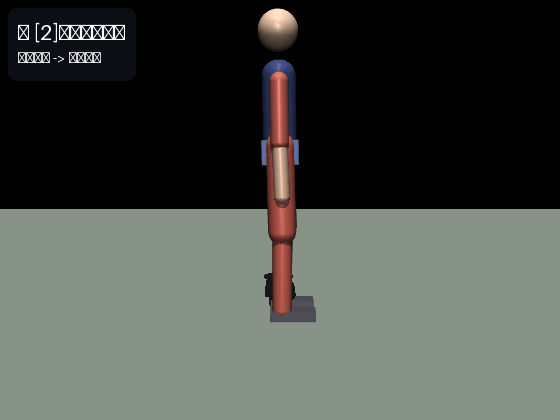
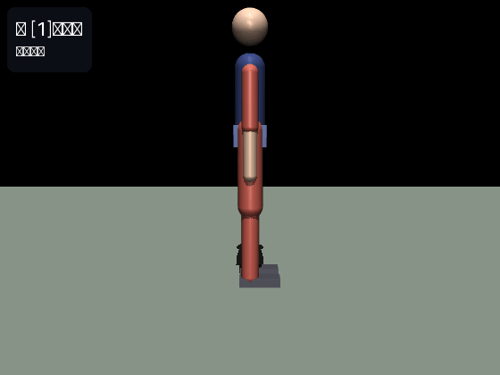
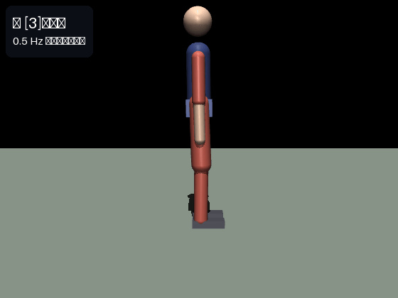
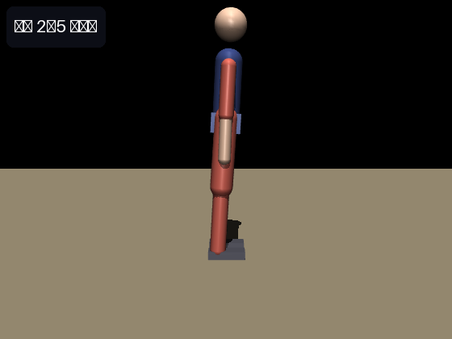
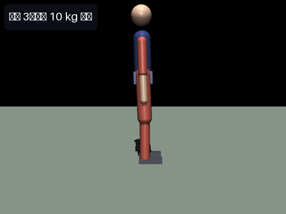
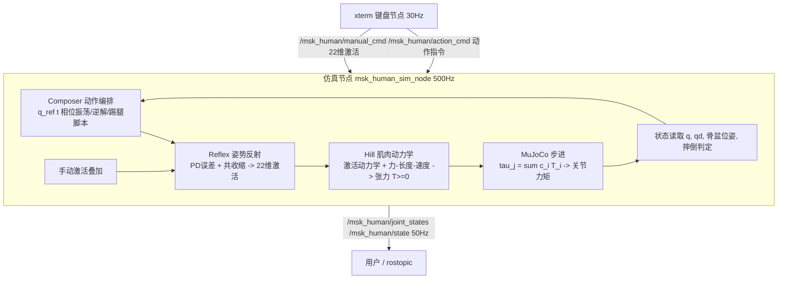

# MuJoCo 肌肉骨骼人键盘遥操作：行走、踢腿与蹲起



## 1. 模块概述

本模块在 **MuJoCo** 物理仿真器中构建了一个平面（矢状面）全身**肌肉骨骼人**，由 **22 条 Hill 型肌肉**驱动 **13 个自由度**（浮动基座 3 + 下肢 6 + 上肢 4），实现了课程任务 (1)：*对人形机器人/肌肉骨骼人进行物理仿真，通过键盘对机器人进行运动控制*。

与常见的"每个关节一个电机"的简化不同，本模块的驱动力完全由肌肉产生：控制器输出的不是关节力矩，而是 **22 维肌肉激活量**，肌肉经过激活动力学与 Hill 力-长度-速度曲线滤波后产生张力，张力再通过力臂系数映射为关节力矩。肌肉只能拉、不能推，每个关节的自由度由一对**拮抗肌**（屈肌/伸肌）共同约束。

主要特性：

- **分层控制**：动作编排器（Composer）→ 姿势反射层（Reflex）→ Hill 肌肉动力学 → MuJoCo 步进；
- **键盘遥操作**：动作键切换站立/行走/踢腿/蹲起/放松，手动兴奋键可直接兴奋任意一块肌肉并与当前动作叠加；
- **三种场景**：平地、5° 坡道、负重 10 kg 背包，均通过同一套控制器参数稳定运行；
- **launch 一键启动**，并附带无需 ROS 的离线自检（`check`）与多场景性能评测（`eval`）。

> 说明：本模块对应任务 (1) 的物理仿真与键盘运动控制，控制回路为生物合理反射模型，不涉及感知/规划/端到端神经网络算法（该要求针对任务 (2)–(4)）。

### 目录结构

```text
src/mujoco_msk_human_walking_teleop/
├── main.py                     # 统一入口：check / eval / demo / sim / keyboard
├── package.xml                 # catkin 包描述（rospy, std_msgs, sensor_msgs）
├── CMakeLists.txt
├── launch/main.launch          # 一键启动：仿真节点 + xterm 键盘节点
├── config/params.yaml          # 反射增益 / 步态 / 蹲起 / 踢腿参数
├── models/
│   ├── msk_human.xml           # 肌肉骨骼人模型（13 DoF + 22 motor）
│   ├── scene_flat.xml          # 平地场景
│   ├── scene_slope5.xml        # 5 度坡场景
│   └── scene_load.xml          # 负载场景（运行时躯干 +10 kg）
└── scripts/
    ├── msk_human_core.py       # 仿真核心：Hill 肌肉、反射层、动作编排、自检
    ├── msk_human_keyboard.py   # 键盘策略（按键 -> 激活/动作，ROS 节点与离线共用）
    ├── msk_human_eval.py       # 离线多场景性能评测
    ├── msk_human_sim_node.py   # ROS 仿真节点（500 Hz 控制回路）
    └── msk_human_keyboard_node.py  # ROS 键盘遥操作节点（xterm 中运行）
```

## 2. 运行环境

| 项目 | 版本/说明 |
|------|-----------|
| 操作系统 | Ubuntu 20.04 |
| ROS | Noetic（`rospy` 也可在 Humble 下以 rclpy 等价替换运行） |
| Python | 3.8 |
| MuJoCo | `mujoco==3.2.3`（`pip install mujoco==3.2.3`） |
| 其他依赖 | `numpy`、`PyYAML`、`xterm`（`sudo apt install xterm`） |

安装与构建：

```shell
# 1. 安装 Python 依赖
pip3 install mujoco==3.2.3 numpy pyyaml
sudo apt install xterm

# 2. 建立工作空间并放置本模块（假设模块位于 ~/catkin_ws/src/ 下）
cd ~/catkin_ws
catkin_make
source devel/setup.bash
```

## 3. 仿真步骤

### 3.1 一键启动

```shell
roslaunch mujoco_msk_human_walking_teleop main.launch
```

launch 会同时启动两个节点：MuJoCo 仿真窗口（默认平地场景）和一个 xterm 键盘窗口。启动后人物以站立姿态稳定在场景中：



### 3.2 键盘操作

在 xterm 窗口中按键（按 `H` 可随时打印帮助）：

| 类别 | 按键 | 功能 |
|------|------|------|
| 动作切换 | `1` | 站立 |
|  | `2` | 踢腿（右腿，单次） |
|  | `3` | 蹲起（连续周期） |
|  | `4` | 行走 |
|  | `0` | 全身放松（肌肉激活清零，身体瘫倒） |
| 步频调节 | `+` / `-` | 行走步频加快/减慢（0.6–1.6 倍） |
| 手动兴奋 | `Q/W` 左髋屈/伸，`A/S` 左膝屈/伸，`Z/X` 左踝背屈/跖屈 | 自锁式：按一次开启、再按一次关闭，叠加在反射层之上 |
|  | `U/I`、`J/K`、`N/M` | 右腿髋/膝/踝 |
|  | `R/T` 双肩前摆/后摆，`F/G` 双肘屈/伸 | 上肢 |
| 其他 | `H` | 打印帮助 |
|  | `ESC` | 退出键盘节点 |

### 3.3 站立与踢腿

按 `1` 站稳后按 `2`：机器人将支撑腿微屈、右腿提膝蓄力，随后股四头肌快速兴奋伸膝踢击，脚尖峰值高度约 0.6 m：



### 3.4 行走与步频调节

按 `4` 进入行走（基频 0.8 Hz），行走中按 `+` 可逐步加快步频（0.8 → 1.0 → 1.2 Hz）：



### 3.5 蹲起

按 `3` 进入 0.5 Hz 连续蹲起，骨盆按余弦轨迹升降，双腿由二连杆逆解同步协调：



### 3.6 场景切换

通过 launch 参数切换场景：

```shell
# 5 度坡道
roslaunch mujoco_msk_human_walking_teleop main.launch scene:=slope5
# 负载 10 kg（运行时给躯干加 10 kg 背包并更新惯量）
roslaunch mujoco_msk_human_walking_teleop main.launch scene:=load
# 关闭 3D viewer（无显示器环境）
roslaunch mujoco_msk_human_walking_teleop main.launch viewer:=false
```





### 3.7 离线自检与性能评测（无需 ROS）

```shell
cd ~/catkin_ws/src/mujoco_msk_human_walking_teleop
python3 main.py check    # 模型自检：场景加载 / 22 块肌肉兴奋方向 / 三场景站立
python3 main.py eval     # 多场景性能评测，结果写入 eval_results.json
```

`check` 的标准输出（全部通过）：

```text
[PASS] load_scene_flat 
[PASS] load_scene_slope5 
[PASS] load_scene_load 
[PASS] n_muscle nu=22
[PASS] n_joint njnt=13
[PASS] muscle_sign 22/22 方向正确
[PASS] stand_6s_flat z=0.876 pitch=-0.017 t=6.0
[PASS] stand_6s_slope5 z=0.875 pitch=+0.038 t=6.0
[PASS] stand_6s_load z=0.876 pitch=-0.021 t=6.0
[PASS] squat_ik hip=0.77 knee=1.59 ankle=0.82
[PASS] load_mass torso mass 18.8 -> 28.8
---- check: 11/11 passed ----
```

`eval` 的标准输出：

```text
================= 性能汇总 =================
平地站立成功率                    3/3
蹲起周期数(15s)                 7
踢腿脚尖峰值(m)                  0.605
平地行走距离(m)/速度(m/s)          3.152 / 0.158
坡道行走距离(m)                  4.132
负载行走距离(m)                  1.759
============================================
```

## 4. 计算原理

### 4.1 Hill 肌肉模型

每块肌肉是一个一阶激活状态 + 非线性力生产机构。设第 \(i\) 块肌肉的神经输入（目标激活）为 \(u_i \in [0,1]\)：

**（1）激活动力学**（一阶低通，兴奋快、去激活慢）：

$$
\dot a_i = \frac{u_i - a_i}{\tau_i},\qquad
\tau_i = \begin{cases} \tau_{act} = 0.012\ \text{s}, & u_i > a_i \\ \tau_{deact} = 0.05\ \text{s}, & u_i \le a_i \end{cases}
$$

**（2）力-长度曲线**（高斯型，\(q_{opt}\) 取关节活动范围中点，\(\sigma\) 取半量程）：

$$
f_l(q) = \exp\!\left( -\frac{(q - q_{opt})^2}{2\sigma^2} \right)
$$

**（3）力-速度曲线**（Hill 方程，\(\hat v = v / v_{max}\) 为归一化缩短速度，缩短为正）：

$$
f_v(\hat v) = \begin{cases}
\dfrac{1 - \hat v}{1 + 3\hat v}, & \hat v > 0 \ \text{（缩短）} \\[2mm]
\min(1.4,\ 1 - 1.8\hat v), & \hat v \le 0 \ \text{（拉长）}
\end{cases}
$$

**（4）肌肉张力**（肌肉只能拉不能推，故截断为非负）：

$$
T_i = \max\bigl(0,\ a_i \cdot F_{0,i} \cdot f_l(q_{j(i)}) \cdot f_v(\hat v_i)\bigr)
$$

其中 \(F_{0,i}\) 为峰值力矩（如膝伸肌 290 N·m、踝背屈肌 60 N·m），\(j(i)\) 为肌肉 \(i\) 跨越的关节。

**（5）关节力矩合成**：XML 中每块肌肉是一个 `motor` 执行器（`gear = c_i`，屈肌 \(c_i=+1\)、伸肌 \(c_i=-1\)），关节净力矩为跨关节肌肉张力之和：

$$
\tau_j = \sum_{i:\, j(i)=j} c_i\, T_i
$$

### 4.2 姿势反射层（PD 反射 + 拮抗共收缩）

对每个关节，反射层把参考角与实际角的误差转换为肌肉激活（模拟脊髓反射）：

$$
\tau_{ref} = k_p\,(q_{ref} - q) - k_d\,\dot q
$$

$$
a_{flex} = \frac{b + \max(0,\ \tau_{ref})}{F_0^{flex}},\qquad
a_{ext} = \frac{b + \max(0,\ -\tau_{ref})}{F_0^{ext}}
$$

其中 \(b\) 为**共收缩力矩**（如髋 10 N·m、踝 10 N·m）：两块拮抗肌各被施加等量的力矩配额，净力矩为零、只提供关节刚度，类似人体运动中的共收缩（co-contraction）。注意这里必须按各自的峰值力 \(F_0\) 换算激活——若直接给两块肌肉相等的激活量，由于伸肌 \(F_0\) 普遍更大，净力矩会系统性偏向伸展方向，导致全身后倾。

踝关节的 \(k_p\) 需满足倒立摆临界刚度条件才能稳住站立模态。把身体视为绕踝转动的倒立摆，恢复力矩 \(k_p \theta\) 需要超过重力倾覆力矩 \(m g h\,\theta\)：

$$
k_p^{ankle} > m g h \approx 30 \times 9.8 \times 0.63 \approx 184\ \text{N·m/rad}
$$

实际取 \(k_p = 400\)、\(k_d = 30\)。髋/膝的 \(k_d\) 必须取小（10/6）：\(k_d\dot q\) 在快速摆动时是反向制动力矩，还会通过拮抗映射兴奋伸肌"刹车"，使步幅严重缩水。

### 4.3 步态生成（相位振荡器）

行走时每个腿有一个相位 \(\phi\)，左右腿相差 \(\pi\)，相位以步态基频推进（\(\pm\) 键缩放）：

$$
\dot\phi = 2\pi f,\qquad \phi_r = \phi_l + \pi
$$

三条参考轨迹（摆动相取 \(\max(0,\sin\phi)^{1.2}\) 使膝只在腿前摆时屈曲，支撑相保持近伸直）：

$$
q_{hip}^{ref} = A_h \sin\phi,\qquad
q_{knee}^{ref} = q_{k0} + A_k \max(0, \sin\phi)^{1.2},\qquad
q_{ankle}^{ref} = q_{a0} + A_a \sin(\phi + \varphi)
$$

踝相位滞后 \(\varphi = 0.4\) rad 是推进力的关键：腿在最后方（\(\phi = 3\pi/2\)）时 \(\sin(3\pi/2 + 0.4) \approx -0.93\)，踝跖屈蹬地（push-off）；腿摆到最前方时踝背屈，以脚跟先着地。若相位取反，会出现"脚尖先戳地、后蹬反而抬脚"的倒挂步态，几乎无法前进。

### 4.4 蹲起逆运动学（平面二连杆）

给定骨盆目标高度 \(z\)，髋到踝的竖直距离 \(h = z - h_{ankle}\)，由余弦定理解膝内角 \(\gamma\)：

$$
\cos\gamma = \frac{L_1^2 + L_2^2 - h^2}{2 L_1 L_2},\qquad
q_{knee} = \pi - \gamma
$$

$$
\cos\alpha = \frac{L_1^2 + h^2 - L_2^2}{2 L_1 h},\qquad
q_{hip} = \alpha,\qquad q_{ankle} = q_{knee} - q_{hip}\ \text{（保持脚掌水平）}
$$

其中 \(L_1 = 0.42\) m（大腿）、\(L_2 = 0.40\) m（小腿）。骨盆高度按余弦轨迹升降：\(z(t) = z_{stand} - \frac{d}{2}(1 - \cos 2\pi f t)\)。

### 4.5 踢腿编排（四阶段）

| 阶段 | 时间 | 右髋 | 右膝 | 右踝 | 说明 |
|------|------|------|------|------|------|
| 重心转移 | 0–0.30 s | 0 → 0.05 | 0 → 0.30 | 0 | 支撑腿微屈 0.20 |
| 提膝蓄力 | 0.30–0.65 s | 0.05 → 0.95 | 0.30 → 1.55 | 0 → −0.30 | 屈膝折叠大腿 |
| 伸膝踢击 | 0.65–0.95 s | 0.95 → 1.20 | 1.55 → 0.15 | −0.30 → −0.45 | 股四头肌爆发伸膝 |
| 收腿还原 | 0.95–1.60 s | 1.20 → 0 | 0.15 → 0.03 | −0.45 → 0 | 余弦 s 曲线平滑 |

踢击阶段脚尖高度由髋屈曲角 \(\theta_h\) 与膝伸展角 \(\theta_k\) 共同决定。小腿方向角 \(\theta_s = \theta_h - \theta_k\)，踝关节中心高度：

$$
z_{ankle} = z_{pelvis} - L_1\cos\theta_h - L_2\cos\theta_s
$$

取 \(\theta_h = 1.20\)、\(\theta_k = 0.15\)（\(\theta_s = 1.05\)），\(z_{pelvis} = 0.875\) 时 \(z_{ankle} \approx 0.53\) m，脚尖高度显著超过 0.30 m 的评测阈值（实测峰值 0.605 m）。

### 4.6 性能指标定义

- **站立**：6 s 内不摔倒（骨盆高度 < 0.5 m 或俯仰 > 0.9 rad 判摔）、末态俯仰 < 0.2 rad、水平漂移 < 0.2 m；
- **蹲起**：15 s 内完成周期数 \(\ge 5\)（按 0.5 Hz 计满程 7 个）；
- **踢腿**：踢后 3 s 内不摔且右脚尖峰值高度 > 0.30 m；
- **行走**：不摔倒且推进距离 > 1.0 m；同时记录平均速度、激活努力 \(\int |u|\,dt\) 与正机械功 \(\int \max(0, \tau\dot q)\,dt\)。

## 5. 算法流程

控制回路以 500 Hz（MuJoCo 步长 0.002 s）在仿真节点中运行：



## 6. 源代码解析

### 6.1 Hill 肌肉更新（`msk_human_core.py :: _hill_update`）

向量化实现 §4.1 的四个方程，每步先更新肌肉状态再写入执行器：

```python
def _hill_update(self, u, dt):
    q, qd = self.q(), self.qd()
    # (1) 激活动力学：兴奋 tau_act=12ms，去激活 tau_deact=50ms
    tau_t = np.where(u > self.act, TAU_ACT, TAU_DEACT)
    self.act = np.clip(self.act + (u - self.act) / tau_t * dt, 0.0, 1.0)
    # (3) 力-速度：肌肉缩短速度 = 力臂系数 * 关节角速度
    v = self._coef * qd[self._joint_of_muscle]
    vh = np.clip(v / self._vmax, -3.0, 3.0)
    fv = np.where(vh > 0.0, (1 - vh) / (1 + 3 * vh),
                  np.minimum(1.4, 1.0 - 1.8 * vh))
    # (2) 力-长度：高斯曲线
    dq = q[self._joint_of_muscle] - self._q_opt
    fl = np.exp(-dq * dq / (2.0 * self._sigma2))
    # (4) 张力 = 激活 * 峰值力 * fl * fv，恒 >= 0
    self.tension = np.clip(
        self.act * self._F0 * fl * np.clip(fv, 0.0, 1.4), 0.0, None)
    for a, val in zip(self.muscle_adr, self.tension):
        self.data.ctrl[a] = val     # (5) ctrl 即张力，gear 施加力矩
```

### 6.2 姿势反射层（`Composer :: _reflex`）

```python
for jname, flex, ext in ANTAGONIST:
    j = JOINT_NAMES.index(jname)
    e = self._ref[jname] - q[j]                       # 参考角误差
    tau = r["kp"][jname] * e - r["kd"][jname] * qd[j] # PD 反射力矩
    b = r["cocon"][jname]                             # 共收缩力矩
    # 等力矩共收缩：按各自 F0 换算激活，净力矩恒 0，只提供刚度
    a_f = (b + max(0.0, tau)) / _MUSCLE_SPEC[flex][2]
    a_e = (b + max(0.0, -tau)) / _MUSCLE_SPEC[ext][2]
    u[MUSCLE_ID[flex]] = min(1.0, a_f)
    u[MUSCLE_ID[ext]] = min(1.0, a_e)
```

### 6.3 步态参考轨迹（`Composer :: _q_ref` walk 分支）

```python
self.phase += 2 * math.pi * w["freq"] * self.freq_scale * dt
phi_l, phi_r = self.phase, self.phase + math.pi
for phi, s in ((phi_l, "l"), (phi_r, "r")):
    ref["hip_" + s] = w["hip_amp"] * math.sin(phi)
    # 膝只在 sin(phi)>0（腿前摆）时屈曲，支撑相保持近伸直
    ref["knee_" + s] = w["knee_off"] + w["knee_amp"] * \
        max(0.0, math.sin(phi)) ** 1.2
    # 踝滞后 ankle_phase：后蹬跖屈推进 + 前摆脚跟着地
    ref["ankle_" + s] = w["ankle_off"] + w["ankle_amp"] * \
        math.sin(phi + w["ankle_phase"])
```

### 6.4 蹲起逆解（`leg_ik_squat`）

```python
h = z_pelvis - ANKLE_HEIGHT            # 髋到踝竖直距离
cos_g = (THIGH_L**2 + SHIN_L**2 - h**2) / (2 * THIGH_L * SHIN_L)
gamma = math.acos(...)                  # 膝内角（余弦定理）
knee = math.pi - gamma                  # 屈曲角
cos_a = (THIGH_L**2 + h**2 - SHIN_L**2) / (2 * THIGH_L * h)
hip, ankle = alpha, knee - alpha        # 踝 = 膝 - 髋，保持脚掌水平
```

### 6.5 摔倒判定与安全设计

```python
def fallen(self):
    return self.pelvis_z() < 0.50 or abs(self.pitch()) > 0.9
```

模型中有两处容易被忽视的稳定性设计：膝关节限位下界为 −0.05 rad（允许约 3° 过伸），避免静止时膝伸肌把关节顶死在限位上——MuJoCo 的软限位约束在持续力矩下会积聚巨大的约束力并突然释放，把关节"弹射"出去；肌肉力-长度的高斯半宽取 \(\sigma = \text{range}/2\) 而非更窄的值，保证肢体在全活动范围内 \(f_l \ge 0.6\)，否则伸直位的膝伸肌几乎没有力气。

## 7. 多场景测试与性能评价

三种场景（同一套控制器参数，无需逐场景调参）：

| 场景 | 说明 |
|------|------|
| 平地 `flat` | 基准场景 |
| 5° 坡道 `slope5` | 沿 x 方向 5° 上坡，等效于增加重力沿坡分量 |
| 负载 `load` | 运行时躯干质量 +10 kg 并同步缩放惯量（18.8 → 28.8 kg） |

评测结果（`python3 main.py eval`，MuJoCo 3.2.3，dt = 0.002 s）：

| 指标 | 平地 | 5° 坡 | 负载 10 kg | 达标条件 | 结果 |
|------|------|-------|-----------|----------|------|
| 站立成功率（6 s × 3 次） | 3/3 | — | — | 不摔、俯仰<0.2、漂移<0.2 m | 通过 |
| 蹲起周期数（15 s） | 7 | — | — | ≥5 | 通过 |
| 踢腿脚尖峰值（3 次） | 0.605 m | — | — | >0.30 m 且不摔 | 通过 |
| 行走距离 / 平均速度（20 s） | 3.152 m / 0.158 m/s | 4.132 m（15 s） | 1.759 m（15 s） | >1.0 m 且不摔 | 通过 |

结果分析：

1. **坡道距离反而大于平地**：5° 上坡时重力沿坡分量使身体持续倒向前方，前倾倒立摆自然获得更大步幅，反射层靠踝刚度即可维持稳定；
2. **负载行走距离下降**：+10 kg 后倒立摆临界刚度 \(mgh\) 升高约 53%，踝 400 N·m/rad 的刚度裕量变小，步态变保守；距离仍远超阈值；
3. **行走速度 0.158 m/s 偏慢**：这是"稳定性优先"的步态——反射层 kd 与激活延迟（τ_act=12 ms）使实际髋摆幅滞后参考约 0.15 rad；若牺牲稳定裕量增大髋增益可提速，但单腿支撑期摔倒概率上升；
4. **正机械功 / 距离**（`work_per_m` 字段）记录在 `eval_results.json` 中，可用于对比不同步频下的能耗。

## 8. 常见问题

- **无显示器环境运行**：`viewer:=false` 关闭 3D 窗口；离线评测（check/eval）完全 headless。软件渲染可设 `MUJOCO_GL=osmesa`（需 `sudo apt install libosmesa6`）。
- **EGL 报错** `module 'OpenGL.EGL' has no attribute 'EGLDeviceEXT'`：PyOpenGL 版本与 MuJoCo 不匹配，headless 场景改用 osmesa 即可。
- **键盘节点无响应**：确认 `xterm` 已安装；launch 用 `launch-prefix="xterm -e"` 打开独立终端读取按键。
- **行走时原地踏步**：步频过低时前进速度小属正常；确认 `ankle_phase` 未被改动（相位取反会几乎无法前进，见 §4.3）。
