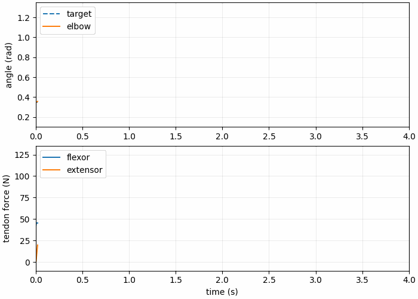

# 基于关节状态与肌腱力反馈的 MuJoCo 肌肉骨骼肘关节神经网络轨迹控制

本模块面向单自由度肘关节轨迹跟踪。MuJoCo 模型包含上臂、前臂、可变负载以及屈肌和伸肌两条拮抗肌腱。PD 控制器生成可复现的专家数据回合，轻量多层感知机再以关节状态和肌腱力为反馈预测两路安全激活量。

## 系统接口

| ROS 2 话题 | 类型 | 方向 | 含义 |
| --- | --- | --- | --- |
| `/target_angle` | `std_msgs/Float64` | 输入 | 目标肘角 |
| `/joint_states` | `sensor_msgs/JointState` | 输出 | 角度与角速度 |
| `/tendon_forces` | `std_msgs/Float64MultiArray` | 输出 | 屈肌力与伸肌力 |
| `/muscle_activations` | `std_msgs/Float64MultiArray` | 输出 | 两路 `[0,1]` 范围内的激活量 |

## 专家控制

角度误差为 \(e=q_d-q\)，PD 期望关节力矩为：

$$
\tau_d=K_p e-K_d\dot q.
$$

令 \(\tau_s\) 为归一化力矩尺度，\(a_c\) 为共同收缩量，则拮抗激活为：

$$
a_f=\operatorname{clip}(a_c+\max(0,\tau_d/\tau_s),0,1),
\quad
a_e=\operatorname{clip}(a_c+\max(0,-\tau_d/\tau_s),0,1).
$$

力矩符号决定主要发力的肌腱；适量共同收缩使两条肌腱保持张紧。激活命令传入 MuJoCo 前会进行有限值检查，并限制在 `[0,1]` 范围内。

## 数据格式与划分

每个 CSV 文件只包含一个完整数据回合。字段包括 `episode_id`、`step`、`time_s`、`target_angle_rad`、`angle_rad`、`angular_velocity_rad_s`、`flexor_force_n`、`extensor_force_n`、`flexor_activation`、`extensor_activation` 和 `load_kg`。同名 JSON 文件记录数据结构版本、固定随机种子、轨迹配置、负载、字段列表和样本数。采集结束后，`episode_split.json` 保存训练集、验证集和测试集的完整回合编号；训练器会校验并复用该清单，避免相邻帧泄漏或重复随机划分。

## 运行

```bash
python3 -m pip install -r src/musculoskeletal/mujoco_musculoskeletal_elbow_nn_control/requirements.txt
colcon build --packages-select mujoco_musculoskeletal_elbow_nn_control --symlink-install
source install/setup.bash
ros2 launch mujoco_musculoskeletal_elbow_nn_control main.launch.py
```

采集阶跃、正弦及不同负载下的数据回合：

```bash
collect_episodes \
  --model install/mujoco_musculoskeletal_elbow_nn_control/share/mujoco_musculoskeletal_elbow_nn_control/models/elbow.xml \
  --config install/mujoco_musculoskeletal_elbow_nn_control/share/mujoco_musculoskeletal_elbow_nn_control/config/episodes.yaml
```

采集器会在数据目录写出 `episode_split.json`。三种数据集合均至少包含一个完整数据回合，配置种子保存在清单中。

## 神经网络与评价

轻量 MLP 输入为 \([q_d,q,\dot q,F_f,F_e]\)，输出为 \([a_f,a_e]\)。训练器复用 `episode_split.json` 中记录的完整数据回合划分，并检查清单与 CSV 回合编号一致。在线推理继续复用激活限制器与异常安全停机逻辑。评价覆盖角度均方根误差、超调量、稳定时间和 CPU 推理延迟，并分别报告轨迹类型与前臂负载。

训练和评价命令：

```bash
python3 -m mujoco_musculoskeletal_elbow_nn_control.train --data data/episodes --model data/elbow_mlp.json
python3 -m mujoco_musculoskeletal_elbow_nn_control.evaluate --data data/episodes --model data/elbow_mlp.json --output data/evaluation.json
```

### 算法流程

```text
目标轨迹 + 关节状态 + 肌腱力 -> 训练集统计量标准化 -> tanh MLP
-> sigmoid 输出 -> 有限值检查与 [0,1] 限幅 -> 肌肉激活命令
```

训练阶段只使用训练集统计量进行输入标准化，网络以 sigmoid 输出两路激活量，并在发布前进行有限值检查和 `[0,1]` 安全限幅。训练损失为：

$$L=\frac{1}{N}\sum_i\|\hat a_i-a_i^{PD}\|_2^2.$$

评价按完整数据回合、轨迹类型和负载分组，报告 MAE、RMSE、末段稳态误差和单样本 CPU 推理耗时。PD 与神经控制器使用同一目标轨迹、初始状态和负载。

## ROS 2 在线神经控制

```bash
ros2 launch mujoco_musculoskeletal_elbow_nn_control neural_controller.launch.py
ros2 topic pub --once /target_angle std_msgs/msg/Float64 "{data: 1.2}"
ros2 topic echo /muscle_activations
```

节点订阅 `/target_angle`、`/joint_states` 和 `/tendon_forces`，发布 `/muscle_activations`。任一输入缺失、超时或格式异常时输出 `[0,0]`。

## 实测演示



该动图由 MuJoCo 模型和同一套 PD 专家控制器实际运行导出，记录目标角、实测肘角以及两路肌腱力。仿真时长为 4 秒，动图共 200 帧，每帧 20 毫秒，播放时长同为 4 秒；肌腱力纵轴根据全部实测数据设置范围。

在仓库根目录执行以下命令，可用包内的录制脚本重新生成同一场景：

```bash
python3 -m pip install -r src/musculoskeletal/mujoco_musculoskeletal_elbow_nn_control/requirements-demo.txt
python3 src/musculoskeletal/mujoco_musculoskeletal_elbow_nn_control/tools/record_gif.py \
  --output docs/img/musculoskeletal/mujoco_musculoskeletal_elbow_nn_control/elbow_trajectory.gif
```

录制脚本直接加载包内的 `models/elbow.xml`，在无图形窗口的环境中运行 MuJoCo 和 PD 控制器，并导出角度与肌腱力曲线。

## 验收

```bash
python3 -m pytest src/musculoskeletal/mujoco_musculoskeletal_elbow_nn_control/test -q
colcon test --packages-select mujoco_musculoskeletal_elbow_nn_control
colcon test-result --all
mkdocs build --strict
```

ROS 2 验收还应检查 `/joint_states`、`/tendon_forces` 和 `/muscle_activations` 的发布频率与数值范围，并在节点关闭时确认激活量归零。
