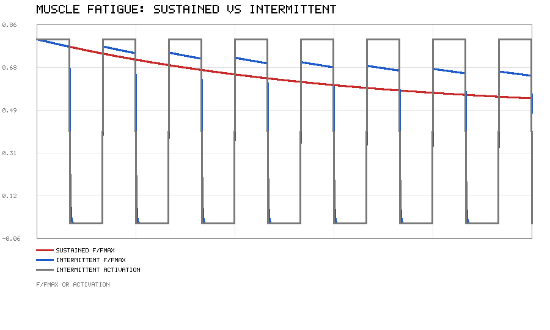

# 肌肉疲劳建模

电机能长时间维持设定力矩，真实骨骼肌不行：持续收缩一阵子，能发出的最大力会
明显下降，歇一会儿又能回来。这种"越用越没劲、歇歇又恢复"的现象就是**肌肉疲劳**。

本篇在 [肌肉驱动的关节控制](./muscle_joint_control.md) 的 Hill 模型基础上，给最大力
乘一个随时间变化的**疲劳因子** `phi(t)`，用纯 Python 标准库（不需要 MuJoCo / ROS /
matplotlib）仿真两种收缩方式下的力衰减，看疲劳怎么依赖"是否休息"。

代码在 `src/musculoskeletal/muscle_fatigue/`，只用标准库。

## 1 为什么肌肉会越用越没劲

持续收缩时，肌纤维内部会发生一连串变化，这里只列对"出力"最直接的三条：

- **横桥循环减慢**：ATP 供应、Ca²⁺ 释放与再摄取跟不上，可形成的横桥变少；
- **代谢物堆积**：H⁺、Pi 等积累干扰收缩蛋白相互作用；
- **中枢驱动下降**：高阶神经也会主动调低指令，保护肌肉不过载。

现象层面看就是：同样的激活度 `a`，疲劳后实际能出的力更小了。对控制的含义很直接——
如果控制器按"不疲劳"标定，疲劳一来，开环就会失准，轨迹/力跟踪都会掉。

## 2 在 Hill 模型上加一个疲劳因子

回顾肌肉驱动的关节控制里的总力公式（长度、速度都做了归一化）：

```
F = F_max * ( a * f_l(l_n) * f_v(v_n) + f_p(l_n) )
```

我们不改 Hill 模型本身，只是把 `F_max` 换成一个会被疲劳吃掉的量：

```
F = phi(t) * F_max * ( a * f_l * f_v + f_p )      phi ∈ (0, 1]
```

- `phi = 1`：完全 fresh，和原模型一致；
- `phi` 越小：肌肉被"榨干"得越厉害，同一条 Hill 曲线整体下移。

这样疲劳就是一个**乘性增益**，不影响力-长度、力-速度的形状，只缩放幅度——和生理学上
"疲劳主要降最大力、对速度依赖性影响较小"的简化认识一致。

## 3 疲劳因子的一阶动力学

用一个一阶状态描述 `phi` 怎么随激活度 `a` 演化：

```
dphi/dt = k_rec * (1 - a) * (1 - phi)  -  k_fat * a * (phi - phi_min)
```

| 符号 | 含义 |
|---|---|
| `phi_min` | 持续满激活时会掉到的下界（例如 0.55，即最多只剩约 55% 力） |
| `k_fat` | 激活时疲劳**累积**速率 (1/s) |
| `k_rec` | 休息时疲劳**恢复**速率 (1/s) |

直观上：

- **休息** `a = 0`：第一项把 `phi` 往 1 拉，`phi → 1`（恢复）；
- **持续激活** `a = 1`：第二项占主导，把 `phi` 往 `phi_min` 拉（掉力）。

稳态（恒定 `a`）可以解析写出：

```
phi_ss = [ k_rec*(1-a) + k_fat*a*phi_min ] / [ k_rec*(1-a) + k_fat*a ]
```

代入两端验证：`a = 1` 时 `phi_ss = phi_min`（掉到底）；`a = 0` 时 `phi_ss = 1`（完全恢复）。
中间激活度下 `phi` 收敛到一个介于两者之间的平台，且激活度越大平台越低——这正是
"用力越大、越容易疲劳"的定量表达。

## 4 两种收缩协议

为了把疲劳的影响看清楚，在**最优长度、零速度**下跑（`f_l = 1`、`f_v = 1`、`f_p = 0`），
此时 `F / F_max = phi * a`，力只由疲劳因子和激活度决定。比较两种激活节奏：

- **持续收缩**：`a = 0.8` 连续 30 s；
- **间歇收缩**：`a = 0.8` 维持 2 s，再休息 2 s，循环 30 s。

间歇的关键不是"总用力更少"（它同样在收缩段用 0.8），而是**每个休息段都让 `phi`
回升一点**，所以整体疲劳程度取决于占空比。

## 5 结果



- 红线（持续）：`phi` 单调下降，`F/Fmax` 一路滑到约 0.55 附近（对应 `phi` 收敛到
  约 0.6 的稳态平台），没有任何喘息；
- 蓝线（间歇）：每个 2 s 休息段 `phi` 明显回升，紧接着的收缩段力始终**高于同期
  的持续收缩**——休息确实在"续命"；
- 灰线（间歇激活度）：标出收缩/休息的时间结构，方便对照。

跑 `python3 main.py` 会得到一组参考数值，例如（步长 0.01 s、30 s）：

```
持续收缩末段 F/Fmax 均值: 0.553
间歇收缩全程 F/Fmax 均值: 0.382
```

注意间歇的**全程均值更低**，是因为休息段 `a = 0` 时力就是 0，把均值拉下去了；
但看**主动收缩段**的力，间歇始终优于持续。这和训练/康复里的常识一致：
同样的"出力总量"，拆成"用力—休息"的节奏比一口气硬扛更可持续。

## 6 调参与扩展

模型只有三个参数，改起来很直观：

- `k_fat` 调大：疲劳来得更快；`k_rec` 调大：恢复更快；
- `phi_min` 调高：表示这块肌肉"耐力好"，持续收缩也掉不到很低；
- 不同肌纤维：快肌 `k_fat` 大、易疲劳，慢肌 `k_rec` 大、耐力好，可给两块拮抗肌
  设不同参数。

往深了做可以接的方向：

- 疲劳速率依赖当前长度/速度，而不是只依赖 `a`；
- 和 [肌肉驱动的关节控制](./muscle_joint_control.md) 的拮抗肌对接上，看共激活下
  两侧肌肉 Fatigue 不同步时关节刚度怎么变；
- 把 `phi` 当作"中枢驱动裕度"，做疲劳感知的激活度前馈补偿。

## 7 运行

```bash
# 在包目录下，只用 Python 标准库
python3 main.py                  # 完整演示，曲线输出到 scripts/fatigue_curves.png
python3 main.py --quick          # 缩短仿真时长
python3 main.py --outdir DIR     # 指定输出目录

# 测试
python3 -m unittest discover -s tests
```

放进 catkin 工作空间后也能用 launch 统一拉起：

```bash
catkin_make && source devel/setup.bash
roslaunch muscle_fatigue main.launch
```

## 参考

- A. V. Hill, *The heat of shortening and the dynamic constants of muscle*, 1938
- F. E. Zajac, *Muscle and tendon: properties, models, scaling, and application to
  biomechanics and motor control*, 1989
- D. G. Thelen, *Adjustment of muscle mechanics model parameters to simulate dynamic
  contractions in older adults*, 2003
- R. M. Enoka, J. Duchateau, *Muscle fatigue: what, why and how it influences muscle
  function*, Journal of Applied Physiology, 2008
- N. K. Vøllestad, *Measurement of human muscle fatigue*, 1997

---

本文档及配套模块代码在编写过程中使用了 AI 大模型辅助（方案讨论、代码与文档起草、问题排查）。
全部内容经过实际运行验证：模块在 Python 3.13 标准库环境下通过 `python3 main.py` 运行，
生成上图结果，并通过 `python3 -m unittest discover -s tests` 的全部单元测试。
作者对提交内容的正确性与完整性负全部责任。
