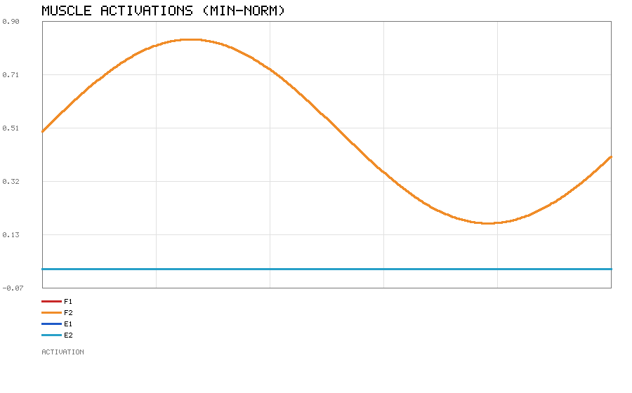
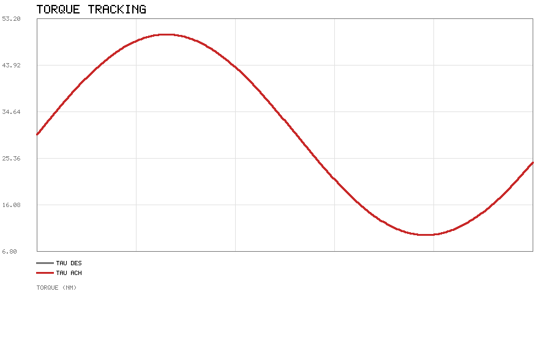

# 肌肉冗余系统的力分配：最小范数与加权最小二乘

## 1. 作业概述与背景

人体骨骼肌系统的一个本质特征是**冗余（redundancy）**：一个关节（1 个自由度）往往由
多块肌肉共同驱动。例如肘关节的屈由肱二头肌等"屈肌"完成，伸由肱三头肌等"伸肌"完成，
而屈肌内部又有多块肌肉。给定期望关节力矩 $\tau_{\mathrm{des}}$，满足
$\sum_i \tau_i = \tau_{\mathrm{des}}$ 的肌肉激活度组合有无穷多个——神经系统究竟如何
"分配"这份力矩，是肌骨生物力学与控制的核心问题。

本模块用一个单自由度、四肌肉的简化模型，给出两种经典分配准则并做仿真：
**最小激活范数（least effort）** 与**加权最小二乘**；同时演示冗余肌群如何平分负载、
以及拮抗共激活如何提高关节刚度。模块仅用 Python 标准库，不含 MuJoCo / ROS / matplotlib。

## 2. 运行环境

- Python 3（仅标准库）
- 运行方式：

```bash
cd src/musculoskeletal/muscle_force_distribution
python3 scripts/main.py --outdir scripts
```

生成 `force_alloc.png`（各肌激活度随时间变化）与 `force_tracking.png`（力矩跟踪），
并打印跟踪最大误差。

## 3. 核心代码文件清单

```
src/musculoskeletal/muscle_force_distribution/
├── scripts/
│   ├── force_alloc.py    # 肌肉模型、可行区间、分配与刚度代理
│   ├── simulate.py       # 时变力矩分配并作图
│   ├── simple_plot.py    # 仅用 zlib 的极简折线图输出
│   └── main.py           # 命令行入口
├── tests/
│   └── test_force_alloc.py
├── package.xml
├── CMakeLists.txt
├── launch/main.launch
├── README.md
└── requirements.txt
```

## 4. 处理原理

### 4.1 单块肌肉的力矩贡献

第 $i$ 块肌肉在激活度 $a_i\in[0,1]$ 下提供的力矩：

$$\tau_i = r_i\,(a_i\,F_{\max,i})$$

其中 $r_i$ 为力臂（屈肌取正、伸肌取负），$F_{\max,i}$ 为最大等长力。关节总力矩为
$\tau = \sum_i \tau_i$。定义力矩向量 $R_i = r_i F_{\max,i}$，则
$\tau = \mathbf{R}^{\!\top}\mathbf{a}$。

### 4.2 可行区间

力矩可正可负取决于哪些肌肉被激活。可行区间：

$$\tau_{\min} = \sum_{r_i<0} R_i,\qquad
\tau_{\max} = \sum_{r_i>0} R_i$$

若期望力矩落在区间外，则只能饱和到边界（出现残余误差）。

### 4.3 最小激活范数分配

在无穷多解里，"最省力"的分配最小化 $\sum_i a_i^2$。把与期望力矩**同向**的肌肉
（即 $R_i\cdot\tau_{\mathrm{des}}>0$）视为有效集，最小范数解为其上的等比分配：

$$a_i = \frac{R_i\,\tau_{\mathrm{des}}}{\sum_{j\in\mathcal{S}} R_j^2},\qquad i\in\mathcal{S}$$

随后裁剪到 $[0,1]$。由于各有效肌的 $R_i$ 相同，冗余肌群会**自动平分**力矩。

### 4.4 加权最小二乘

若按疲劳、能耗或力-长度特性给肌肉赋权 $w_i$，则最小化 $\sum_i w_i a_i^2$：

$$a_i = \frac{w_i R_i\,\tau_{\mathrm{des}}}{\sum_{j\in\mathcal{S}} w_j R_j^2}$$

权越大代表该肌肉越"优先被少用力"。

### 4.5 拮抗共激活与刚度

令拮抗双方同时激活（如 $a_{\text{屈}}=a_{\text{伸}}=0.3$），净力矩可为零，但关节刚度代理量

$$K_{\mathrm{proxy}} = \sum_i |R_i|\,a_i$$

随共激活增大而上升——这正是人体通过共激活调节关节硬度的机制。

## 5. 仿真结果

模型取两块屈肌（$r=+0.03\,\mathrm{m},F_{\max}=1000\,\mathrm{N}$）与两块伸肌
（$r=-0.03\,\mathrm{m}$），期望力矩取 $\tau_{\mathrm{des}}(t)=30+20\sin(1.5t)\,\mathrm{Nm}$
（始终为正，故只需屈肌发力）。采用最小范数分配。





结果印证了两点：两块屈肌 F1、F2 的激活度曲线几乎重合（**冗余平分**），伸肌 E1、E2 保持为 0；
力矩跟踪最大误差为 0（在可行区间内精确实现）。

## 6. 小结

- 冗余驱动下，期望力矩对应无穷多组肌肉激活，分配准则决定具体方案；
- 最小激活范数给出"最省力"解，并在同构冗余肌间自动平分负载；
- 加权最小二乘可把权重导向更不易疲劳/更高效的肌肉；
- 拮抗共激活以零净力矩换取更高关节刚度，是生物运动控制的常用策略。

## 参考

- E. Todorov, *Optimality principles in sensorimotor control*, Nature Neuroscience, 2004
- M. L. Latash, *Synergy*, 2008
- T. S. Buchanan et al., *Neuromusculoskeletal Modeling*, 2004

> 说明：本模块仅依赖 Python 标准库，开箱即跑；文档与代码在编写过程中使用 AI 辅助，
> 但均经实跑验证（单元测试与 `python3 main.py` 生成上图），作者对内容正确性负责。
