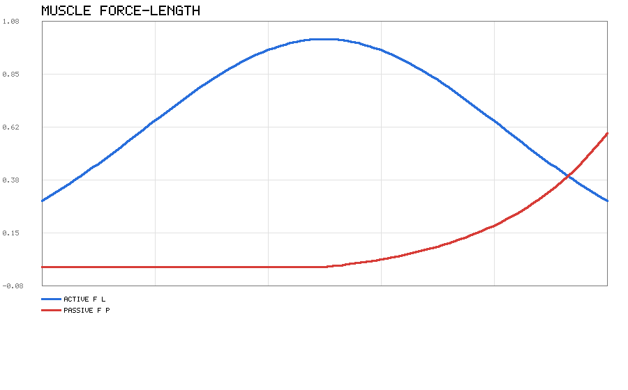
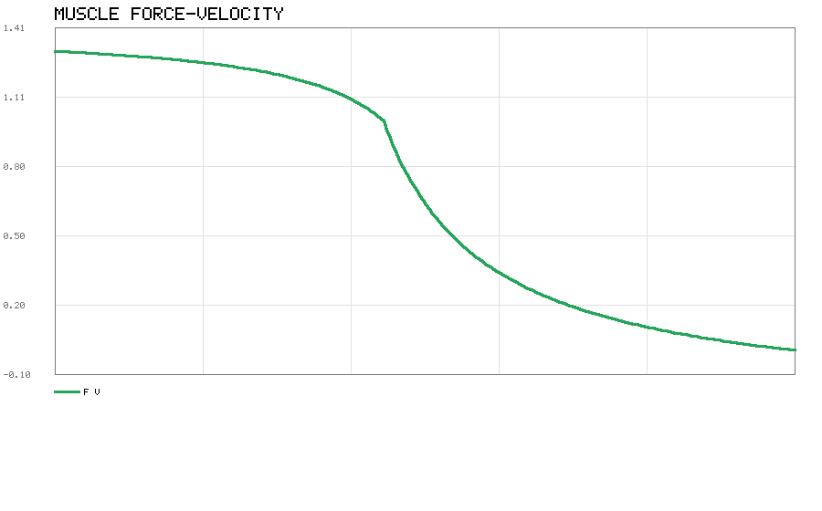
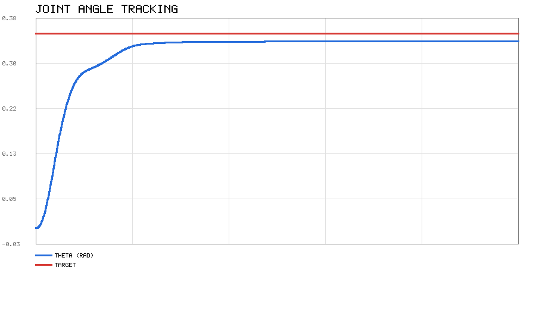
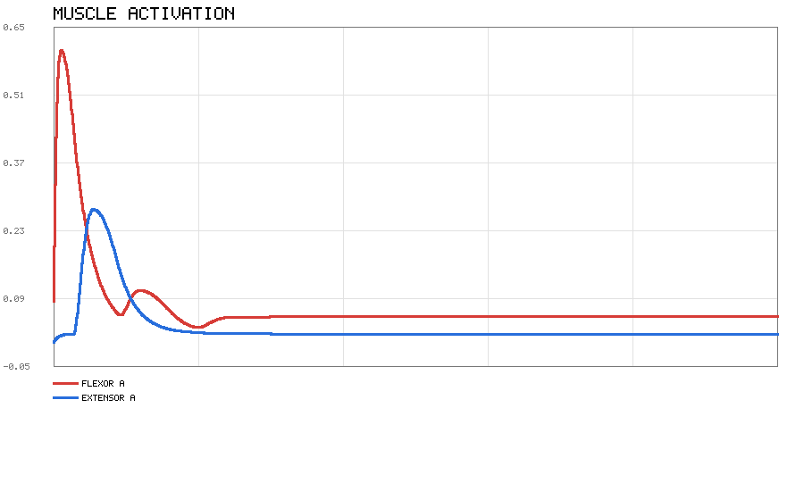
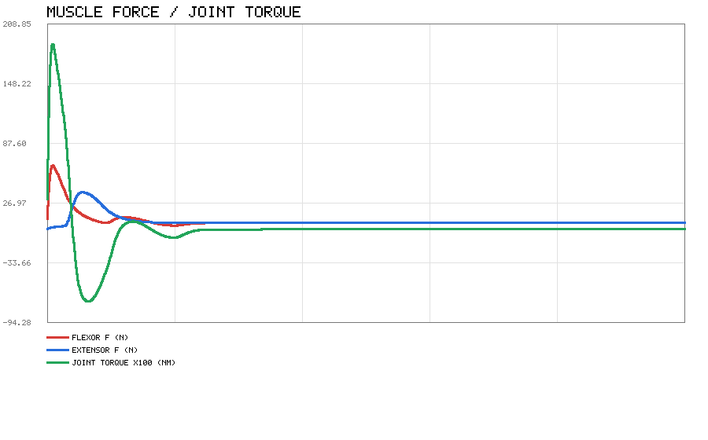
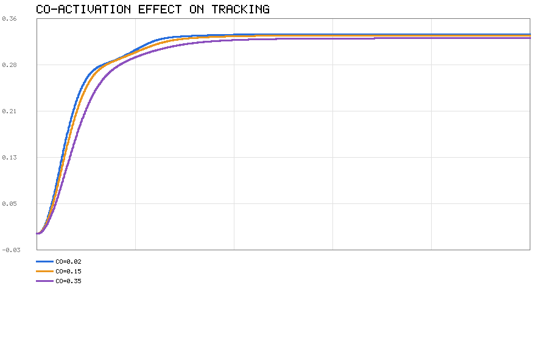
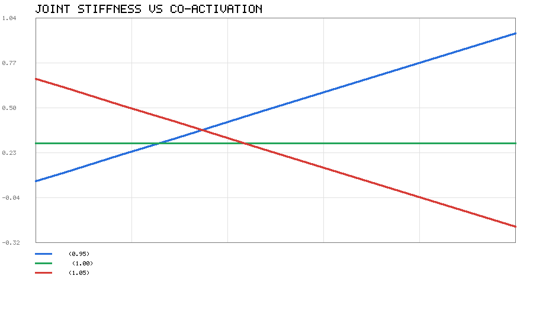
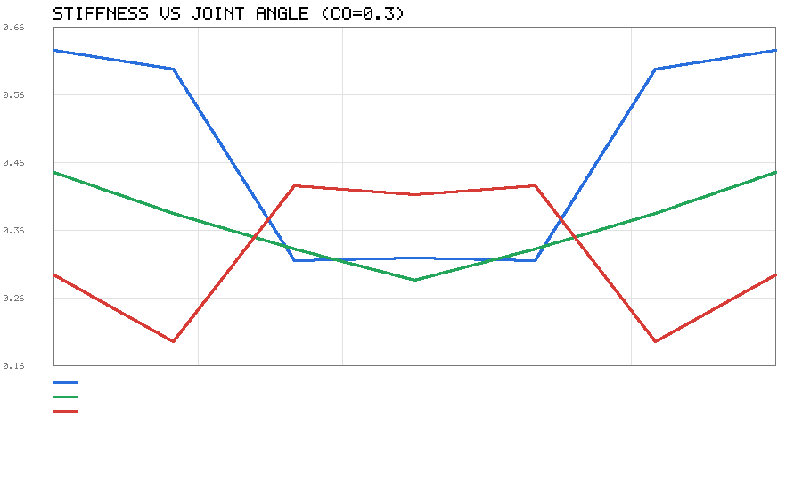
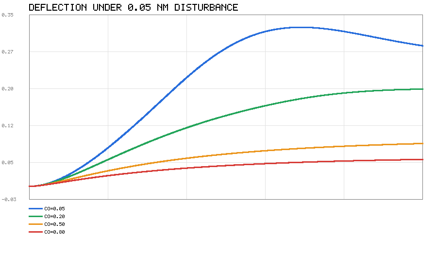
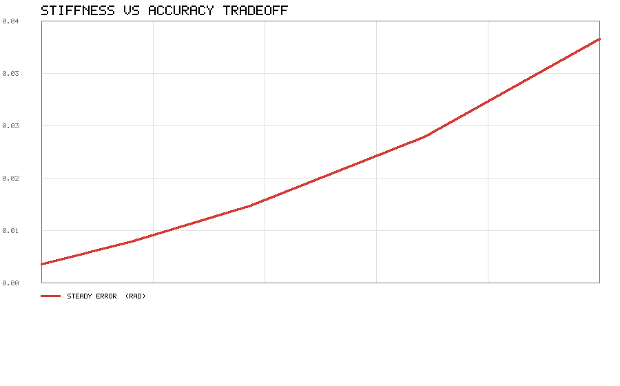

# 肌肉驱动的关节控制

用 Hill 肌肉模型做了一个单自由度关节仿真。跟常见的关节仿真不一样的是，控制器
输出的不是关节力矩，而是两块拮抗肌的激活度，力由肌肉模型根据当前长度和收缩
速度算出来。

代码在 `src/musculoskeletal/muscle_joint_control/`，只用 Python 标准库，不需要
MuJoCo、ROS 或 matplotlib。Python 3.8 以上都能跑。

## 为什么不能直接给力矩

平时做仿真习惯把关节当成理想力矩源，想要多大力就发多大力。真实肌肉做不到：

- 控制量是激活度 a，范围只有 0 到 1
- 肌肉只能拉，不能推。想让关节往反方向转，只能靠对侧那块肌肉拉
- 能出多大力跟肌肉当前的长度、收缩速度都有关系，不是固定的
- 激活和放松都要时间，而且放松比激活慢

这样一来就多出几个力矩源模型里看不到的问题：共激活会互相打架、力矩会饱和、
增益给大了反而会振荡。这些后面都会给数据。

## Hill 肌肉模型

长度和速度都做归一化，`l_n = l / l_opt`，`v_n = v / v_max`。这里的 v 是缩短
速度，向心收缩为正。总力是

```
F = F_max · [ a · f_l(l_n) · f_v(v_n) + f_p(l_n) ]
```

### 激活

激活度不会瞬间跳变，用一阶滞后：

```
da/dt = (u - a) / τ,    τ = τ_act   (u > a，正在激活)
                        τ = τ_deact (u ≤ a，正在放松)
```

真实肌肉激活比放松快，所以 τ_act 要比 τ_deact 小。这里默认 0.01 s 和 0.04 s，
参数类会拒绝 τ_deact ≤ τ_act 的配置。

### 力-长度

主动力用高斯函数，最优长度处最大：

```
f_l(l_n) = exp( -((l_n - 1) / w)² )      w 取 0.45
```

肌肉被拉长超过最优长度以后，结缔组织会被动张紧，产生被动力：

```
f_p(l_n) = 0                                              l_n ≤ 1
f_p(l_n) = [exp(k(l_n-1)) - 1] / [exp(k(l_max-1)) - 1]     l_n > 1
```

k 取 5，l_max 取 1.6，也就是拉到 1.6 倍最优长度时被动力跟最大等长力差不多。



蓝的是主动力，峰值在 l_n = 1，两边对称下降。红的是被动力，l_n 小于 1 的时候
一直是 0，超过以后才开始涨。

### 力-速度

从 Hill 方程 `(F + a)(v + b) = (F0 + a)b` 归一化过来，取 a/F0 = b/v_max = 0.25：

```
向心（v_n ≥ 0）:  f_v = 0.3125 / (v_n + 0.25) - 0.25      v_n = 1 时为 0
离心（v_n < 0）:  f_v = 1 + 0.4 · x / (0.25 + x),  x = min(1, -v_n)
```

离心收缩（肌肉被拉长）时的力反而比等长收缩大，上限大概 1.4 倍。这是肌肉比较
特别的地方，弹簧和阻尼器都没有这个性质。



等长时是 1.0000，离心 v=-0.5 时涨到 1.2667，缩短到最大速度 v=1 时降到 0。

## 关节

一个绕轴转的关节，两边各挂一块肌肉。力学关系是

```
J · θ̈ = r · (F_flex - F_ext) - b · θ̇ + τ_ext
```

τ_ext 是外加力矩，做扰动测试用。肌肉长度跟关节角的关系（小角度下近似）是

```
l_flex = l_rest - r·θ        l_ext = l_rest + r·θ
```

对时间求导的时候要注意，缩短速度是长度导数的相反数：

```
v_flex = +r·θ̇               v_ext = -r·θ̇
```

也就是关节正转时屈肌缩短、伸肌被拉长。这个符号我第一次写反了，后面测试里
专门留了一条守住它。



## 怎么跑

```bash
cd src/musculoskeletal/muscle_joint_control/scripts
python3 main.py                 # 完整演示
python3 main.py --quick         # 只跑基本阶跃响应
python3 main.py --outdir 输出目录
```

跑完终端会打印各项指标，曲线写到 `demo_out/`：

| 文件 | 内容 |
|---|---|
| `muscle_curves.png` | 力-长度曲线 |
| `force_velocity.png` | 力-速度曲线 |
| `joint_step.png` | 关节角跟踪 |
| `activation.png` | 两块肌肉的激活过程 |
| `muscle_force.png` | 肌肉力和关节力矩 |
| `coactivation.png` | 不同共激活下的跟踪对比 |
| `stiffness_vs_coactivation.png` | 刚度随共激活的变化 |
| `stiffness_vs_angle.png` | 刚度随关节角的变化 |
| `disturbance_response.png` | 扰动力矩下的偏转 |
| `tradeoff.png` | 刚度-精度权衡 |

跑测试：

```bash
cd src/musculoskeletal/muscle_joint_control
python3 -m unittest discover -s tests
```

## 阶跃响应

控制器把 PD 算出来的期望力矩分给两块肌肉。需要正力矩就让屈肌激活、伸肌维持
一点共激活，反过来也一样。

目标 0.35 rad，kp = 9.0，kd = 0.9，共激活 0.02，步长 0.001 s，跑 1.5 s：

| 指标 | 数值 |
|---|---|
| 最终角度 | +0.335306 rad |
| 稳态误差 | -0.014694 rad |
| 上升时间 | 0.258 s |
| 超调 | 0.00 % |
| 屈肌最大激活 | 0.6060 |
| 伸肌最大激活 | 0.2769 |
| 最大关节力矩 | 1.8794 N·m |

单块肌肉全力时关节力矩上限是 `F_max · r = 120 × 0.03 = 3.6 N·m`，这里用到
1.8794 N·m，还差得远，所以没饱和，跟踪很平稳。



屈肌激活先升后降，伸肌只在要刹车的时候才明显出力。



### 共激活的影响

目标还是 0.35 rad，把共激活调大：

| 共激活 | 稳态误差 (rad) | 上升时间 (s) |
|---|---|---|
| 0.02 | -0.014694 | 0.258 |
| 0.15 | -0.016797 | 0.278 |
| 0.35 | -0.021544 | 0.333 |

共激活越大，误差越大、响应越慢。这是花代价换来的，具体换到了什么看后面刚度
那一节。



### 力矩饱和

这是肌肉驱动跟理想力矩源区别最明显的地方。力矩上限是 3.6 N·m，kp 取 9 时：

| 目标 (rad) | PD 要的力矩 (N·m) | 实际最大力矩 (N·m) | 稳态误差 (rad) |
|---|---|---|---|
| 0.10 | 0.9000 | 0.5781 | -0.00335 |
| 0.30 | 2.7000 | 1.6328 | -0.01199 |
| 0.60 | 5.4000 | 2.5023 | -0.03307 |
| 1.00 | 9.0000 | 2.5023 | -0.09008 |

目标越大，PD 要的力矩越可能超出肌肉能力，误差就跟着涨。

再把增益也调大看看：

| kp | 稳态误差 (rad) | 超调 (%) | 最大力矩 (N·m) |
|---|---|---|---|
| 4.0 | -0.025579 | 0.00 | 0.7655 |
| 9.0 | -0.011990 | 0.00 | 1.6328 |
| 20.0 | -0.005554 | 8.27 | 2.5023 |
| 40.0 | -0.001829 | 30.78 | 2.8814 |
| 80.0 | -0.007864 | 54.13 | 2.8384 |

kp 小于等于 9 的时候，增益越大误差越小。到 20 以后指令经常超出上限，开始振
荡，超调迅速变大，kp = 80 时误差反而回升了。所以"增益越大越好"在这里不成立。

## 关节刚度

### 刚度怎么算

关节力矩 `τ = r(F_flex - F_ext)`。稳定的关节，τ 和 θ 是反号的（偏得越多，往回
拉的力矩越大），所以刚度定义成

```
k = -∂τ/∂θ          k > 0 表示稳定
```

把 τ 对小角度展开一下，能看出刚度是从哪来的：

```
∂l_flex/∂θ = -r,   ∂l_ext/∂θ = +r

k = r² · ( ∂F_flex/∂l + ∂F_ext/∂l )
```

刚度正比于两条肌肉力-长度曲线斜率之和，再乘力矩臂的平方。下面这些现象都能用
这个式子解释。

### 关键结果：共激活不一定提高刚度

肌肉处在力-长度曲线的不同位置，`∂f_l/∂l` 的符号不一样：

- 上升段（l < l_opt）：斜率为正，共激活越大刚度越大
- 最优长度：斜率为 0，共激活不影响刚度
- 下降段（l > l_opt）：斜率为负，共激活越大刚度越小，甚至变负

实测（θ = 0，共激活从 0.05 扫到 0.90）：

| l_rest / l_opt | 工作段 | k(0.05) | k(0.90) | 趋势 |
|---|---|---|---|---|
| 0.90 | 上升段 | 0.1015 | 1.8275 | 上升 |
| 0.95 | 上升段 | 0.0527 | 0.9482 | 上升 |
| 0.98 | 上升段 | 0.0213 | 0.3832 | 上升 |
| 1.00 | 最优长度 | 0.2829 | 0.2829 | 不变 |
| 1.02 | 下降段 | 0.6041 | 0.2421 | 下降 |
| 1.05 | 下降段 | 0.6739 | -0.2216 | 下降 |
| 1.10 | 下降段 | 0.8314 | -0.8945 | 下降 |



蓝线是上升段，一路涨上去。绿线是最优长度，完全平的。红线是下降段，一路往下
掉，最后穿过零点变成负的。

所以"共激活提高关节刚度"这句话只对上升段成立。下降段上把肌肉拉长反而会让它
的主动力变小，相当于挂了个负弹簧，激活越高这个负效应越强。

### 为什么下降段会失稳

下降段能不能稳住，看被动力够不够抵消主动项的负斜率：

```
a · ∂f_l/∂l + ∂f_p/∂l > 0
```

拿 l_rest/l_opt = 1.05 算一下（都是对 l_n 的导数）：

| 激活 a | a·∂f_l/∂l | ∂f_p/∂l | 合计 | 结果 |
|---|---|---|---|---|
| 0.0 | -0.0000 | +0.3364 | +0.3364 | 稳定 |
| 0.2 | -0.0976 | +0.3364 | +0.2388 | 稳定 |
| 0.5 | -0.2439 | +0.3364 | +0.0925 | 稳定 |
| 0.8 | -0.3902 | +0.3364 | -0.0538 | 失稳 |
| 1.0 | -0.4878 | +0.3364 | -0.1514 | 失稳 |

激活超过大概 0.7 以后，主动项的负斜率就压过被动力了，关节失去自稳能力。所以
被动力不光是个限位保护，它在下降段上还是稳定性的来源。

### 刚度随关节角变化



三个工作点在 θ=0 附近的形状不一样（共激活 0.3，摘几个点）：

| θ (rad) | 上升段 | 最优长度 | 下降段 |
|---|---|---|---|
| -0.30 | 0.6253 | 0.4437 | 0.2901 |
| 0.00 | 0.3161 | 0.2829 | 0.4105 |
| +0.30 | 0.6253 | 0.4437 | 0.2901 |

上升段的曲线是个 U 形，中间最低，往两边翘。下降段正好反过来，中间最高。

### 抗扰测试

加 0.05 N·m 的恒定外力矩，看关节偏多少（上升段，l_rest/l_opt = 0.95）：

| 共激活 | 稳态偏转 (rad) | 等效刚度 (N·m/rad) | 解析刚度 |
|---|---|---|---|
| 0.05 | 0.292232 | 0.1711 | 0.0527 |
| 0.20 | 0.196514 | 0.2544 | 0.2107 |
| 0.50 | 0.085913 | 0.5820 | 0.5268 |
| 0.80 | 0.054102 | 0.9242 | 0.8429 |



共激活从 0.05 提到 0.80，同样扰动下偏转从 0.292 rad 降到 0.054 rad，少了 81%。
抗扰能力是实实在在换到了。

### 代价

最后把三个指标摆一起看（上升段，目标 0.3 rad）：

| 共激活 | 刚度 k | 稳态误差 (rad) | 上升时间 (s) | 能耗 |
|---|---|---|---|---|
| 0.02 | 0.0211 | -0.005703 | 0.244 | 0.100 |
| 0.10 | 0.1054 | -0.009228 | 0.258 | 0.500 |
| 0.20 | 0.2107 | -0.014431 | 0.284 | 1.000 |
| 0.35 | 0.3688 | -0.024550 | 0.388 | 1.750 |
| 0.50 | 0.5268 | -0.039059 | — | 2.500 |



刚度涨了约 25 倍，代价是稳态误差涨了 6.8 倍，能耗线性涨 25 倍。共激活不是白
来的抗扰手段，实际用的时候得在刚度、精度和能耗之间找个平衡点。

## 测试

`tests/` 下一共 134 个测试：

| 文件 | 数量 | 内容 |
|---|---|---|
| `test_muscle_model.py` | 57 | 参数校验、激活、力-长度、力-速度、总力 |
| `test_joint_model.py` | 37 | 运动学、动力学、阶跃响应、指标计算 |
| `test_stiffness.py` | 40 | 刚度符号、工作点判定、机理、共激活效应、扰动响应 |

测试断言的是肌肉的定性特征，不是拟合出来的数值，比如主动力峰值一定在 l_n = 1、
被动力在 l_n ≤ 1 时一定是 0、离心收缩力大于等长收缩力、激活比放松快、刚度正比
于力矩臂平方。这些规律任何实现都不该违反。

写的过程中测试抓到过两个问题。一个是把缩短速度写成了长度导数，符号反了，结果
关节正转时屈肌反而越来越离心，被 `test_positive_angular_velocity_shortens_flexor`
拦下来了。另一个是我一开始以为零激活就等于零力矩，其实 θ > 0 时伸肌被拉过最优
长度会产生被动力，现在有 `test_passive_only_restoring_torque` 固定这个行为。

## 文件结构

```
src/musculoskeletal/muscle_joint_control/
├── scripts/
│   ├── muscle_model.py     Hill 肌肉模型
│   ├── joint_model.py      单自由度关节和拮抗肌对
│   ├── stiffness.py        刚度、工作点判定、扰动响应、权衡分析
│   ├── simple_plot.py      PNG 折线图（手写的，只用 zlib）
│   └── main.py             演示入口
└── tests/
    ├── test_muscle_model.py
    ├── test_joint_model.py
    └── test_stiffness.py
```

`simple_plot.py` 是自己写的，因为想在没有绘图库的环境里也能出图。PNG 最小结构
只有 IHDR、IDAT、IEND 三个块，用 zlib 压一下像素行就能生成。

## 参考

- A. V. Hill, *The heat of shortening and the dynamic constants of muscle*, 1938
- F. E. Zajac, *Muscle and tendon: properties, models, scaling, and application to
  biomechanics and motor control*, 1989
- D. G. Thelen, *Adjustment of muscle mechanics model parameters to simulate dynamic
  contractions in older adults*, 2003
- [肌肉骨骼人的示例](https://openhutb.github.io/doc/pedestrian/humanoid/#humanoid_model)
