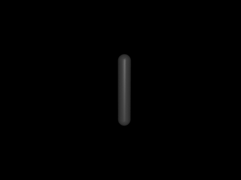
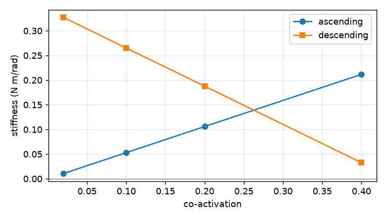
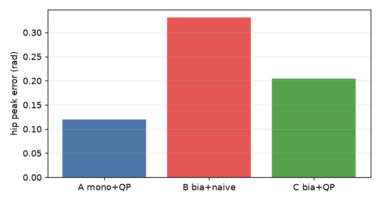
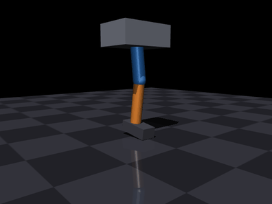
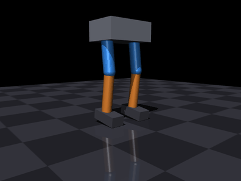

# 肌肉驱动的下肢关节与步态

本页不依赖 ROS，全部指标由 `python3 main.py bench` 在 Ubuntu 22.04.5 + Python 3.10 + MuJoCo 3.16.0 下复现。

本页用一个模块串起六级递进实验：**单条肌肉 → 拮抗肌对 → 共激活刚度 → 双关节耦合 →
负重站立 → 原地踏步**。与仓库已有模块的关系是：

| 已有模块 | 本模块的差异 |
|---|---|
| [肌肉驱动的关节控制](./muscle_joint_control.md) | 那个是 1 自由度、纯 Python、不负重；本模块有 MuJoCo 刚体动力学、多关节、承重 |
| [MuJoCo 肌肉骨骼灵巧手](./msk_hand_teleop.md) | 那个是手，不负重；本模块是腿，要撑住体重 |
| [MuJoCo 肌肉骨骼人键盘遥操作](./msk_human_walking_teleop.md) | 那个是整机 13 自由度行走/踢腿/蹲起；本模块是分级验证平台，L4 专门分析双关节肌耦合 |
| 人形机器人系列（电机驱动） | 那些用理想力矩源；本模块控制量是激活度 \\(a \\in [0,1]\\)，可作对照 |

## 1 为什么是肌肉，而不是电机

电机可以直接给力矩，可正可负；肌肉只能收缩，控制量是激活度，且出力随长度与速度变化。
这带来三个电机模型里不存在的现象：

* **反向运动必须靠拮抗肌**：一块肌肉只能拉，不能推；
* **力会饱和**：能出的力矩随构型与速度变化，不是常数；
* **共激活可调刚度**：同样的关节角，可以用"低激活、软"或"高激活、硬"实现。

前两条让控制变难，第三条是肌肉相对电机的独特价值——也是本模块 L3 要量化的东西。

## 2 模型与实现

### 2.1 分工

MuJoCo 只负责刚体动力学、关节限位与地面接触；**肌肉模型用 Python 实现**，肌力经
`qfrc_applied` 施加。这样肌肉部分完全可单元测试，也避免依赖 MuJoCo 内置 `muscle`
执行器的归一化细节（其 `lengthrange` 与缠绕腱配合时会把力推到非物理区间）。

### 2.2 Hill 肌肉模型

$$
F = F_{max}\left[a\, f_l(\tilde l)\, f_v(\tilde v) + f_p(\tilde l)\right],
\qquad
f_l(\tilde l)=\exp\!\left[-\left(\frac{\tilde l-1}{0.45}\right)^2\right]
$$

$$
f_v(\tilde v)=\begin{cases}
\dfrac{0.3125}{\tilde v+0.25}-0.25, & \tilde v \ge 0 \quad\text{（缩短）}\\[2mm]
1+\dfrac{0.4x}{0.25+x},\ x=\min(1,-\tilde v), & \tilde v<0 \quad\text{（拉长）}
\end{cases}
$$

激活动力学为一阶滞后，且**激活快于放松**：

$$
\dot a = \frac{u-a}{\tau},\qquad
\tau=\begin{cases}\tau_{act}=0.01\,\text{s}, & u>a\\ \tau_{deact}=0.04\,\text{s}, & u\le a\end{cases}
$$

被动力只在 \\(\tilde l>1\\) 时出现，是下降段唯一的稳定来源（见 3.3 节）。

### 2.3 单关节阶段的肌肉几何

单关节用解析矩臂，肌肉长度与关节角线性相关，便于手算复核：

$$
l_{flex}=L_0-r\theta,\qquad l_{ext}=L_0+r\theta,\qquad \tau = r\,(F_{flex}-F_{ext})
$$

于是关节刚度有闭式解，可与数值结果逐项对照：

$$
k=-\frac{\partial \tau}{\partial \theta}
 = r^2\left(\frac{\partial F_{flex}}{\partial l}+\frac{\partial F_{ext}}{\partial l}\right)
$$

## 3 六级实验

### 3.1 L1 单条肌肉：能不能驱动关节

激活在 0.4 s 从 0.05 跳到 0.30、1.0 s 撤回 0.05。腿被拉起后靠重力自然落回。

| 指标 | 数值 |
|---|---|
| 峰值关节角 | **0.828 rad** |
| 终止角 | 0.190 rad |
| 峰值肌力 | **32.2 N** |



### 3.2 L2 拮抗肌对 + PD：能不能控到目标

期望力矩按符号分配给屈/伸肌，对侧维持 0.02 共激活。

| 目标 (rad) | 末态 (rad) | 峰值激活 |
|---|---|---|
| 0.00 | 0.036 | 0.11 |
| +0.30 | 0.277 | 0.75 |
| −0.30 | −0.220 | 0.75 |

纯 PD 有稳态droop（约 2–8 cm 的等效角误差），加积分或重力前馈可进一步收敛。


### 3.3 L3 共激活：肌肉到底多出了什么

固定激活度、零速度，直接对 \\(\tau(\theta)\\) 求导得到刚度（准静态，避开动力学瞬态）：

| 共激活 | 上升段 k (N·m/rad) | 下降段 k (N·m/rad) |
|---|---|---|
| 0.02 | 0.011 | 0.327 |
| 0.10 | 0.053 | 0.265 |
| 0.20 | 0.106 | 0.188 |
| 0.40 | **0.212** | **0.033** |

数值解与解析式在四位小数上完全一致。结论：

* **上升段**（\\(l_{opt}>l_0\\)）：共激活越大，刚度越大，但能耗与稳态误差同步上升；
* **下降段**（\\(l_{opt}<l_0\\)）：共激活反而**降低**刚度，稳定性完全依靠被动力。

所以"共激活提高刚度"这句话只在上升段成立——这是本模块最重要的一条结论。



### 3.4 L4 双关节肌：按关节分配为什么会失效

加入跨髋膝的**腘绳肌**（同时伸髋、屈膝），并让它成为唯一的屈膝肌。
任务：髋保持 0，膝屈曲到 0.9 rad。

| 模型 | 髋峰值误差 (rad) | 激活代价 |
|---|---|---|
| A 单关节版（纯屈膝肌，解剖上不存在） | 0.120 | 0.012 |
| B 双关节版 + 朴素分配 | **0.331** | 0.012 |
| C 双关节版 + 联合 QP | **0.204** | 0.023 |

朴素分配把屈膝的力矩串到了髋上，误差是联合求解的 1.6 倍；联合 QP 用髋屈肌抵消
耦合，代价是激活增加约一倍。**这就是双关节肌的代价，也是电机模型里看不到的问题。**



### 3.5 L5 单腿负重站立

骨盆挂在两个滑轨上（水平允许屈膝时后移、竖直承重），相当于体重支撑架。
100% 重力，微蹲姿态：

| 指标 | 数值 |
|---|---|
| 骨盆高度 | **−0.015 ± 0.000 m** |
| 膝关节角 | 0.21 rad |
| 峰值激活 | **0.236** |

注意：必须做**重力前馈**（`qfrc_bias`），纯 PD 在稳态误差为零时输出为零，腿会直接
塌到关节限位。



### 3.6 L6 双腿原地踏步

相位 1.2 s 一个周期，左右腿各摆动 0.6 s；35% 体重支撑。

| 指标 | 数值 |
|---|---|
| 骨盆高度 | +0.007 ± 0.000 m |
| 抬脚幅度 | **0.180 m** |
| 峰值激活 | 0.379 |



## 4 复现

```
cd src/musculoskeletal/mujoco_muscle_leg_gait
python3 main.py check
python3 main.py bench --out out      # 复现 3.1-3.6 的全部数字
python3 main.py gif --out gif        # 复现本页动图
python3 -m unittest discover -s tests -v
```

> `gif` 子命令需要图形环境。远程或无显示服务器时先设置 `MUJOCO_GL=egl`（或 `osmesa`），否则会报 `an OpenGL platform library has not been loaded`；`bench` 与单元测试不受影响。

## 5 已知限制

1. **L6 不是自由行走**：骨盆受滑轨约束、无躯干俯仰与重心转移控制，35% 重力是刻意
   简化。真正的双足行走需要自由基座 + 平衡控制器。
2. **单关节用解析矩臂**：真实肌肉的力臂由肌腱缠绕几何决定并随构型变化。
3. **参数为缩放模型**：总质量约 11 kg、`F_max=600 N`，不对应具体人体。
4. **未接入 ROS 话题**：`launch` 只是把 `main.py` 包成 ROS 2 启动入口，尚未发布
   关节状态或订阅外部指令。
5. **未做 sim2real**：全部结果来自 MuJoCo，未在实机或 AirSim/Unreal 中验证。

## 6 参考

* A. V. Hill, *The heat of shortening and the dynamic constants of muscle*, 1938
* F. E. Zajac, *Muscle and tendon: properties, models, scaling, and application to
  biomechanics and motor control*, 1989
* D. G. Thelen, *Adjustment of muscle mechanics model parameters to simulate dynamic
  contractions in older adults*, 2003
