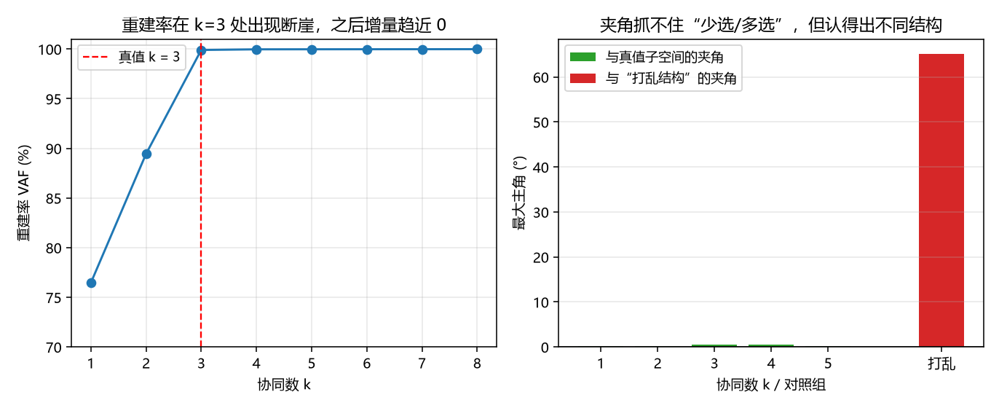

# 肌肉协同降维：VAF 到了 95%，协同就一定对吗

「人体用少数几个肌肉协同完成动作」是运动控制里最常见的结论之一，通常用非负矩阵分解（NMF）来验证：
把 n 块肌肉的激活矩阵 E（n × T）分解成 E ≈ W·H，W 的列数 k 就被解释成"协同数"。

问题是：**k 越大重建一定越好**，直到 k = 肌肉数时误差必然为零。
所以"VAF 达到 95%"这种判据本身并不能证明协同结构是真的。

本模块用**已知协同的合成数据**把这件事量出来，并顺带验证另一个常被滥用的指标——
**与真值协同的子空间夹角**——到底能说明什么、不能说明什么。属于**肌肉骨骼人**方向。

与仓库已有模块的分工：

| 模块 | 做什么 | 本模块的不同 |
|---|---|---|
| `msk_tendon_basics` | 肌腱-肌肉单元的单关节仿真 | 单块肌肉的动力学，不做多肌肉降维 |
| `muscle_joint_control` | 肌肉驱动关节的控制 | 控制问题，不是"协同结构是否成立" |
| `mujoco_msk_*`（系列） | MuJoCo 里的肌骨模型与控制 | 需要仿真器；本模块是**数据分析**方法 |
| 本模块 | 协同数选择与指标适用性检验 | 无仿真器、无 EMG 数据，纯 numpy + 合成真值 |

## 运行效果



左：重建率在 k=3 处出现断崖（2→3 涨 10.5 个百分点，3→4 只涨 0.06）；
右：子空间夹角对 k **几乎不敏感**（1–5 维全在 0.6° 以内），但对"完全不同的协同结构"能读出 65°。

## 功能包结构

```
src/musculoskeletal/muscle_synergy_lab/
├── package.xml  setup.py  setup.cfg  requirements.txt
├── main.py                      # 脚本入口（不需要 ROS）
├── muscle_synergy_lab/
│   ├── core.py                  # 合成数据、NMF、VAF、子空间夹角（纯 numpy）
│   ├── cli.py                   # 结果排成 Markdown 表格
│   ├── main.py                  # 命令行参数与输出
│   └── ros_node.py              # 在线协同分解节点
├── config/params.yaml
├── launch/main.launch.py
├── tools/make_figures.py        # 生成上面那张图（需要 matplotlib）
└── test/test_core.py            # 16 项单元测试
```

## 运行环境

| 项 | 版本 | 说明 |
|---|---|---|
| OS | 任意 | 纯 Python |
| Python | 3.10 / 3.12 | **运行（`core`/`main.py`/测试）只需 `numpy`** |
| matplotlib | ≥3.5 | **仅 `tools/make_figures.py` 出图需要**（不在运行依赖里） |
| ROS 2（可选） | Humble | 仅 `ros_node.py` 需要 |

已实测：**Windows 11 + Python 3.12.14 + NumPy 2.5.4**（不装 matplotlib 也能跑完全部计算与测试）。

## 编译与运行

```bash
# A. 不需要 ROS
cd src/musculoskeletal/muscle_synergy_lab
python3 main.py
python3 -m unittest discover -s test -p "test_*.py" -v     # 16 passed

# 出图（额外需要 matplotlib）
pip3 install "matplotlib>=3.5"
python3 tools/make_figures.py --out ../../docs/img/musculoskeletal/muscle_synergy_lab

# B. ROS 2
colcon build --packages-select muscle_synergy_lab --symlink-install
source install/setup.bash
ros2 launch muscle_synergy_lab main.launch.py k:=3 window:=200
```

## 方法

### 1. 为什么用合成数据

仓库里没有真实 EMG。如果拿"随手造的数据"跑 NMF，得到的协同数没有可比对的真值，
结论就是自说自话。所以本模块先**设定** W₀（肌肉分簇）与 H₀（升余弦时间包络）生成 E，
再加噪声——这样"恢复得对不对"有真值可查，属于可验证的构造性实验。

### 2. NMF 与两个指标

乘性更新（Lee & Seung）：

```
H ← H ∘ (WᵀE) / (WᵀWH),    W ← W ∘ (EHᵀ) / (WHHᵀ)
```

- **VAF** = 1 − ‖E−WH‖²/‖E‖²，衡量重建；
- **子空间夹角**：W 与 W₀ 的列空间做主角分析，最大主角 = arccos(σ_min)，
  其中 σ 是 `QaᵀQb` 的奇异值（Qa、Qb 为列空间的正交基）。

### 3. 子空间夹角的一个实现坑（review 指出，已修复）

**不能**把两边的正交基按 `min(k1, k2)` 截断再相乘。QR 的列顺序本身没有意义，
`Qa[:, :k].T @ Qb[:, :k]` 取的是"前 k 个基向量"，换个列序结果就变：

| 真值列顺序 | 旧实现读数 |
|---|---|
| `[0,1,2]` | 37.61° |
| `[1,2,0]` | 48.18° |
| `[2,0,1]` | 84.84° |

同一个子空间读出三个答案，与"只比方向、不比列序"的设计目标直接矛盾。
正确写法是直接算 `Qa.T @ Qb`（k1×k2 矩阵，奇异值个数自然就是 min(k1, k2)）。
修正后该用例恒为 0.25°，并补了一条**置换不变性**回归测试。

### 4. 另一个必须说明的实现细节

NMF 是非凸的，**独立地对每个 k 求解时 VAF 可能出现轻微回落**。
`scan_k` 默认用 warm start（把 k−1 的解加一列作为 k 的初值）来消除这种抖动，
所以下表的 VAF 是单调的。这一点写在注释里，不是运气。

## 结果（8 块肌肉 × 200 采样点，真值 3 个协同，噪声 3%）

### 重建率随协同数变化

| 协同数 k | VAF | 相邻增量 |
|---|---|---|
| 1 | 0.7645 | — |
| 2 | 0.8944 | +0.1299 |
| **3** | **0.9990** | +0.1047 |
| 4 | 0.9997 | +0.0006 |
| 5 | 0.9997 | +0.0001 |
| 6 | 0.9998 | +0.0000 |
| 7 | 0.9998 | +0.0000 |
| 8 | 0.9999 | +0.0000 |

达到 VAF ≥ 0.95 所需协同数：**3**（真值 3）。

### 子空间夹角：对 k 不敏感，但认得出不同结构

| 协同数 k | VAF | 与真值子空间的夹角 | 与"打乱结构"的夹角 |
|---|---|---|---|
| 1 | 0.7645 | 0.24° | 65.16° |
| 2 | 0.8944 | 0.25° | 65.16° |
| 3 | 0.9998 | 0.49° | 65.16° |
| 4 | 0.9998 | 0.58° | 65.16° |
| 5 | 0.9998 | 0.25° | 65.16° |

也就是说：**k=2 的两个协同方向其实是对的**（0.25°），问题在于它们只能解释 89.4% 的方差；
而 k=4、5 多出来的协同也没有把子空间带偏（0.58° / 0.25°）。

### k = 3 时估计出的协同权重

| 肌肉 | 协同 1 | 协同 2 | 协同 3 |
|---|---|---|---|
| `tib_ant` | 0.60 | 0.12 | 0.01 |
| `gas_med` | 0.48 | 0.08 | 0.01 |
| `gas_lat` | 0.44 | 0.10 | 0.00 |
| `sol` | 0.07 | 0.02 | 0.35 |
| `vas_lat` | 0.07 | 0.02 | 0.53 |
| `vas_med` | 0.09 | 0.01 | 0.56 |
| `rec_fem` | 0.01 | 0.67 | 0.09 |
| `bi_fem` | 0.00 | 0.69 | 0.08 |

三列正好对应三组肌肉簇（胫骨前肌+腓肠肌 / 股直肌+股二头肌 / 比目鱼肌+股外侧肌）。

## 三条结论

1. **子空间夹角不能用来选协同数**：k=1..5 的夹角全在 0.6° 以内。
   原因是"子空间嵌套"——少选时估计子空间落在真值空间**内部**，多选时**包含**真值空间，
   两种情况下主角都是 0。它只适合回答"因素有没有跑到真值结构之外"，
   和对"完全不同的结构"（65°）做区分。
2. **选 k 要靠 VAF 的增量断崖，而不是绝对阈值**：2→3 涨 10.5 个百分点，3→4 只涨 0.06。
   如果按"VAF ≥ 95%"去选，会得到 k=3（碰巧对）；如果按"VAF ≥ 99%"，会选到 k=4 或更高——
   这就是只看阈值会**多选**的原因。
3. **"与真值相似度高"这句证据本身要打问号**：本实验里 k=1、k=2 的夹角也已经接近 0。
   很多工作用"协同与真值相似度 0.9+"证明方法有效，但如果真值结构是嵌套的，
   这个指标会自动满足，**缺乏区分力**；想证明协同数选对了，必须同时给出重建水平的断崖。

## 方法边界

- 全部结论基于**合成数据**（已知真值），未使用真实 EMG；真实数据的协同结构可能更重叠；
- NMF 非凸：不同初始化会落到不同局部最优，`scan_k` 用 warm start 减轻但不消除；
- 子空间夹角只对"有真值"的合成数据可算，真实场景只能做跨条件一致性检验；
- 不含肌肉动力学、力矩约束与运动学耦合（那属于 `mujoco_msk_*` 系列）。

## 可以继续做的实验

- 把噪声从 3% 加到 20%，看增量断崖是否还清楚；
- 设计"非嵌套"的真值结构（例如两个协同共享肌肉但方向不嵌套），检验夹角能否分辨，
  这能进一步划清该指标的适用边界；
- 用"不同动作各分解一次"做跨条件一致性检验（真实场景里替代真值夹角）；
- 接入真实 EMG（OpenSim 数据集），用同一套指标复算。
