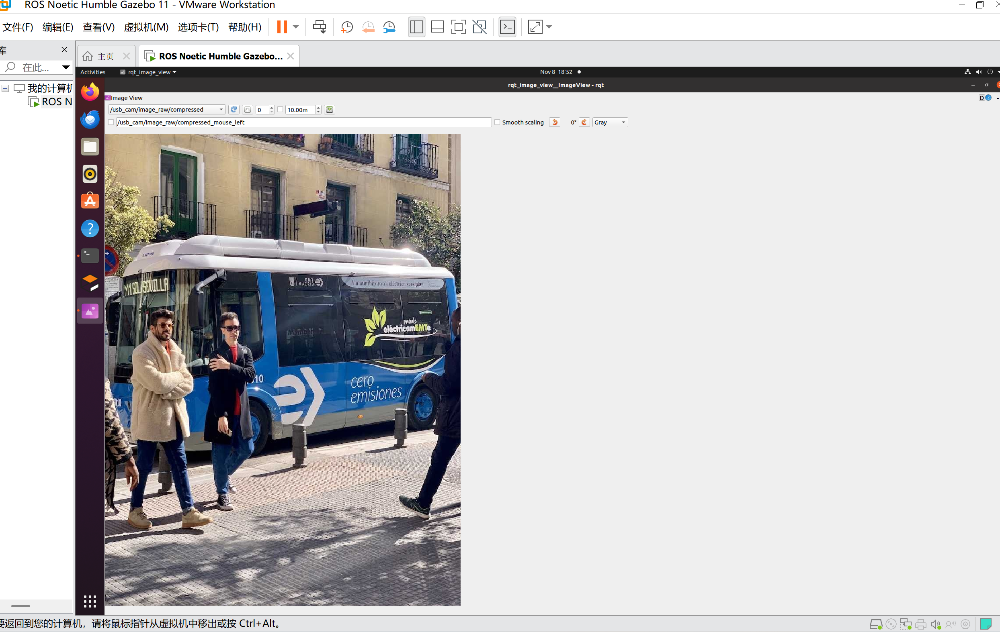
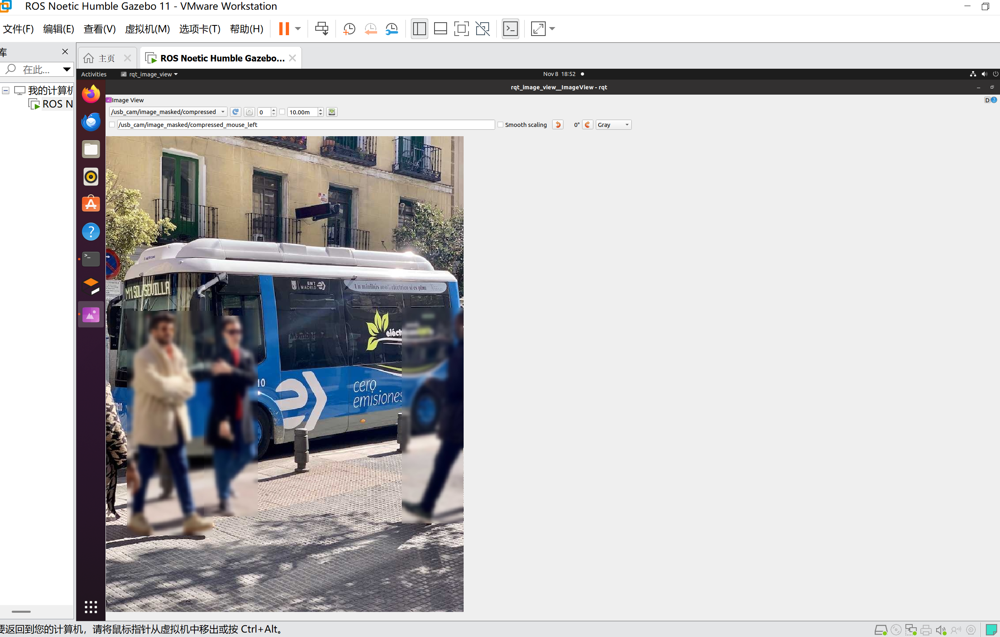
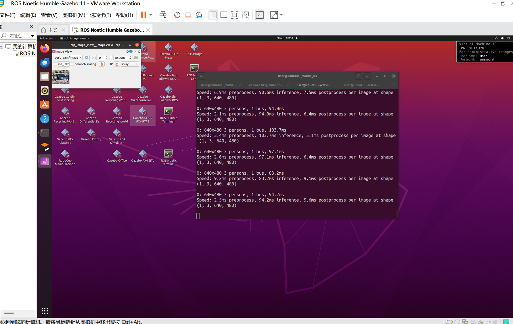

# 行人隐私脱敏视觉检测节点

基于 YOLOv8n 的 ROS 2 视觉节点：加载一张静态测试图片，用目标检测模型找出画面中的行人，
对行人包围盒区域执行高斯模糊完成隐私脱敏，并把原图与脱敏图分别以压缩图像话题发布，
可在 `rqt_image_view` 中对比查看。

## 1. 任务目标

1. 节点内加载一张静态测试图片；
2. 使用 YOLOv8n 做目标检测，只保留行人类别（COCO 类别 id = 0）；
3. 对检出的行人包围盒区域做高斯模糊；
4. 发布两个 `sensor_msgs/msg/CompressedImage` 话题：
   - `/image_raw/compressed`：原始输入图像
   - `/image_masked/compressed`：行人区域模糊后的脱敏图像
5. 通过 launch 文件一键启动节点。

## 2. 验证环境

| 项目 | 版本 |
| --- | --- |
| 操作系统 | Ubuntu 22.04 |
| ROS | ROS 2 Humble |
| Python | 3.10 |
| 推理框架 | ultralytics（YOLOv8n，检测模型） |

## 3. 功能包结构

```text
src/chap5/privacy_mask/
├── launch/
│   └── privacy_mask.launch.py      # 启动文件
├── privacy_mask/
│   ├── __init__.py
│   └── privacy_mask_node.py        # 节点实现
├── resource/
│   ├── privacy_mask                # ament 资源索引标记文件
│   ├── test.png                    # 测试图片
│   └── yolov8n.pt                  # 模型权重，随包安装
├── package.xml
├── setup.cfg
└── setup.py
```

## 4. 依赖安装

```bash
# OpenCV 用系统包，避免 pip 版与 ROS 自带版本冲突
sudo apt install -y python3-opencv

# 推理库，使用国内镜像加速
pip install "ultralytics==8.3.*" "numpy<2" -i https://pypi.tuna.tsinghua.edu.cn/simple
```

说明：`ultralytics` 会同时安装 `torch`，首次安装体积较大；把 `numpy` 限制在 2.0 以下，
可以避免与 ROS 2、OpenCV 的 ABI 冲突。

## 5. 模型文件

节点默认读取 `share/privacy_mask/resource/yolov8n.pt`，该权重已随功能包提供，
由 `setup.py` 中的 `glob("resource/*.pt")` 安装到 share 目录，无需联网下载。

如果 `resource/yolov8n.pt` 缺失，节点会打印警告并回退为 `YOLO("yolov8n.pt")` 自动下载，
离线环境会因此启动失败，此时请先补齐权重文件再重新 `colcon build`。

## 6. 构建与运行

```bash
cd ~/ros2_ws                     # 进入包含 src/ 的工作空间根目录
colcon build --packages-select privacy_mask
source install/setup.bash
ros2 launch privacy_mask privacy_mask.launch.py
```

另开一个终端查看图像：

```bash
source install/setup.bash
rqt_image_view
```

在 `rqt_image_view` 左上角下拉框中切换 `/image_raw/compressed` 与 `/image_masked/compressed`
两个话题，即可对比原始图像与脱敏结果。

启动成功的终端会打印如下日志：

```text
[privacy_mask_node]: 图片：.../resource/test.png，模型：.../resource/yolov8n.pt，行人目标数：N，发布周期：0.1s
```

## 7. 参数

| 参数 | 默认值 | 说明 |
| --- | --- | --- |
| `image_path` | `<share>/resource/test.png` | 测试图片路径 |
| `model_path` | `<share>/resource/yolov8n.pt` | 模型权重路径 |
| `blur_kernel` | `21` | 高斯核大小，必须为奇数，值越大越模糊 |
| `publish_period` | `0.1` | 话题发布周期，单位秒 |

## 8. 效果图

原始输入图像：



用 YOLOv8n 离线推理得到的行人检测结果（用于说明检测环节的效果，节点本身只发布原图与脱敏图两个话题，不发布带框图像）：



节点发布的脱敏图像，行人区域已做高斯模糊：



## 9. 验证范围与限制

- 已验证：`colcon build` 通过，节点正常启动，两个话题持续发布图像，行人区域被模糊；
- 已验证：`resource/` 中的图片与模型均随包安装，离线环境可运行；
- 未验证：真实相机视频流、多人重叠场景、不同分辨率与光照条件下的稳定性；
- 当前实现基于检测包围盒而非像素级分割，包围盒内的背景也会被模糊；
- 仅支持静态图片，不订阅相机话题，也不支持视频流输入。
