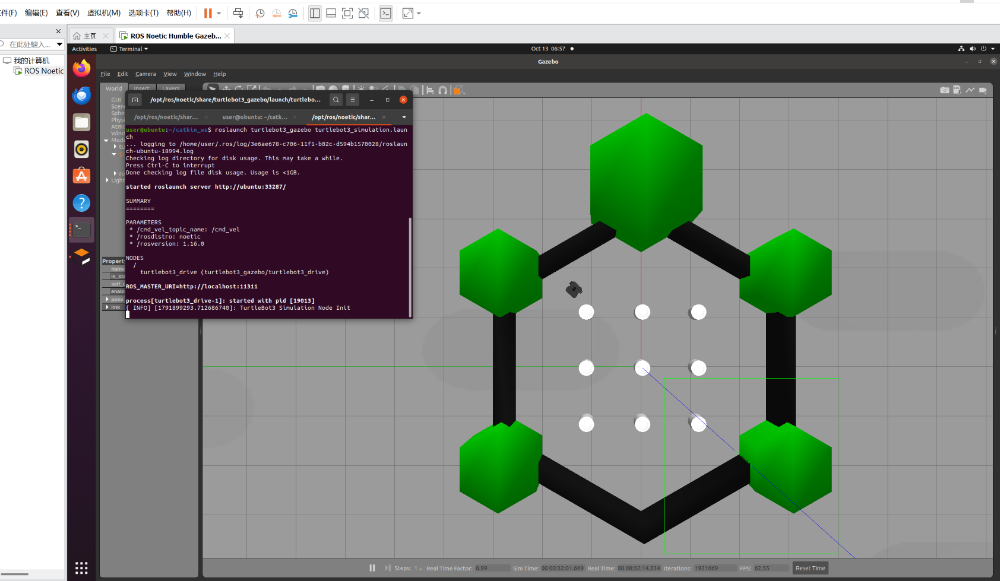
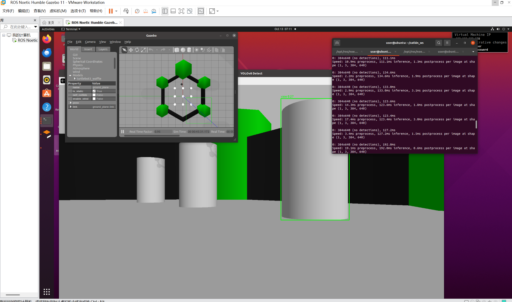

# YOLOv8-based Visual Target Tracking for Mobile Robots

## 1. 项目简介
本项目基于 ROS Noetic 和 Gazebo 仿真环境，结合 YOLOv8 深度学习算法，实现移动机器人对特定目标的视觉感知与自主跟随。

## 2. 项目技术路线

### 模块一：仿真环境搭建与基础控制
1. 使用 `roslaunch turtlebot3_gazebo turtlebot3_simulation.launch` 启动包含 TurtleBot3 及障碍物的仿真世界。
2. 通过键盘控制节点验证机器人底盘 `/cmd_vel` 话题通信。
3. 验证 `/camera/rgb/image_raw` 图像话题正常发布。

### 模块二：视觉感知模块（YOLOv8 + ROS 封装）
1. 在 ROS 节点中集成 Ultralytics 库，加载 `yolov8n.pt` 权重。
2. 利用 `cv_bridge` 将 ROS 图像消息转换为 OpenCV 格式。
3. 将图像输入 YOLOv8 模型进行推理，获取检测框坐标、类别和置信度。
4. 利用 OpenCV 绘制检测框并实时显示。

### 模块三：目标跟随控制模块
1. 在回调函数中提取目标中心点坐标。
2. 计算目标中心点与图像画面中心点的水平偏差和距离偏差。
3. 将偏差转化为机器人的角速度（`angular.z`）和线速度（`linear.x`）。
4. 发布速度指令到 `/cmd_vel`，驱动机器人跟随目标。

### 模块四：工程化封装与文档撰写
1. 编写 `yolov8_tracking.launch`，一键启动所有节点。
2. 采用规范的代码结构，代码放于 `src` 目录。
3. 使用 Markdown 编写实验报告。

## 3.文件结构
```text
src/yolov8-target-tracking/
├── src/
│   ├── main.py                 # YOLOv8 视觉检测节点（入口）
│   └── target_follower.py      # 目标跟随控制节点
├── launch/
│   └── yolov8_tracking.launch  # 一键启动文件
├── CMakeLists.txt
└── package.xml
```
## 4. 运行说明

1. 启动仿真环境：roslaunch turtlebot3_gazebo turtlebot3_simulation.launch
2. 启动完整项目：roslaunch yolo_detect yolov8_tracking.launch

## 5. 运行效果




```
