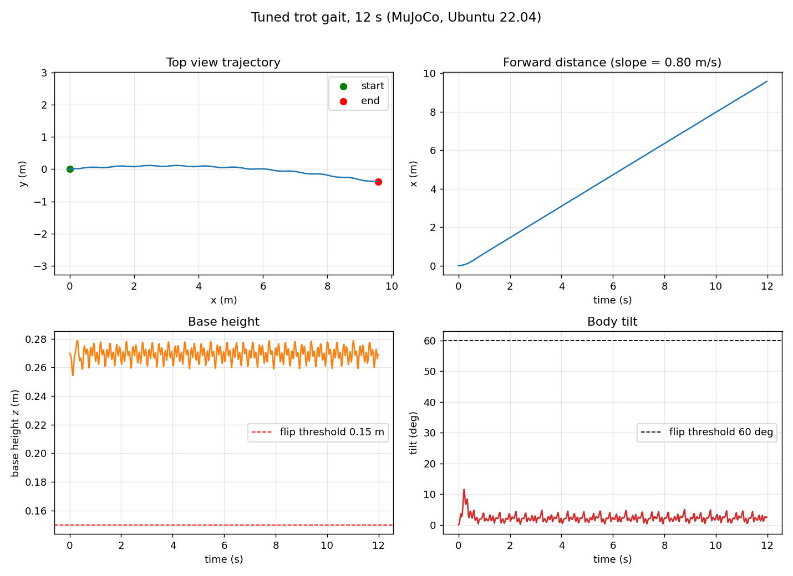
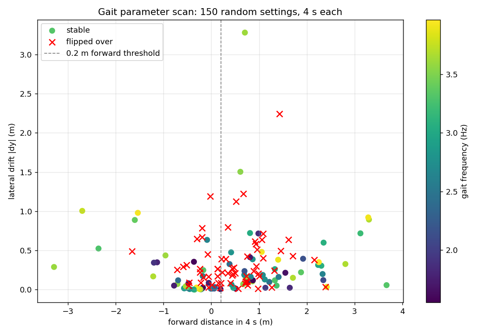

# ROS 环境下基于 MuJoCo 的机器人强化学习与仿真验证

## 一、项目介绍

本实验在 Ubuntu 和 ROS Noetic 环境下，利用 MuJoCo 物理引擎搭建虚拟仿真环境。通过 Python 脚本加载四足机器人的 MJCF 模型，使用 `mujoco.mj_step` 实现物理引擎的步进运算，并通过 `rospy` 节点实时输出仿真时间与机器人基座位置。实验旨在验证 ROS 节点与 MuJoCo 引擎数据交互的可行性，为后续接入强化学习算法（PPO）打下工程基础。

## 二、运行环境

- 操作系统：Ubuntu 20.04 (VMware 虚拟机)
- ROS 版本：ROS Noetic
- 编程语言：Python 
- 物理引擎：MuJoCo
- 深度学习框架：PyTorch / Stable-Baselines3
- 依赖功能包：mujoco (python)

## 三、项目结构

```text
src/quadruped_mujoco_rl/
├── launch/
│   └── mujoco_quadruped.launch  # 启动 MuJoCo 仿真与 RL 控制节点
├── config/
│   └── mujoco_params.yaml       # 仿真与 RL 超参数配置
├── scripts/
│   ├── main_train.py            # 训练脚本（入口）
│   └── main_test.py             # 测试与渲染脚本
├── models/        
|   ├─ a1.xml
│   ├─ quadruped.xml             # 四足机器人 MJCF 模型文件
│   └─ assets/
│   ├─ calf.obj
│   ├─ hip.obj
│   ├─ thigh.obj
│   ├─ thigh_mirror.obj
│   ├─ trunk.obj
│   └─ trunk_A1.png
├── package.xml                  # ROS 包清单
├── CMakeLists.txt               # 编译文件
└── README.md                    # 运行说明
```
(注：原本设计的 mujoco_quadruped.launch 因外部依赖包 mujoco_ros_pkgs 失效，改用直接运行 main_test.py 脚本的方式完成仿真验证。)
四、核心算法与源码解析

## 四、核心算法与源码解析

1. **物理引擎加载**：代码通过 `mujoco.MjModel.from_xml_path` 加载四足机器人 MJCF 文件，初始化物理模型和数据结构 `MjData`。
2. **闭环仿真流程**：`main_test.py` 节点启动后，通过循环以 100Hz 的频率调用 `mujoco.mj_step(model, data)` 推进物理仿真。
3. **状态数据输出**：在循环中，通过 `rospy.loginfo_throttle` 限制日志频率，实时打印仿真时间（`data.time`）和机器人基座位置（`data.qpos[:3]`），验证仿真环境连通性。
4. **参数配置**：后续可通过 `config/mujoco_params.yaml` 统一管理仿真步长与强化学习超参数，便于模型训练阶段的调参。
## 五、运行步骤

### 1. 安装 MuJoCo 与 ROS 接口依赖：
   ```bash
   pip install mujoco
   ```
### 2. 准备四足机器人的 MJCF 模型文件：
   从 MuJoCo 官方模型库（mujoco_menagerie）下载四足机器人模型，将获取的 quadruped.xml 和 assets 文件夹放置在功能包 models/ 目录下。
   *(注：如果网络受限无法从 GitHub 克隆，可在浏览器中下载 ZIP 包并解压)*
   
### 3. 编译工作空间并刷新环境（确保当前位于工作空间根目录）：

```bash
cd ~/catkin_ws
catkin_make
source devel/setup.bash
```

### 4. 启动 ROS Master 与 MuJoCo 仿真节点（因原定的 roslaunch 依赖包失效，改用终端直接启动）：

打开一个新的终端，输入以下命令（保持运行，不要关闭）：

```bash
roscore
```

### 5. 另开一个新的终端，启动四足机器人仿真测试节点：

```bash
cd ~/catkin_ws
source devel/setup.bash
rosrun quadruped_mujoco_rl main_test.py
```

(注：如果是虚拟机运行，建议在执行上述命令前，先在终端执行 export MUJOCO_GL=osmesa 防止渲染闪退。运行成功后，终端将持续打印仿真时间和机器人基座位置。)
## 六、运行效果


## 七、实验总结

本次实验成功在 ROS 框架下配置了 MuJoCo 物理引擎环境，加载了四足机器人 MJCF 模型，实现了基于 Python 节点的物理仿真步进。

实验证明了 ROS 节点能够与 MuJoCo 物理引擎进行有效的数据交互，通过终端能够实时输出机器人的仿真时间与基座位置，验证了物理仿真回路的连通性。该实验为后续接入强化学习（PPO）算法及进一步实现机器人自主步态控制奠定了坚实的工程基础，达到了阶段性实验目的。

## 八、补充：站立与步态控制（纯 Python / ROS 2，本 PR 新增）

上面的流程依赖 ROS 1（Noetic）。为在 ROS 2 Humble 或纯 Python 环境下也能复现，本节在不改动原有 `main_test.py` / `main_train.py` 的前提下，新增了几组脚本，把"控制"这一环补上。

复现环境：Ubuntu 22.04 + MuJoCo 3.16.0 + Python 3.10（CPU，无 ROS 1）。

### 8.1 为什么需要补

本模型的 12 个执行器是**位置伺服**（`biastype=affine`、`gainprm=100`），即 `ctrl` 就是目标关节角。原 `main_test.py` 空跑 `mj_step` 且 `ctrl` 保持默认 0，实测该值会被 `ctrlrange` 裁剪（小腿被裁到上限 −0.916），**基座高度掉到 0.059 m，机体基本趴在地上**；`main_train.py` 中 RL 相关代码（PPO、gym、`predict`、给 `ctrl` 赋值）也全部处于注释状态。因此原有"仿真验证"并未验证控制效果。

### 8.2 新增文件

| 文件 | 作用 |
| --- | --- |
| `scripts/locomotion_core.py` | 控制核心库：站立/姿态保持控制器、参数化对角步态（带横滚/俯仰/高度反馈）、统一的指标统计 |
| `scripts/run_locomotion.py` | 跑单次实验并打印指标（可导出逐帧 CSV） |
| `scripts/tune_gait.py` | 步态参数搜索，输出"参数-稳定性"对照表 |
| `scripts/locomotion_node.py` | ROS 2 节点：发布 `/joint_states`、订阅 `/cmd_vel`、发布 `/locomotion_status` |

同时把原仓库中的 `README,md` 修正为 `README.md`（原文件名用逗号，GitHub 无法作为包说明渲染，且与本文档第三节的目录树不一致）。

### 8.3 运行方法（不需要 ROS）

```bash
pip install mujoco

cd src/quadruped_mujoco_rl/scripts

# 站立基线（可选外部推力抗扰）
python3 run_locomotion.py --mode stand --seconds 3
python3 run_locomotion.py --mode stand --seconds 3 --disturbance 60

# 调优后的对角步态
python3 run_locomotion.py --mode trot --seconds 8

# 对照：朴素开环步态（会翻倒）
python3 run_locomotion.py --mode trot --seconds 3 --freq 1.0 \
    --thigh-amp 0.35 --calf-amp 0.35 --kp-roll 0

# 参数搜索（默认 150 组随机搜索，4 秒/组）
python3 tune_gait.py --trials 150 --seconds 4
```

### 8.4 实测结果

| 场景 | 前进 Δx | 横向 Δy | 最大倾角 | 最低基座高度 | 结果 |
| --- | --- | --- | --- | --- | --- |
| 原脚本行为（`ctrl=0`，零位起始） | — | — | — | **0.059 m** | 趴在地上 |
| 站立保持（3 s） | −0.009 m | 0.000 m | 0.86° | 0.246 m | 稳定（关节跟踪误差 0.0180 rad） |
| 站立 + 60 N 横推 0.1 s | −0.008 m | 0.000 m | 1.39° | 0.246 m | 未倒（末态倾角 0.34°） |
| 朴素开环步态（1 Hz ±0.35 rad，3 s） | +0.263 m | +0.659 m | **180°** | 0.057 m | **翻倒** |
| 调优步态（3.97 Hz，8 s） | +6.346 m | −0.039 m | 11.58° | 0.254 m | 未翻倒，均速 0.79 m/s |
| 调优步态（12 s） | +9.592 m | −0.390 m | 11.58° | 0.254 m | 漂移比 4.1% |

调优步态参数：`freq=3.97 Hz`、大腿摆幅 `0.15 rad`、小腿摆幅 `0.29 rad`、小腿相位差 `π/2`、`kp_roll=0.01`。关节平均跟踪误差 0.0606 rad，能耗代理（Σ|τ·q̇|Δt）在 8 s 内为 1940.96。



### 8.5 步态参数扫描

150 组随机搜索（`tune_gait.py --trials 150 --seconds 4`，翻倒判定：倾角 > 60° 或基座 < 0.15 m）：**63 组翻倒（42%），87 组未翻倒（58%），其中 48 组前进 > 0.2 m**。最优几组：

| freq | thigh | calf | phase | kp_roll | kp_pitch | kp_height | Δx | Δy | max_tilt | min_z |
| --- | --- | --- | --- | --- | --- | --- | --- | --- | --- | --- |
| 3.32 | 0.274 | 0.289 | 1.57 | 0.00 | 0.02 | 1.0 | +3.668 | −0.057 | 25.7° | 0.241 |
| 3.89 | 0.188 | 0.107 | 1.57 | 0.05 | 0.02 | 0.0 | +2.417 | +0.035 | 5.2° | 0.239 |
| 3.67 | 0.165 | 0.179 | 1.57 | 0.00 | 0.00 | 0.0 | +2.807 | −0.327 | 8.3° | 0.242 |



可见最优参数**并不依赖复杂的姿态反馈**（前排既有 `kp_pitch=kp_height=0` 的，也有带高度反馈的），起决定作用的是**步态频率与幅度配比**：频率偏低（1 Hz）或幅度过大（±0.35 rad）都会翻倒。另外开环步态对**起始相位**敏感：同一组参数在相位偏移 0/1/3/6 s 时，12 s 横漂比分别为 4.1% / 8.6% / 9.0% / 3.1%。

### 8.6 ROS 2 节点

| 话题 | 类型 | 方向 |
| --- | --- | --- |
| `/joint_states` | `sensor_msgs/JointState` | 发布（12 个关节角与角速度） |
| `/cmd_vel` | `geometry_msgs/Twist` | 订阅（`linear.x` = 期望前进速度，m/s） |
| `/locomotion_status` | `std_msgs/String` | 发布（当前模式与位置/倾角） |

```bash
source /opt/ros/humble/setup.bash
python3 scripts/locomotion_node.py
# 另开终端
ros2 topic hz /joint_states
ros2 topic pub -r 5 /cmd_vel geometry_msgs/Twist "{linear: {x: 0.8}}"
```

实测：`/joint_states` 稳定 **50.1 Hz**；未收到速度指令时保持站立（`stand`，基座 0.251 m）；指令 0.8 m/s 后切换为 `trot`，10 秒前进 8.36 m（**实测 0.82 m/s**，与指令一致），横向漂移≈0，倾角 ≤ 3.1°。节点在切换步态时把相位归零，保证每次起步可复现（对比：相位续接时 10 秒横漂一度达 20%，归零后降到约 0.4%）。

### 8.7 未验证项

- 全部为 MuJoCo 仿真结果，**无实机验证**。
- 只验证了直线前进；转向（偏航控制）未实现。
- 长距离（> 30 s）与不平地面的漂移、抗扰强度扫描（只测了 60 N 一档）未测试。
- 未接入强化学习：原 `main_train.py` 的 PPO 仍为注释状态，本补充只做了经典控制。
- 参数扫描为 4 秒单次评估，未做多种子重复；最优参数在其他随机种子下的稳定性未验证。
- ROS 2 节点以脚本方式直接运行（未做 `colcon` 打包），`ros2 run` 不可用。
